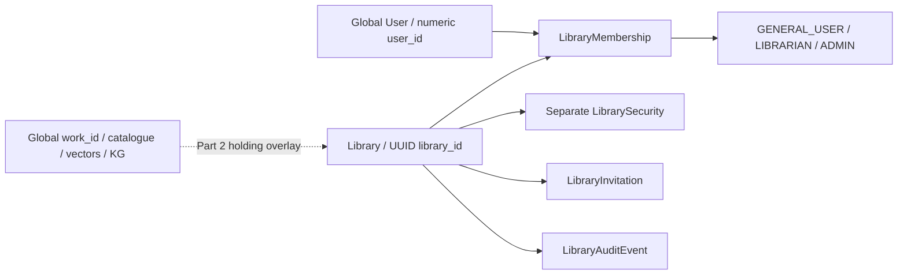

# LuminaR Institution V1 architecture

Completed 8 October 2026. Scope: Institutions / Private Libraries Part 1 only.

## Before and after

Before this phase, Mongo `users.user_id` identified a global account and `User.role` / the refreshed JWT role controlled installation-wide staff endpoints. `library_inventory.library_id` already existed as a free-form legacy identifier, generally `LIB001`; it was not a canonical institution or membership boundary. Catalogue works, vectors, search, knowledge graphs, circulation and events belonged to the installation.

This phase adds canonical UUID libraries and `(library_id, user_id)` memberships. A global account can be an Admin at one library, Librarian at another, and member at many others. The existing numeric `user_id` is retained. No catalogue, FAISS index, model, global role, or domain record is duplicated or migrated.

## Persisted models and indexes

Contracts are in `backend/schemas/institution_models.py`; strict requests are in `backend/schemas/institutions.py`. Collections use the `institution_` prefix to avoid confusing canonical entities with the existing physical `library_inventory` collection.

| Collection | Contract / authority | Indexes |
|---|---|---|
| institution_libraries | UUID, normalized unique slug, nonunique name, profile, access mode, owner numeric ID, status and timestamps | unique library_id; unique slug_normalized; status + library_type + name |
| institution_security | Password hash and setter/time, separate from public metadata | unique library_id |
| institution_memberships | UUID; library + global user; current role/status; join and mutation attribution; optional invitation grant proof | unique membership_id; unique library_id + user_id; user_id + status + library_id; library_id + status + role |
| institution_invitations | UUID, exact normalized email, optional bound user ID, inviter, staff role, status, hash and expiry | unique invitation_id; unique string token_hash; unique pending library + email; library + status + time; email + status; expires_at |
| institution_audit | Immutable application event ID, library, actor, target, membership, allowlisted metadata, timestamp | unique event_id; library + time; actor + time |
| institution_attempts | Atomic fixed-window counters for account/library and whole-library verification budget | built-in unique _id; TTL expires_at |
| institution_locks | Persistent per-library mutation gate, holder and creation time | built-in unique _id; deliberately no TTL |
| institution_migrations | Stable legacy migration identity and completion marker | built-in unique _id |

Startup audits indexes and adds missing specifications. It refuses conflicting definitions and does not drop or replace existing indexes. Invitation expiry is enforced in application checks; accepted proofs and audit records are not TTL-deleted.

## Product behavior

Authenticated users register without any global admin provisioning. The server derives the owner from the authenticated canonical user, creates an ACTIVE ADMIN membership, and never changes `User.role`. PUBLIC_LIBRARY pairs only with PUBLIC; PRIVATE_INSTITUTION pairs only with PRIVATE_CODE. Request models reject mass-assigned owner IDs, staff privileges, statuses, and user IDs.

Discovery searches literal name, slug, city and region in Mongo, with all/public/private/mine filters and bounded pages. It exposes intended public metadata and only the requesting user's membership. Public joins are idempotent; private joins verify an independent code. Both grant GENERAL_USER only. Staff-suspended or removed memberships require explicit staff action; join cannot reactivate them.

`/me/libraries` returns current ACTIVE memberships and uses bounded pages. The frontend fetches pages as needed, selects the only/first membership when no valid prior selection exists, and stores only the account identity and library UUID as a convenience. Switching verifies `/libraries/{id}/context`. Session changes remount scoped pages, clear prior state, and discard stale responses. Logout clears institution state immediately.

## Authorization matrix

All entries require an ACTIVE library, active current membership, and normal authenticated account checks.

| Action | Owner (ADMIN membership) | Non-owner ADMIN | LIBRARIAN | GENERAL_USER / outsider |
|---|---|---|---|---|
| Register a new library | Any authenticated account | Any authenticated account | Any authenticated account | Authenticated account only |
| Join public / private with code | GENERAL_USER result when not a member | Same | Same | Same; outsiders need successful join |
| Read protected library context | Yes | Yes | Yes | Active members only; outsider 404 |
| Edit profile / public-private mode | Yes | Yes | No | No |
| Rotate existing private entry code | Yes | Yes | Yes | No |
| List members / invitations / audit | Yes | Yes | No | No |
| Invite Librarian | Yes | Yes | No | No |
| Invite Admin / promote to Admin | Yes | No | No | No |
| Change / suspend / remove Admin | Non-owner target only | No | No | No |
| Manage Librarian/member | Yes | Yes | No | No |
| Change owner membership | Never | Never | Never | Never |

An outsider, including a legacy global ADMIN, receives a private 404 from protected guards. An active member with insufficient role receives 403. Public display profiles remain discoverable. UUIDs are the only tenant identifiers; slugs, Mongo `_id`, frontend state, and JWT legacy roles do not grant institution authority.

Central helpers in `backend/institution_dependencies.py` resolve membership, require membership, require role/staff, and require owner. Future private material services must call these helpers and include `library_id` in every resource lookup. The protected context endpoint and cross-library fixture tests prove the guard; they do not make legacy resources tenant-private.

## Access-code security

Codes are case-sensitive, preserved exactly, 8–128 Unicode characters, and independent of account passwords. They use Argon2id with the RFC 9106 low-memory profile: 64 MiB, three passes, four lanes, random salt. The separate security record contains the encoded hash; general display serialization is an explicit allowlist. Neither code nor hash is returned in settings, discovery, membership, invitation lists, audit, or validation errors.

The password profile follows [argon2-cffi's parameter guidance](https://argon2-cffi.readthedocs.io/en/stable/parameters.html). Measured local KDF cost is recorded in `institution_v1_performance.json`; no security parameters were weakened to meet a latency target.

Private verification attempts consume persistent account/library and whole-library counters before the KDF, with defaults of 5 attempts per 900-second fixed window and 200 attempts per library/window. This deliberately bounds all attempts, not only failures. Windows expire rather than permanently locking users. `LUMINAR_JOIN_ATTEMPTS`, `LUMINAR_JOIN_WINDOW_SECONDS`, and `LUMINAR_LIBRARY_JOIN_ATTEMPTS` configure these budgets. A fixed-window boundary can allow two adjacent budgets in a short interval; production alternatives are in the review.

Owner/Admin/Librarian can rotate an existing private code. Public-private conversion belongs to Owner/Admin. Conversion to private requires a fresh code; conversion to public clears the hash. Existing members survive both changes. After verification, join rechecks mode and the exact verified hash under the mutation gate, so a concurrent rotation invalidates an old-code grant.

## Invitations

Owner can invite Admin/Librarian; non-owner Admin can invite Librarian only. Staff choose their own login password through the existing signup flow. Both known and unknown email addresses receive the same creation shape; no account-existence field is returned. Emails use the existing exact lowercase/trim normalization; ambiguous legacy variants fail closed in account lookup.

Each invitation gets 256 random bits, a SHA-256 token hash, and a configurable seven-day lifetime (`LUMINAR_INVITE_DAYS`). A fast hash is appropriate for a random high-entropy token; human entry codes use a password KDF. Raw invite tokens are returned only by the create response for copying. Browser links place the token in a fragment, remove it from the displayed URL on entry, and send it in an authenticated POST body. No mail provider was added and no external invitation was sent.

Existing accounts can accept a pending invitation addressed to their canonical ID in their dashboard. Token-link acceptance additionally verifies the hash. Unknown-account invitations require a valid token and the now-authenticated, verified account's exact email. Known invites require both the bound ID and unchanged verified email. New users create and verify their account, then reopen the invitation link. Wrong user/email/token, expired, revoked, declined, and replayed invitations fail. Duplicate pending invitations cannot overlap for the same library/email, including across roles; expired invitations can be reissued.

Acceptance rechecks the inviter's current ADMIN membership, account state, and target-role policy. A stale inviter cannot retain delegated power; a pending Librarian invitation cannot demote a user who has since become an Admin. Owner identity is immutable in Part 1.

## Atomicity, concurrency, and recovery

The inspected Mongo server is standalone. Multi-document transactions require a replica set or sharded cluster; see [MongoDB transaction documentation](https://www.mongodb.com/docs/manual/core/transactions/). This phase supports the existing deployment with a persistent per-library Mongo gate. Unique `_id` serializes mutations across processes; no local mutex or mutable global active library is authoritative.

Registration starts PROVISIONING and publishes ACTIVE only after security, owner membership and audit exist. Invitation-derived membership authority additionally requires the ACCEPTED invitation proof for that same library/user. A membership write without its completed proof grants no authority. Owner membership is never modifiable, and admin mutation validates the active owner and remaining admin count while serialized.

Competing mutations wait up to three seconds. Protected reads return 503 with Retry-After while a mutation is in progress; clients may retry. Concurrent duplicate joins can consequently receive a transient 503, but retries return the single existing membership. Tests verify exactly one successful double acceptance, unique memberships, protected owners under 20 concurrent requests, and exactly 5 verification failures + 15 rate-limit responses from 20 same-account attempts.

Expected authorization/validation failures release their gate. Unexpected errors retain it because commit outcome may be unknown. There is intentionally no automatic expiry: a delayed old writer cannot resume after a successor acquires the same gate. This trades availability for fail-closed tenant security on standalone Mongo.

If a holder crashes: stop **all** API workers, back up the selected database, inspect that library's `institution_locks`, library status, owner membership, security, pending invitation proofs and audit events, then reconcile the interrupted operation. PROVISIONING records must remain undiscoverable until all owner/security invariants hold. For an interrupted acceptance, keep the pending proof ungranted or finish the verified grant consistently. Only after reconciliation and while workers remain stopped may an operator remove the exact reviewed lock and restart. Never configure a TTL or blind timed unlock. No automated crash-recovery or ownership-transfer workflow is claimed; replica-set transactions and supervised reconciliation are recommended before a production rollout with availability requirements.

## Legacy migration and compatibility

`scripts/migrate_institution_v1.py` is read-only by default and avoids importing index-writing backend modules during dry-run. `--access-mode public|private` is mandatory. Exactly one legacy global ADMIN may be proposed; zero/multiple ADMINs require explicit `--owner-user-id` or `--owner-email`. The owner must be active, verified, and have completed account setup.

Apply requires `--apply`. Private apply also requires `--prompt-access-code`, using hidden interactive input and confirmation. The script reserves a stable UUID in `institution_migrations`, maps existing roles into memberships with unique upserts, leaves global roles intact, and deduplicates migration audit. Repeating a completed apply is a no-op; owner/slug/access changes in a later invocation are rejected. Domain records and old `LIB001` inventory are untouched.

The real CLI was exercised on a disposable database for dry-run, apply, repeat, and domain preservation. Private hashing and owner ambiguity were integration-tested. The production database was not migrated. See `institution_v1_migration.json`, `institution_v1_legacy_role_audit.md`, and `institution_v1_phase2_scope.md`.

## Validation and operational boundaries

Institution integration: 56 tests, real disposable Mongo. Frontend institution interactions: 28. Full npm test: 204 tests; additional frontend regressions: 156. Frozen backend product regressions: 1,310 cases, 10 existing security skips, no failures. These group totals include intentional overlap (KG tests also occur in the assistant group); do not interpret the sum as unique tests. No Router V1–V5 research evaluations were rerun.

Live uvicorn/HTTP validation passed scenarios A–J and 20 concurrent cross-user read/guard checks. Browser verification confirmed role-specific controls, account switching, keyboard dialog focus/restoration, and no page-wide overflow on discovery/private-registration/dashboard across the six requested sizes. Windows browser scaling gives a one-pixel deviation for some nominal viewport dimensions; actual measurements are recorded. Build and lint exit successfully. The existing 19 lint warnings and Vite large-chunk advisory remain; new institution files produce no warnings.

This is a passing Part 1 foundation, not a claim that existing holdings, files, RAG assets, events, analytics or circulation are institution-private. Full institutional data isolation requires the explicitly deferred Part 2 migration.
