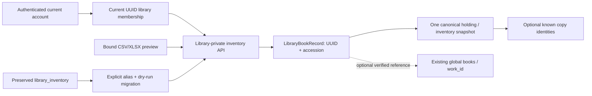

# Institution Part 2A architecture

Part 2A adds a private catalogue and inventory snapshots to the accepted Institution V1 membership model. It does not migrate lending availability. Production `luminar_library` retains its five million global books, three legacy inventory rows and zero canonical libraries/catalogue rows; all migration/apply validation used disposable databases.

## Models and boundaries

- `LibraryBookRecord`: UUID `library_book_id` + UUID `library_id`, immutable accession/sequence, optional `global_work_id`, title and at least one subject, optional bibliographic/local fields, source/status/review flag, timestamps and actor attribution. Local records can remain unlinked forever. Only local metadata is copied into canonical records; the shared catalogue is referenced.
- `LibraryHolding`: UUID holding ID, same-library book UUID, one holding per book, strict nonnegative total/available with available <= total, local shelf/call/tags/note, attribution and `INVENTORY_SNAPSHOT_NOT_CIRCULATION`. There is no write to the legacy availability source.
- `LibraryCopy`: UUID copy/book/holding/tenant references, monotonically allocated copy ordinal, optional barcode/date, status foundation. Only known barcodes are preserved during migration, with `UNVERIFIED` status. Aggregate historical quantities are not turned into invented copies. Borrowed/reserved states are storage foundations; the Part 2A API does not issue those transitions.

## Collections and indexes

| New collection | Indexes (in addition to Mongo `_id`) |
|---|---|
| institution_library_books | Unique library_book_id; unique library_id+accession_number; unique library_id+accession_sequence; partial library_id+work/ISBN10/ISBN13; library_id+normalized_title; library_id+status+sequence; partial unique library_id+source_key |
| institution_holdings | Unique holding_id; unique library_id+library_book_id |
| institution_copies | Unique copy_id; library_id+library_book_id; partial unique library_id+barcode; unique library_id+holding_id+copy_number |
| institution_sequences | Unique library_id+sequence_type |
| institution_library_aliases | Unique explicit legacy_library_id |
| institution_inventory_imports | Unique import_id; library_id+actor_user_id+created_at |
| institution_inventory_previews | Unique import_id; expires_at TTL |
| institution_inventory_migrations | Unique library_id+source_key |

V1 institution_libraries, memberships, invitations, security, audit and persistent locks are reused. Existing conflicting index specifications fail with an operator-review error; no existing index is dropped. Global books indexes and data remain unchanged.

## Atomic accession and mutation behavior

The sequence document is unique for `(library_id, BOOK_ACCESSION)`. `find_one_and_update` applies `$inc` atomically and returns the updated document; the prefix is frozen by `$setOnInsert`. A racing initial upsert that hits the unique index retries the increment against the existing counter. Mongo documents its [single-document atomic updates](https://www.mongodb.com/docs/manual/core/write-operations-atomicity/) and [`findAndModify` behavior](https://www.mongodb.com/docs/manual/reference/method/db.collection.findandmodify/).

Accessions use a stable first-three-character uppercase ASCII alphanumeric prefix or `LIB`, a hyphen and at least six digits. Numbers can exceed six digits. Prefixes may coincide across institutions; only the tuple with canonical library UUID is unique. UUIDs remain the external resource identity. Numbers are never decremented/reused, even after withdrawal or failed writes. Preview has no sequence call.

The local Mongo server is standalone. Multi-document mutations therefore reuse V1's cross-worker persistent lock. Inventory callers wait up to 30 seconds; V1 callers retain their accepted three-second default. Authorization is checked inside the lock. Reads fail closed while a mutation is in progress. Records start `PROVISIONING` and become `ACTIVE` after their holding and audit writes. Unknown write outcomes retain the lock: an operator must stop workers, inspect/reconcile the specific tenant, and only then repair/unlock. No stale-lock TTL grants a competing writer authority. This favors correctness over availability; it is not a replica-set transaction guarantee.

## HTTP and UI

All new routes start `/libraries/{UUID}/inventory`. They support list/create/detail/metadata patch/soft withdrawal, holding snapshot update, explicit global link/unlink, paginated copy list and copy registration, protected import preview/apply/status. Search is bounded literal matching over local title/subjects/authors/ISBN/accession/call number. Body fields cannot supply library/actor/accession/book IDs or roles.

ACTIVE members may read; ADMIN/LIBRARIAN may write; the owner is an ADMIN membership. The account must remain active and verified with no unfinished password setup. Public inventory uses the same conservative member-only visibility. A global ADMIN without membership is an outsider. Current role and eligibility are rechecked on import apply. Audit records contain allowlisted identifiers and counts, never raw datasets/credentials.

`/library-inventory` integrates with the active-library switcher, library home and Institution staff panel. The add form requires only title/subjects and collapses optional fields. Dataset upload supplies a minimal template, preview classifications and row errors, explicit existing-item policy and retained apply results. Legacy inventory/import tabs remain usable and are clearly labelled. UI admission is backed by server role responses; library/session changes clear stale inventory.

## Import and migration

CSV UTF-8/BOM and XLSX are bounded to 5 MiB, 2,000 rows and 40 columns; XLSX expansion is capped at 25 MiB. Formulas are never executed. Explicit header aliases and bounded field normalization apply the same metadata rules as manual creation. IDs, tenancy and accession headers are rejected.

Preview persists only a protected job and normalized rows, bound to actor, library, SHA-256 and one-hour expiry. Apply rechecks eligibility, membership, work references and current duplicate state, stores row outcomes and a replayable result. New rows use per-import/per-row source keys. Invalid rows are isolated. Same title never merges records. Verified work or validated ISBN plus compatible metadata is strong identity; existing-item quantity increase is explicit and audited.

Migration/ID assignment default to a read-only plan. They require an existing active canonical library UUID and explicit aliases. Missing title/subject is reported; a verified legacy work can supply genuinely existing missing metadata. No LLM runs. Apply creates canonical overlays and leaves legacy inventory/loans untouched. Per-source migration markers make repeat apply idempotent. Reconciliation checks same-tenant references, quantities, identities/accessions, links, copy counts and sequence high-water marks.

## Validation and limits

See regression/live/performance/browser reports for the exact measurements and suite evidence. No Router V1–V5 research evaluations or model work ran. Global search, recommendations, KG, RAG and Assistant algorithms match the 754-file baseline; only eight existing integration files changed. Inventory counts must not be presented as tenant lending availability before Part 2B.
