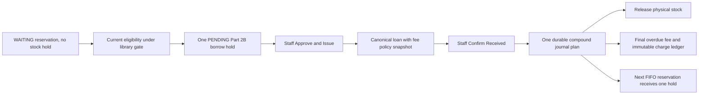

# LuminaR Institutions Part 2C

Canonical reservations and fees extend the accepted V1 identity, Part 2A inventory and Part 2B approval circulation. No production data was migrated. A library admin must explicitly activate its subsystem after migration/reconciliation.

Legacy reservations use global work_id and installation-wide availability. Legacy fines use integer issue_id and FINE_PER_DAY=5, without authoritative tenant loan/policy identity. Those collections remain historical; guards stop competing writes once a proven library has canonical authority.

Canonical queue identity is library UUID + local book UUID + global numeric user identity. Optional global_work_id never joins institutions. A WAITING record has no physical allocation. A durable persistent counter assigns a per-book sequence; cancellation leaves sequence gaps. Public requestability gives the eligible FIFO head first claim while physical stock arithmetic remains unchanged.

The pure plan extension projects prior effects before the existing journal persists PREPARED. Physical release, fee generation, queue/copy handoff and audit entries replay as absolute changes with deterministic generated identities. There are no postcommit callbacks. Uncertain acknowledgement retains the persistent library gate and reports RECOVERY_REQUIRED; an operator stops every writer, replays, reconciles, then releases the proven gate.

New collections are institution_reservations, institution_reservation_counters, institution_fees, institution_fee_ledger, institution_fee_policies and institution_v2c_config. Accepted institution_lending_operations, lending_requests, loans, holdings, copies, locks and audit are reused. Models and index constraints are listed in the completion report.

Members read their own rows. Tenant LIBRARIAN can inspect queues/fees and record a manual payment. Tenant ADMIN/OWNER also versions policies, adjusts and waives. Global ADMIN without tenant membership has no privilege. Path UUIDs and current membership remain authoritative after the shared gate is acquired.

The frontend resets state/dialogs and discards old responses when the active library changes. Inventory offers Join Waitlist only when canonical stock is unavailable; converted reservations link to accepted Borrow Requests. Fees show original/current/paid/balance, policy version, due/request/receipt timestamps and immutable history. No online payment control is presented.

Assistant adapters are additive explicit actions with immutable scoped pending confirmation. They read only own fees/reservations and expose no staff financial tool. The existing_qwen routing/retrieval systems and accepted phase report artifacts are preserved.
