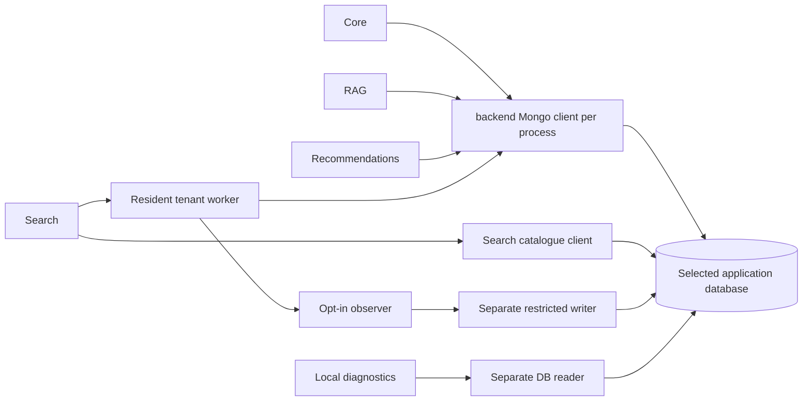

# Architecture and identity boundaries

AUDITED source: scripts/start_local.py supervises Core8002, Search8003, Recommendation8004, RAG8005 and Vite5173; it loads one shared environment and is guarded for local development. It can create an unauthenticated loopback Mongo for its own local database. It is not a production authentication cutover launcher. Actual database luminar_library does not satisfy its luminar_local guard. No launcher was executed in N.

Core imports backend.database.mongodb once per process; registration/membership, Staff/platform, catalogue, circulation, events, notifications, analytics and digital assets share that client. Recommendation imports it for history/feedback/catalogue. RAG imports it through book/private authorization and its library document worker. Personal document/session registries and model artifacts also use SQLite/filesystem; Mongo authentication does not secure those files. Search owns a distinct global catalogue client plus backend tenant client. Its resident tenant worker reuses the backend client; telemetry has an independent restricted writer. Both diagnostic CLIs use an independent read-only client. Frontend has no Mongo client or credential delivery path.

Source/import dependency edges and line references: client_inventory.json and permission_inventory.json. These are conservative Python import closures, including conditional imports, rather than an execution proof for all deployed processes. Current service ownership is not established for the application processes. Supplemental boundary inspection maps MongoDB Windows service to NetworkService; current deployment classification remains UNKNOWN.
