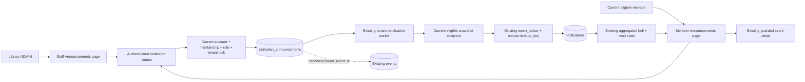

# Part 2P architecture decisions

The preimplementation audit identified editable event notices and an existing tenant notification pipeline. Announcements are the missing immutable communication aggregate, not a replacement Events implementation or second inbox.

Use `institution_announcements` for DRAFT → PUBLISHED → WITHDRAWN. Creator, library, timestamps and recipient snapshot are server-owned. ADMIN is the only manager; all current eligible members can read published announcements. Published content cannot be patched. Corrections require withdrawal and a new publication. Linking uses an existing tenant event ID and never copies or edits event records.

Publication atomically stores content, first-publication time, a bounded server-resolved recipient snapshot and delivery cursor in one Mongo document. This document is the durable intent; there is no claim of cross-document transactions. Snapshot ceiling is 20,000 eligible recipients; exceeding it rejects publication before mutation. Audience eligibility uses the existing account/membership/invitation proof rules, with batched resolution. New members can read older publications but receive no retroactive notification copy.

The existing tenant notification worker also drains bounded announcement batches. It calls the existing notification_service.insert_notice with a deterministic library/announcement/recipient/type dedupe key and the existing unique dedupe index. Notification copies use a generic safe title/message and server-generated route, not the private announcement body. Delivery revalidates current membership before copying; revoked recipients are suppressed. A persisted cursor and error state support restart/retry. Publication and inbox materialization have distinct outcomes. No new worker or messaging system.

The existing account-wide bell remains aggregated and explicitly labels each library. Only the new private announcement notification type is hidden after access revocation; existing generic lending-history behavior remains intact. Bell routes are reconstructed/validated from canonical identities, never arbitrary stored URLs. The announcement page has independent current-membership checks.

Existing canonical transport modules and Part 2O.3 guards remain byte-identical. New frontend clients import institutionApi. A keyed page body and abort/session checks discard responses from another library/session. Staff navigation gains an Announcements entry; the member library gains its own entry. Shared buttons/cards/selects/dialogs and text rendering are reused.

These are design decisions recorded before implementation. Executed verification, limitations and measured results will be recorded in the completion and evaluation reports; this design document alone is not evidence of a passing implementation.
