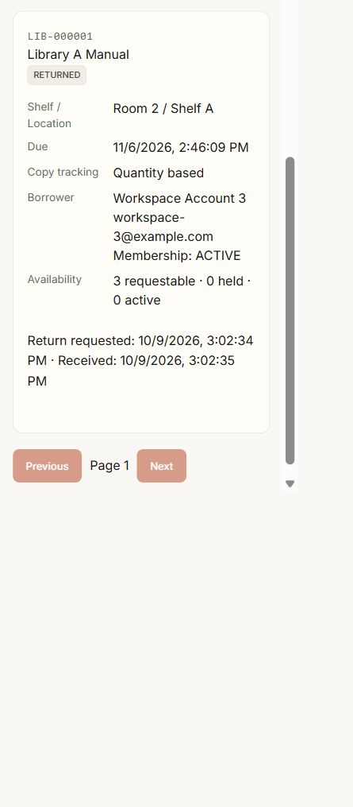
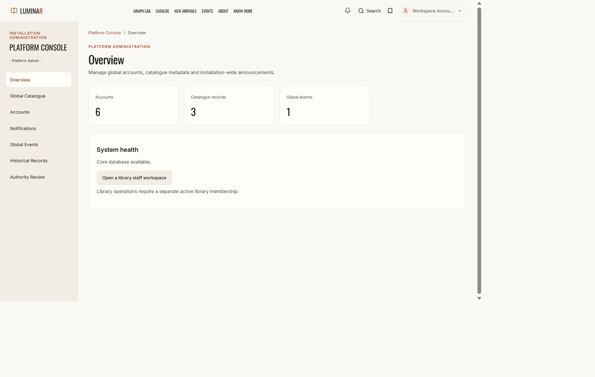

# Legacy dashboard removal and authority convergence

Status: **PASS for acceptance gates 52–80**. Verified 2026-10-09T10:04:13.721945+00:00.

The final management product has Platform Console, Library Staff Workspace and Patron Workspace. Legacy management dashboards, navigation and independent writers have been retired. Existing ambiguous accounts remain unprivileged pending independently approved mapping; their records were retained.

## Authority and routing

- Platform Console requires the current active, verified identity and an ACTIVE PLATFORM_ADMIN assignment with nonblank approval reference, approving operator and valid approval time. Expired, revoked, incomplete, malformed and future-dated approvals fail closed.
- Library Staff Workspace requires an active ADMIN or LIBRARIAN LibraryMembership for the explicit canonical library UUID. Patron Workspace requires a GENERAL_USER membership. A staff member cannot obtain patron mutation controls in that same library.
- `/admin` uses explicit platform access when available, otherwise the same staff resolution as `/librarian` and `/staff`: exactly one staff membership goes to its workspace, several go to the selector, none deny. Remembered context never breaks a tie.
- Frontend `/staff/events` and setup compatibility links redirect to `/platform/events` and `/account/setup`. The old `/admin/{path}` API is a guarded 307 redirect preserving method/query to the Platform API; retired circulation targets return 410.
- Global metadata administration accepts no physical stock/shelf mutations. Platform account creation produces an ordinary identity and neither a membership nor a platform grant.

## Complete feature classification

YES/NO describes the identified implementation. OBSOLETE rows are intentionally not migrated. NO under removal explicitly identifies a retained read-only/personal/offline compatibility implementation, never a second tenant writer. UNKNOWN rows are account records kept for manual review, not unclassified features deleted from the product.

| OLD COMPONENT / ROUTE | OLD FUNCTION | CLASSIFICATION | NEW DESTINATION | MIGRATED | OLD IMPLEMENTATION REMOVED | REDIRECT REMAINING | WHY REDIRECT REMAINS | BACKEND AUTHORITY REPLACED |
| --- | --- | --- | --- | --- | --- | --- | --- | --- |
| StaffDashboard.tsx: AdminDashboard /admin | Mixed global/tenant dashboard shell | OBSOLETE | PlatformShell or StaffLibraryShell after authority resolution | NO | YES | YES | One transition period for bookmarks; no old UI | YES |
| StaffDashboard.tsx: LibrarianDashboard /librarian | Independent librarian shell | OBSOLETE | /staff/libraries/{library_id} or staff selector | NO | YES | YES | Exactly one staff membership or selector; no inferred library | YES |
| StaffDashboard.tsx: LegacyStaffDashboard /staff | Independent staff shell | OBSOLETE | /staff/libraries/{library_id} or staff selector | NO | YES | YES | Exactly one staff membership or selector; otherwise deny | YES |
| StaffDashboard.tsx + lib/nav.ts | Admin/Librarian navigation, role-based login destinations | OBSOLETE | Account menu and membership-based account landing | NO | YES | NO | None | YES |
| StaffDashboard.tsx: Admin summary | Global accounts/catalogue summary | PLATFORM_GLOBAL | /platform: PlatformOverview | YES | YES | YES | Old /admin entry only redirects | YES |
| StaffDashboard.tsx: Admin summary | Mixed tenant stock/loans/fees metrics | LIBRARY_TENANT | /staff/libraries/{library_id}: StaffOverviewPage | YES | YES | YES | Old dashboard entry only redirects | YES |
| StaffForms.tsx: BookManagement | Global book metadata create/edit/delete | PLATFORM_GLOBAL | /platform/catalogue: PlatformCatalogue; /books metadata API | YES | YES | YES | Old dashboard entry only redirects | YES |
| StaffForms.tsx + book_service.py | Physical copy counts and shelf on global book editor | LIBRARY_TENANT | Canonical Staff Inventory stock/copy/shelf commands | YES | YES | NO | Global metadata mutation rejects physical stock fields | YES |
| StaffForms.tsx: InventoryManagement | Library inventory CRUD | LIBRARY_TENANT | /staff/libraries/{library_id}/inventory | YES | YES | NO | Legacy mutation endpoints return 410 | YES |
| StaffForms.tsx: DatasetImport | Local physical inventory CSV preview/confirm | LIBRARY_TENANT | Canonical Staff Inventory import preview/confirm | YES | YES | NO | Legacy import endpoints return 410 | YES |
| StaffDashboard.tsx: Issues | Loan directory and issuance/approval | LIBRARY_TENANT | /staff/libraries/{library_id}/circulation | YES | YES | NO | Legacy issue writer returns 410 | YES |
| AdminOperations.tsx + issue_service.py | Staff-assisted physical return | LIBRARY_TENANT | Canonical staff receive command and lending journal | YES | YES | YES | /admin API redirects to /platform; retired return target returns 410 | YES |
| LoanRenewalControl.tsx + loan_renewal_service.py | Staff-assisted renewal | LIBRARY_TENANT | Canonical staff loan renewal; shared renewal policy and journal | YES | YES | YES | Old /admin API redirect has a retired 410 target | YES |
| StaffDashboard.tsx: Reservations | Tenant reservation queue | LIBRARY_TENANT | /staff/libraries/{library_id}/reservations | YES | YES | NO | Legacy reservation writer returns 410 | YES |
| StaffDashboard.tsx: Fines | Tenant fee ledger and settlement | LIBRARY_TENANT | /staff/libraries/{library_id}/fees | YES | YES | NO | Legacy fee writer returns 410 | YES |
| StaffDashboard.tsx: InstitutionPanel | Library members, local staff invitations and role changes | LIBRARY_TENANT | /staff/libraries/{library_id}/members (local ADMIN) | YES | YES | YES | Old dashboard entry only redirects; shared scoped panel remains canonical | YES |
| StaffDashboard.tsx: InstitutionPanel | Local library settings and policies | LIBRARY_TENANT | /staff/libraries/{library_id}/settings | YES | YES | YES | Old dashboard entry only redirects; shared scoped panel remains canonical | YES |
| StaffDashboard.tsx: InstitutionPanel | Membership/security audit | LIBRARY_TENANT | /staff/libraries/{library_id}/audit (local ADMIN) | YES | YES | YES | Old dashboard entry only redirects | YES |
| StaffDashboard.tsx: Activity | Librarian operational activity | LIBRARY_TENANT | /staff/libraries/{library_id}/activity: LibraryActivityPage | YES | YES | NO | Canonical scoped read-only audit projection, excluding membership/security admin events | YES |
| StaffManagement.tsx + staff_service.py | Installation-wide account directory and provisioning | PLATFORM_GLOBAL | /platform/accounts: identity CRUD and verification | YES | YES | NO | Old /staff API retired; new accounts have GENERAL_USER identity only | YES |
| StaffManagement.tsx + staff_service.py | Setting global ADMIN/LIBRARIAN as management authority | OBSOLETE | Independently reviewed PlatformRoleAssignment or local invitations/migration | NO | YES | NO | No role editor and no automatic privilege grants | YES |
| AdminOperations.tsx | Global notification recipient search/compose/history | PLATFORM_GLOBAL | /platform/notifications: PlatformNotifications and NotificationComposer | YES | YES | YES | /admin notification API is a guarded 307 redirect only | YES |
| AdminOperations.tsx | Read-only historical operations and account inspection | PLATFORM_GLOBAL | /platform/history: LegacyOperationHistory | YES | YES | YES | /admin history API is a guarded 307 redirect only | YES |
| ManageEventsPage.tsx /staff/events | Global event lifecycle and publication | PLATFORM_GLOBAL | /platform/events: existing event editor and management | YES | YES | YES | Old frontend event links redirect; API authority now explicit platform assignment | YES |
| StaffSetupPage.tsx /staff/setup | Personal email verification/password setup | PERSONAL | /account/setup: AccountSetupPage | YES | YES | YES | Old credential setup bookmark redirects, granting no authority | YES |
| ProfilePage.tsx: legacy loan controls | Own borrowing/return/renewal | PERSONAL | /libraries/{library_id}/my-library with GENERAL_USER membership | YES | YES | NO | Old issue/renew writers return 410; personal history stays read-only | YES |
| ProfilePage.tsx: legacy reservation controls | Own reservation create/cancel | PERSONAL | /libraries/{library_id}/reservations | YES | YES | NO | Legacy reservation mutations return 410 | YES |
| ProfilePage.tsx: legacy fine controls | Own fee settlement | PERSONAL | /libraries/{library_id}/fees | YES | YES | NO | Legacy payment writer returns 410 | YES |
| ProfilePage.tsx + /issues/my /reservations/my /fines/my /activity/my | Own legacy historical records | PERSONAL | /account/history (read-only) | YES | NO | NO | No redirect; authenticated owner-only historical projection is retained | YES |
| issue/reservation/fine/activity GET APIs | Legacy installation history | PLATFORM_GLOBAL | Platform Historical Records, read-only compatibility APIs | YES | NO | NO | No redirect; explicit platform assignment or owner-only detail, no stock writes | YES |
| inventory_service.py GET /inventory | Read legacy inventory with explicit library mapping | LIBRARY_TENANT | Read-only compatibility: selected UUID/approved alias + active LibraryMembership | YES | NO | NO | No redirect; unresolved aliases fail closed and CRUD/import always 410 | YES |
| issue_service.py reservation_service.py fine_service.py | Duplicate legacy circulation writers | OBSOLETE | Canonical library lending/reservations/fees services only | NO | YES | NO | Only read projections and 410 retirement stubs remain | YES |
| inventory_import_service.py inventory_service.py | Duplicate legacy inventory/import writers | OBSOLETE | Canonical institution inventory/import services only | NO | YES | NO | Import parsing/write implementation removed; retirement stubs return 410 | YES |
| AdminPlaceholder.tsx | Unused future-dashboard placeholder | OBSOLETE | Removed | NO | YES | NO | No legitimate caller remains | YES |
| backend/scripts/bootstrap_admin.py | Legacy ADMIN role bootstrap | OBSOLETE | Retired CLI; scripts/migrate_management_authority.py with reviewed mapping | NO | YES | NO | Role labels are not management authority | YES |
| backend/scripts/reset_admin_password.py | Offline operator personal credential recovery for legacy-labeled accounts | PERSONAL | Explicit offline credential recovery compatibility only | NO | NO | NO | Not a dashboard/API; does not insert any membership or assignment and was not executed | YES |
| backend/scripts/migrate_users.py | SQL identity import retaining historical role metadata | PERSONAL | Offline identity migration compatibility only | NO | NO | NO | No authority creation; not executed in this phase | YES |
| users user_id=2, legacy LIBRARIAN | Unapproved legacy account scope | UNKNOWN_REVIEW_REQUIRED | Authority review report; manual approved library mapping required | NO | NO | NO | Account retained; no membership inferred and no deletion | YES |
| users user_id=3, legacy ADMIN | Unapproved legacy account scope | UNKNOWN_REVIEW_REQUIRED | Authority review report; platform/local scope needs independent justification | NO | NO | NO | Account retained; no platform promotion and no deletion | YES |

Search infrastructure, global dataset administration and future HNSW/KG administration were not implemented old dashboard features. No speculative modules were invented, and their protected algorithm/training code was unchanged.

## Exact implementation removal

Removed after migration and regression:

- `backend/services/staff_service.py`
- `frontend/src/components/LoanRenewalControl.tsx`
- `frontend/src/pages/AdminOperations.tsx`
- `frontend/src/pages/AdminPlaceholder.tsx`
- `frontend/src/pages/StaffDashboard.tsx`
- `frontend/src/pages/StaffForms.tsx`
- `frontend/src/pages/StaffManagement.tsx`
- `frontend/src/pages/StaffSetupPage.tsx`

The product source audit found no imports or callers of the deleted dashboard/forms/service symbols. Shared StaffUI controls and membership-scoped InstitutionPanel remain canonical dependencies. Old shell/navigation CSS was removed while shared table/dialog styles remain.

Legacy issue, return, renewal, reservation, fee and inventory/import writer implementations were removed. Authenticated legacy mutation routes and direct service stubs return 410 and cannot mutate stock. Global and personal history remains explicitly read-only. No old ready-reservation/fine-creation/renewal write algorithm remains authoritative.

Canonical staff-assisted renewal and physical receipt call the existing library lending service. They reuse its lock, durable operation journal, pinned renewal policy, stable command keys and receipt confirmation. Preparation failure leaves the loan pending receipt and retains allocation; replay resumes the same command. Staff cannot assist their own personal legacy loan or another library, and platform-only access cannot invoke these operations.

## Every retained legacy User.role usage

The source audit records exact lines and source text in [dashboard_convergence_source_audit.json](dashboard_convergence_source_audit.json). Remaining product usages are explained below. None authorizes institution or platform management.

- `scripts/migrate_management_authority.py` (1, 33, 43, 45, 48, 49, 51, 69, 73, 85, 93, 99, 132, 134): Offline manual legacy-account review query. Grant role fields identify independently approved membership/assignment models; no User.role inference.
- `backend/services/identity_service.py` (7, 8, 9, 46, 52, 55, 58): Legacy identity schema, supported label validation and public identity serialization; never a grant.
- `backend/services/auth_service.py` (4, 62, 112, 256, 276, 288): Personal sign-in/signup/setup identity metadata. New identities use GENERAL_USER; no management grant.
- `backend/routes/auth.py` (216, 238, 242): JWT identity metadata; staff sign-in eligibility uses a LibraryMembership query or explicit platform assignment, not User.role.
- `backend/utils/jwt_utils.py` (20, 23, 29): Historical JWT role claim and conservative shorter lifetime for legacy labels. Claims cannot authorize management.
- `backend/dependencies.py` (29): Deprecated require_roles always denies. There are no product callers.
- `backend/routes/models/user.py` (21): Historical SQL identity schema default; no tenant/platform authority.
- `backend/routes/platform.py` (76, 77, 79): Legacy-account classification query/display for manual review. Assignment lookup is separate.
- `backend/services/platform_account_service.py` (10, 33): Account directory metadata and GENERAL_USER-only identity creation. No role-edit fields or privilege creation.
- `backend/services/notification_service.py` (14): Legacy identity label projection for recipient/actor presentation; no role-based authorization.
- `backend/services/admin_operation_service.py` (No executable role usage remains): Legacy read-only operation/actor projection, not a management permission.
- `backend/scripts/bootstrap_admin.py` (1, 7): Retired role bootstrap with no account or authority creation.
- `backend/scripts/reset_admin_password.py` (10, 11, 16, 24, 53, 87, 109): Offline personal credential recovery selector for legacy labels. Not run; creates no management grants.
- `backend/scripts/migrate_users.py` (25, 62, 72): Offline SQL identity metadata import only. Not run; no membership/assignment provision.
- `frontend/src/store/useAuthStore.ts` (19, 32, 75, 120, 121): Identity type/session supported-label validation only. Workspace and console permissions come from separate fresh server stores.
- `frontend/src/components/ProtectedRoute.tsx` (2, 7, 12, 13, 14): UserRole is a type alias for the same literal values; runtime role comes from activeLibrary.membership, not identity.
- `frontend/src/components/BookCapabilities.tsx` (16, 29): Unrelated legacy digital read UI helper input, with backend document capability checks; no institution authority.
- `frontend/src/lib/readNow.ts` (5, 16): Personal historical digital-reading UI compatibility predicate; no lending/inventory writes and no library grant.
- `frontend/src/lib/nav.ts` (3, 4): Deprecated role-named helper returns only My Libraries for any identity; no role-specific dashboard navigation.
- `frontend/src/lib/authDestination.ts` (4): Deprecated role argument is ignored; membership-based account landing chooses context.
- `frontend/src/pages/PlatformAccounts.tsx` (6, 76): Explicitly marked legacy label display in migrated account directory; no authority editor.
- `frontend/src/pages/PlatformOperations.tsx` (8, 136): Historical account label display in migrated read-only inspection; no authority or lending mutation.

Canonical membership roles, explicit platform assignment roles, HTML accessibility roles and assistant conversation roles are separate concepts. Frozen historical report-generation scripts may reference old filenames to document earlier snapshots; they do not mount UI or grant access.

## Legacy account migration and preserved records

Production dry run found user_id **2 (LIBRARIAN)** and **3 (ADMIN)** without approved context. Both are `UNKNOWN_REVIEW_REQUIRED`; zero inferred memberships, zero platform promotions and zero production document mutations. Their identities and historical records were retained. Platform Console has a paginated read-only review screen.

`scripts/migrate_management_authority.py` defaults to dry run. Apply requires an explicit mapping whose every grant has `approved=true`, `approved_by`, `approval_ref` and `reason`. A local grant requires an existing active canonical UUID and ADMIN/LIBRARIAN membership role; an installation grant requires independently justified PLATFORM_ADMIN. Optional legacy aliases are explicit, never guessed. Invalid identity, conflicting grant/alias, duplicate input and incomplete existing proof fail before writes. Apply uses an operator lock and does not overwrite grants; concurrent/partial failure requires operator review.

No approved production mapping was supplied, so apply was not run. Existing legacy inventory, issues, reservations and fees remain historical read-only records. Existing canonical cutover migration tooling requires its own reviewed library mapping and stopped legacy writers; this phase does not silently convert those records or provision authority.

## Verification

- Backend grouped product regressions: **1591 passed, 10 pre-existing skips, 0 failed**. Latest authority suite: **38 passed**; 52 post-removal search/access checks also passed. Group counts follow prior reporting conventions and are not claimed as a deduplicated census.
- Frontend: **462 passed, 0 failed** across the final default suite (including management tests) and supplementary Events/notifications/history/search/RAG-formatting suites.
- TypeScript/Vite production build passed. Lint exited 0 with 19 warnings and no errors. Existing large-bundle and React hook/style warnings remain visible in logs.
- Browser: **42 checks**, seven Platform sections across six requested widths, no document overflow and no old navigation. Actual dimensions record Windows display rounding. Real-browser proof covers platform-only access, legacy role-only denial, single-membership redirect, multiple-membership selector with remembered context, staff renewal and physical receipt, Librarian operational activity and patron separation.
- Retired positive legacy-writer tests were replaced by HTTP 410/direct-service no-write assertions. Canonical V1/V2A/V2B/V2C business suites remain active. No Router V1–V5 research suite was substituted for product validation.
- The pinned Events test wall clock was aligned to current time without disabling JWT expiry verification. A combined fixture run exposed incompatible per-suite DB prefixes; suites were rerun in separate processes. An initial timing-sensitive knowledge test passed unchanged on rerun. Final recorded results above are passing runs.

Evidence: [validation](dashboard_convergence_validation.json), [backend groups](dashboard_convergence_regression.json), [latest authority XML](dashboard_convergence_authority_final.xml), [browser dimensions](dashboard_convergence_browser_matrix.json), [browser flows](dashboard_convergence_browser_flows.json), [classification](dashboard_convergence_classification.json), [production account review](dashboard_convergence_account_review.json).

## Preservation and cleanup

All **1989** earlier report hashes are unchanged. All **305** protected source/config/model files under assistant, chatbot, search, recommendation, RAG, KG, pipeline, training, evaluation and benchmark roots are unchanged. Production collection counts match the phase baseline, including five million catalogue books, 13 identities, 39 legacy issues and zero platform assignments. Count equality is not a full content hash; the phase performed no production document writes or original-service restart.

Both owned disposable browser fixture databases were dropped and their services stopped. The temporary tab was closed and viewport restored. Other user tabs/services were left running. See [preservation](dashboard_convergence_preservation.json), [cleanup](dashboard_convergence_cleanup.json) and [first fixture cleanup](dashboard_convergence_cleanup_first_fixture.json).

## Gates 52–80

| Gate | Status | Requirement | Evidence |
| --- | --- | --- | --- |
| 52 | PASS | Legacy Librarian is not an independent surface | Deleted StaffDashboard.tsx; App mounts ManagementRedirect only. |
| 53 | PASS | Legacy Staff is not an independent surface | Deleted LegacyStaffDashboard with the old shell; canonical StaffLibraryShell remains. |
| 54 | PASS | Old Librarian navigation removed | nav.ts/AccountMenu use membership destinations; browser oldNav arrays are empty. |
| 55 | PASS | Old Staff navigation removed | App and shared CSS no longer mount the old staff shell or tabs. |
| 56 | PASS | /librarian cannot render old dashboard | ManagementRedirect; real-browser single/multiple/no-membership cases. |
| 57 | PASS | /staff cannot render old dashboard | ManagementRedirect; real-browser single/multiple/no-membership cases. |
| 58 | PASS | Valid Librarian functionality in Staff Workspace | Inventory, circulation, reservations, fees, settings and scoped operational activity; canonical suites and browser activity proof. |
| 59 | PASS | User.role=LIBRARIAN grants no institution authority | Fresh identity + active scoped membership guard; legacy-labeled account without membership denied. |
| 60 | PASS | Old Admin no longer mixed global/library dashboard | Deleted AdminDashboard; global PlatformShell and scoped StaffLibraryShell are separate. |
| 61 | PASS | Every old Admin feature classified | Complete feature table below and machine-readable classification.json; no unknown feature deleted. |
| 62 | PASS | Valid tenant Admin features moved to Staff Workspace | Inventory/import, lending, reservations, fees, members, invitations, settings and audit use canonical library routes. |
| 63 | PASS | Valid platform-global Admin features moved to Platform Console | Catalogue metadata, accounts, global notifications/history/events, health and authority review. |
| 64 | PASS | Obsolete duplicate Admin features removed | Old dashboard/forms/account service removed; duplicate circulation/import writers reduced to read-only/stubs. |
| 65 | PASS | No unexplained old Admin feature | Feature table distinguishes retained personal/offline/history compatibility and unapproved accounts. |
| 66 | PASS | Old tenant mutations do not use global Admin role | All legacy stock/circulation writers return 410. Canonical writers use LibraryMembership. |
| 67 | PASS | New library Admin operations require LibraryMembership | institution_dependencies + canonical services; GENERAL_USER identity with local ADMIN works, global ADMIN without membership fails. |
| 68 | PASS | New platform operations require PlatformRoleAssignment | require_platform_admin checks current identity and approved active unexpired assignment on every request. |
| 69 | PASS | Legacy Admin not automatically Platform Admin | Production dry run creates zero assignments; role-only HTTP tests denied. |
| 70 | PASS | Legacy Librarian not automatically given membership | Production dry run creates zero memberships; no-library browser account denied. |
| 71 | PASS | Ambiguous legacy accounts reported | user_id 2 and 3 UNKNOWN_REVIEW_REQUIRED, retained, no inferred scope. |
| 72 | PASS | Old dashboard compatibility URLs redirects only | Authorized contexts redirect; unsupported context denies. No old UI component exists behind any compatibility URL. |
| 73 | PASS | Multiple memberships never select first library | ManagementRedirect counts active staff memberships and sends >1 to selector, even with remembered Library A. |
| 74 | PASS | Duplicate business logic removed or read-only compatibility | Explicit writer retirement, removed old algorithms, retained own/global historical reads only. |
| 75 | PASS | Old/new inventory cannot both mutate stock | Legacy CRUD/import 410; global metadata rejects stock/shelf and does not rewrite physical counts. |
| 76 | PASS | Old/new lending cannot both mutate canonical lending | Legacy issue/return/renew 410; staff/patron commands share canonical lock, journal and policy. |
| 77 | PASS | Old/new reservations cannot both mutate reservations | Legacy create/cancel 410; canonical membership-scoped reservations service remains. |
| 78 | PASS | Old/new fees cannot both mutate fees | Legacy creation/payment writer removed/410; canonical membership-scoped fees service remains. |
| 79 | PASS | Platform Console cannot mutate library internals without membership | Platform-only fixture receives 404 on library staff endpoints; account API forbids grant fields; tenant commands require local membership. |
| 80 | PASS | Complete legacy_dashboard_removal.md | This report includes classification, exact removal, routes, authority, migration, verification, preservation and remaining compatibility. |

## Reviewable proof

Canonical physical return completed in an isolated fixture:

Platform Console global overview:

