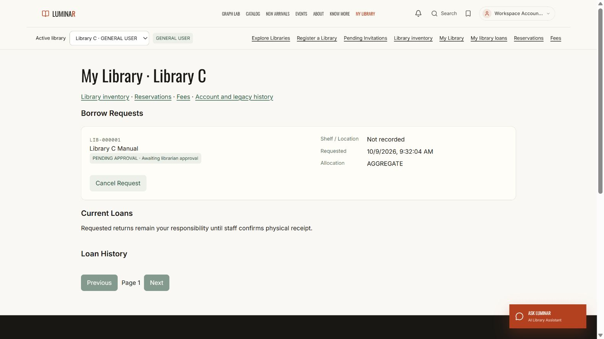
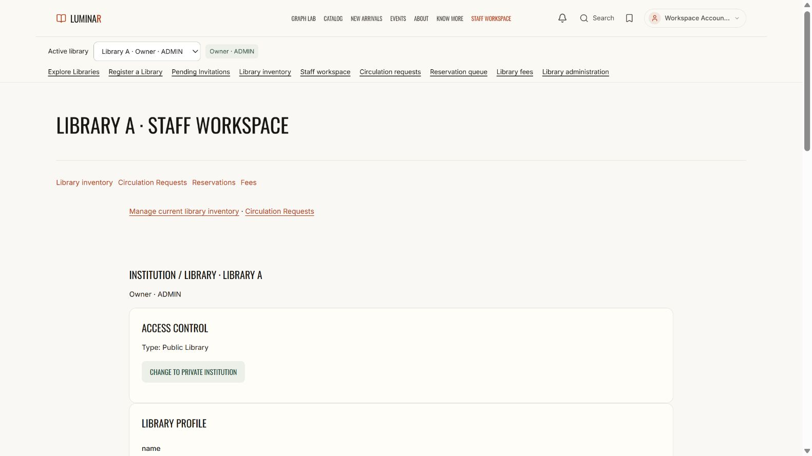

# Per-library workspace separation — PASS

One global account now uses the active library's membership role to choose its workspace.

| Active membership | Workspace | Default route |
| --- | --- | --- |
| ADMIN | Staff workspace only | `/admin?tab=Institution` |
| LIBRARIAN | Staff workspace only | `/librarian?tab=Institution` |
| GENERAL_USER | Patron / My Library only | `/profile` |

Switching libraries revalidates the selected membership and opens its corresponding workspace. The global account role cannot override the selected library's role. Wrong-workspace URLs redirect before mounting the page. Suspended or unknown selected memberships cannot fall back to global staff authority. A new account session waits for its own library permissions, and older selection responses cannot replace the latest selection.

Staff navigation, desktop/mobile header links, account menus, dashboard content, and inventory controls use the selected membership. Staff inventory exposes management actions and omits personal Request Book / Join Waitlist controls. Patron inventory retains personal requests. Library administration remains ADMIN-only; LIBRARIAN sees the library's staff settings without ADMIN profile or staff-management controls. Role changes reset inventory and institution forms.

Scope: frontend workspace routes, navigation, and controls. Existing backend patron borrowing and reservation API role rules are unchanged. Existing tenant staff APIs still enforce membership authority. Legacy global dashboards remain available when no library is selected. Global catalogue, reading list, knowledge tools, and events retain their existing behavior.

## Verification

- Full `npm test`: **293 passed, 0 failed**, including **23 new workspace tests**.
- `npm run build`: PASS; existing large-chunk advisory remains.
- `npm run lint`: **0 errors**, **19 existing warnings**.
- Live browser: **10 checks passed**, using one global ADMIN account with A ADMIN, B LIBRARIAN, C GENERAL_USER memberships.
- Real HTTP APIs: A/B staff fees allowed, C staff fees denied; C patron book request succeeds and creates a pending hold.
- Preservation: **820 existing source files unchanged**, no unexpected source changes, **69 accepted Part 2B reports unchanged**. Backend source was not changed for this update.
- Cleanup: disposable fixture database removed and temporary services stopped; production data was not modified.

An unrelated document-answer UI test timed out in the first run, then passed both its standalone recheck and the final full run. Four existing inventory tests now explicitly use GENERAL_USER memberships when checking patron request behavior.

## Files

Changed: frontend package scripts, App routes, Header, ProtectedRoute, LibrarySwitcher, CorePages, StaffDashboard, InstitutionPanel, LibraryInventory, Institutions, useInstitutionStore, and institution-lending tests.

Added: `frontend/src/lib/libraryWorkspace.ts`, `frontend/src/components/LibraryWorkspaceRoute.tsx`, `frontend/tests/library-workspaces.test.tsx`, and `scripts/check_library_workspaces.py`.

Verification details and source hashes: [library_workspace_verification.json](library_workspace_verification.json). Live evidence: [browser](library_workspace_browser.json), [API](library_workspace_live_api.json), [cleanup](library_workspace_cleanup.json).

