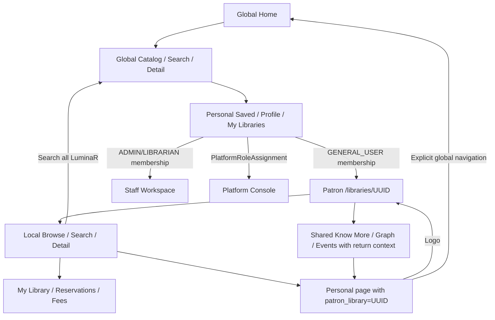

# Navigation context graph

The URL defines presentation context. /libraries/<UUID>/... beats remembered state and forged return queries. Global /, /catalog and /search stay global. Personal/shared reading-list, account, invitations, library directory/registration, llm, events, experimental and book routes may carry strictly validated patron_library return metadata. Backend membership/entitlement remains authority.

Header, AccountMenu, account/reader/Know More/Graph/related/event/Assistant links preserve explicit return context. Local paths remain local UUID identities; related global discoveries carry return context with global data. Switchers use actual GENERAL_USER memberships; staff/platform destinations require distinct authority. Compatibility redirects never choose a first of multiple libraries or guess grants from legacy roles.

Filter URL state supports router history and component remount/deep links. MemoryRouter tests cover current/stale/forged contexts, explicit global reset and switching. Browser Back/Forward/Reload and six-viewport navigation are NOT_VERIFIED.
