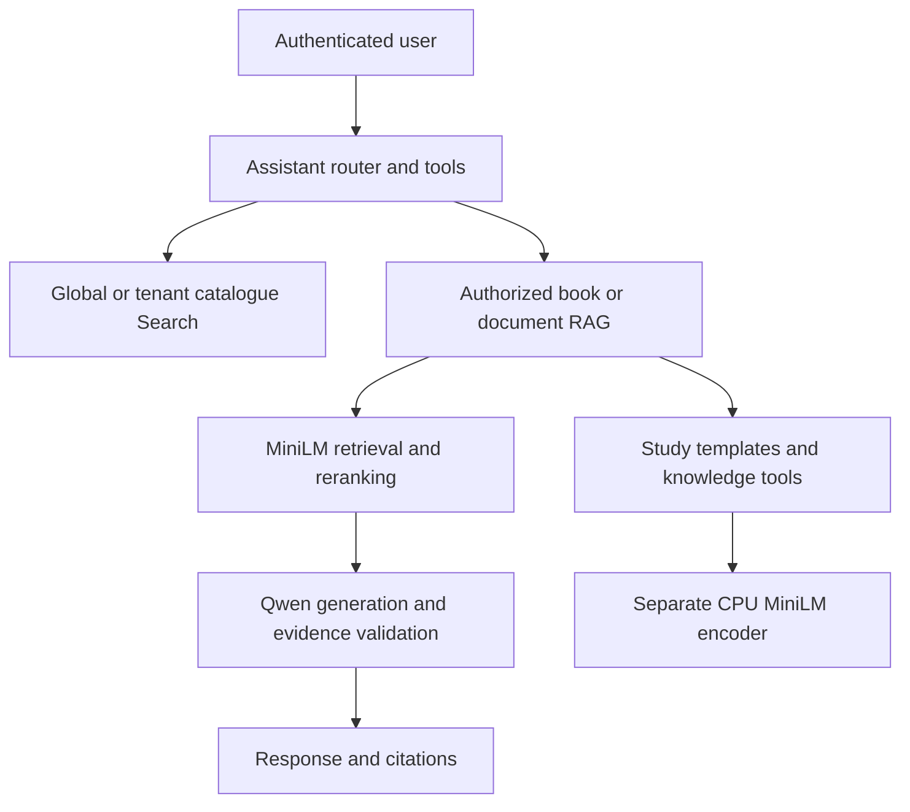
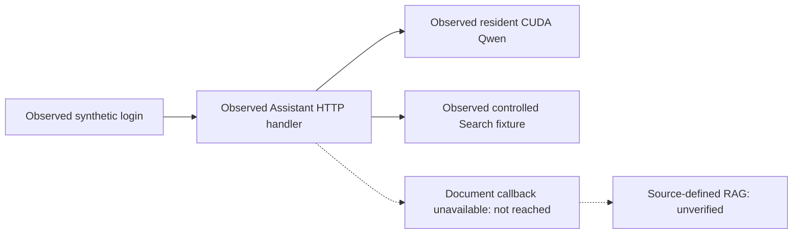
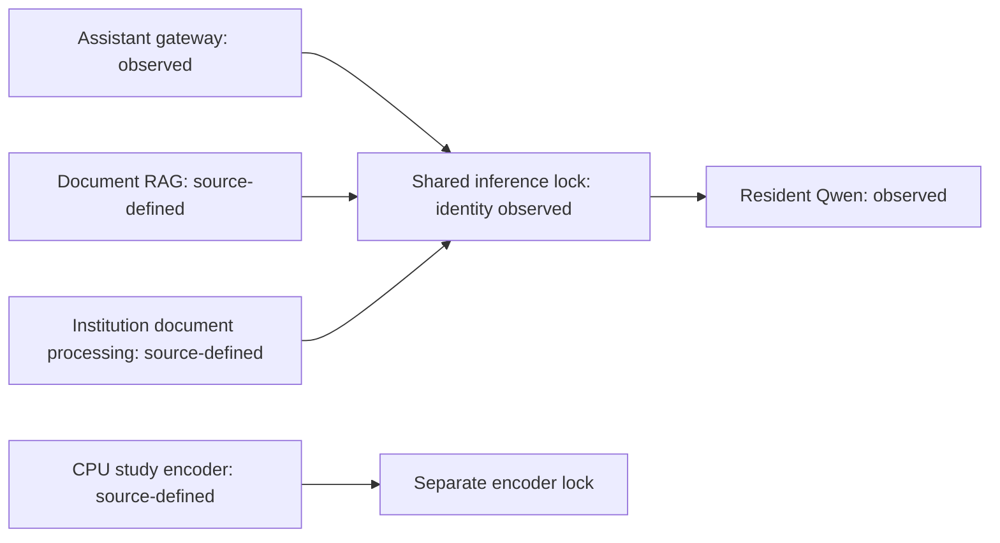
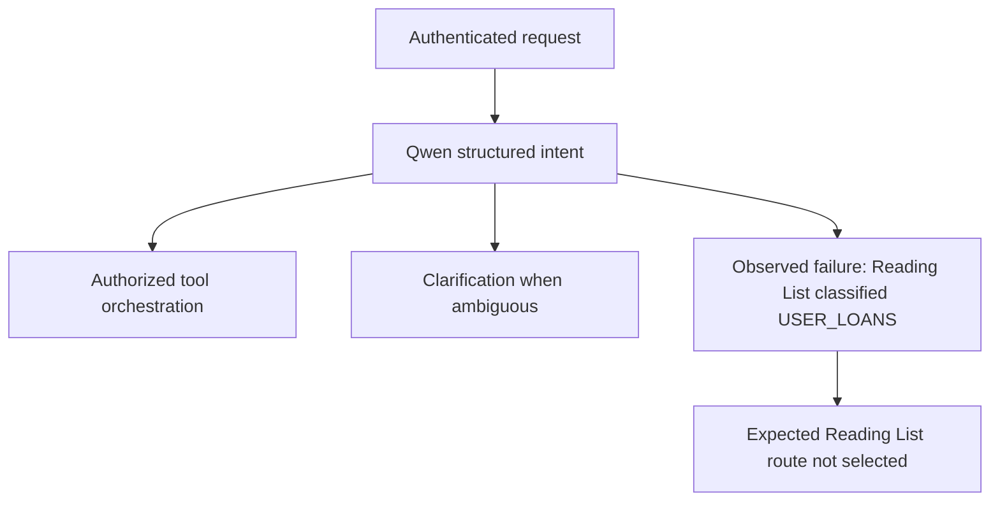
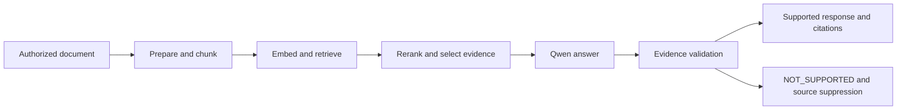

# 15 — Figure recipes

Snapshot `20261105T045721Z_606f0df_15_gpu_v2`, captured 2026-11-05 04:57:21 UTC; branch `codex/search-v11-finalization`, HEAD `606f0dfce3970bea8e6fc2b62d243433d1a66b8a`. [Snapshot](15_snapshot.json) · [checks](15_test_results.json) · [ledger](15_feature_status.csv). Historical CPU snapshot `20261031T140041Z_606f0df_15`; prior GPU evidence `reports/module15_gpu_verification/`; V2 evidence `reports/module15_gpu_v2/`. Repository paths identify external evidence; this package includes its own summaries. V2 outcome **FAIL**: one observed Reading List misroute; substantial coverage untested. Production Mongo authentication and index integrity **NOT QUALIFIED**.

Figure recipes show source-defined flow. Named observations are limited to V2; these are not measured production deployment maps.

## Figure A — AI subsystem architecture (source-defined)

## Figure B — Tested integration boundary

Legend: observed nodes identify V2 cases; dashed paths are source-defined or unverified. The document callback was not successfully exercised.

## Figure C — Shared inference model

No contention, throughput or resource-allocation comparison is inferred.

## Figure D — Assistant routing

## Figure E — RAG validation (source-defined; live evaluation NOT VERIFIED)

