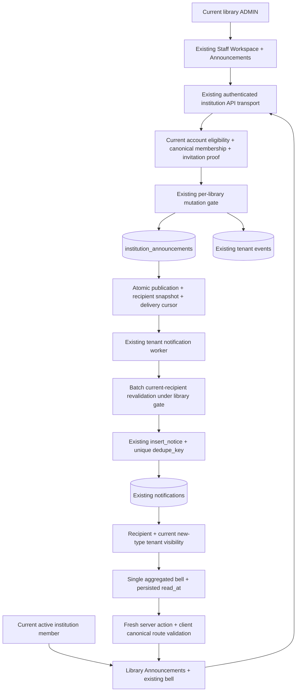

# Part 12 — Announcement architecture

The research question is whether a library platform can add explicit, tenant-isolated member communication while preserving existing event workflows and a single account inbox. This implementation evaluates an application-level consistency design on the project's current standalone Mongo configuration. It does not claim a distributed transaction or universal production performance.

The source audit is `reports/institution_v2p_existing_events_audit.md`. Events already supports library notices and editable published event details. `backend/services/event_service.py` owns those records. `library_event_service.py` enforces institution authority. The new immutable communication lifecycle therefore lives in `library_announcement_service.py`, links existing event IDs, and reuses `notification_service.insert_notice` plus `tenant_notification_service.materialize` and the existing TenantNotificationWorker.

The stack is the repository's Python/FastAPI/Pydantic/PyMongo services, MongoDB, React/TypeScript/Zustand frontend, existing React Router context guards, Node test runner/Testing Library, pytest and Playwright/Chromium. No framework replacement, new queue product or new worker.



The data dictionary and indexes are detailed in `reports/institution_v2p_database_contract.md`; API routes and status codes are in `institution_v2p_api_contract.md`. Library/creator/publication history are server-owned. The editable draft uses a revision token. Publication stores the immutable body and membership snapshot in the same authoritative Mongo document. Recipient IDs are never sent to the frontend.

```mermaid
sequenceDiagram
    participant Admin
    participant API
    participant Mongo
    participant Worker as Existing tenant worker
    participant Inbox as Shared notification store
    participant Member
    Admin->>API: Publish draft + revision
    API->>API: Verify current ADMIN, library gate, event ownership
    API->>Mongo: Resolve eligible members/accounts/proofs in batches
    API->>Mongo: CAS DRAFT to PUBLISHED + snapshot + cursor0
    Mongo-->>API: Durable publication
    API-->>Admin: Published; delivery pending
    Worker->>Mongo: Bounded pending scan
    Worker->>Mongo: Revalidate slice under membership gate
    loop At most100 snapshot recipients per slice
        Worker->>Inbox: insert_notice with deterministic dedupe key
        Inbox-->>Worker: Existing or newly stored notice
    end
    Worker->>Mongo: Persist cursor/delivered/suppressed
    Member->>API: Existing inbox/list/unread/read endpoints
    API->>API: Recipient + current membership filter
    API-->>Member: Generic copy + safe source-library action
    Member->>API: Open published announcement
    API->>API: Current tenant membership again
    API-->>Member: Authorized published content
```

A failure after inserting notices but before cursor persistence replays identical keys. Ten unsuccessful delivery attempts stop automatic retries; ADMIN may resume one bounded slice with the original snapshot. An unknown-outcome domain mutation retains the existing fail-closed tenant lock. Staff-visible state distinguishes PUBLISHED from delivery COMPLETE/FAILED. See consistency report for limits rather than inferring atomicity from the happy path.

Implementation verification status and executed measurements are maintained in the evaluation document and final JSON evidence. Planned scheduling, RSVP, external messaging and engagement analytics are not implemented by this architecture.


## Final executed Part2P evidence

Status: PASS. Final actual-tree backend2917 passed / 0 failed / 20 skipped; frontend988 passed / 0 failed / 0 skipped. Production buildPASS; lintPASS with16 pre-existing warnings and0 new warnings. Current feature checks84; legacy notification recheck51; existing installed protected mutation checks75. Supplementary checks are not double-counted.

Real communication Chromium23 checks; preserved Intelligence Chromium29 checks; isolated authenticated-Mongo10 checks. No unexpected HTTP/page JavaScript errors. Expected404 revocation responses are retained. Data/fixture cleanup is recorded in browser/auth evidence. No current2P implementation remains IN_PROGRESS after closure; future features remain NOT_IMPLEMENTED/PLANNED.

| Feature | Research status | Source/evidence |
|---|---|---|
| Immutable announcements and tenant lifecycle | IMPLEMENTED_VERIFIED | library_announcement_service create/update/publish/withdraw; final_clean_institution_v2p.xml |
| Canonical audience and delivery recovery | IMPLEMENTED_VERIFIED | eligible_recipients/deliver_one; security.json |
| Existing shared inbox and read state | IMPLEMENTED_VERIFIED | notification_service; notification_recheck.xml and browser.json |
| Staff/member/librarian UI | IMPLEMENTED_VERIFIED | LibraryAnnouncements.tsx; final5_frontend.log |
| Existing Events and native progress preservation | IMPLEMENTED_VERIFIED | final_events.xml and intelligence_browser.json |
| Production deployment | NOT_IMPLEMENTED | No deployment authorized or performed |
| Capacity at configured20,000-member ceiling | IMPLEMENTED_NOT_VERIFIED | Cap enforced/tested; largest measured fan-out2,000, no production throughput claim |
| Scheduling/RSVP/external messaging/preferences | NOT_IMPLEMENTED | Future roadmap only |

Measured real local standalone-Mongo fixture results (cohosted with regression workloads):

| Recipients | Publication ms | Full fan-out ms | List median ms | Unread median ms | Inbox median ms |
|---|---|---|---|---|---|
| 20 | 17.005 | 83.203 | 10.832 | 8.204 | 24.27 |
| 200 | 20.776 | 757.09 | 9.892 | 7.436 | 22.327 |
| 2000 | 59.042 | 7525.843 | 9.287 | 6.204 | 23.102 |

Each list/count/inbox median uses five actual samples; raw command counts/samples are in ../institution_v2p_performance.json. No production percentile/throughput or engagement outcome is claimed. Preservation resultPASS; approximately5M global catalogue, global/tenant artifacts and original event/notification records preserved. Concurrent live activity is explicitly recorded: a TEST-library announcement by existing creator4 and three copies, one valid SYSTEM overdue reminder, and a committed actor0 request-expiry transition. Original50 notices/audit/operation digests match; the original request receipt projection verifies the expiry without a DB reversal. The initial empty schema cleanup predates live publication; populated live records are retained. The final runner isolates fallback startup. No production auth/telemetry activation, automatic/global rebuild, commit or deployment.
