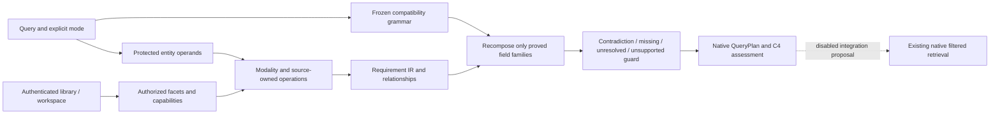

# Query representation and flow
`Requirement` stores field, operator, parsed value, exact original source span, owning clause span, status, required/advisory ownership, hard/advisory/relationship representation and provenance. `Understanding` holds source candidates, relationship evidence, changed field families, canonical corrections and topic spans. QueryPlan remains the native dataclass.

Scope is not inferred from query text. The parser receives scoped vocabulary; trusted capability validation and native actor/library/workspace ownership remain external. `trusted_scope_from_text=False` is explicit IR metadata, not an authorization credential. EXACT and identifiers retain native literal behavior. The parser may interpret words about another library as text; it cannot change the authenticated provider.

Semantic topic/advice is kept separately from hard filters. Native `ranking_query()` can carry beginner/research guidance. Unrepresented strict operations remain blocked. Structured advisory truth has no invented string-equivalence metric. The failed fresh examples show that current missing-operand and inherited-facet ownership is still incomplete.
