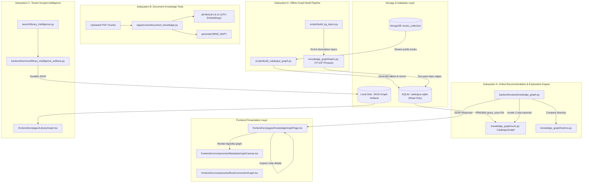
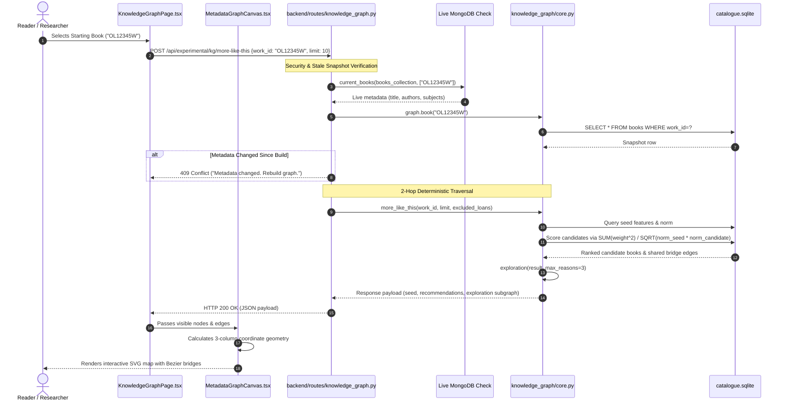

# 03 — COMPLETE SYSTEM ARCHITECTURE & END-TO-END PIPELINES

## 1. High-Level Architectural Architecture

LuminaR's Knowledge Graph subsystem is structured across three execution pipelines. Below is the verified architectural component diagram:

---

## 2. End-to-End Execution Pipeline (Subsystem A: Catalogue Graph)

Below is the verified end-to-end processing pipeline tracing a user request from the browser to the database and back to SVG rendering:

---

## 3. Stage-by-Stage Processing Pipeline Specification

### Stage 1: Document / Catalogue Streaming & Ingestion
- **Input:** Raw bibliographic documents from MongoDB `books_collection` (`work_id`, `title`, `authors`, `subjects`, `description`, `active`).
- **Processing:** Filters out inactive/non-searchable records (`searchable(row)`). Normalizes text via Unicode NFKC case-folding. Pipe-delimited author and subject fields are parsed into deduplicated dictionaries.
- **Output:** Memory batch of book tuples and typed edge records.
- **Algorithm:** Deterministic string canonicalization:
  $$\text{canonical}(v) = \text{join}(\text{NFKC}(v).\text{casefold}().\text{split}())$$
- **File / Function:** [`scripts/build_catalogue_graph.py:L35-L45`](file:///d:/SDC/LibraryLLM/scripts/build_catalogue_graph.py#L35-L45) in `build()`.
- **Error Handling:** Skipped books increment `skipped` metric; missing authors/subjects increment `isolates` metric.

---

### Stage 2: SQLite Relational Indexing & Feature Extraction
- **Input:** Flushed batch inserts into temporary SQLite database (`books`, `edges`).
- **Processing:** Creates uniqueness constraints and indexes on `books(work_id)`, `books(title_key, work_id)`, `edges(book_id, kind, term)`, and `edges(kind, term, book_id)`. Populates `features` table by grouping edges by `(kind, term)` to compute degrees.
- **Output:** Populated relational schema with initial degree distribution.
- **Algorithm:** SQL aggregation: `INSERT INTO features SELECT kind, term, COUNT(*), 0.0 FROM edges GROUP BY kind, term;`.
- **File / Function:** [`scripts/build_catalogue_graph.py:L46-L51`](file:///d:/SDC/LibraryLLM/scripts/build_catalogue_graph.py#L46-L51).

---

### Stage 3: Feature Weighting & Vector Norm Calculation
- **Input:** Degree counts from `features` table and total catalogue book count $N$.
- **Processing:** Computes inverse-degree logarithmic feature weights, assigning higher importance to rare authors and specialized subjects. Computes squared vector Euclidean norm for every book.
- **Output:** Populated `features.weight` and `norms` table.
- **Algorithm:**
  $$\text{weight}(k, t) = W_k \cdot \left(1 + \ln\left(\frac{N + 1}{\text{degree}(k, t) + 1}\right)\right)$$
  $$\text{Norm}(b) = \sum_{(k, t) \in \text{edges}(b)} \text{weight}(k, t)^2$$
- **File / Function:** [`scripts/build_catalogue_graph.py:L54-L62`](file:///d:/SDC/LibraryLLM/scripts/build_catalogue_graph.py#L54-L62).

---

### Stage 4: Description Topic NLP Mining (V2 Enrichment)
- **Input:** Book descriptions from catalogue.
- **Processing:** Adjacent n-gram generation (bigrams, trigrams). Stopword filtering via `scikit-learn`. TF-IDF scoring bounded by degree limits ($3 \le \text{degree} \le 0.001 \times N$). Capped at 5 topics per book.
- **Output:** Additional `HAS_TOPIC` edges and enriched feature weights ($W_{\text{topic}} = 0.5$).
- **Algorithm:** Corpus degree-bounded phrase selection:
  $$\text{score}(p) = (1 + \ln(\text{tf}(p))) \cdot \left(1 + \ln\left(\frac{N + 1}{\text{degree}(p) + 1}\right)\right)$$
- **File / Function:** [`knowledge_graph/topics.py:L40-L52`](file:///d:/SDC/LibraryLLM/knowledge_graph/topics.py#L40-L52) and [`scripts/build_kg_topics.py:L60-L83`](file:///d:/SDC/LibraryLLM/scripts/build_kg_topics.py#L60-L83).

---

### Stage 5: Online 2-Hop Traversal & Scoring
- **Input:** Target `work_id`, `limit` (1–50), and authenticated reader exclusion list (borrowed/reserved books).
- **Processing:** Executes SQL query to match candidate books sharing at least one feature with the seed book. Computes cosine similarity scores without sampled neighbor caps. Retrieves exact reason paths between seed and candidate.
- **Output:** Ranked list of recommended books with mathematical reason paths.
- **Algorithm:**
  $$\text{score}(s, c) = \frac{\sum_{f \in \text{shared}} \text{weight}(f)^2}{\sqrt{\text{Norm}(s) \cdot \text{Norm}(c)}}$$
- **File / Function:** [`knowledge_graph/core.py:L60-L107`](file:///d:/SDC/LibraryLLM/knowledge_graph/core.py#L60-L107) in `more_like_this()`.
- **Error Handling:** Raises `KeyError` (404) if book not in graph; raises `HTTPException(409)` if live metadata diverges from snapshot.

---

### Stage 6: Subgraph Transformation & SVG Layout
- **Input:** Backend recommendation and reason paths payload.
- **Processing:** Extracts unique nodes (`seed`, `recommended books`, and intermediate `features`). Computes 3-column coordinate mapping:
  - Seed: $(x=135, y=\text{height}/2)$
  - Features: $(x=450, y=45 + i \cdot \Delta y_{\text{features}})$
  - Books: $(x=765, y=45 + j \cdot \Delta y_{\text{books}})$
- **Output:** Interactive SVG markup with cubic Bezier paths and clickable node pills.
- **File / Function:** [`knowledge_graph/core.py:L108-L116`](file:///d:/SDC/LibraryLLM/knowledge_graph/core.py#L108-L116) and [`frontend/src/components/MetadataGraphCanvas.tsx:L3-L12`](file:///d:/SDC/LibraryLLM/frontend/src/components/MetadataGraphCanvas.tsx#L3-L12).
