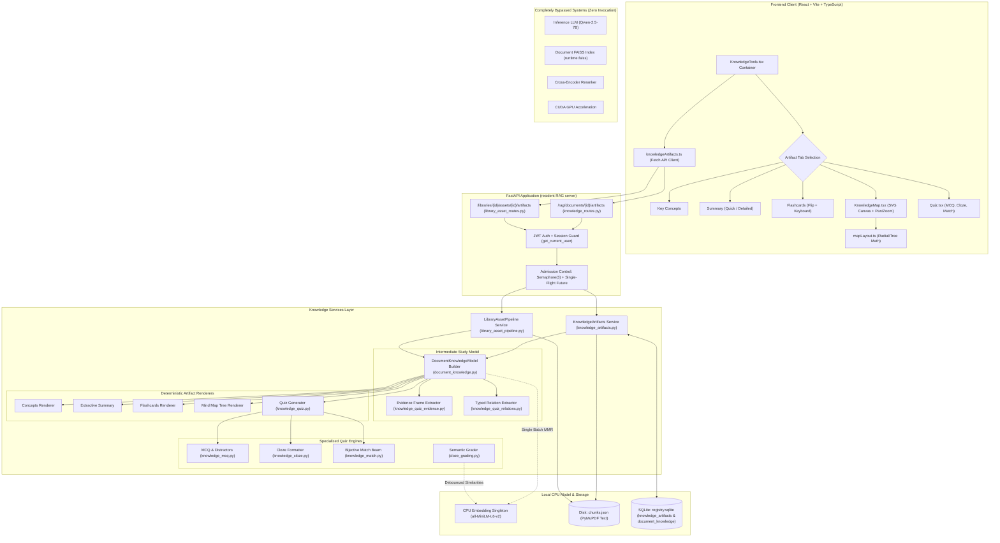
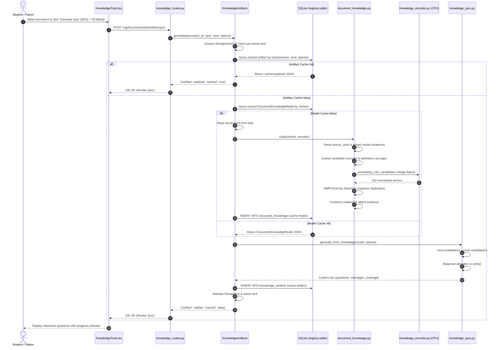

# LuminaR Knowledge Tools — Complete System Architecture & Pipeline Audit

## 1. System Overview and Core Architectural Thesis

The Knowledge Tools subsystem in **LuminaR** is a source-grounded educational synthesis engine. It extracts, structures, and visualizes knowledge from documents into five interactive study formats:
1. **Key Concepts** (`KEY_CONCEPTS`): Salient domain concepts with source explanations, confidence scores, and chunk provenance.
2. **Extractive Summary** (`EXTRACTIVE_SUMMARY`): Representative sentence-level summaries in Quick (up to 5 sentences) or Detailed (up to 12 sentences) modes.
3. **Flashcards** (`FLASHCARDS`): Pedagogical front/back study cards categorized into Definition, Cloze, Concept, Relationship, Process step, Application, and Comparison cards.
4. **Mind Map** (`MIND_MAP`): Hierarchical tree-and-evidence graph rendered on a dynamic SVG canvas with pan, zoom, fullscreen, and balanced branch positioning.
5. **Interactive Quiz** (`QUIZ`): Multi-format assessment supporting Multiple Choice Questions (MCQ), Fill-in-the-Blank (Cloze) with semantic grading, and Match-the-Following (bijective pairing), plus legacy True/False compatibility.

### The Decoupled Architecture Thesis
A defining architectural decision in LuminaR is the **complete decoupling of Knowledge Tools from the inference LLM (Qwen) and GPU infrastructure**.
- Traditional RAG applications invoke LLMs for summarization, quiz generation, and concept extraction. This causes GPU resource contention, non-deterministic outputs, prompt injection vulnerabilities, hallucinated facts, and high per-document latency.
- LuminaR implements a **deterministic, rule-and-feature-based pipeline** augmented by a **single CPU-only embedding model** (`sentence-transformers/all-MiniLM-L6-v2`) used exclusively for Maximal Marginal Relevance (MMR) deduplication and semantic answer grading.
- Production metric tracking explicitly reports `'qwen_calls': 0` and `'cuda_calls': 0` across all knowledge artifact generation jobs ([document_knowledge.py:L445](file:///d:/SDC/LibraryLLM/rag/services/document_knowledge.py#L445), [knowledge_quiz.py:L302](file:///d:/SDC/LibraryLLM/rag/services/knowledge_quiz.py#L302), [cloze_grading.py:L158](file:///d:/SDC/LibraryLLM/rag/services/cloze_grading.py#L158)).

---

## 2. Dual-Scope Processing Pipeline: Personal Documents vs Institutional Assets

The repository implements two parallel, tenant-isolated entry routes for knowledge tools:

```
                                 [Document Ingestion]
                                          |
                +-------------------------+-------------------------+
                |                                                   |
      [Personal Uploads]                                  [Institutional Assets]
   PrivateDocuments Service                           LibraryAssetPipeline Service
  /rag/documents/{doc_id}/...                         /libraries/{lib_id}/assets/{asset_id}/...
                |                                                   |
         Session Storage                                     Tenant Folder
   Path: rag/private_documents/                       Path: local-data/tenants/{lib_id}/assets/
   Database: registry.sqlite                          Database: PostgreSQL / Tenant DB
                |                                                   |
                +-------------------------+-------------------------+
                                          |
                                [Text & Chunk Retrieval]
                                (Reads chunks.json directly)
                                          |
                          [DocumentKnowledgeModel Build]
                     (Extracts Concepts, Relations, Evidence)
                                          |
                          [Knowledge Artifacts Generation]
                     (Key Concepts, Flashcards, Mindmap, Quiz)
```

### 2.1 Private Personal Documents
- **Mounted in**: [rag/services/knowledge_routes.py:L30-L70](file:///d:/SDC/LibraryLLM/rag/services/knowledge_routes.py#L30-L70) via `install_knowledge_artifacts(app, documents, encoder)`.
- **Base Endpoint**: `/rag/documents/{document_id}/artifacts`
- **Ownership & Lifetime**: Tied to the authenticated user's active session ID (`sid`) and expiration timestamp (`exp`). Documents are stored on disk in `rag/private_documents/{document_id}/` and tracked in `registry.sqlite`.
- **Database Schema**: 
  - `document_knowledge`: Caches the parsed `DocumentKnowledgeModel` JSON payload per document revision.
  - `knowledge_artifacts`: Caches the rendered artifact JSON payload per document, user, type, and options key.
- **Cascade Deletion**: Purging a document or logging out triggers `PRAGMA foreign_keys=ON;` with `ON DELETE CASCADE`, immediately dropping all cached study models and artifacts ([knowledge_artifacts.py:L31-L38](file:///d:/SDC/LibraryLLM/rag/services/knowledge_artifacts.py#L31-L38)).

### 2.2 Institutional Library Assets
- **Mounted in**: [rag/services/library_asset_routes.py:L29-L84](file:///d:/SDC/LibraryLLM/rag/services/library_asset_routes.py#L29-L84) via `install_library_assets(app, engine)`.
- **Base Endpoint**: `/libraries/{library_id}/assets/{asset_id}/artifacts`
- **Ownership & Permissions**: Governed by role-based library memberships (Staff vs Patron). Patrons can view and generate study tools; deleting artifacts requires staff privileges ([library_asset_pipeline.py:L425-L426](file:///d:/SDC/LibraryLLM/rag/services/library_asset_pipeline.py#L425-L426)).
- **Storage**: Maintained inside the asset directory under a dedicated `knowledge/` subdirectory. Persists `{cache_key}.json` artifacts and `{model_key}.model.json` intermediate knowledge models using atomic POSIX file writes ([library_asset_pipeline.py:L46-L66](file:///d:/SDC/LibraryLLM/rag/services/library_asset_pipeline.py#L46-L66)).

---

## 3. End-to-End Execution Trace

### Phase 1: User Request & Client Handling
1. The user navigates to a document in `LLMPage.tsx` (Personal workspace) or `LibraryAssets.tsx` (Institutional catalog).
2. The UI renders the `<KnowledgeTools />` container ([KnowledgeTools.tsx:L53-L56](file:///d:/SDC/LibraryLLM/frontend/src/components/knowledge/KnowledgeTools.tsx#L53-L56)).
3. `KnowledgeToolsSession` mounts and initiates `listArtifacts(documentId)`.
4. If an artifact already exists for the selected tab and options, it renders immediately.
5. If the user clicks **Generate** or switches Quiz question types and clicks **Generate Quiz**, `generateArtifact()` is invoked with `AbortController` signal support.

### Phase 2: Route Guards & Concurrency Admission Control
1. **Authentication Check**: The route verifies JWT claims via `get_current_user` ([backend/dependencies.py](file:///d:/SDC/LibraryLLM/backend/dependencies.py)). Session revocation is validated via `is_revoked(user['sid'])` ([private_documents.py:L54-L56](file:///d:/SDC/LibraryLLM/rag/services/private_documents.py#L54-L56)).
2. **Cache Headers**: `response.headers['Cache-Control'] = 'no-store'` is injected on every knowledge response to prevent browser caching of private data.
3. **Capacity Gate**: `KnowledgeArtifacts` enforces a global `Semaphore(3)` (maximum 3 concurrent generation jobs) and a per-user `_owners` lock ([knowledge_artifacts.py:L26-L29](file:///d:/SDC/LibraryLLM/rag/services/knowledge_artifacts.py#L26-L29)).
4. **Single-Flight Future Leader/Follower**: If duplicate requests arrive for the same `(owner, sid, document_id, slug, mode, question_types, count)`, subsequent requests await the leader's `concurrent.futures.Future` with a 25-second timeout ([knowledge_artifacts.py:L108-L122](file:///d:/SDC/LibraryLLM/rag/services/knowledge_artifacts.py#L108-L122)).

### Phase 3: Text & Chunks Retrieval
1. The backend resolves the document root and inspects `chunks.json`.
2. Document size guard: If `chunks.json` exceeds 64 MB, HTTP 413 (`This document is too large for Knowledge Tools.`) is raised ([knowledge_artifacts.py:L86-L87](file:///d:/SDC/LibraryLLM/rag/services/knowledge_artifacts.py#L86-L87)).
3. The content revision hash is computed: `revision = hashlib.sha256(raw).hexdigest()`.

### Phase 4: Shared Knowledge Model Construction (`DocumentKnowledgeModel`)
If the intermediate model is not already cached in SQLite `document_knowledge` for this `(document_id, owner, revision, VERSION)`:
1. `document_knowledge.source_units(chunks)` parses up to 1,200 chunks and 2,200 units, filtering boilerplate headers, repetitive footers, and low-value sections.
2. `unit_rows(units)` extracts grammatical, verbal sentences (up to 6,000 sentences).
3. Candidate concepts are harvested from explicit definitions, section headings, list items, cloze phrases, and recurring multi-word noun chunks.
4. Candidate concepts are scored based on definitional presence, heading signals, document frequency specificity, and multi-page distribution.
5. Top 192 candidates are embedded in a single batch using CPU `all-MiniLM-L6-v2` (`knowledge_encoder.encode`).
6. Bounded MMR (Maximal Marginal Relevance) selects between 12 and 30 diverse concepts, suppressing lexical or semantic duplicates.
7. `knowledge_quiz_evidence.attach(model)` and `knowledge_quiz_relations.attach(model)` construct typed, source-validated relation frames.
8. The constructed `DocumentKnowledgeModel` is serialized and persisted to SQLite or filesystem cache.

### Phase 5: Artifact Rendering & Normalization
Once the `DocumentKnowledgeModel` is acquired:
- `document_knowledge.generate(kind, model, title, options)` is executed synchronously.
- Rendering reads directly from the memory model. **Zero chunks are re-parsed. Zero embedding calls are made.**
- The output structure is validated, and source chunk IDs are aggregated for deep linking.

### Phase 6: Response Serialization & Cache Storage
1. An artifact envelope is constructed:
   ```json
   {
     "id": "artifact_xxxxxxxxxxxxxxxx",
     "userId": "owner_id",
     "documentId": "doc_xxxx",
     "type": "FLASHCARDS",
     "scope": {"type": "document"},
     "generator": "document-knowledge-v3",
     "generatorVersion": "3.0.0",
     "options": {},
     "sourceRevision": "sha256_hash",
     "content": { ... },
     "sourceChunkIds": ["c1", "c2"],
     "createdAt": 1740000000.0,
     "updatedAt": 1740000000.0,
     "analysis": { ... }
   }
   ```
2. Saved to `knowledge_artifacts` table under unique constraint `(document_id, owner, type, cache_key)`.
3. Returned to frontend as `{"artifact": ..., "cached": false}`.

### Phase 7: Interactive Frontend Visualization
- React receives the payload, stores it in local state `artifacts`, and mounts the specialized component:
  - `KEY_CONCEPTS`: Responsive grid of cards with labels, explanations, confidence tags, and source excerpts.
  - `EXTRACTIVE_SUMMARY`: Grouped section blocks with sentence-level citations.
  - `FLASHCARDS`: Card presentation with 3D/flip toggles, card-type filter dropdown, keyboard navigation (left/right/space), and source panel.
  - `MIND_MAP`: Full SVG visual tree with pan/zoom engine, fullscreen modal with DOM inert trap, node inspection sidebar, and cubic bezier links.
  - `QUIZ`: Multi-question stepper with radio MCQs, interactive dropdown matching matrices, and fill-in-the-blank inputs connected to live server grading.

---

## 4. Subsystem Reuse Matrix

The table below proves exactly what Knowledge Tools share with the broader LuminaR system and what remains isolated:

| Pipeline Component | Shared with Core RAG? | Implementation Details in Knowledge Tools |
|---|---|---|
| **Document Ingestion & OCR** | **YES** | Reuses `PrivateDocuments.begin()`, PyMuPDF (`fitz`), and Tesseract OCR (`private_document_ocr.py`). |
| **Document Chunking** | **YES** | Reads the pre-generated `chunks.json` produced during upload (`CHUNK_SIZE=3000`, `CHUNK_OVERLAP=400`). |
| **FAISS Vector Index** | **NO** | Core RAG searches `runtime.faiss`. Knowledge Tools **never open or query** the FAISS index. |
| **CrossEncoder Reranker** | **NO** | Core RAG uses `BAAI/bge-reranker-base`. Knowledge Tools do not use the reranker. |
| **Inference LLM (Qwen)** | **NO** | Core RAG asks Qwen via resident process or local engine. Knowledge Tools **make 0 LLM calls**. |
| **GPU Acceleration** | **NO** | Core RAG can utilize CUDA GPU. Knowledge Tools run **strictly on CPU** (`device='cpu'`). |
| **Text Embedding Model** | **HYBRID** | Reuses the same architecture (`all-MiniLM-L6-v2`), but Knowledge Tools isolate it in a CPU singleton `knowledge_encoder.py`. |
| **Database Persistence** | **HYBRID** | Uses the same SQLite database (`registry.sqlite`) or tenant directory, but in dedicated tables (`document_knowledge`, `knowledge_artifacts`). |
| **Authentication & Auth** | **YES** | Shares JWT dependency `get_current_user` and session revocation checks `is_revoked`. |

---

## 5. Architectural Mermaid Diagrams

### Diagram 1: Overall Knowledge Tools End-to-End Architecture



### Diagram 2: Data Processing & Document Knowledge Pipeline


