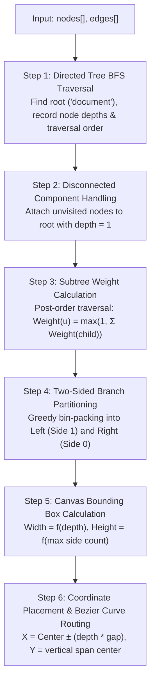
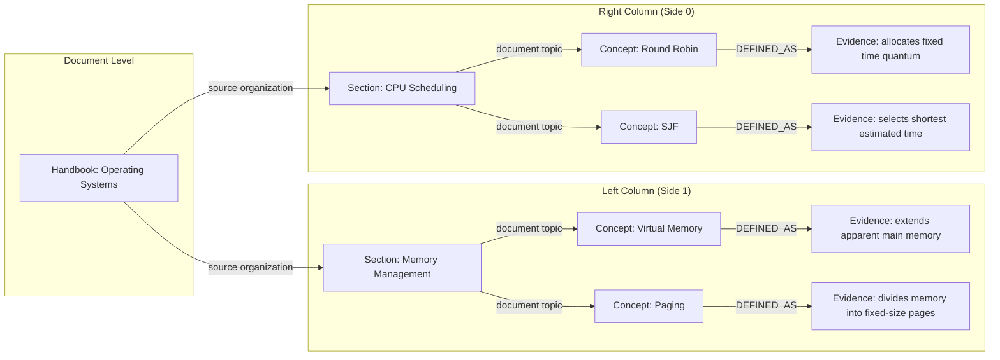

# LuminaR Mind Map Implementation Audit & Technical Analysis

## 1. Executive Summary

The **Mind Map** module in LuminaR generates an interactive, hierarchical concept tree from uploaded PDFs or library assets. It translates document structure and synthesized educational concepts into an interactive SVG canvas.

Key architectural characteristics:
- **Zero LLM Invocation**: Built deterministically from structural headings, chapters, concept rankings, and copular relations ([document_knowledge.py:L516-L547](file:///d:/SDC/LibraryLLM/rag/services/document_knowledge.py#L516-L547)).
- **Custom Radial / Balanced Tree Layout**: Uses a custom-written TypeScript layout algorithm in [mapLayout.ts](file:///d:/SDC/LibraryLLM/frontend/src/components/knowledge/mapLayout.ts) rather than external layout engines like D3-hierarchy, Cytoscape, or React Flow.
- **Pure SVG Rendering & Canvas Controls**: Implemented in [KnowledgeMap.tsx](file:///d:/SDC/LibraryLLM/frontend/src/components/knowledge/KnowledgeMap.tsx) with pointer capture panning, wheel panning, dynamic zoom fitting, cubic bezier edge curves, and an accessible fullscreen modal portal with focus trapping.

---

## 2. Backend Generation Pipeline

### 2.1 Code Location
- **Endpoint**: `POST /rag/documents/{id}/artifacts/mindmap` (or `/libraries/{lib_id}/assets/{asset_id}/artifacts/mindmap`)
- **Backend Function**: `generate(kind='MIND_MAP', model, title, options)` in [rag/services/document_knowledge.py:L516-L547](file:///d:/SDC/LibraryLLM/rag/services/document_knowledge.py#L516-L547)

### 2.2 Hierarchical Construction Algorithm
The mind map hierarchy is assembled in four strictly defined tiers:

```
[Tier 0: Root]           Document Node (id: 'document', label: title)
                              |
                     (source organization)
                              v
[Tier 1: Groups]         Chapter & Section Group Nodes (up to 10 groups)
                              |
                      (document topic)
                              v
[Tier 2: Concepts]       Extracted Domain Concepts (up to 24 concepts)
                              |
                    (typed copular relation)
                              v
[Tier 3: Leaves]         Evidence Statements (up to 24 factual targets)
```

#### Algorithmic Sequence in `document_knowledge.py`:
1. **Root Node Creation**:
   ```python
   nodes = [{'id': 'document', 'label': title, 'type': 'document', 'sourceChunkIds': []}]
   edges = []
   groups = {}
   ```
2. **Structural Grouping (Chapters & Sections)**:
   For each concept in the top 24 accepted concepts (`concepts[:24]`):
   - Inspects `concept.get('chapter')` and `concept.get('section')`.
   - If a chapter or section exists and is not identical to the concept itself, a group node is generated:
     ```python
     key = (parent, field, label)
     if key not in groups and len(groups) < 10:
         group = legacy.identifier('group', '|'.join(key))
         groups[key] = group
         nodes.append({'id': group, 'label': label, 'type': field, ...})
         edges.append({'source': parent, 'target': group, 'relation': 'source organization', ...})
     ```
   - If no structural heading exists, the concept directly attaches to `'document'`.
3. **Concept Node Attachment**:
   - The concept node (`type: 'concept'`) is appended to `nodes`.
   - An edge is drawn from `parent` (the section group or root) to `concept['id']` with `relation: 'document topic'`.
4. **Evidence Leaf Expansion**:
   - For relations in `model.relations[:min(24, 60 - len(nodes))]`:
     - If the relation's source matches an active concept in `nodes`:
     - An evidence node (`type: 'evidence'`) is created with the target text (up to 160 characters).
     - An edge is drawn from the concept to the evidence node with the relation's semantic type (`DEFINED_AS`, `CONTAINS`, `USED_FOR`, `HAS_STEP`, `DESCRIBED_AS`).
5. **Safety Constraints**:
   - Total nodes capped at 60 ([document_knowledge.py:L539](file:///d:/SDC/LibraryLLM/rag/services/document_knowledge.py#L539)).
   - Total groups capped at 10 ([document_knowledge.py:L527](file:///d:/SDC/LibraryLLM/rag/services/document_knowledge.py#L527)).
   - Top concepts capped at 24 ([document_knowledge.py:L520](file:///d:/SDC/LibraryLLM/rag/services/document_knowledge.py#L520)).

---

## 3. Frontend Layout Algorithm: `mapLayout.ts`

Rather than relying on heavy third-party graph layout packages, LuminaR includes an original balanced radial/tree layout algorithm in [mapLayout.ts](file:///d:/SDC/LibraryLLM/frontend/src/components/knowledge/mapLayout.ts).

### 3.1 Constants & Dimensions
- Node Card Dimensions: `mapCardWidth = 205` px, `mapCardHeight = 68` px ([mapLayout.ts:L3](file:///d:/SDC/LibraryLLM/frontend/src/components/knowledge/mapLayout.ts#L3)).

### 3.2 Step-by-Step Mathematical Layout Sequence



#### Step 1 & 2: Traversal & Dangling Edge Handling
The algorithm finds the root node (node with `type === 'document'` or first node). It runs a BFS traversal to compute each node's `depth`. If dangling or disconnected components exist, it automatically attaches them to the root as depth 1 children without drawing artificial visual edges ([mapLayout.ts:L23-L24](file:///d:/SDC/LibraryLLM/frontend/src/components/knowledge/mapLayout.ts#L23-L24)).

#### Step 3: Subtree Weighting
In reverse topological order (leaves to root), each node computes its visual weight:
$$\text{Weight}(u) = \max\left(1, \sum_{v \in \text{Children}(u)} \text{Weight}(v)\right)$$

#### Step 4: Balanced Two-Sided Branch Partitioning
Root child branches are greedily partitioned into two columns (Left = Side 1, Right = Side 0) to balance the canvas vertically:
```typescript
const sides: string[][] = [[], []], counts = [0, 0]
for (const branch of children.get(root)!) {
  const side = counts[0] <= counts[1] ? 0 : 1
  sides[side].push(branch)
  counts[side] += weight.get(branch) || 1
}
```

#### Step 5: Canvas Sizing & Dynamic Gap Calculation
Canvas width and height are dynamically derived from maximum branch depth and column counts:
$$\text{Width} = \max(\text{cardWidth} + 2 \cdot \text{Depth} \cdot (\text{cardWidth} + 96) + 64, \text{availableWidth})$$
$$\text{Height} = \max(300, \max(1, \text{counts}_0, \text{counts}_1) \cdot (\text{cardHeight} + 24) + 64, \text{availableHeight})$$
$$\text{Gap} = \frac{\text{Width} - \text{cardWidth} - 64}{2 \cdot \text{Depth}}$$

#### Step 6: Node Coordinate Formula
- **Root Node**: Exactly centered:
  $$X_{\text{root}} = \frac{\text{Width} - \text{cardWidth}}{2}, \quad Y_{\text{root}} = \frac{\text{Height} - \text{cardHeight}}{2}$$
- **Child Nodes**:
  $$X_u = X_{\text{root}} + (1 \text{ if side}=0 \text{ else } -1) \cdot \text{Depth}(u) \cdot \text{Gap}$$
  $$Y_u = \text{Top} + \frac{\text{Span} - \text{cardHeight}}{2}$$
  Where $\text{Span}$ is proportionally divided based on subtree weights:
  $$\text{Span}(u) = (\text{Height} - 64) \times \frac{\text{Weight}(u)}{\text{TotalSideWeight}}$$

---

## 4. Frontend Interactive Rendering: `KnowledgeMap.tsx`

### 4.1 SVG Canvas & Cubic Bezier Edges
The map is rendered as an SVG with viewBox. Edges are drawn using smooth cubic bezier curves connecting the edge of the source card to the edge of the target card ([KnowledgeMap.tsx:L94-L100](file:///d:/SDC/LibraryLLM/frontend/src/components/knowledge/KnowledgeMap.tsx#L94-L100)):
```tsx
const right = to.x >= from.x
const x1 = from.x + (right ? mapCardWidth : 0)
const x2 = to.x + (right ? 0 : mapCardWidth)
const y1 = from.y + mapCardHeight / 2
const y2 = to.y + mapCardHeight / 2
const middle = (x1 + x2) / 2

<path
  d={`M${x1},${y1} C${middle},${y1} ${middle},${y2} ${x2},${y2}`}
  fill="none"
  stroke="currentColor"
  strokeWidth="1.2"
  opacity=".3"
/>
```

### 4.2 Pan & Zoom Engine
1. **Initial Fit**: Calculates `fit = min(1, (width - 48)/natural.width, (height - 48)/natural.height)` to ensure large maps fit on initial render without horizontal overflow.
2. **Wheel Delta Pan**: Listens to mouse wheel events with `passive: false`, calling `event.preventDefault()` to prevent outer page scroll and panning the internal `(pan.x, pan.y)` offsets ([KnowledgeMap.tsx:L36-L40](file:///d:/SDC/LibraryLLM/frontend/src/components/knowledge/KnowledgeMap.tsx#L36-L40)).
3. **Pointer Drag**: Implements `onPointerDown`, `setPointerCapture`, `onPointerMove`, and `onPointerUp` to provide smooth desktop and touch drag-to-pan.
4. **Zoom Scaling**: Supports Zoom in (1.25x), Zoom out (0.8x), and Reset view (100% fit).

### 4.3 Fullscreen Modal & Accessibility
- Clicking **Fullscreen** creates a React Portal mounted directly to `document.body` ([KnowledgeMap.tsx:L124](file:///d:/SDC/LibraryLLM/frontend/src/components/knowledge/KnowledgeMap.tsx#L124)).
- Applies `document.body.style.overflow = 'hidden'`.
- Sets `document.getElementById('root').inert = true` to trap keyboard focus inside the modal dialog.
- Attaches an Escape key listener to close fullscreen and return focus to the toggle button.
- Inspecting a concept opens an accessible `<aside aria-label="Map details">` displaying label, explanation, incoming relations, and clickable source citations.

---

## 5. Technical Comparison: Mind Map vs Knowledge Graph

During a viva review, this distinction is crucial:

| Dimension | Mind Map (`MIND_MAP`) | Catalogue Knowledge Graph (`core.py`) |
|---|---|---|
| **Graph Structure** | Strictly Hierarchical Tree with leaf evidence branches | Non-hierarchical Bipartite Graph (Books $\leftrightarrow$ Features) |
| **Root Node** | Single central document root | Multi-seed / decentralized |
| **Node Types** | `document`, `chapter`, `section`, `concept`, `evidence` | `book`, `author`, `subject`, `topic` |
| **Edge Semantics** | Structural (`source organization`, `document topic`) & Grammatical (`DEFINED_AS`, `CONTAINS`, `USED_FOR`) | Relational metadata (`authored_by`, `classified_under`, `discusses_topic`) |
| **Cycles** | Acyclic by design (BFS spanning tree guarantees no cycles) | Cyclic, allows multi-hop traversals and dense clusters |
| **Visualization** | Custom balanced 2-sided SVG canvas with cubic beziers | Exploration subgraph API with force/node lists |
| **Computation Engine** | Syntactic regex + rule grammar + BFS positioning | SQLite indexed relational joins + TF-IDF cosine weights |

---

## 6. Worked Example (Educational Notes)



---

## 7. Reviewer Viva Q&A: Mind Maps

### Q1: "How is the central topic and hierarchy determined?"
**Spoken Answer (20-30s):**
> "The central root node is always the verified document title. The first level of branches is extracted from structural section and chapter headings identified during PDF parsing. The second level attaches domain concepts scored by our multi-signal MMR algorithm, and the leaf nodes attach verified copular facts like definitions or purposes. If a document lacks section headings, concepts attach directly to the document root."

### Q2: "Which layout algorithm did you use for the mind map?"
**Spoken Answer (20-30s):**
> "Rather than importing heavy layout libraries, we wrote a balanced two-sided tree layout algorithm in `mapLayout.ts`. It performs a BFS traversal from the root, computes subtree weights using post-order accumulation, partitions top-level branches into left and right columns using greedy bin-packing, and routes smooth cubic bezier curves between card anchors."

### Q3: "What happens if the document has circular references or disconnected components?"
**Spoken Answer (20-30s):**
> "Our layout algorithm in `mapLayout.ts` specifically defends against this: the BFS traversal tracks visited node IDs in a `seen` set, so duplicate edges and cycles are ignored. Any disconnected nodes are automatically gathered in a post-traversal pass and assigned depth 1 under the root, ensuring every valid node receives non-overlapping coordinates without drawing fake edges."
