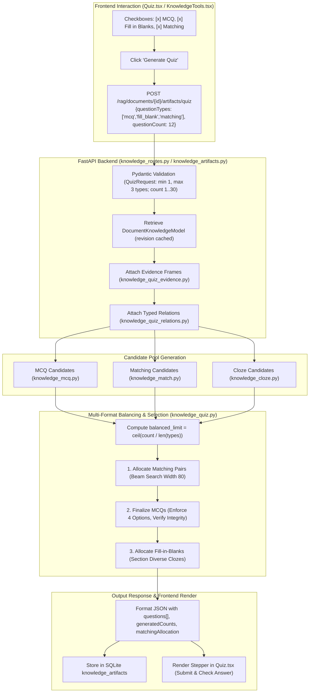
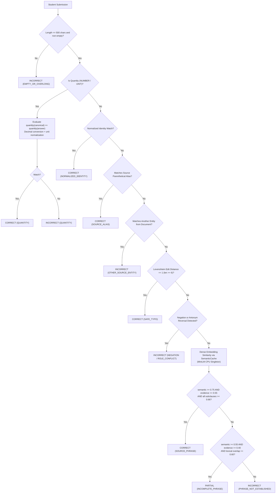

# LuminaR Quiz Generation Subsystem — Complete Implementation Audit & Defense Guide

## 1. Executive Summary & Subsystem Overview

The Quiz Generation engine in LuminaR is one of the most sophisticated modules in the platform. It provides an automated, multi-format educational assessment suite grounded entirely in source document facts, without any generative LLM calls.

### Core Supported Formats
1. **Multiple Choice Questions (MCQ)**: 4-option questions with rigorous distractor compatibility verification and source citations for every option ([knowledge_mcq.py](file:///d:/SDC/LibraryLLM/rag/services/knowledge_mcq.py)).
2. **Fill in the Blanks (Cloze)**: Masked-sentence questions supporting server-side semantic grading, typo tolerance, alias recognition, and dimensional quantity checking ([knowledge_cloze.py](file:///d:/SDC/LibraryLLM/rag/services/knowledge_cloze.py), [cloze_grading.py](file:///d:/SDC/LibraryLLM/rag/services/cloze_grading.py)).
3. **Match the Following**: Dual-column pairing matrices with strict mathematical bijection verification and beam search pair allocation ([knowledge_match.py](file:///d:/SDC/LibraryLLM/rag/services/knowledge_match.py)).
4. **Legacy True/False**: Backward-compatible evaluation format for previously saved artifacts ([Quiz.tsx:L68](file:///d:/SDC/LibraryLLM/frontend/src/components/knowledge/Quiz.tsx#L68)).

---

## 2. End-to-End Quiz Generation Architecture



---

## 3. Multiple Choice Questions (MCQ) Implementation

### 3.1 Stem Generation & Question Forms
MCQ questions are constructed by `stem(record, identify, qid)` in [knowledge_mcq.py:L10-L26](file:///d:/SDC/LibraryLLM/rag/services/knowledge_mcq.py#L10-L26) across two distinct forms:
1. **Target Identification (Forward Question)**:
   - For `DEFINITION`: `"Which description best defines {subjectText}?"` or `"According to the document, how is {subjectText} defined?"`
   - For `PURPOSE`: `"What is {subjectText} used for according to the document?"`
   - For `PROCESS`: `"Which step is specified for {subjectText}?"`
   - For `COMPOSITION`: `"What does {subjectText} consist of according to the document?"`
   - For `NUMERIC:*`: `"What {unit/property} is specified for {subjectText}?"`
2. **Subject Identification (Inverse Question)**:
   - Generated when all 4 options share the exact same category:
   - `"Which concept is defined by this source description: “{targetText}”?"`

### 3.2 Distractor Generation & Peer Compatibility
To prevent meaningless or hallucinated options, **distractors are 100% extracted from the same document** and must satisfy strict compatibility rules ([knowledge_quiz_relations.py:L174-L182](file:///d:/SDC/LibraryLLM/rag/services/knowledge_quiz_relations.py#L174-L182)):
```python
def compatible(left, right, relations):
    if (left['relationType'] != right['relationType'] or e.labels_overlap(left['subjectText'], right['subjectText'])
            or equivalent(left['targetText'], right['targetText']) or peers(left, right)):
        return False
    return not any(r['subjectId'] == left['subjectId'] and r['relationType'] == left['relationType']
                   and equivalent(r['targetText'], right['targetText']) for r in relations)
```
- **Same Relation Family**: A `DEFINITION` question only takes definitions as distractors; a `PURPOSE` question only takes purposes.
- **No Label Overlap**: Rejects distractors whose names share lexical tokens with the subject (prevents near-synonym ambiguity).
- **No Semantic Peers**: Rejects concepts flagged as semantic duplicates during the MMR embedding pass (`cosine >= 0.88`).
- **Secondary Answer Check**: Scans the entire relation pool to ensure the distractor statement is **not** true for the target subject in another section of the document!

### 3.3 The 11-Point MCQ Integrity Verifier
Every candidate MCQ must pass `verify(question, relations)` in [knowledge_mcq.py:L50-L73](file:///d:/SDC/LibraryLLM/rag/services/knowledge_mcq.py#L50-L73):

| Rejection Code | Verification Constraint | Code Evidence |
|---|---|---|
| `SOURCE_BINDING` | Relation record must exist in validated source relations. | [L51-L52](file:///d:/SDC/LibraryLLM/rag/services/knowledge_mcq.py#L51-L52) |
| `STEM_ANSWER_BINDING` | Question stem must match the template for that exact relation. | [L53](file:///d:/SDC/LibraryLLM/rag/services/knowledge_mcq.py#L53) |
| `ANSWER_KEY` | Correct answer must appear in `options` exactly once. | [L58](file:///d:/SDC/LibraryLLM/rag/services/knowledge_mcq.py#L58) |
| `ANSWER_LEAK` | The correct answer cannot appear inside the question text! | [L59](file:///d:/SDC/LibraryLLM/rag/services/knowledge_mcq.py#L59) |
| `SOURCE_PROVENANCE` | Explanation and excerpt must match the verified source record. | [L60](file:///d:/SDC/LibraryLLM/rag/services/knowledge_mcq.py#L60) |
| `OPTION_BINDING` | `set(options) == set(optionSources)` (every option must cite a source). | [L62](file:///d:/SDC/LibraryLLM/rag/services/knowledge_mcq.py#L62) |
| `DUPLICATE_OPTION` | Exactly 4 options required, and all 4 strings must be unique. | [L64](file:///d:/SDC/LibraryLLM/rag/services/knowledge_mcq.py#L64) |
| `AMBIGUOUS_OPTION` | In inverse questions, options cannot overlap lexically. | [L67](file:///d:/SDC/LibraryLLM/rag/services/knowledge_mcq.py#L67) |
| `MULTIPLE_CORRECT` | All pairs of options must be mutually compatible distractors. | [L69](file:///d:/SDC/LibraryLLM/rag/services/knowledge_mcq.py#L69) |
| `DISTRACTOR_REUSE_LIMIT` | No single distractor may be reused more than twice across the quiz. | [L114](file:///d:/SDC/LibraryLLM/rag/services/knowledge_mcq.py#L114) |
| `CORRECT_ANSWER_REUSE` | The exact same correct answer is never tested twice in one quiz. | [L115](file:///d:/SDC/LibraryLLM/rag/services/knowledge_mcq.py#L115) |

---

## 4. Fill in the Blanks (Cloze) & Semantic Grading

### 4.1 Masked Sentence Construction
Cloze items are created by masking a single key entity or term in an authoritative source sentence ([knowledge_cloze.py:L58-L66](file:///d:/SDC/LibraryLLM/rag/services/knowledge_cloze.py#L58-L66)):
- Blank prompt: `"Complete the source sentence: " + text[:start] + "_____" + text[end:]`
- Constraints: The blank `"_____"` must appear **exactly once**.
- Blank Types:
  - `TERM`: Specialized vocabulary term.
  - `ENTITY`: Named entity (acronym, capitalized name).
  - `SHORT_PHRASE`: Multi-word descriptive clause ($>5$ words).
  - `NUMBER`: Bare scalar quantity (`2`, `50`).
  - `NUMBER_WITH_UNIT`: Scalar with dimensional unit (`5 ms`, `50%`, `20 seconds`).
  - `DESCRIPTION`: Functional verbal clause (`controlling the sender rate...`).

### 4.2 Server-Side Semantic Grading Algorithm (`cloze_grading.py`)
Unlike naive string matching that marks students wrong for capitalization or minor wording, LuminaR implements a **conservative multi-tier grading pipeline**:



#### Key Grading Rules:
1. **Dimensional Quantity Normalization**:
   Supports `ms`, `second`, `minute`, `hour`, `%` via `Decimal` conversions ([cloze_grading.py:L13-L17](file:///d:/SDC/LibraryLLM/rag/services/cloze_grading.py#L13-L17)). For example:
   - Canonical: `"5 ms"` $\leftrightarrow$ Student: `"0.005 s"` $\rightarrow$ **CORRECT**
   - Canonical: `"50%"` $\leftrightarrow$ Student: `"0.5"` $\rightarrow$ **CORRECT**
2. **Safe Typo Tolerance**:
   Single edit distance ($D_{\text{edit}} = 1$) allowed on long words ($\ge 6$ letters). Single-letter qualifiers, acronyms, and plural swaps (`s`, `es`) stay exact ([cloze_grading.py:L64-L74](file:///d:/SDC/LibraryLLM/rag/services/cloze_grading.py#L64-L74)).
3. **Negation & Logic Guard**:
   Detects presence of `not`, `never`, `cannot`, `without`. If the canonical sentence is positive but the student answers with negation, it immediately returns **INCORRECT (`NEGATION`)** even if sentence embedding similarity is high ([cloze_grading.py:L170-L177](file:///d:/SDC/LibraryLLM/rag/services/cloze_grading.py#L170-L177)).
4. **Antonym & Role Inversion Guard**:
   Explicitly checks opposing role pairs: `('sender', 'receiver')`, `('transmission', 'reception')`, `('incoming', 'outgoing')`, `('earliest', 'latest')`, `('increases', 'decreases')`. Reversing sender/receiver returns **INCORRECT (`ROLE_OR_DIRECTION_CONFLICT`)** ([cloze_grading.py:L184-L193](file:///d:/SDC/LibraryLLM/rag/services/cloze_grading.py#L184-L193)).
5. **Debounced Semantic Cache (`SemanticCache`)**:
   CPU MiniLM similarity evaluations are collected in a 5-millisecond window thread-safe debounce queue (`time.sleep(0.005)`), sharing embeddings across concurrent answers with an LRU cache size of 512 entries and 300-second TTL ([cloze_grading.py:L90-L143](file:///d:/SDC/LibraryLLM/rag/services/cloze_grading.py#L90-L143)).

---

## 5. Match the Following Implementation

### 5.1 Pairing Matrix Structure
A matching question consists of Column A (`leftItems`: 3 to 6 terms) and Column B (`rightItems`: 3 to 6 descriptions).
- `leftItems`: Each has a unique `id` (e.g. `'L1'`, `'L2'`), `text`, `sourceFactId`, and provenance.
- `rightItems`: Each has a unique `id` (e.g. `'R1'`, `'R2'`) and `text`.
- `correctMatches`: Explicit mapping table: `{"L1": "R2", "L2": "R1", ...}`.

### 5.2 Mathematical Bijection Guarantee
The verifier enforces that the matching question forms a **strict mathematical bijection** (one-to-one and onto):
```python
if set(question['correctMatches']) != {x['id'] for x in left} or set(question['correctMatches'].values()) != {x['id'] for x in right}:
    return 'NOT_BIJECTION'
```
- Every Left item maps to exactly one Right item.
- Every Right item is matched by exactly one Left item.
- No item in Column A or Column B can be duplicated (`DUPLICATE_PAIR` check).
- **Shuffle with Non-Identity Guarantee**: Column B is shuffled with deterministic PRNG `random.Random(qid)`. If the shuffled order happens to match Column A order identically, it cyclically shifts `right = right[1:] + right[:1]` so no answer appears directly across from its prompt ([knowledge_match.py:L62](file:///d:/SDC/LibraryLLM/rag/services/knowledge_match.py#L62))!

### 5.3 Beam Search Pair Allocation Algorithm
Matching questions are not allocated as arbitrary question blocks; they are allocated **at the pair level** using beam search with a beam width of 80 ([knowledge_match.py:L83-L105](file:///d:/SDC/LibraryLLM/rag/services/knowledge_match.py#L83-L105)):
- Maintains search states: `(chosen_questions, used_facts, used_concepts, used_relations, used_targets, total_pairs, score, start_index)`.
- Discards any match set that reuses facts, concepts, or relations already claimed by MCQs or other match sets.
- Selects the optimal combination of 3-pair and 4-pair matching sets maximizing quality score while strictly adhering to `requested_pairs`.

---

## 6. Multi-Format Selection & Question Balancing

When users select multiple question types (e.g., both **MCQ** and **Fill in the Blanks**), question allocation is governed by [knowledge_quiz.py:L261-L288](file:///d:/SDC/LibraryLLM/rag/services/knowledge_quiz.py#L261-L288):

### 6.1 Balanced Allocation Formula
$$\text{balanced\_limit} = \max\left(1, \left\lceil \frac{\text{questionCount}}{\text{len(selectedTypes)}} \right\rceil\right)$$
For example, for total count = 12:
- If 2 types selected (`['mcq', 'fill_blank']`): $\text{balanced\_limit} = 6$ MCQs and 6 Clozes.
- If 3 types selected (`['mcq', 'fill_blank', 'matching']`): $\text{balanced\_limit} = 4$ MCQs, 4 Clozes, and 4 Matching pairs (typically 1 matching set of 4 pairs).

### 6.2 Format Priority Sequence
1. **Matching Allocation**: Allocated first because matching requires 3-4 mutually compatible pairs from the same relation family. To protect MCQ quality, 1 validated MCQ relation is reserved before matching runs ([knowledge_quiz.py:L271-L278](file:///d:/SDC/LibraryLLM/rag/services/knowledge_quiz.py#L271-L278)).
2. **MCQ Allocation**: Allocated second from remaining verified relations, enforcing cross-format disjointness (`q['_facts'].isdisjoint(used_facts)`).
3. **Cloze Allocation**: Allocated third, prioritizing sections with concepts not yet covered by MCQs or Matching.

---

## 7. Quiz Scoring & Evaluation

### 7.1 Client-Side vs Server-Side Scoring
- **MCQ**: Scored synchronously on client in `Quiz.tsx:L91` (`answers[q.id] === q.correctAnswer`).
- **Match the Following**: Scored with **partial credit**:
  $$\text{Score} = \frac{\sum_{l \in \text{leftItems}} \mathbb{I}(\text{matches}[l.\text{id}] = q.\text{correctMatches}[l.\text{id}])}{|\text{leftItems}|}$$
  Displays exact count: e.g. `"3 / 4 pairs correct."` ([Quiz.tsx:L78-L79](file:///d:/SDC/LibraryLLM/frontend/src/components/knowledge/Quiz.tsx#L78-L79)).
- **Fill in the Blank**: Submits asynchronous POST to `/artifacts/{id}/cloze/{item_id}/grade`. Displays `CORRECT` (✓ Correct), `PARTIAL` (~ Partially correct), or `INCORRECT` (× Needs review) with canonical answer and explanation feedback ([Quiz.tsx:L85-L89](file:///d:/SDC/LibraryLLM/frontend/src/components/knowledge/Quiz.tsx#L85-L89)).

---

## 8. Reviewer Viva Q&A: Quiz Subsystem

### Q1: "How do you generate multiple-choice distractors, and how do you know they are incorrect?"
**Spoken Answer (20-30s):**
> "Our distractors are 100% sourced from the same document—never fabricated. We group relations by semantic family, such as DEFINITION or PURPOSE. When creating distractors for concept A, we select other concepts from the same family. Our `compatible()` function verifies three things: first, that distractor labels do not overlap lexically with concept A; second, that they are not semantic synonyms; and third, that the distractor statement is not asserted as true for concept A anywhere else in the document."

### Q2: "How does fill-in-the-blank answer checking work without calling an LLM?"
**Spoken Answer (20-30s):**
> "We use a multi-tier conservative grader in `cloze_grading.py`. First, it handles dimensional numbers like '5 ms' versus '0.005 s' using Decimal normalization. Next, it handles exact matches, parenthetical acronym aliases, and Levenshtein edit-distance-1 typos. Finally, for descriptive phrases, it uses our CPU MiniLM embedding model to evaluate semantic similarity, requiring at least 0.75 similarity while explicitly rejecting answers that reverse roles like sender versus receiver or introduce negation."

### Q3: "How does the system ensure mathematical correctness in matching questions?"
**Spoken Answer (20-30s):**
> "Our `verify()` function in `knowledge_match.py` enforces a strict mathematical bijection: Column A and Column B must have identical size between 3 and 6, and every element in Column A must map to a unique element in Column B. We also use beam search with width 80 to allocate matching pairs cleanly alongside MCQs without starving either format."
