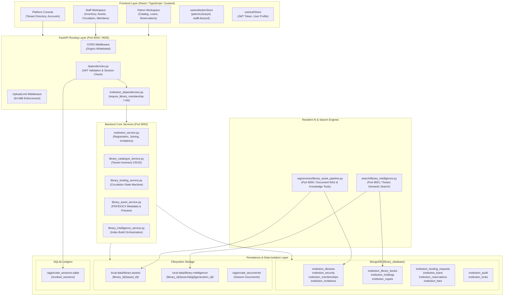
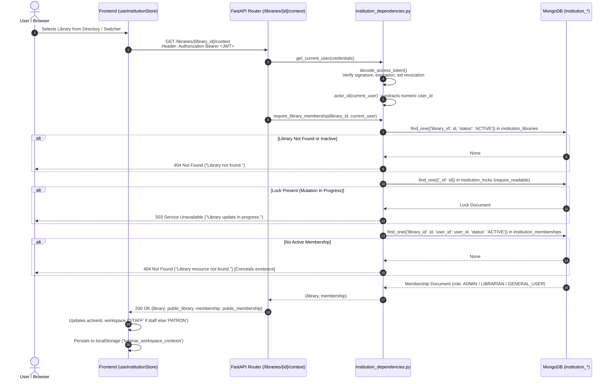
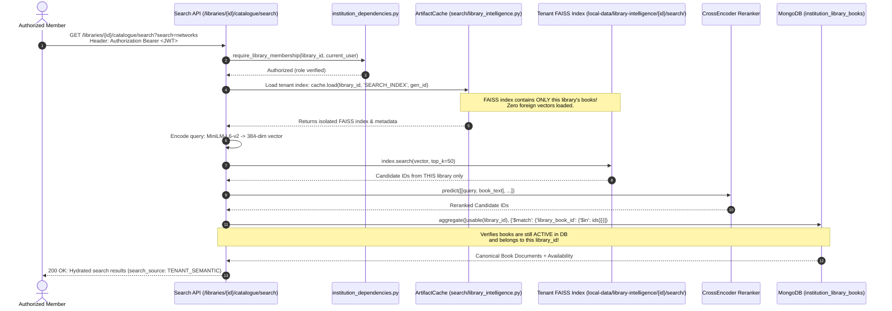
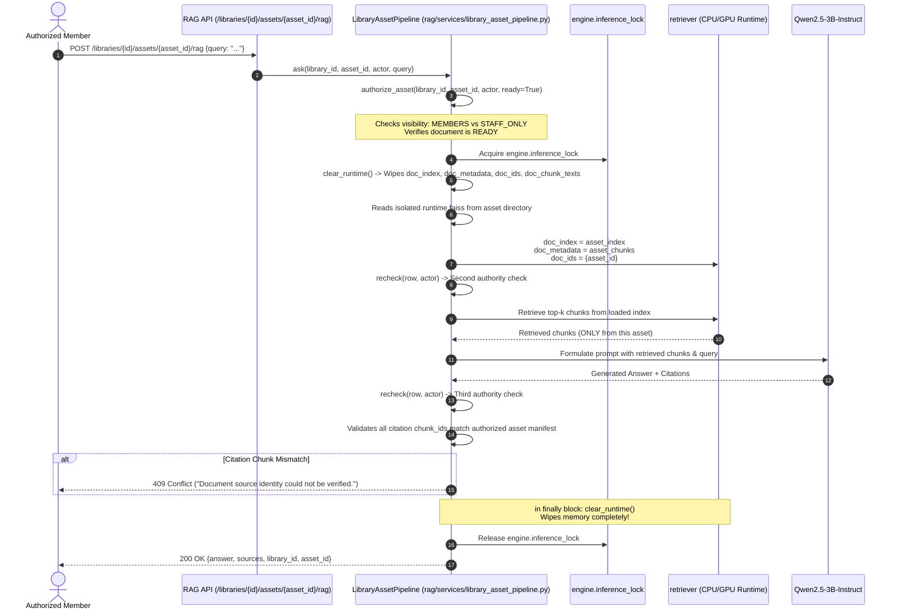

# 01 — PRIVATE LIBRARY & MULTI-TENANCY SYSTEM ARCHITECTURE

## 1. System Overview & Taxonomy

The LuminaR platform implements a **hierarchical, multi-tenant workspace architecture** designed to support both shared public catalog discovery and strictly partitioned private institutions. To evaluate the platform accurately for academic review and technical defense, distinct concepts that are often conflated in documentation must be clearly delineated:

### 1.1 Conceptual Distinctions in LuminaR

| Concept | Definition in LuminaR | Storage Mechanism | Isolation Boundary | Implemented Status |
|---|---|---|---|---|
| **Private Library / Institution** | A registered organizational tenant with its own staff, members, physical inventory, digital assets, lending policies, reservations, and private search/knowledge graph indexes. | MongoDB `institution_*` collections + Filesystem `local-data/library-intelligence/{library_id}/` & `local-data/library-assets/{library_id}/` | **Strict Backend Tenant Isolation**: Cryptographic UUIDs, per-request DB membership verification, isolated FAISS indexes, partitioned filesystem namespaces. | **VERIFIED** |
| **Personal Document Collection** | Ephemeral or session-bound user uploads for ad-hoc RAG question answering, decoupled from institutional library assets. | SQLite `rag/private_documents/registry.sqlite` + Filesystem `rag/private_documents/{doc_id}/` | **Session & Owner Isolation**: Bounded by numeric `user_id` and session ID (`sid`) in SQLite with `PRAGMA secure_delete=ON`. | **VERIFIED** |
| **Library Workspace** | The active UI and operational mode (`PATRON` vs `STAFF`) assumed by a user when interacting with a specific institution. | Frontend Zustand store (`useInstitutionStore.ts`) + LocalStorage (`luminar_workspace_contexts`) | **Client Navigation Boundary**: Revalidated against backend `/libraries/{library_id}/context` on every switch. | **VERIFIED** |
| **Multi-Tenant Library Subsystem** | The software architecture enabling multiple independent institutions to co-exist on a single deployment without cross-tenant interference. | Shared MongoDB database with collection-level namespacing (`institution_*`) + tenant scoping (`library_id`). | **Logical Multi-Tenancy (Architecture A/D Hybrid)**: Shared database with strictly scoped queries, compound unique indexes, and separate vector indexes. | **VERIFIED** |
| **Public Catalogue / Global Discovery** | Shared central bibliographic works (OpenLibrary derived) accessible to all users for reading list tracking and discovery. | MongoDB `books_collection` (`books` collection) + SQLite `catalogue.sqlite` | **Public Shared Domain**: Read-only reference catalogue. Local library inventory records can optionally link to global works via `global_work_id`. | **VERIFIED** |

---

## 2. Feature Capability Matrix

The following matrix documents the verified capabilities of the private library system across the frontend, API, backend services, database, and security enforcement layers:

| Capability | Implemented? | Frontend Component / Page | Backend Route / Handler | Database Collection / Store | Security Enforcement Mechanism |
|---|---|---|---|---|---|
| **Multiple Independent Libraries** | **VERIFIED** | `Institutions.tsx`, `useInstitutionStore.ts` | `GET /libraries`, `GET /me/libraries` (`backend/routes/institutions.py:L23-32`) | `institution_libraries` | UUID primary keys, status filtering (`status: ACTIVE`), slug normalization. |
| **User-Created Libraries** | **VERIFIED** | `Institutions.tsx` (Register Modal) | `POST /libraries/register` (`backend/routes/institutions.py:L18-21`) | `institution_libraries`, `institution_security` | Auto-assigns creator as `ADMIN`, initializes canonical defaults, serialized under `library_mutation`. |
| **Private Access Mode (Access Code)** | **VERIFIED** | `Institutions.tsx` (Join Modal) | `POST /libraries/{id}/join` (`backend/routes/institutions.py:L50-53`) | `institution_security`, `institution_attempts` | **Argon2id** password hash verification; rate-limited brute-force budget (5 attempts/15m per user, 200/15m per library). |
| **Public Access Mode (Open Join)** | **VERIFIED** | `Institutions.tsx` | `POST /libraries/{id}/join` (`backend/routes/institutions.py:L50-53`) | `institution_memberships` | Open join creates `GENERAL_USER` membership document immediately. |
| **Role-Based Membership (RBAC)** | **VERIFIED** | `InstitutionPanel.tsx`, `useInstitutionStore.ts` | `backend/institution_dependencies.py` | `institution_memberships` | Roles: `ADMIN`, `LIBRARIAN`, `GENERAL_USER`. Resolved from MongoDB on **every request**. |
| **Staff Invitation System** | **VERIFIED** | `InstitutionPanel.tsx` | `POST /libraries/{id}/invitations`, `POST /invitations/{id}/accept` (`backend/routes/institutions.py:L90-108`) | `institution_invitations` | Cryptographic raw token (`secrets.token_urlsafe(32)`), stored as SHA-256 `token_hash`. Single-use, 7-day TTL, re-validates inviter authority upon redemption. |
| **Library Switching** | **VERIFIED** | `Institutions.tsx`, `Navbar.tsx` | `GET /libraries/{id}/context` (`backend/routes/institutions.py:L44-48`) | `institution_memberships` | Frontend updates `patronLibraryId`/`staffLibraryId`; backend validates active membership, returns 404 if unauthorized. |
| **Private Inventory Management** | **VERIFIED** | `LibraryInventory.tsx` | `/libraries/{id}/inventory/*` (`backend/routes/library_inventory.py`) | `institution_library_books`, `institution_holdings`, `institution_copies` | `TenantInventory` repository wrapper rejects any cross-tenant query predicate. Compound unique indexes on `(library_id, accession_number)`. |
| **Private Digital Document Uploads** | **VERIFIED** | `LibraryAssets.tsx` | `POST /libraries/{id}/assets` (`backend/routes/library_assets.py:L33-44`) | `institution_library_assets`, `local-data/library-assets/{id}/` | 64 MiB limit, PyMuPDF validation, path traversal sanitization, isolated filesystem directory per library and asset. |
| **Private Document RAG** | **VERIFIED** | `LLMPage.tsx`, `BookReaderPage.tsx` | `POST /libraries/{id}/assets/{asset_id}/rag` (`rag/services/library_asset_routes.py:L40-48`) | Isolated `runtime.faiss` per asset generation | Loads single asset FAISS into memory under `inference_lock`; rechecks authorization before and after LLM inference; wipes runtime memory in `finally:`. |
| **Tenant Semantic Search** | **VERIFIED** | `SearchPage.tsx`, `LibraryCatalogue.tsx` | `GET /libraries/{id}/catalogue/search` (`search/library_intelligence_api.py:L19-24`) | `local-data/library-intelligence/{id}/search/{gen}/index.faiss` | **Pre-filtering / Dedicated Index**: Searches ONLY the tenant's dedicated FAISS index. Zero cross-tenant candidate retrieval. |
| **Tenant Knowledge Graph** | **VERIFIED** | `LibraryGraph.tsx` | `GET /libraries/{id}/intelligence/graph` (`backend/routes/library_intelligence.py`) | `local-data/library-intelligence/{id}/kg/{gen}/graph.json` | Generated exclusively from the library's active catalogue records. Foreign books strictly excluded. |
| **Lending & Circulation Isolation** | **VERIFIED** | `LibraryCirculation.tsx` | `/libraries/{id}/lending/*`, `/libraries/{id}/loans/*` (`backend/routes/library_lending.py`) | `institution_lending_requests`, `institution_loans` | Scoped by `library_id`; atomic state machine serialized under `library_mutation` lock; durable journal reconciliation. |
| **Reservations & Fees Isolation** | **VERIFIED** | `LibraryReservationsFees.tsx` | `/libraries/{id}/reservations*`, `/libraries/{id}/staff/fees*` (`backend/routes/library_reservations_fees.py`) | `institution_reservations`, `institution_fees` | Scoped by `library_id`; queue sequence ordered per book holding; atomic fee adjustments/waivers restricted to library staff. |
| **Platform Console Isolation** | **VERIFIED** | `PlatformConsole.tsx`, `PlatformLibraries.tsx` | `/platform/*` (`backend/routes/platform.py`) | `platform_role_assignments` | Requires explicit `PLATFORM_ADMIN` record with approval metadata. Platform admins CANNOT read private library contents without explicit membership (concealed via 404). |
| **Audit Logging & Security Trail** | **VERIFIED** | `InstitutionPanel.tsx` (Audit Tab) | `GET /libraries/{id}/audit` (`backend/routes/institutions.py:L110-113`) | `institution_audit` | Tamper-evident append-only log with metadata whitelist preventing credential leakage. Scoped to `library_id`. |

---

## 3. Authoritative Access Context Derivation

A fundamental security question in multi-tenant architectures is: **Where does the active library context originate, and how does the backend verify that the client has authority to access it?**

```
                       AUTHORITY RESOLUTION IN LUMINAR
                       
   [ Client HTTP Request ]
              │
              ├── 1. Authorization: Bearer <JWT>
              │         └── backend/dependencies.py: get_current_user
              │               └── jwt_utils.py: decode_access_token (HS256)
              │                     └── Checks sid in sqlite revoked_sessions
              │                     └── Validates exp, sub (numeric user_id)
              │                     └── Authoritative Identity: user['sub']
              │
              ├── 2. URL Path: /libraries/{library_id}/...
              │         └── FastAPI path parameter validates canonical UUID format
              │         └── URL Path is the AUTHORITATIVE TENANT IDENTIFIER
              │
              └── 3. backend/institution_dependencies.py: require_library_membership
                        └── Queries MongoDB: institution_libraries {'library_id', 'status': 'ACTIVE'}
                        └── Checks library_mutation locks: require_readable(library_id)
                        └── Queries MongoDB: institution_memberships {'library_id', 'user_id', 'status': 'ACTIVE'}
                        └── If invitation-granted, verifies proof in institution_invitations
                        └── IF NO MEMBERSHIP: Raises HTTPException(404, 'Library resource not found.')
```

### Critical Architectural Finding: Zero Trust in Client Headers or JWT Tenant Claims
1. **The JWT does NOT contain `library_id` or tenant permissions.** 
   - Code evidence: [backend/utils/jwt_utils.py:L26-33](file:///d:/SDC/LibraryLLM/backend/utils/jwt_utils.py#L26-L33) encodes only `sub`, `email`, `role`, `sid`, `iat`, `exp`.
   - Architectural rationale: If tenant permissions were embedded in the JWT, revoking a member or rotating permissions would leave a window of vulnerability until token expiration (30-60 minutes).
2. **The backend NEVER trusts a client-supplied `library_id` without verifying membership on that exact request.**
   - Code evidence: [backend/institution_dependencies.py:L18-45](file:///d:/SDC/LibraryLLM/backend/institution_dependencies.py#L18-L45) queries `institution_memberships` in MongoDB on **every single sensitive API call**.
   - If a member is suspended or removed in the database, their next API request is rejected **immediately**, even with a valid JWT.
3. **Information Concealment (404 instead of 403):**
   - Code evidence: [backend/institution_dependencies.py:L41-44](file:///d:/SDC/LibraryLLM/backend/institution_dependencies.py#L41-L44):
     ```python
     if not membership:
         # Conceal the existence of protected resources from outsiders, including global admins.
         raise HTTPException(404, 'Library resource not found.')
     ```
   - If an unauthenticated user or outsider attempts to probe another library's endpoints, the backend returns `404 Not Found`, preventing enumeration of private libraries and their assets.

---

## 4. End-to-End System Diagrams

### 4.1 Overall Multi-Library Architecture



---

### 4.2 Library Selection and Authorization Flow



---

### 4.3 Dataset Ingestion and Index Isolation Flow

```mermaid
flowchart TD
    subgraph Ingestion ["Staff CSV / MARC Catalog Import"]
        A[Staff Uploads Catalogue File] --> B[POST /libraries/{id}/inventory/imports/preview]
        B --> C[require_library_staff: Check ADMIN/LIBRARIAN]
        C --> D[library_inventory_import.py: Parse rows, ISBN check]
        D --> E[POST /libraries/{id}/inventory/imports/{import_id}/apply]
        E --> F[TenantInventory.insert: Writes institution_library_books]
    end

    subgraph Fingerprint ["Intelligence Target Staling"]
        F --> G[Fingerprint Change Detected: SHA256 of canonical records]
        G --> H[institution_targets: Marks SEARCH_INDEX and KG as STALE]
    end

    subgraph Build ["Background Worker (TenantIntelligence)"]
        I[Staff Requests Index Build] --> J[POST /libraries/{id}/intelligence/builds]
        J --> K[require_library_role: ADMIN only]
        K --> L[Claims job under lease & fence_token]
        L --> M[Extracts local records ONLY for library_id]
        M --> N[Generates MiniLM Embeddings: 384-dim normalized]
        N --> O[Builds Isolated FAISS Index]
        O --> P[Writes to temporary folder: {generation_id}.building]
        P --> Q[Validates integrity & checksums]
        Q --> R[Atomic rename to: local-data/library-intelligence/{id}/search/{gen}/]
        R --> S[Updates institution_targets: status = READY]
    end
```

---

### 4.4 Semantic Search Isolation Flow (Dedicated Index Architecture)



---

### 4.5 RAG Execution and Runtime Isolation Boundary



---

### 4.6 Library Switching Context Preservation & Purge

```mermaid
flowchart TD
    A[User clicks 'Switch Library' in UI] --> B[Calls useInstitutionStore.select(target_library_id)]
    B --> C[API: GET /libraries/{target_id}/context]
    C --> D{User has active membership?}
    D -- No --> E[Throws Error: 'Active membership required']
    D -- Yes --> F[Returns updated Library & Membership]
    F --> G[Determines workspace: STAFF or PATRON]
    G --> H[Updates store: activeId = target_id, workspace = STAFF/PATRON]
    H --> I[Persists to localStorage: 'luminar_workspace_contexts']
    I --> J[Purges Stale State Across Stores]
    J --> K[useLibraryStore: clearUserData() - resets active loans & book state]
    J --> L[useAssistantStore: syncOwner() - updates assistant session context]
    J --> M[window.dispatchEvent('luminar-documents-cleared')]
    M --> N[Navigates user to target workspace dashboard]
```

---

### 4.7 Security Enforcement Boundaries

```mermaid
graph LR
    subgraph Boundary_1 ["Boundary 1: Network & Protocol"]
        CORS["CORS Whitelist (localhost:3000, 5173)"]
        UploadCap["MAX_FILE_BYTES: 64 MiB Cap"]
    end

    subgraph Boundary_2 ["Boundary 2: Authentication"]
        JWT["JWT Signature (HS256)"]
        Revoke["SQLite Session Revocation Check"]
        Expiry["Token Expiration (30m / 60m)"]
    end

    subgraph Boundary_3 ["Boundary 3: Tenant Authorization"]
        DB_Member["MongoDB Active Membership Check"]
        Role_Guard["Role Verification (ADMIN/LIBRARIAN/GENERAL_USER)"]
        Conceal["Information Concealment (404 on Unauthorized)"]
    end

    subgraph Boundary_4 ["Boundary 4: Concurrency & Mutation"]
        Mut_Lock["MongoDB Locks Collection (library_mutation)"]
        Durable["WriteConcern: w=1, j=True"]
        ReadBarrier["require_readable (503 if mutating)"]
    end

    subgraph Boundary_5 ["Boundary 5: Database Scoping"]
        TenantInv["TenantInventory.scope() Wrapper"]
        CompIdx["Compound Unique Indexes (library_id, ...)"]
        Audit["Append-Only Audit Trail (institution_audit)"]
    end

    subgraph Boundary_6 ["Boundary 6: Storage & AI Isolation"]
        PathSan["Canonical UUID & resolve() Path Traversal Guards"]
        FAISS_Iso["Dedicated FAISS Indexes per Tenant/Asset"]
        MemWipe["clear_runtime() Memory Purge on RAG Completion"]
    end

    Boundary_1 --> Boundary_2 --> Boundary_3 --> Boundary_4 --> Boundary_5 --> Boundary_6
```



---

## 5. Architectural Findings Summary

1. **Multi-Tenancy Model**: LuminaR uses a **hybrid multi-tenancy model**. For structured relational data (catalog, loans, reservations, memberships), it uses **Shared Database, Shared Prefixed Collections** with programmatic `library_id` query scoping and compound unique indexes. For unstructured and vector data (search indexes, knowledge graphs, digital PDFs), it uses **Dedicated Filesystem & Dedicated Vector Index Isolation**.
2. **Authoritative Scope**: The URL path `/libraries/{library_id}` is the authoritative identifier. Possession of a valid JWT grants account identity only; library access is dynamically queried from MongoDB on every request.
3. **Fail-Closed Security Posture**: If an unexpected exception occurs during mutation or build, locks fail closed, requiring manual operator reconciliation rather than granting unverified authority.
