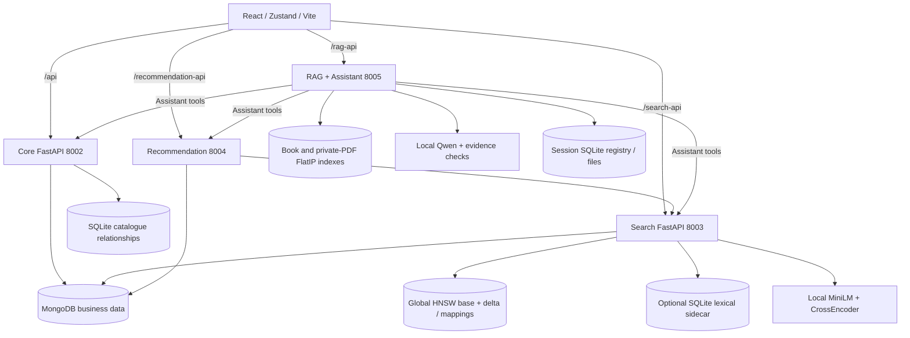
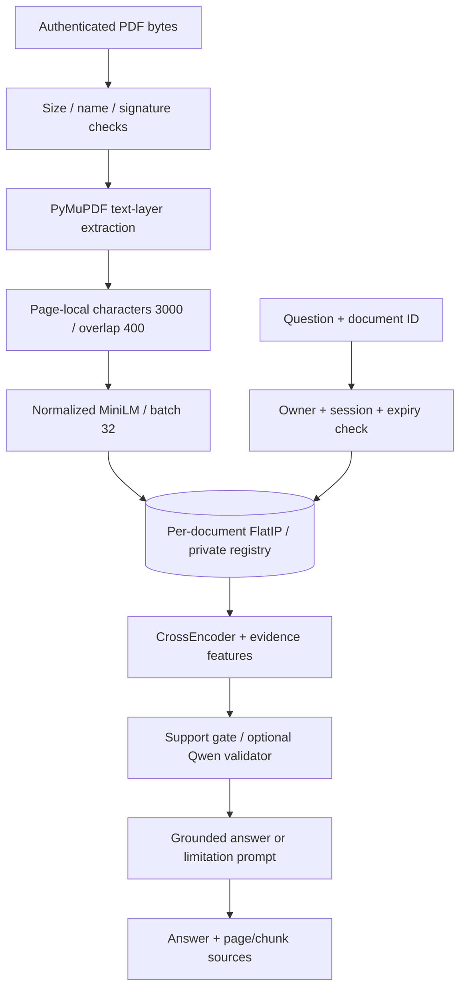
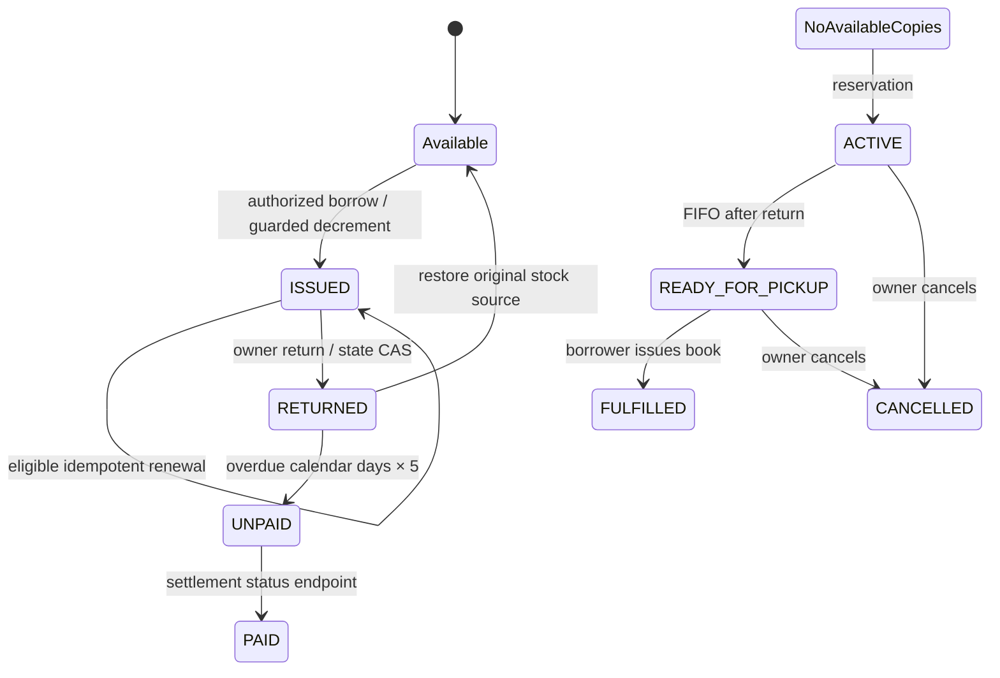
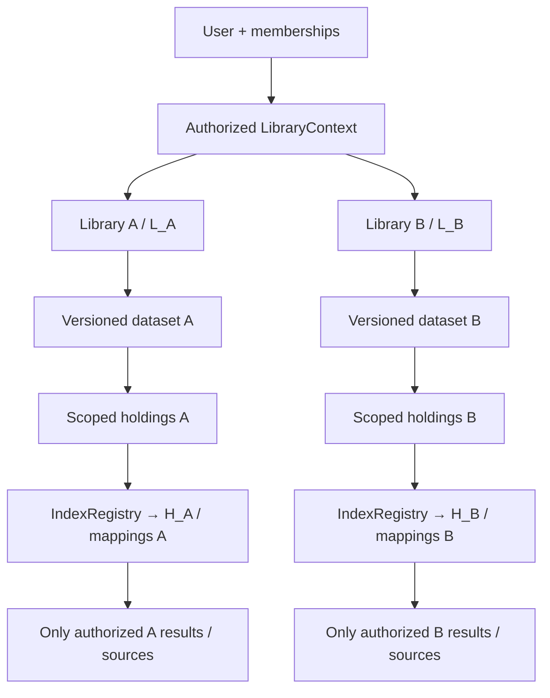
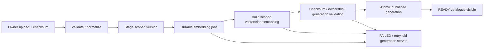

# Paper figure specifications

Figures below are source-supported topology or explicitly proposed architecture. Use consistent labels and captions; export final publication figures as SVG/PDF through a diagram tool. No latency/accuracy values should appear without measured sources.

## Figure 1 — Implemented LuminaR architecture

Caption: Four APIs share identity/business records while catalogue ANN and resource QA use different index structures. Optional lexical path must be dashed in final artwork. Evidence: frontend/vite.config.ts; backend/main.py; search/api.py; recommendation/api.py; rag/api.py; assistant/tools.py.

## Figure 2 — Implemented catalogue retrieval

```mermaid
flowchart LR
 Q[Authenticated query] --> E[Normalized MiniLM 384]
 E --> S[Capture immutable snapshot]
 S --> ANN[Base + delta HNSW]
 ANN --> MAP[Labels → work IDs / override suppression]
 MAP --> LIVE[Current Mongo validation / bounded overfetch]
 LIVE --> CE[CrossEncoder + optional lexical tiers]
 CE --> HYDRATE[Live facts / inventory]
 HYDRATE --> PAGE[Bounded 50-pool / 10-result pages]
```

Draw lexical title/author lookup as an optional side input before CE. Mark physical inventory filtering after global retrieval; do not label it isolated library ANN. Show versioned cache around ranking separately from live fact hydration.

## Figure 3 — Implemented private document QA

Caption must say text extraction, not OCR. Overlay inference lock/session binding; optional ciphertext export/restore is a separate lifecycle inset.

## Figure 4 — Implemented circulation workflow

This diagram summarizes multiple collections rather than one transactional state machine. Caption the stock/issue/fine side-effect failure windows and absence of financial processing.

## Figure 5 — PROPOSED private libraries

Caption: Proposed institution ownership and retrieval isolation, not current deployed capability. Global bibliographic Work records may be referenced by both holding branches; private text/metadata is scoped. Separate user-personal PDF ownership from library-shared corpus boxes.

## Figure 6 — PROPOSED dataset publication and recovery

Add a dotted edge from failure to resumable job; add previous generation/rollback inset. Never suggest Mongo transaction includes filesystem graph construction. Supplementary figure candidates: snapshot base/delta tombstones, book entitlement matrix, cache restore/key-version flow, library switching/new-chat context, and measured latency/recall Pareto plot after experiments.
