# LuminaR — Repository Architecture & Service Topology

> **Audit Report:** Part 1 Research Evidence Audit  
> **Repository Root:** `d:\SDC\LibraryLLM`  
> **Scope:** Directory Structure, Entry Points, Network Ports, Active vs. Legacy Services, and Runtime Dependencies  

---

## 1. Meaningful Repository Directory Tree

The core repository codebase lives under `LibraryLLM/`. Below is the architectural tree of active and notable directories, omitting non-informative vendor directories (`node_modules/`, `.venv/`, `__pycache__/`, `.pytest_cache/`):

```
LibraryLLM/
├── backend/                             # Core Circulation, Auth, Institution & Platform Service (Port 8002)
│   ├── main.py                          # FastAPI application entry point, lifecycle hooks & router mounting
│   ├── dependencies.py                  # Core JWT authentication & user dependency injection
│   ├── institution_dependencies.py      # Multi-tenant library membership & security dependencies
│   ├── platform_dependencies.py         # Global platform admin authorization dependencies
│   ├── database/
│   │   └── mongodb.py                   # PyMongo client initialization & collection references
│   ├── routes/                          # 25 HTTP route controllers
│   │   ├── auth.py                      # Registration, login, OTP verification, password setup, logout
│   │   ├── institutions.py              # Library registration, discovery, joining, staff invitation
│   │   ├── library_catalogue_experience.py # Tenant-scoped catalogue browsing, home, recommendations
│   │   ├── library_inventory.py         # Tenant inventory CRUD, copy controls, CSV/XLSX import
│   │   ├── library_lending.py           # Approval circulation: borrow requests, loans, returns, renewals
│   │   ├── library_reservations_fees.py # Waiting queues, fee policies, waivers, adjustments, payments
│   │   ├── library_assets.py            # Digital asset management (PDF/EPUB/DOC uploads)
│   │   ├── library_analytics.py         # Tenant circulation & desk analytics dashboards
│   │   ├── library_events.py            # Tenant event scheduling & publishing
│   │   ├── platform.py                  # Platform console: library lifecycle, account directory
│   │   ├── notifications.py             # In-app notifications & platform broadcast operations
│   │   ├── books.py                     # Global catalogue book lookup & category listings
│   │   ├── reading_list.py              # User personal reading list CRUD
│   │   ├── knowledge_graph.py           # Bipartite metadata graph routes (/experimental/kg & /kg)
│   │   ├── assistant_catalogue.py       # Exact catalogue entity resolver for assistant tool calling
│   │   ├── activity.py                  # Public/tenant recent circulation activity feed
│   │   ├── know_more.py                 # RAG-eligible book discovery for authenticated patrons
│   │   ├── issues.py                    # [LEGACY] Single-tenant un-scoped book issuing
│   │   ├── reservations.py              # [LEGACY] Single-tenant un-scoped book reservations
│   │   ├── fines.py                     # [LEGACY] Single-tenant un-scoped fine calculation
│   │   └── inventory.py                 # [LEGACY] Single-tenant un-scoped inventory manager
│   ├── schemas/                         # Pydantic request/response validation schemas
│   └── services/                        # Business logic & repository access layers (58 modules)
│       ├── institution_service.py       # Library lifecycle, membership & invitation logic
│       ├── institution_repository.py    # Multi-tenant MongoDB repository with durable locks
│       ├── library_catalogue_service.py # Tenant inventory insertion, linking, copy creation
│       ├── library_inventory_import.py  # Bounded CSV/XLSX parser with dry-run previews
│       ├── library_lending_service.py   # State machine for borrow/return approvals
│       ├── library_lending_journal.py   # Write-ahead operation journal for standalone Mongo
│       ├── library_fee_service.py       # Integer minor-unit fee ledger & calculation
│       ├── library_reservation_service.py # Queue ordering & copy return advancement
│       ├── library_asset_service.py     # Asset disk storage & visibility rules
│       ├── library_analytics_service.py # Aggregated metrics calculation
│       ├── library_event_service.py     # Event publication state machine
│       ├── notification_service.py      # In-app notification creation & delivery
│       ├── notification_worker.py       # Background thread checking loan due dates
│       ├── tenant_notification_worker.py# Background thread checking tenant loan due dates
│       ├── email_service.py             # Brevo API transactional OTP delivery
│       └── auth_service.py              # Password hashing, token generation & verification
│
├── search/                              # 5M Catalogue Semantic Search Service (Port 8003)
│   ├── api.py                           # FastAPI search service entry point
│   ├── luminar_search.py                # LuminaRSearchEngine: Bi-Encoder + Cross-Encoder pipeline
│   ├── index_manager.py                 # FAISS IndexHNSWFlat manager with base + delta snapshots
│   ├── sync_queue.py                    # SQLite write-ahead queue for catalogue mutations
│   ├── embedding_cache.py               # SQLite cache for 384-D query and title embeddings
│   ├── ranked_pages.py                  # Search pagination & bounded slicing
│   ├── lexical_store.py                 # [EXPERIMENTAL] SQLite inverted index store for BM25
│   ├── lexical_delta.py                 # [EXPERIMENTAL] Real-time lexical delta updates
│   ├── lexical_integration.py           # [EXPERIMENTAL] Hybrid dense-sparse candidate fusion
│   └── typo_assistance.py               # Fuzzy query correction helpers
│
├── recommendation/                      # Multi-Factor Recommendation Service (Port 8004)
│   ├── api.py                           # FastAPI recommendation service entry point
│   ├── recommendation_service.py        # 8-factor hybrid scoring, profile builder, feedback weights
│   └── ranked_pages.py                  # Paged recommendation cache
│
├── rag/                                 # Document Intelligence & RAG QA Service (Port 8005)
│   ├── api.py                           # FastAPI RAG service entry point (also mounts Assistant)
│   ├── qa.py                            # LuminaRAG engine orchestrating retrieval, reranking & LLM
│   ├── llm.py                           # LuminaRLLM: Qwen2.5-3B-Instruct (4-bit NF4) + lm-format-enforcer
│   ├── retriever.py                     # FAISS IndexFlatIP retriever over book and document chunks
│   ├── reranker.py                      # Cross-Encoder (ms-marco-MiniLM-L-6-v2) scoring engine
│   ├── evidence.py                      # Evidence scoring, concept mapping & fact verification
│   ├── fast_filter.py                   # Pre-retrieval candidate pruning
│   ├── document_latency.py              # Telemetry & performance profiler for document QA
│   ├── book_assets.py                   # Catalogue book metadata & chunk mapping
│   ├── private_documents/               # Directory storing session-isolated upload artifacts & registry.sqlite
│   ├── books/                           # 18 full-text public domain novel text files
│   ├── book_chunks/                     # Pre-chunked JSON text segments of domain books
│   ├── book_index/                      # Pre-built FAISS IndexFlatIP index for domain books
│   └── services/                        # Study tools & document management
│       ├── private_documents.py         # Session upload lifecycle, isolated FAISS indices, cleanup
│       ├── private_document_routes.py   # Upload, export, delete, cache inspection endpoints
│       ├── private_document_ocr.py      # Tesseract OCR fallback for scanned PDFs
│       ├── document_service.py          # PyMuPDF parser, chunking, and MiniLM embedding
│       ├── document_knowledge.py        # Deterministic study model builder (concepts, summaries)
│       ├── knowledge_artifacts.py       # Artifact persistence (mind maps, flashcards, quizzes)
│       ├── knowledge_quiz.py            # Quiz generation orchestrator
│       ├── knowledge_mcq.py             # Multiple-choice distractor generation
│       ├── knowledge_cloze.py           # Fill-in-the-blank extraction
│       ├── cloze_grading.py             # Semantic sentence embedding grading engine
│       ├── knowledge_match.py           # Match-the-following pairing engine
│       ├── knowledge_routes.py          # Knowledge tool HTTP endpoints
│       ├── library_asset_routes.py      # Digital asset routes mounted in RAG app
│       └── local_document_cache.py      # Client IndexedDB / OPFS cache fingerprinting
│
├── assistant/                           # Conversational AI Assistant Module (Mounted in Port 8005)
│   ├── api.py                           # install_assistant(): mounts /assistant/chat into Port 8005
│   ├── orchestrator.py                  # AssistantOrchestrator: multi-turn dialogue, tool dispatch
│   ├── tools.py                         # Typed HTTP adapters into Services 8002, 8003, 8004 & local RAG
│   ├── qwen.py                          # QwenGateway: conversational prompting & generation
│   ├── schemas.py                       # Pydantic schemas for intents, actions, tools & responses
│   ├── state.py                         # In-memory ConversationStore with thread locks
│   ├── selected_context.py              # Multi-book selection tray context injector
│   ├── lending_boundary.py              # Assistant-mediated borrow & return proposal generator
│   ├── reservation_boundary.py          # Assistant-mediated reservation proposal generator
│   ├── ROUTER_FREEZE.md                 # Technical governance document freezing router research
│   ├── router_v2.py                     # [ARCHIVED/EXPERIMENT] V2 router variant
│   ├── router_v2_legacy.py              # [LEGACY/DEAD] Deprecated V2 router implementation
│   ├── router_v3.py                     # [EXPERIMENT/FROZEN] Router V3 variant
│   ├── router_v4.py                     # [EXPERIMENT/FROZEN] Router V4 variant
│   └── router_v5/                       # [EXPERIMENT/FROZEN] Router V5 hybrid gateway
│
├── chatbot/                             # [DEAD/EMPTY] Abandoned directory (all logic in assistant/)
│
├── knowledge_graph/                     # Bipartite Metadata Catalogue Graph (SQLite-backed)
│   ├── core.py                          # CatalogueGraph: 2-hop graph reasoning, cosine similarity
│   ├── relations.py                     # Typed relation predicates (author, subject, topic)
│   ├── topics.py                        # TF-IDF topic extraction from book descriptions
│   ├── metrics.py                       # Overlap & rank correlation metrics
│   └── data/
│       └── catalogue.sqlite             # Read-only SQLite database storing graph nodes & edges
│
├── datasets/                            # Persistent Data, Models & Vector Indices
│   └── ai/
│       ├── faiss/
│       │   ├── hnsw/
│       │   │   ├── hnsw.index           # 9.04 GB FAISS IndexHNSWFlat (5,000,000 vectors)
│       │   │   ├── index_work_ids.npy   # 67.8 MB NumPy array of OpenLibrary work_ids
│       │   │   ├── hnsw_metadata.json   # Index build parameters (M=32, ef=200, dim=384)
│       │   │   ├── active_index.json    # Active version pointer
│       │   │   └── sync_queue.sqlite3   # Mutation write-ahead log
│       │   └── faiss.index              # 7.68 GB flat index snapshot
│       ├── metadata/
│       │   └── book_metadata.duckdb     # DuckDB database of 5M book metadata records
│       └── mappings/
│           └── isbn_lookup.duckdb       # DuckDB ISBN-to-work mapping table
│
├── frontend/                            # React 19 Web Application (Vite 6 on Port 5173)
│   ├── package.json                     # Frontend dependencies (React 19, Tailwind v4, Lucide)
│   ├── vite.config.ts                   # Proxy configuration routing to 8002, 8003, 8004, 8005
│   └── src/
│       ├── App.tsx                      # Root application router with 30+ pages & layouts
│       ├── main.tsx                     # React root DOM mount
│       ├── store/                       # Zustand state management stores
│       │   ├── useAuthStore.ts          # Authentication token, user profile & session
│       │   ├── useAssistantStore.ts     # Conversational assistant state & selection tray
│       │   ├── useInstitutionStore.ts   # Active tenant library context & memberships
│       │   ├── useLibraryStore.ts       # Patron active loans, reading list, fines
│       │   └── usePlatformStore.ts      # Platform administrator state
│       ├── lib/                         # Network clients & utility helpers
│       │   ├── api.ts                   # Core API HTTP transport & type declarations
│       │   ├── assistant.ts             # Assistant chat transport & payload sanitization
│       │   ├── knowledgeArtifacts.ts    # Study tools HTTP transport (mind map, quiz, cloze)
│       │   └── libraryCatalogue.ts      # Tenant catalogue fetchers & mutation commands
│       ├── pages/                       # 38 full React page views
│       │   ├── Home.tsx                 # Homepage with global/tenant catalogue hero & carousels
│       │   ├── CatalogPage.tsx          # 5M-book catalogue browsing page
│       │   ├── SearchPage.tsx           # Semantic search query execution view
│       │   ├── LLMPage.tsx              # Document & Book RAG workspace with study tools
│       │   ├── Institutions.tsx         # Library discovery & registration portal
│       │   ├── LibraryCatalogue.tsx     # Tenant-scoped catalogue, genres & detail views
│       │   ├── LibraryInventory.tsx     # Librarian inventory table & CSV/XLSX import modal
│       │   ├── LibraryCirculation.tsx   # Desk approval queue for borrow & return requests
│       │   ├── LibraryReservationsFees.tsx # Waiting queues & fee ledger desk
│       │   ├── LibraryAnalyticsPage.tsx # Tenant circulation analytics dashboard
│       │   ├── LibraryAssets.tsx        # Tenant digital assets manager
│       │   ├── PlatformConsole.tsx      # Platform administrator console
│       │   ├── EventsPage.tsx           # Library events public listing & details
│       │   └── KnowledgeGraphPage.tsx   # Interactive catalogue graph exploration
│       └── components/                  # Reusable UI component library (49 components)
│           ├── AIChatWidget.tsx         # Persistent floating conversational assistant widget
│           ├── Header.tsx               # Primary application navigation & library context
│           ├── LibrarySwitcher.tsx      # Tenant library switcher dropdown
│           ├── NotificationCenter.tsx   # In-app notification drawer
│           ├── knowledge/               # Knowledge Tools components
│           │   ├── KnowledgeTools.tsx   # Tabs for Key Concepts, Summary, Flashcards, Quiz, Map
│           │   ├── Quiz.tsx             # Interactive quiz UI (MCQ, Cloze, Matching)
│           │   └── KnowledgeMap.tsx     # SVG hierarchical concept mind map visualizer
│           └── rag/
│               └── RAGAnswer.tsx        # RAG answer presentation with sources & confidence
│
├── tests/                               # Comprehensive Backend Pytest Suite (69 test files)
│   ├── institution_v1/ ... v2f/         # Tenant migration & circulation verification suites
│   ├── test_assistant_backend.py        # Assistant tool calling & response contracts
│   ├── test_knowledge_artifacts.py      # Artifact extraction & persistence tests
│   ├── test_cloze_v2_3.py               # Semantic cloze grading accuracy tests
│   └── test_semantic_sync.py            # HNSW write-ahead queue synchronization tests
│
└── frontend/tests/                      # Comprehensive Frontend Vitest Suite (36 test files)
```

---

## 2. System Entry Points

| Process / Service | Working Directory | Shell Launch Command | Port | Description |
|---|---|---|---|---|
| **Core Circulation API** | `d:\SDC\LibraryLLM` | `uvicorn backend.main:app --host 127.0.0.1 --port 8002` | `8002` | Primary FastAPI backend handling Auth, Institutions, Circulation, Inventory, Fines, Events, Notifications, and DuckDB/Mongo storage. |
| **Catalogue Search API** | `d:\SDC\LibraryLLM` | `uvicorn search.api:app --host 127.0.0.1 --port 8003` | `8003` | Dedicated vector search backend hosting the 5M-vector FAISS `IndexHNSWFlat`, Sentence-Transformers Bi-Encoder, Cross-Encoder reranker, and HNSW sync queue. |
| **Recommendation API** | `d:\SDC\LibraryLLM` | `uvicorn recommendation.api:app --host 127.0.0.1 --port 8004` | `8004` | Decoupled recommendation service calculating 8-factor behavioral user recommendations and diversity re-ranking. |
| **RAG QA & Assistant API**| `d:\SDC\LibraryLLM` | `uvicorn rag.api:app --host 127.0.0.1 --port 8005` | `8005` | AI reasoning server hosting `Qwen2.5-3B-Instruct` (4-bit NF4), PyMuPDF document processor, Study Tools synthesizer, and the `AssistantOrchestrator` chatbot. |
| **Frontend Web App** | `d:\SDC\LibraryLLM\frontend` | `npm run dev -- --host 0.0.0.0` | `5173` | Vite 6 development web server serving the React 19 application and proxying `/api`, `/search-api`, `/recommendation-api`, and `/rag-api`. |

---

## 3. Frontend Architecture

- **Core Framework:** React 19 (`19.0.0`), TypeScript (`5.6.3`), Vite 6 (`6.1.1`).
- **Styling System:** TailwindCSS v4 (`@tailwindcss/vite`), custom CSS modules for workspaces (`styles/workspaces.css`, `styles/product.css`).
- **State Management:** Zustand (`4.5.5`):
  - `useAuthStore`: Manages JWT access tokens, authenticated user payload, and session revocation.
  - `useAssistantStore`: Manages active conversation IDs, message turn streams, recent work IDs, and the 4-item Selected Books tray.
  - `useInstitutionStore`: Manages current tenant library context, active role (`PATRON` vs `STAFF` vs `ADMIN`), and pending invitations.
  - `useLibraryStore`: Manages reader personal loans, reservations, fines, and reading list.
  - `usePlatformStore`: Manages platform console navigation and administrative authority.
- **Routing:** React Router DOM v7 (`7.1.1`):
  - Global routes: `/`, `/catalog`, `/search`, `/book/:workId`, `/book/:workId/read`, `/reading-list`, `/llm`.
  - Tenant Patron workspace: `/libraries/:libraryId/*` (`catalogue`, `loans`, `reservations`, `fees`, `resources`, `events`).
  - Tenant Staff workspace: `/staff/libraries/:libraryId/*` (`overview`, `inventory`, `circulation`, `reservations`, `fees`, `events`, `assets`, `analytics`, `members`, `settings`).
  - Platform Administrator console: `/platform/*` (`libraries`, `accounts`, `catalogue`, `notifications`, `history`).
- **Vite Reverse Proxy (`vite.config.ts`):**
  - `/api/*` $\rightarrow$ `http://127.0.0.1:8002` (Core API)
  - `/search-api/*` $\rightarrow$ `http://127.0.0.1:8003` (Search API)
  - `/recommendation-api/*` $\rightarrow$ `http://127.0.0.1:8004` (Recommendation API)
  - `/rag-api/*` $\rightarrow$ `http://127.0.0.1:8005` (RAG & Assistant API)

---

## 4. Backend Microservice Architecture

```mermaid
flowchart TB
    subgraph Browser ["Web Client (Browser)"]
        UI["React 19 SPA (Port 5173)"]
    end

    subgraph ServiceCore ["Core Library Service (:8002)"]
        CoreMain["backend.main:app"]
        AuthMod["Auth & Session Controller"]
        InstMod["Institution & Membership Controller"]
        LendMod["Approval Lending & Journal"]
        InvMod["Inventory & CSV/XLSX Importer"]
        FeeMod["Integer Minor-Unit Fee Engine"]
        WorkerDue["DueWorker & TenantWorker"]
    end

    subgraph ServiceSearch ["Search Service (:8003)"]
        SearchMain["search.api:app"]
        SearchEngine["LuminaRSearchEngine"]
        HNSW["FAISS IndexHNSWFlat (5M)"]
        SyncQ["SyncQueue (SQLite)"]
        MiniLM_Search["all-MiniLM-L6-v2 (GPU/CPU)"]
        CrossEnc_Search["ms-marco-MiniLM-L-6-v2"]
    end

    subgraph ServiceRec ["Recommendation Service (:8004)"]
        RecMain["recommendation.api:app"]
        RecService["8-Factor Hybrid Scorer"]
        RecRanker["Diversity Re-ranker"]
    end

    subgraph ServiceRAG ["RAG & AI Service (:8005)"]
        RAGMain["rag.api:app"]
        LuminaRAGEngine["LuminaRAG QA Pipeline"]
        QwenLLM["Qwen2.5-3B-Instruct (4-bit NF4)"]
        PrivDoc["Private Documents Service"]
        KnowArt["Knowledge Artifacts Generator"]
        AssistantOrch["AssistantOrchestrator"]
    end

    subgraph DataStorage ["Persistent Storage"]
        Mongo[(MongoDB: luminar_library)]
        Duck[(DuckDB Metadata: 5M Books)]
        HNSWFile[("hnsw.index (9.04 GB)")]
        LocalAssets[("local-data/library-assets")]
    end

    UI --> CoreMain
    UI --> SearchMain
    UI --> RecMain
    UI --> RAGMain

    CoreMain --> Mongo
    CoreMain --> Duck
    CoreMain --> LocalAssets

    SearchMain --> HNSW
    SearchMain --> MiniLM_Search
    SearchMain --> CrossEnc_Search
    SearchMain --> SyncQ
    SearchMain --> Mongo

    RecMain --> Mongo
    RecMain --> SearchMain

    RAGMain --> QwenLLM
    RAGMain --> PrivDoc
    RAGMain --> KnowArt
    RAGMain --> AssistantOrch

    AssistantOrch --> CoreMain
    AssistantOrch --> SearchMain
    AssistantOrch --> RecMain
    AssistantOrch --> LuminaRAGEngine
```



---

## 5. Active Services vs. Legacy Services Breakdown

### 5.1 Active Production Services
- **Multi-Tenant Institution Infrastructure (`backend/routes/institutions.py`, `backend/services/institution_service.py`):** Canonical path for library registration, membership, access security, and staff delegation.
- **Approval Lending & Write-Ahead Journal (`backend/routes/library_lending.py`, `backend/services/library_lending_journal.py`):** Authoritative path for borrow requests, staff approvals, loans, and returns.
- **Tenant Inventory & Bulk Importer (`backend/routes/library_inventory.py`, `backend/services/library_inventory_import.py`):** Authoritative path for managing library inventory and spreadsheet imports.
- **5M HNSW Semantic Search Engine (`search/luminar_search.py`, `search/index_manager.py`):** Production catalogue search engine with snapshot synchronization.
- **Grounded Qwen RAG QA (`rag/qa.py`, `rag/llm.py`):** Production question answering with JSON schema validation.
- **Conversational Assistant (`assistant/orchestrator.py`, `assistant/tools.py`):** Production multi-turn assistant running in `ASSISTANT_ROUTER_MODE=existing_qwen`.
- **Knowledge Tools (`rag/services/knowledge_artifacts.py`, `document_knowledge.py`):** Production CPU-based study tool synthesis.

### 5.2 Legacy & Compatibility Services (Maintained for Backward Compatibility)
- **`backend/routes/issues.py` / `backend/services/issue_service.py`:** Legacy un-scoped single-library book checkout. Kept for backward compatibility with existing tests; superseded by `library_lending.py`.
- **`backend/routes/reservations.py` / `backend/services/reservation_service.py`:** Legacy un-scoped single-library reservations. Superseded by `library_reservations_fees.py`.
- **`backend/routes/fines.py` / `backend/services/fine_service.py`:** Legacy un-scoped fine calculation (fixed 5 INR/day without tenant policies). Superseded by `library_fee_service.py`.
- **`backend/routes/inventory.py` / `backend/services/inventory_service.py`:** Legacy inventory routes. Superseded by `library_inventory.py`.
- **`backend/services/library_lending_legacy.py` & `library_v2c_legacy.py`:** Explicit backward-compatibility shims translating old requests to the canonical journal.

### 5.3 Dead / Abandoned / Placeholder Code
- **`LibraryLLM/chatbot/`:** Completely empty directory. All conversational chatbot logic was implemented in `assistant/`.
- **`assistant/router_v2_legacy.py`:** Dead code from pre-freeze router iterations.
- **`assistant/router_v3.py`, `router_v4.py`, `router_v5/`:** Frozen research router prototypes. Explicitly disabled in production per `ROUTER_FREEZE.md`.

---

## 6. Important Runtime Dependencies

### 6.1 Backend Dependencies (`requirements.txt`, `requirements-local.txt`)
- **FastAPI (`0.115.0+`) & Starlette:** Asynchronous REST microservice framework.
- **Uvicorn (`0.30.0+`):** ASGI production web server.
- **PyMongo (`4.8.0+`):** MongoDB driver with connection pooling.
- **DuckDB (`1.0.0+`):** Embedded analytical database for read-only 5M catalogue lookups.
- **FAISS (`faiss-cpu 1.8.0+`):** Facebook AI Similarity Search for dense vector indexing.
- **PyTorch (`torch 2.4.0+`):** Tensor computation backend (CUDA with cuDNN or CPU fallback).
- **Transformers (`transformers 4.44.0+`):** HuggingFace library for tokenizer and causal LM loading.
- **BitsAndBytes (`bitsandbytes 0.43.0+`):** 4-bit NF4 quantization for local GPU LLM inference.
- **Sentence-Transformers (`sentence-transformers 3.0.0+`):** Embedding and cross-encoder inference (`all-MiniLM-L6-v2`, `ms-marco-MiniLM-L-6-v2`).
- **lm-format-enforcer (`0.10.0+`):** Constrained JSON schema token decoding for LLMs.
- **PyMuPDF (`pymupdf 1.24.0+`):** Native high-performance PDF text and metadata extraction.
- **OpenPyXL (`3.1.5+`):** Microsoft Excel (`.xlsx`) parsing for inventory dataset uploads.
- **HTTPX (`0.27.0+`):** Asynchronous HTTP client for internal microservice RPC calls.
- **python-jose (`3.3.0+`) & passlib / bcrypt:** HS256 JWT encoding/decoding and password hashing.
- **brevo-python (`5.0.0+`):** Transactional email delivery API for user OTPs.

### 6.2 Frontend Dependencies (`frontend/package.json`)
- **React (`19.0.0`) & React DOM (`19.0.0`)**
- **React Router DOM (`7.1.1`)**
- **Zustand (`4.5.5`):** Lightweight reactive store.
- **Lucide React (`0.468.0`):** Iconography library.
- **TailwindCSS (`@tailwindcss/vite 4.0.0-beta`):** Utility CSS engine.
- **Canvas Confetti & Math/Utility libs**
