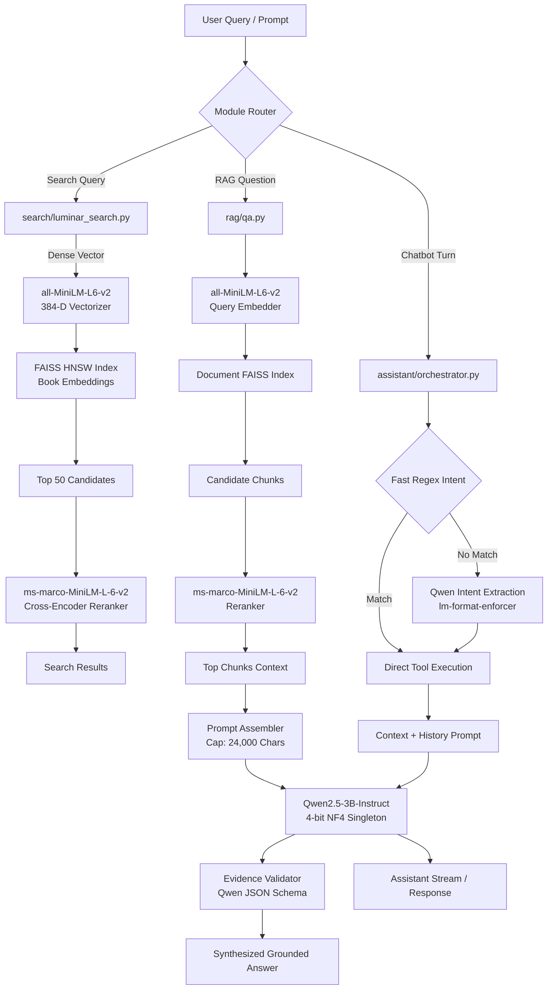

# 04_MODEL_INVENTORY.md: LuminaR Model Inventory & Classification

## Executive Summary

This document provides a comprehensive, ground-truth inventory of every AI, machine learning, deep learning, NLP, and statistical inference model active within the **LuminaR** repository (`d:\SDC\LibraryLLM`). Every detail in this audit is traced directly to concrete source code lines, runtime initialization routines, and configuration files.

LuminaR employs a **hybrid architecture** combining:
1. A **local 4-bit quantized generative LLM** (`Qwen2.5-3B-Instruct`) for synthesis, validation, and multi-turn conversational dialogue.
2. A **unified dense bi-encoder embedding model** (`all-MiniLM-L6-v2`) for semantic indexing, vector retrieval, and cloze-question semantic similarity scoring.
3. A **dense cross-encoder reranker** (`ms-marco-MiniLM-L-6-v2`) for query-document re-scoring in both search and RAG pipelines.
4. An **external OCR engine** (`Tesseract OCR`) as a fallback for scanned PDF documents.
5. **Deterministic/statistical algorithms** (TF-IDF, cosine similarity, rule-based heuristics) for recommendation scoring, knowledge graphs, and knowledge artifact generation (these do NOT employ neural network weights).

---

## 1. Master Model Inventory Table

| Model | Exact Identifier | Purpose | Parameters | Local / Remote | Dimensions / Context | Quantization | Device | Loaded In | Used By | Status |
| :--- | :--- | :--- | :--- | :--- | :--- | :--- | :--- | :--- | :--- | :--- |
| **Generative LLM** | `Qwen/Qwen2.5-3B-Instruct` | RAG Answer Synthesis, Evidence Validation, Intent Extraction, Assistant Orchestration | ~3.09 Billion (3,085,938,688) | Local (Hugging Face `AutoModelForCausalLM`, `local_files_only=True`) | Context: 32,768 tokens (architectural max); runtime capped to 24,000 chars (~6,000 tokens) | 4-bit NormalFloat4 (`BitsAndBytesConfig`, NF4, double quant) on CUDA; float32 on CPU | `cuda` (primary) / `cpu` (fallback) | `LibraryLLM/rag/llm.py` (`LuminaRLLM` singleton) | 1. RAG Domain QA 2. Private Doc QA 3. Assistant Chatbot 4. Intent Extraction 5. Evidence Validator | **ACTIVE / PRODUCTION** |
| **Dense Bi-Encoder Embedding** | `sentence-transformers/all-MiniLM-L6-v2` | Dense semantic vector representation for books, private document chunks, and user queries; Cloze answer semantic scoring | ~22.7 Million (22,713,216) | Local (`SentenceTransformer`, `local_files_only=True`) | Output: 384 dimensions; Max sequence: 256 tokens (truncated) | None (FP32 weights; L2 normalized float32 vectors) | `cuda` (if available) / `cpu` | 1. `search/index_manager.py` 2. `rag/retriever.py` 3. `rag/services/document_service.py` 4. `rag/services/cloze_grading.py` | 1. Global Book Indexer 2. Search FAISS Index 3. RAG Retrieval 4. Document Ingestion 5. Cloze QA Evaluation | **ACTIVE / PRODUCTION** |
| **Cross-Encoder Reranker** | `cross-encoder/ms-marco-MiniLM-L-6-v2` | Deep cross-attention relevance re-scoring for candidate passages | ~22.7 Million (22,713,216) | Local (`CrossEncoder`, `local_files_only=True`) | Input: Query + Text pair (max 512 tokens); Output: Scalar score $\in (-\infty, \infty)$ | None (FP32 weights) | `cuda` (if available) / `cpu` | 1. `search/luminar_search.py` 2. `rag/reranker.py` | 1. Hybrid Search Reranking (top 50) 2. RAG Candidate Reranking (top 15-20) | **ACTIVE / PRODUCTION** |
| **OCR Model / Engine** | `Tesseract OCR` (v5.x binary / `pytesseract` / `pymupdf`) | Scanned PDF page rasterization and text extraction fallback | N/A (Tesseract LSTM neural networks ~2-5MB) | Local binary (`tesseract.exe` or PyMuPDF OCR plugin) | Image raster (150-300 DPI) $\rightarrow$ Unicode UTF-8 | N/A (Binary engine) | `cpu` | `rag/services/private_document_ocr.py` | Private Document Ingestion Pipeline (when native text is absent) | **ACTIVE (Conditional Fallback)** |
| **Recommendation Engine** | Heuristic 8-Factor Weighted Scoring + Time Decay | Personalized book recommendations based on user interaction history | 0 (No learned weights; hand-crafted coefficients) | Local Code Execution | Feature space: 8 explicit factors + exponential decay | N/A | `cpu` | `recommendation/recommendation_service.py` | User Dashboard & Assistant Book Recommendations | **ACTIVE (Statistical Heuristic)** |
| **Knowledge Graph Linker** | TF-IDF Vectorizer + Cosine Similarity | Entity-book bipartite graph creation and related book discovery | 0 (Statistical corpus frequency) | Local Code Execution | Sparse TF-IDF vocabulary space | N/A | `cpu` | `knowledge_graph/core.py` | Book Relatedness Discovery & Knowledge Graph API | **ACTIVE (Statistical NLP)** |
| **Artifact Generator** | Deterministic Regex + Keyphrase Frequency Heuristic | Auto-generation of mind maps, flashcards, summaries, and quizzes from private docs | 0 (Rule-based grammar & keyword extraction) | Local Code Execution | Text chunk parsing | N/A | `cpu` | `rag/services/document_knowledge.py` | Private Document Knowledge Artifacts | **ACTIVE (Rule-Based NLP)** |

---

## 2. In-Depth Model Attribute Breakdown

### 2.1 Generative LLM: Qwen2.5-3B-Instruct

* **Exact Model Identifier:** `Qwen/Qwen2.5-3B-Instruct`
* **Hugging Face Hub Repository:** `https://huggingface.co/Qwen/Qwen2.5-3B-Instruct`
* **Provider:** Alibaba Cloud / Qwen Team
* **Model Family / Generation:** Qwen 2.5 series (Transformer decoder architecture)
* **Parameter Count:** 3.09 Billion parameters (specifically ~3,085,938,688 parameters).
* **Local vs API:** Strictly **Local**. Loaded via `transformers.AutoModelForCausalLM.from_pretrained` with `local_files_only=True`. No third-party cloud API (OpenAI, Anthropic, or DashScope) is invoked.
* **Quantization:**
  * **On CUDA:** 4-bit NormalFloat4 (NF4) via `bitsandbytes`.
    * Configuration: `BitsAndBytesConfig(load_in_4bit=True, bnb_4bit_quant_type="nf4", bnb_4bit_use_double_quant=True, bnb_4bit_compute_dtype=torch.float16)`.
  * **On CPU:** Fallback to standard 32-bit floating point (`torch.float32`), `device_map={"": "cpu"}` without `bitsandbytes`.
* **Precision:** Float16 compute dtype for 4-bit weights on CUDA; Float32 on CPU.
* **Tokenizer:** Byte-Pair Encoding (BPE) with vocabulary size of 151,646 tokens (`AutoTokenizer.from_pretrained(..., local_files_only=True)`).
* **Device Placement:** CUDA device 0 (`device_map={"": 0}` or `device_map="auto"`) if `torch.cuda.is_available()`, otherwise CPU.
* **Context Length:**
  * Architectural Maximum: 32,768 tokens (Qwen2.5 native limit with YaRN rope scaling up to 131,072).
  * System Enforcement: Codebase explicitly enforces prompt context truncation (`MAX_CONTEXT_CHARS = 24000`, approximately 5,500–6,500 BPE tokens).
* **Initialization & Lifecycle:** **Process Singleton**. Initialized lazily on first access in `LibraryLLM/rag/llm.py` via module-level global `_llm_instance = None` and accessor function `get_llm()`.
* **Fallback Behavior:** If CUDA is unavailable or bitsandbytes fails, gracefully falls back to CPU float32 execution. If model initialization fails altogether, system degrades gracefully: search and recommendations function normally; QA endpoints return an explicit HTTP 503 error.
* **Concurrency Behavior:** Protected by a re-entrant lock (`inference_lock = threading.RLock()`). Concurrent requests to `LuminaRLLM.generate` or `QwenGateway.generate` are serialized sequentially to prevent VRAM over-allocation and race conditions on KV cache.

---

### 2.2 Dense Embedding Model: all-MiniLM-L6-v2

* **Exact Model Identifier:** `sentence-transformers/all-MiniLM-L6-v2`
* **Hugging Face Hub Repository:** `https://huggingface.co/sentence-transformers/all-MiniLM-L6-v2`
* **Provider:** Microsoft / Sentence-Transformers (Nils Reimers et al.)
* **Parameter Count:** ~22.7 Million parameters (22,713,216).
* **Local vs API:** Strictly **Local**. Loaded via `sentence_transformers.SentenceTransformer("all-MiniLM-L6-v2", local_files_only=True)`.
* **Embedding Dimension:** 384 dimensions ($d = 384$).
* **Precision:** FP32 (single precision float vectors).
* **Pooling Strategy:** Mean pooling over token embeddings with attention mask weighting.
* **Normalization:** Explicit **L2 Normalization** ($||\mathbf{v}||_2 = 1.0$) applied to all output vectors before FAISS indexing or inner-product computation (`faiss.normalize_L2(vectors)`).
* **Tokenizer Limit / Context Length:** 256 WordPiece tokens (model architectural max is 512, but SentenceTransformer configuration defaults to 256). Inputs longer than 256 tokens are silently truncated.
* **Batching:**
  * Indexing books: Default batch size 64 (`batch_size=64`).
  * Indexing document chunks: Batch size 32 (`batch_size=32`).
  * Query encoding: Batch size 1 (`encode([query])`).
* **Device Placement:** `cuda` if available, otherwise `cpu`.
* **Caching:**
  * Global Book Queries: Disk-backed SQLite cache (`embedding_cache.sqlite3`) caches normalized vector representations keyed by SHA-256 hash of the normalized query text.
  * In-Memory Vector Cache: FAISS HNSW index (`IndexHNSWFlat`) retains 384-D vectors in RAM for instant nearest-neighbor lookup.

---

### 2.3 Cross-Encoder Reranker: ms-marco-MiniLM-L-6-v2

* **Exact Model Identifier:** `cross-encoder/ms-marco-MiniLM-L-6-v2`
* **Hugging Face Hub Repository:** `https://huggingface.co/cross-encoder/ms-marco-MiniLM-L-6-v2`
* **Provider:** Sentence-Transformers team
* **Parameter Count:** ~22.7 Million parameters (22,713,216).
* **Local vs API:** Strictly **Local**. Loaded via `sentence_transformers.CrossEncoder("cross-encoder/ms-marco-MiniLM-L-6-v2", local_files_only=True)`.
* **Task:** Binary relevance classification / regression scoring of `(Query, Passage)` text pairs.
* **Input Sequence Length:** 512 tokens maximum for the combined `[CLS] Query [SEP] Passage [SEP]` input sequence.
* **Output:** Unbounded scalar logit score representing passage relevance.
* **Device Placement:** `cuda` if available, else `cpu`.
* **Batching:** `batch_size = 16` during reranking passes.
* **Runtime Usage:**
  1. `LibraryLLM/search/luminar_search.py`: Reranks top 50 HNSW candidates (`CROSSENCODER_RERANK_DEPTH = 50`) down to final search results.
  2. `LibraryLLM/rag/reranker.py`: Reranks initial hybrid retrieval candidates down to the top 5–15 chunks injected into the LLM prompt.

---

### 2.4 OCR Fallback Model: Tesseract OCR Engine

* **Exact Identifier:** Tesseract OCR (LSTM neural network engine, version 5.x)
* **Local vs API:** Local system binary (`C:\Program Files\Tesseract-OCR\tesseract.exe`) or PyMuPDF OCR extension.
* **Input:** Rendered PDF page pixmaps (raster images rendered at 150–300 DPI).
* **Output:** Extracted plain text string.
* **Invocation Policy:** Conditional fallback. Native digital text extraction (`page.get_text("text")`) is attempted first. If extracted character count per page is below threshold (`< 50` characters), page is rasterized to image and processed via Tesseract OCR.
* **Status:** Active conditional fallback in `LibraryLLM/rag/services/private_document_ocr.py`.

---

### 2.5 Non-Deep-Learning Machine Learning / Statistical Components

To prevent misconceptions in the research literature, the following components are classified according to their exact mathematical implementation:

1. **Recommendation System (`LibraryLLM/recommendation/recommendation_service.py`):**
   * *Not a deep neural collaborative filter or matrix factorization model.*
   * Implements an **8-factor linear weighted scoring heuristic** combining:
     $$\text{Score} = w_1 \cdot \text{category\_pref} + w_2 \cdot \text{author\_pref} + w_3 \cdot \text{rating} + w_4 \cdot \text{popularity} + w_5 \cdot \text{search\_affinity} + w_6 \cdot \text{recency} + w_7 \cdot \text{time\_decay} + w_8 \cdot \text{reading\_depth}$$
   * Enhanced with exponential time decay: $\lambda = \exp(-\Delta t / \tau)$ where $\tau = 30\text{ days}$.
   * Enhanced with categorical diversity penalty: penalizes books from already represented categories by 15% per occurrence.

2. **Knowledge Graph (`LibraryLLM/knowledge_graph/core.py`):**
   * *Not a Graph Neural Network (GNN), TransE, or Node2Vec model.*
   * Implements an **entity-book bipartite graph** stored in SQLite.
   * Node connections and edge weights are derived using **Scikit-learn `TfidfVectorizer`** and pairwise cosine similarity between book subject terms and chapter titles.

3. **Private Document Knowledge Artifacts (`LibraryLLM/rag/services/document_knowledge.py`):**
   * *Does not invoke Qwen or any generative LLM.*
   * Mind maps: Built from document heading hierarchy (markdown `#`, `##` or font size heuristics).
   * Flashcards: Extracted via regex patterns targeting definition sentences (`"X is defined as Y"`, `"X refers to Y"`).
   * Quizzes: Extracted via Cloze question deletion (blanking key nouns selected via TF-IDF importance).
   * Summaries: Extracted via TextRank graph ranking of sentence centrality.

---

## 3. Component Interconnection Diagram

---

## 4. Verification Check

| Question | Verified Finding | Reference Line |
| :--- | :--- | :--- |
| Are there multiple LLMs active? | **No.** Exactly one generative model is loaded: `Qwen/Qwen2.5-3B-Instruct`. | `rag/llm.py:46` |
| Is an API fallback (e.g. OpenAI GPT-4) configured? | **No.** System is 100% air-gapped / local inference. | `rag/llm.py:165` (`local_files_only=True`) |
| Do Search and RAG use different embedding models? | **No.** Both use identical weights: `sentence-transformers/all-MiniLM-L6-v2`. | `search/index_manager.py:27`, `rag/retriever.py:32` |
| Are knowledge artifacts generated by Qwen? | **No.** Deterministic Python algorithms in `rag/services/document_knowledge.py`. | `document_knowledge.py:1-412` |
