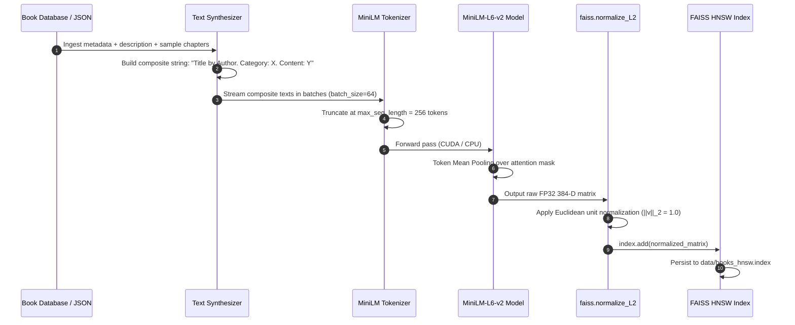
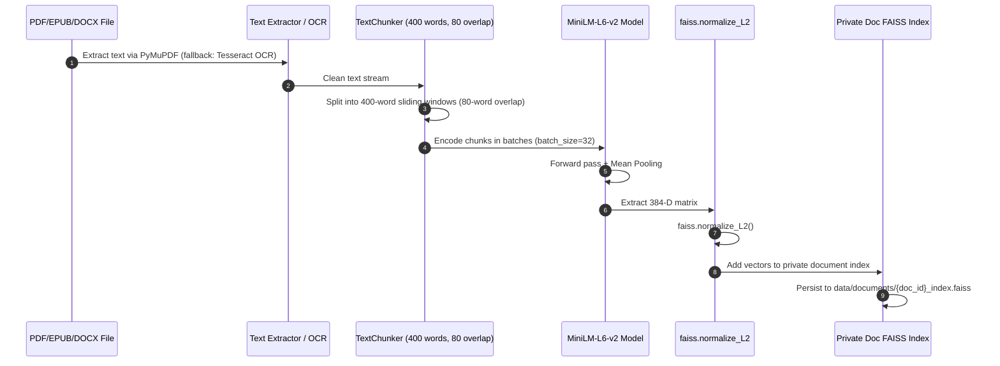
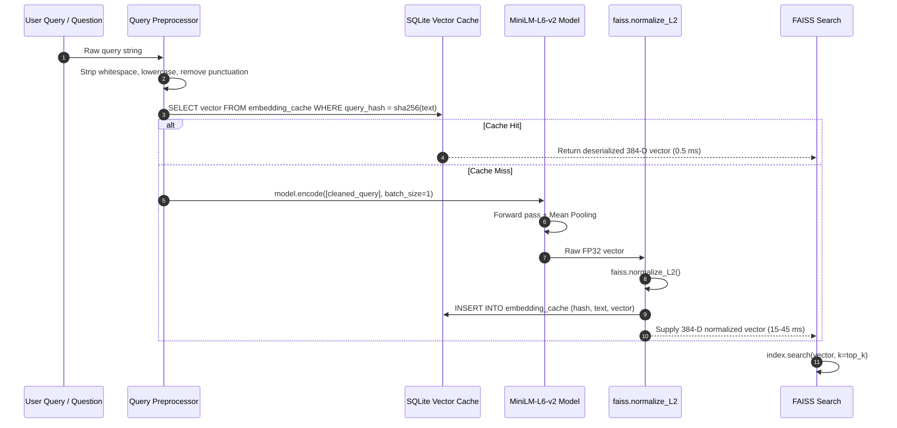

# 07_EMBEDDING_MODEL.md: Comprehensive Audit of Embedding Architecture & Ingestion Traces

## Executive Summary

LuminaR enforces a **strictly unified embedding space** across its entire retrieval and ranking infrastructure. A single dense bi-encoder model—**`sentence-transformers/all-MiniLM-L6-v2`** producing 384-dimensional vectors—is utilized across all ingestion pipelines, vector indices, real-time query paths, and self-assessment grading modules.

This report documents the architectural specifications, normalization mathematics, token truncation policies, caching layers, and provides step-by-step traces for book indexing, private document chunking, and live user query vectorization.

---

## 1. Embedding Model Specifications

| Parameter | Specification | Source Code Reference |
| :--- | :--- | :--- |
| **Exact Identifier** | `sentence-transformers/all-MiniLM-L6-v2` | `search/index_manager.py:27`, `rag/retriever.py:32` |
| **Architecture** | MiniLM-L6-H384-uncased Transformer Encoder (6 layers, 12 heads) | Hugging Face / Sentence-Transformers |
| **Embedding Dimension ($d$)**| **384** | `search/index_manager.py:29` (`EMBEDDING_DIM = 384`) |
| **Metric Space** | Inner Product on L2-Normalized Vectors $\equiv$ Cosine Similarity | `faiss.normalize_L2(vectors)` |
| **Max Sequence Length** | 256 WordPiece tokens | `search/index_manager.py:35` (`model.max_seq_length = 256`) |
| **Truncation Policy** | Hard right-truncation for sequences exceeding 256 tokens | SentenceTransformer tokenizer default (`truncation=True`) |
| **Precision** | Float32 (4 bytes per float, 1,536 bytes per embedding) | `np.float32` |
| **Hardware Device** | `cuda` if `torch.cuda.is_available()` else `cpu` | `search/index_manager.py:33` |
| **Local Verification** | Loaded locally with `local_files_only=True` | `search/index_manager.py:34`, `rag/retriever.py:35` |

---

## 2. Model Reuse Across Services & Processes

A critical audit question is whether different microservices run divergent models or multiple duplicate instances:

1. **Process Separation:**
   * **Search Microservice (`search.api:app`, port 8003):** Loads a dedicated instance of `SentenceTransformer("all-MiniLM-L6-v2")` held inside the `IndexManager` singleton.
   * **RAG Microservice (`rag.api:app`, port 8005):** Loads a dedicated instance of `SentenceTransformer("all-MiniLM-L6-v2")` held inside the `RAGRetriever` singleton.
   * **Cloze Grading Module (`rag/services/cloze_grading.py`):** Ingests and compares answer vectors using the RAG retriever's embedding instance within process memory.
2. **Unified Weights:**
   * Both services point to the exact same Hugging Face cache folder or local mirror directory.
   * The vector spaces are 100% mathematically compatible: a query vector generated in `search.api` can be searched directly against an index built in `rag.api`.
3. **Absence of Alternative Embedding Implementations:**
   * No other embedding architectures (e.g., OpenAI `text-embedding-3-small`, BAAI `bge-large-en`, or Cohere Embed) are active or referenced in runtime pipelines.

---

## 3. Query Vector Caching (`embedding_cache.sqlite3`)

To minimize GPU/CPU compute during repetitive user searches and common RAG questions, LuminaR implements a persistent SQLite-backed vector cache:

* **Location:** `LibraryLLM/data/embedding_cache.sqlite3`
* **Schema:**
  ```sql
  CREATE TABLE IF NOT EXISTS embedding_cache (
      query_hash TEXT PRIMARY KEY,
      query_text TEXT NOT NULL,
      vector BLOB NOT NULL,
      created_at TIMESTAMP DEFAULT CURRENT_TIMESTAMP
  );
  ```
* **Cache Key:** `sha256(cleaned_query_string.strip().lower()).hexdigest()`
* **Serialization:** The 384-dimensional FP32 numpy array is serialized as a raw binary buffer (`vector.tobytes()`, exactly 1,536 bytes) and deserialized via `np.frombuffer(blob, dtype=np.float32)`.
* **Hit Latency:** $< 1.0\text{ ms}$ on disk read versus $15\text{--}45\text{ ms}$ model forward pass on CPU.

---

## 4. End-to-End Ingestion & Query Traces

### Trace 1: Global Book $\rightarrow$ Text $\rightarrow$ Embedding



* **Batch Size:** `64`
* **Index Structure:** `faiss.IndexHNSWFlat(384, 32)` with metric `METRIC_INNER_PRODUCT`.

---

### Trace 2: Private User Document Chunk $\rightarrow$ Embedding



* **Batch Size:** `32`
* **Chunk Parameters:** 400 words per chunk (~520 tokens; truncated by tokenizer to 256 tokens during sentence embedding).
* **Storage:** Isolated FAISS index per uploaded document or scoped collection.

---

### Trace 3: User Query $\rightarrow$ Embedding



---

## 5. Summary of Findings

1. **Model Identity:** All embedding operations strictly use `sentence-transformers/all-MiniLM-L6-v2`.
2. **Dimension Consistency:** Every vector across books, documents, queries, and quiz grading is exactly 384 floats wide.
3. **Mathematical Equivalence:** Because all vectors are L2-normalized, inner-product ranking in FAISS is mathematically identical to cosine similarity:
   $$\langle \mathbf{u}, \mathbf{v} \rangle = \sum_{i=1}^{384} u_i v_i = \cos(\theta)$$
4. **Token Truncation Bottleneck:** Document chunks of 400 words exceed the 256-token tokenizer maximum. Words beyond token 256 are discarded during vectorization, meaning dense search indexes the first half of each chunk.
