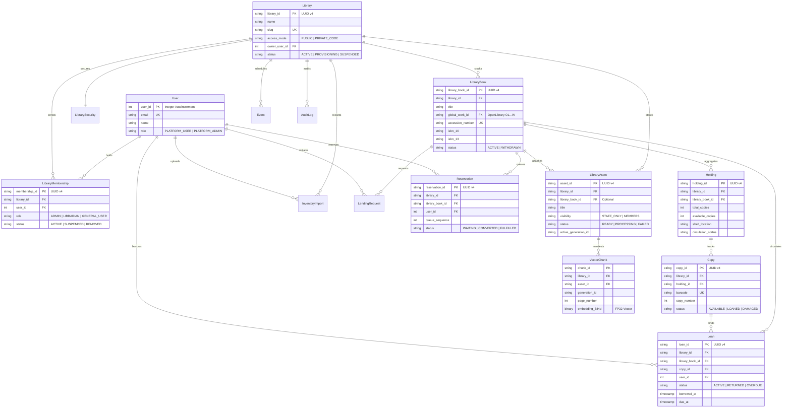

# 15_LIBRARY_DATA_MODEL.md: Comprehensive Entity-Relationship Data Model

## Executive Summary

This document specifies the concrete data model governing multi-library tenancy, cataloging, circulation, digital assets, and analytics in LuminaR. It establishes the exact mathematical relationships, primary keys, foreign keys, and cardinalities connecting all eleven institutional entities, explicitly distinguishing **current production implementation** from **proposed future fields**.

---

## 1. Entity-Relationship Diagram

---

## 2. Detailed Entity Specifications: Current vs Proposed Fields

### 2.1 `Library` Entity
* **Collection:** `institution_libraries` ([backend/services/institution_service.py:21](file:///d:/SDC/LibraryLLM/backend/services/institution_service.py#L21))
* **Current Implementation:**
  * `library_id` (UUID string, PK)
  * `name` (string, 1–150 chars)
  * `slug` / `slug_normalized` (string, unique)
  * `description` (string)
  * `library_type` (`PHYSICAL`, `PRIVATE_COLLECTION`, `INSTITUTIONAL`, `CONSORTIUM`)
  * `access_mode` (`PUBLIC`, `PRIVATE_CODE`)
  * `owner_user_id` (integer FK $\to$ `users.user_id`)
  * `contact_email`, `phone`, `address` (subdocument: `street`, `city`, `region`, `postal_code`, `country`)
  * `status` (`PROVISIONING`, `ACTIVE`, `SUSPENDED`, `REMOVED`)
  * `created_at`, `updated_at` (UTC datetime)
* **Proposed Fields (Not Yet Implemented):**
  * `custom_domain` (string, for tenant white-labeling)
  * `max_concurrent_members` (integer capacity limit)
  * `federation_consortium_id` (UUID link to parent consortium network)

---

### 2.2 `User` Entity
* **Collection:** `users` ([backend/database/mongodb.py](file:///d:/SDC/LibraryLLM/backend/database/mongodb.py))
* **Current Implementation:**
  * `user_id` (integer PK, historical sequence)
  * `email` (string, normalized unique)
  * `password_hash` (string, bcrypt/argon2)
  * `name` (string)
  * `role` (`PLATFORM_USER`, `PLATFORM_ADMIN`)
  * `is_active` (boolean)
  * `created_at`, `updated_at` (datetime)
* **Proposed Fields:**
  * `primary_library_id` (UUID default landing library)
  * `institutional_id_number` (student/employee badge string)

---

### 2.3 `LibraryMembership` Entity
* **Collection:** `institution_memberships` ([backend/services/institution_service.py:23](file:///d:/SDC/LibraryLLM/backend/services/institution_service.py#L23))
* **Current Implementation:**
  * `membership_id` (UUID string, PK)
  * `library_id` (UUID string FK $\to$ `institution_libraries.library_id`)
  * `user_id` (integer FK $\to$ `users.user_id`)
  * `role` (`ADMIN`, `LIBRARIAN`, `GENERAL_USER`)
  * `status` (`ACTIVE`, `SUSPENDED`, `REMOVED`)
  * `joined_at`, `created_at`, `updated_at` (datetime)
  * `created_by_user_id` (integer FK)
  * `grant_invitation_id` (UUID string FK, nullable)
* **Proposed Fields:**
  * `borrow_limit_override` (integer custom quota)
  * `expiration_date` (datetime for semester-based enrollment)

---

### 2.4 `InventoryImport` (Dataset) Entity
* **Collection:** `institution_inventory_imports` & `institution_inventory_previews`
* **Current Implementation:**
  * `import_id` (UUID string, PK)
  * `library_id` (UUID string FK)
  * `actor_user_id` (integer FK)
  * `filename` (string)
  * `file_hash` (SHA-256 string)
  * `status` (`PREVIEW`, `IMPORTING`, `COMPLETED`, `PARTIAL`, `FAILED`)
  * `rows_total`, `rows_valid`, `rows_invalid` (integers)
  * `global_matches`, `new_library_records`, `existing_holdings`, `possible_duplicates` (integers)
  * `created_records`, `increased_holdings`, `skipped_existing` (integers)
  * `created_at`, `started_at`, `completed_at`, `expires_at` (datetime)
* **Proposed Fields:**
  * `error_log_uri` (S3/blob storage link for full row failure dumps)
  * `auto_index_vectors` (boolean trigger for background embedding jobs)

---

### 2.5 `LibraryBook`, `Holding`, and `Copy` Entities
* **Collections:** `institution_library_books`, `institution_holdings`, `institution_copies`
* **Current Implementation:**
  * `library_book_id` (UUID string, PK)
  * `library_id` (UUID string FK)
  * `title`, `normalized_title` (strings)
  * `authors`, `subjects` (list of strings)
  * `isbn_10`, `isbn_13` (strings)
  * `global_work_id` (string FK $\to$ OpenLibrary `books.work_id`, nullable)
  * `accession_number` (string unique sequence per library: `ACC-000001`)
  * `status` (`ACTIVE`, `WITHDRAWN`)
  * `holding.total_copies`, `holding.available_copies`, `holding.shelf_location`
  * `copies[].barcode`, `copies[].status` (`AVAILABLE`, `LOANED`, `DAMAGED`)
* **Proposed Fields:**
  * `lccn` (Library of Congress Control Number)
  * `dewey_decimal` (normalized numeric classification)

---

### 2.6 Circulation: `LendingRequest`, `Loan`, `Reservation` Entities
* **Collections:** `institution_lending_requests`, `institution_loans`, `institution_reservations`
* **Current Implementation:**
  * `loan_id` (UUID PK), `library_id` (UUID FK), `library_book_id` (UUID FK), `user_id` (integer FK)
  * `copy_id` (UUID FK $\to$ `institution_copies.copy_id`)
  * `status` (`ACTIVE`, `RETURNED`, `OVERDUE`)
  * `borrowed_at`, `due_at`, `returned_at` (datetime)
  * `reservation_id` (UUID PK), `queue_sequence` (integer 1-indexed order)
* **Proposed Fields:**
  * `renewal_count` (integer current renewals used)
  * `fine_accrued_cents` (integer currency fine)

---

### 2.7 Digital Document AI: `LibraryAsset` & `VectorChunk`
* **Collections:** `institution_library_assets`, disk FAISS manifest
* **Current Implementation:**
  * `asset_id` (UUID string, PK)
  * `library_id` (UUID string FK)
  * `library_book_id` (UUID string FK, nullable)
  * `title`, `original_filename`, `storage_path` (strings)
  * `visibility` (`STAFF_ONLY`, `MEMBERS`)
  * `status` (`READY`, `PROCESSING`, `FAILED`)
  * `active_generation_id` (string hash)
  * `VectorChunk`: 384-dimensional float vector linked by composite key:
    `library:{library_id}:asset:{asset_id}:generation:{generation_id}:chunk:{chunk_id}`
* **Proposed Fields:**
  * `ocr_engine_used` (enumeration: `TESSERACT_OCR`, `NATIVE_PYMUPDF`)
  * `chunk_count` (integer total vector fragments)

---

### 2.8 `Event` Entity
* **Collection:** `institution_events` ([backend/routes/library_events.py](file:///d:/SDC/LibraryLLM/backend/routes/library_events.py))
* **Current Implementation:**
  * `event_id` (UUID string, PK)
  * `library_id` (UUID string FK)
  * `title`, `description` (strings)
  * `category` (`ACADEMIC`, `COMMUNITY`, `WORKSHOP`, `GENERAL`)
  * `status` (`DRAFT`, `PUBLISHED`, `CANCELLED`, `ARCHIVED`)
  * `start_time`, `end_time` (datetime)
  * `location`, `capacity` (string, integer)
  * `created_by_user_id` (integer FK)

---

### 2.9 `Analytics` Entity
* **Computation Mode:** Computed on-demand via MongoDB aggregation pipelines in `LibraryLLM/backend/services/library_analytics_service.py` across `institution_loans`, `institution_memberships`, `institution_library_books`, and `institution_reservations`.
* **Output Metrics:** Active patron count, circulation velocity (7d, 30d, 90d, all-time), top circulating categories, overdue ratios, waitlist pressure.
