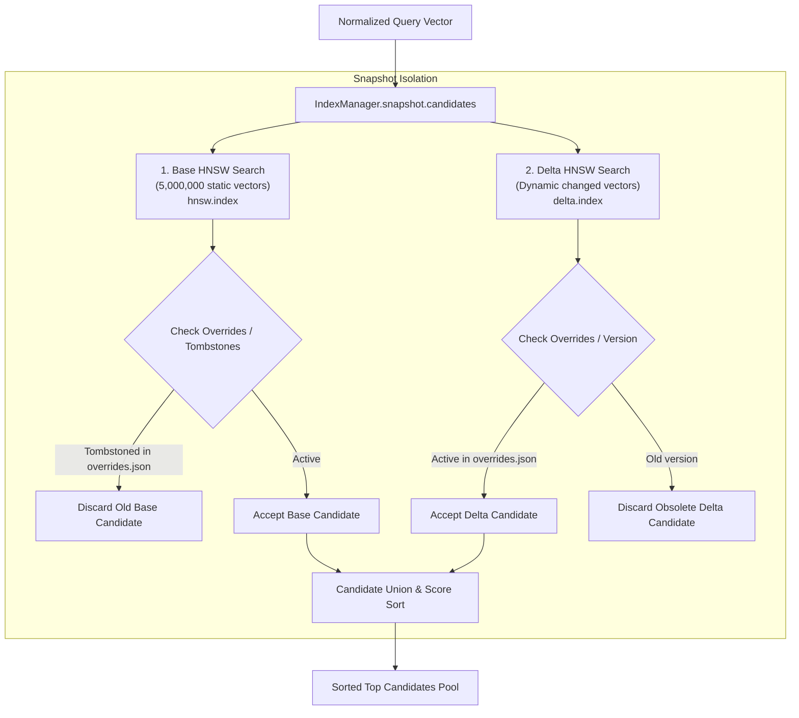

# 19_HNSW_VECTOR_INDEX.md: FAISS HNSW Vector Index Architecture & Mutation Lifecycle

## Executive Summary

LuminaR employs Facebook AI Similarity Search (**FAISS**) for high-dimensional vector indexing. The active vector engine is an in-memory **Hierarchical Navigable Small World** graph index (`faiss.IndexHNSWFlat`) indexing 5,000,000 dense 384-dimensional vectors.

Because native FAISS HNSW graphs do not support dynamic node deletion or vector replacement, LuminaR implements an **Immutable Base + Dynamic Delta + Tombstone Snapshot Architecture** ([search/index_manager.py](file:///d:/SDC/LibraryLLM/search/index_manager.py)).

---

## 1. Technical Specifications of the HNSW Index

| Parameter | Value in LuminaR | Source Code Reference | Implementation Detail |
| :--- | :--- | :--- | :--- |
| **Library / Framework** | `faiss` (`faiss-cpu` / `faiss-gpu`) | `search/index_manager.py:23` | Python bindings for Meta FAISS C++ library |
| **Index Type** | `faiss.IndexHNSWFlat` | `search/index_manager.py:54` | Exact distance computation at graph leaves (no product quantization loss) |
| **Vector Dimension ($d$)**| **384** | `search/index_manager.py:32` | Generated by `sentence-transformers/all-MiniLM-L6-v2` |
| **Distance Metric** | `faiss.METRIC_INNER_PRODUCT` | `search/index_manager.py:54` | Inner Product on L2-normalized vectors ($\equiv$ Cosine Similarity) |
| **Graph Links ($M$)** | **32** | `search/index_manager.py:54` | Number of bi-directional connection edges per node |
| **Build Exploration ($efConstruction$)**| **200** | `search/index_manager.py:55` | Depth of nearest-neighbor exploration during graph creation |
| **Search Exploration ($efSearch$)** | **128** | `search/luminar_search.py:67` | Depth of exploration during live query search |
| **Base Index Capacity** | **5,000,000 vectors** | `datasets/ai/faiss/hnsw/hnsw_metadata.json` | $N = 5{,}000{,}000$ |
| **Disk File Size** | **9,040,711,138 bytes** (~9.04 GB)| File system | Raw binary index persistence file (`hnsw.index`) |
| **Build Duration** | **2,058.11 seconds** (~34.3 min)| `hnsw_metadata.json:13` | Wall-clock compile time on host NVMe/CPU hardware |

---

## 2. Immutable Base + Delta Snapshot Architecture

FAISS `IndexHNSWFlat` stores vector points as continuous flat arrays. Deleting or modifying a point would break graph navigability and require a full graph reconstruction. LuminaR solves this through a multi-tier snapshot pattern:



### Components of a Snapshot:
1. **Base Index (`base`):** The massive, read-only 5,000,000-vector index (`hnsw.index`). Never modified at runtime.
2. **Delta Index (`delta`):** A small, in-memory `IndexHNSWFlat` containing vectors for books created or updated since the base index was generated.
3. **Overrides Dictionary (`overrides`):** A hash map keyed by `work_id`:
   * If a book in the base index is updated: `overrides[work_id] = {"label": delta_label}`.
   * If a book is deleted: `overrides[work_id] = {"label": -1}` (tombstone).
4. **Manifest (`manifest.json`):** Cryptographic SHA-256 digests and version UUIDs tying the components together.

---

## 3. Mutation Operations (Insert, Update, Delete)

All mutations are serialized through a filesystem process lock (`search/index_manager.py:76-78`):
```python
with writer_lock(self.root):  # acquires writer.lock via msvcrt/fcntl
    ...
```

* **Insert (New Book):**
  1. The new book text is embedded into a 384-D vector by `embedder.encode()`.
  2. The vector is appended to a cloned delta index: `delta.add(vector)`.
  3. The `work_id` is appended to `delta_ids`.
  4. The override map is updated: `overrides[work_id] = {"label": new_label}`.
  5. The new version is written to `datasets/ai/faiss/hnsw/versions/<uuid>/`.
  6. The active pointer (`active_index.json`) is atomically swapped via `os.replace()`.
* **Update (Modified Metadata):**
  1. Re-embeds the updated composite text.
  2. Appends the new vector to `delta`.
  3. Updates `overrides[work_id]` to point to the new delta label. The old vector (whether in base or delta) is now dead.
* **Delete (Removed Book):**
  1. Sets `overrides[work_id] = {"label": -1}`.
  2. During query execution, `snapshot.candidates()` encounters the `-1` label and ignores the candidate.
* **Rebuild / Consolidation:**
  1. When the delta index grows too large (e.g. thousands of mutations), an offline maintenance worker executes a complete merge, rewriting a fresh unified `hnsw.index` and resetting the delta to empty.

---

## 4. Vector-to-Entity Mapping Architecture

A critical architectural property of LuminaR is that **the vector index does NOT store library identifiers**:

```
FAISS Vector Integer Label (0 .. 4,999,999)
       │
       ▼  (Mapped via index_work_ids.npy: Array lookup in O(1))
OpenLibrary Global Work ID (e.g., "OL1000000W")
       │
       ▼  (Mapped via MongoDB books_collection.find)
MongoDB Book Record (title, authors, subjects, ratings)
       │
       ▼  (Mapped via MongoDB library_inventory.find: Optional post-filter)
Physical Library Holdings (library_id, total_copies, available_copies)
```

* **Mapping File:** `datasets/ai/faiss/hnsw/index_work_ids.npy` (67,839,750 bytes).
* **Storage Type:** 1D NumPy array of string objects.
* **Lookup Mechanism:** If FAISS returns nearest-neighbor label `421,085`, the code executes `wid = str(self.work_ids[421085])`, resolving the exact OpenLibrary identifier in under 1 microsecond.
* **Absence of Tenant Partitioning:** The HNSW graph is strictly single-tenant (global). There is no multi-index directory or per-library vector routing in the search service.
