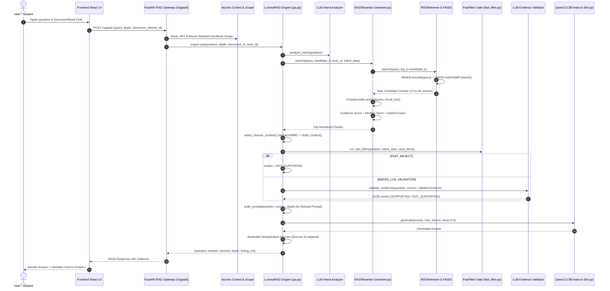

# RAG End-to-End Pipeline Architecture Evidence

> **Audit Context**: LuminaR Research Evidence Audit — Part 5  
> **Source Files Verified**:
> - `frontend/src/lib/api.ts` (Lines 815–836)
> - `rag/api.py` (Lines 110–140, 194–276)
> - `rag/qa.py` (Lines 36–72, 141–261, 538–920)
> - `rag/reranker.py` (Lines 33–38, 125–460)
> - `rag/retriever.py` (Lines 140–280)
> - `rag/llm.py` (Lines 71–80, 268–460)
> - `rag/fast_filter.py` (Lines 1–150)
> - `rag/services/private_documents.py` (Lines 221–234)

---

## 1. End-to-End Execution Trace

The LuminaR Retrieval-Augmented Generation (RAG) pipeline executes along a synchronous, stage-profiled pipeline:

---

## 2. Step-by-Step Code Path Mapping

### Step 1: User Question & Frontend Submission
- **File**: `frontend/src/lib/api.ts:815-836` (`askRAG`)
- **Action**: Packages `{ query, depth, document_id, work_id }`.
- **Note**: No conversation history is transmitted; questions are dispatched as standalone query payloads.

### Step 2: Gateway API & Authentication Guard
- **File**: `rag/api.py:194-276` (`ask()`)
- **Route**: `POST /rag/ask`
- **Validation**:
  - Enforces `depth in {"concise", "normal", "detailed", "comprehensive"}`.
  - Requires non-empty string.
  - Scope isolation: If querying a private document, verifies user ownership via `private_documents.owned(selected, user)` and mounts isolated runtime state via `private_documents.selected()`. If querying an institutional book, validates entitlement via `authorize_selection()`.

### Step 3: Retrieval Configuration by Depth
- **File**: `rag/qa.py:36-62` (`DEPTH_CONFIG`)
- Configuration maps depth to candidate breadth and token capacity:
  - `concise`: 10 candidates, 4 context chunks, 300 max tokens.
  - `normal`: 15 candidates, 7 context chunks, 320 max tokens.
  - `detailed`: 20 candidates, 10 context chunks, 1,000 max tokens.
  - `comprehensive`: 20 candidates, 15 context chunks, 1,500 max tokens.

### Step 4: Intent Analysis
- **File**: `rag/llm.py:530-580` (`analyze_intent`) & `rag/qa.py:610-618`
- **Action**: Extracts structured intent parameters (actors, targets, events, temporal direction, negation) using Qwen with constrained schema decoding (`IntentSchema`).

### Step 5: Multi-Query Expansion & Vector Retrieval
- **File**: `rag/reranker.py:192-250` & `rag/retriever.py:140-220`
- **Action**:
  - For book RAG, generates expanded concept queries (`generate_expanded_queries(query)`).
  - Queries encoded into 384-dimensional dense vectors using `sentence-transformers/all-MiniLM-L6-v2`.
  - Searches FAISS inner-product index (`IndexFlatIP`).
  - Retrieves up to 40 unique candidate chunks (`MAX_MULTIQ_CANDIDATES = 40`).

### Step 6: Cross-Encoder Reranking & Hybrid Scoring
- **File**: `rag/reranker.py:270-435`
- **Action**:
  - Pairs query with each candidate text.
  - Computes cross-encoder logits using `cross-encoder/ms-marco-MiniLM-L-6-v2`.
  - Computes deterministic evidence signals (`calculate_evidence_score()`).
  - Normalizes scores via Min-Max (`normalize_scores_minmax()`).
  - Calculates hybrid final score:
    $$\text{final\_score} = 0.30 \times \text{CrossEncoder}_{\text{norm}} + 0.55 \times \text{EvidenceScore} + 0.15 \times \text{FAISS}_{\text{norm}}$$
  - Sorts candidates descending by `final_score`.

### Step 7: Diversity-Aware Context Construction
- **File**: `rag/qa.py:141-261` (`select_diverse_context()` & `build_context()`)
- **Action**:
  - Applies greedy Jaccard redundancy penalty ($0.3 \times \max \text{sim}$) against already selected chunk terms to maximize informational diversity across passages.
  - Formats passages with book, author, chapter, page, and `[Source N]` headers.
  - Enforces hard character ceiling: `MAX_CONTEXT_CHARS = 24000`.

### Step 8: Fast Filter & Evidence Validation Gate
- **File**: `rag/qa.py:712-790`, `rag/fast_filter.py:1-120`, `rag/llm.py:647-730`
- **Action**:
  - `run_fast_filter()` deterministically checks actor, target, event, polarity, and temporal alignment.
  - If ambiguous, invokes `llm.validate_evidence()` using Qwen as an LLM judge with constrained JSON schema (`ValidatorSchema(supported: bool, confidence: float)`).
  - If `NOT_SUPPORTED`, the generation prompt is redirected to an explicit refusal prompt.

### Step 9: Prompt Assembly & Deterministic Generation
- **File**: `rag/qa.py:268-482` (`build_prompt()`) & `rag/llm.py:268-450` (`generate()`)
- **Action**:
  - Injects `SYSTEM_MESSAGE`, strict negative rules (no world knowledge, no fictional recreation, no invented source citations), and formatted context passages.
  - Tokenized using Qwen chat template (`tokenizer.apply_chat_template()`).
  - Deterministic greedy generation: `do_sample = False`, `temperature = 0.0`.
  - Repetition control: Logits processor prevents 3-gram repetitions in the generated answer while allowing verbatim source quote copying.

### Step 10: Citation Extraction & Response Delivery
- **File**: `rag/qa.py:847-920`
- **Action**:
  - Deduplicates used chunk IDs.
  - Strips internal `[Source X]` markers from generated answer text.
  - Returns answer string alongside source citation objects (`{chunk_id, filename, page, chapter, work_id}`).
