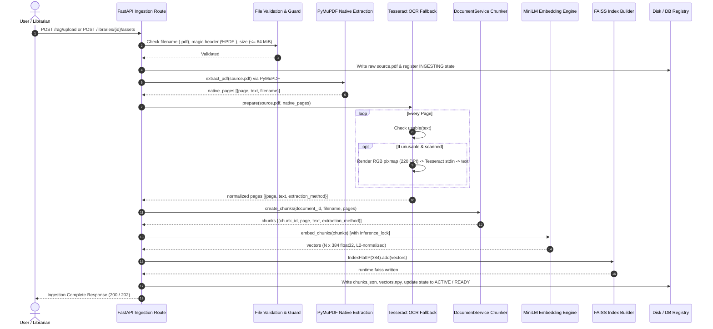

# Document Ingestion Pipeline Evidence

> **Audit Context**: LuminaR Research Evidence Audit — Part 6  
> **Source Files Verified**:
> - `rag/services/private_documents.py` (Lines 1–273)
> - `rag/services/private_document_routes.py` (Lines 1–182)
> - `rag/services/private_document_ocr.py` (Lines 1–136)
> - `rag/services/document_service.py` (Lines 1–787)
> - `rag/services/library_asset_pipeline.py` (Lines 1–477)
> - `backend/services/library_asset_service.py` (Lines 1–495)
> - `backend/routes/library_assets.py` (Lines 1–70)

---

## 1. Supported Formats & Validation

Across the entire LuminaR codebase, **only Portable Document Format (PDF) files are supported for document ingestion**.

### A. Format Acceptance & Validation Rules
| Check | Private Session Upload (`/rag/upload`) | Institutional Digital Asset (`/libraries/{id}/assets`) |
| :--- | :--- | :--- |
| **Filename Extension** | Must end with `.pdf` (case-insensitive); length $\le 255$ characters (`private_document_routes.py:73`) | Must end with `.pdf` (case-insensitive); length $\le 255$ characters; NFC-normalized; no path traversal characters (`library_asset_service.py:175-184`) |
| **Magic Header** | Starts with `b'%PDF-'` (`private_document_routes.py:86`) | Starts with `b'%PDF-'` (`library_asset_service.py:191`) |
| **File Size Limit** | 64 MiB maximum (`bounded()` in `private_document_routes.py:50`) | 64 MiB maximum (`MAX_FILE_BYTES = 64 * 1024 * 1024` in `library_asset_upload_limit.py`) |
| **Page Count Limit** | $1 \le \text{pages} \le 10,000$ (`private_documents.py:133`) | $1 \le \text{pages} \le 10,000$ (`library_asset_pipeline.py:113`) |
| **Encryption** | Rejects unreadable / corrupted PDFs | Rejects encrypted PDFs (`parsed.is_encrypted`, `library_asset_service.py:195`) |

### B. Unadvertised / Unsupported Formats
As confirmed by institutional verification reports (`reports/institution_v2f1_book_format_architecture.md:7` and `scripts/institution_v2f1_reports.py:44`):
- Word documents (`.docx`, `.doc`): **NOT IMPLEMENTED / NOT SUPPORTED**.
- EPUB e-books (`.epub`): **NOT IMPLEMENTED / NOT SUPPORTED**.
- Plain text (`.txt`) / Markdown (`.md`): **NOT IMPLEMENTED / NOT SUPPORTED**.
- Scanned raw image formats (`.png`, `.jpg`, `.tiff`): **NOT ACCEPTED DIRECTLY** (only accepted embedded inside a `.pdf` container).

---

## 2. Text Extraction, OCR, and Ingestion Taxonomy

LuminaR strictly differentiates three distinct layers:

```
+-----------------------------------------------------------------------------------------+
|                                    DOCUMENT INGESTION                                   |
|  Upload Validation -> Storage -> Processing Orchestration -> Tenant Security -> Index  |
+-----------------------------------------------------------------------------------------+
                                             |
                     +-----------------------+-----------------------+
                     |                                               |
                     v                                               v
     +-------------------------------+               +-------------------------------+
     |        TEXT EXTRACTION        |               |       SELECTIVE LOCAL OCR     |
     |   PyMuPDF (fitz) Native Text  |               |    Tesseract CLI / Subprocess |
     |      Fast, zero-GPU CPU       |               |     Triggered ONLY if needed  |
     +-------------------------------+               +-------------------------------+
```

### A. Text Extraction (Primary)
- **Engine**: PyMuPDF (`fitz` / `pymupdf.open(path)`).
- **Function**: `DocumentService.extract_pdf(pdf_path)` (`rag/services/document_service.py:248-292`).
- **Mechanism**: Iterates over PDF pages ($1 \dots N$). Calls `page.get_text("text")`.
- **Text Normalization**: Soft line breaks (`\r\n` $\to$ `\n`), tabs/spaces collapsed (`[ \t]+` $\to$ `' '`), excessive linebreaks clamped (`\n{3,}` $\to$ `\n\n`).
- **Classification**: Each page extraction is initially tagged as `extraction_method = 'NATIVE'`.

### B. Selective OCR Fallback (Secondary)
- **Engine**: Tesseract OCR via CLI (`tesseract.exe`) or PyMuPDF OCR worker (`rag/services/private_document_ocr.py`).
- **Execution Policy**:
  1. Each native page text is evaluated by `usable(text)` (`private_document_ocr.py:34-45`):
     - Minimum letters: $\ge 30$ alphabetic characters.
     - Minimum words: $\ge 6$ unicode words.
     - Minimum alphabetic ratio: $\ge 0.40$ of non-whitespace characters.
     - Minimum printable ratio: $\ge 0.97$ printable ASCII/Unicode.
     - Maximum bad/replacement character ratio: $\le 0.02$ (`\ufffd` or non-printable).
  2. If `usable()` returns `True`, native text is kept (`extraction_method = 'NATIVE'`).
  3. If `usable()` returns `False`:
     - If page is blank (no text, no images, no vector drawings via `get_images()` and `get_drawings()`), text is set to `""` (`blank_pages += 1`).
     - If page has graphics/scanned scans, OCR is invoked.
  4. OCR Guardrails:
     - Concurrency: Limited to 1 concurrent page OCR job globally (`_pages = Semaphore(1)`).
     - Page limit: Maximum 80 OCR attempts per document (`page_limit = 80`).
     - Resolution: Scaled dynamically to 220 DPI (capped at 12,000,000 pixels; reduced if page area exceeds budget).
     - Timeout: 20 seconds per page (`page_timeout = 20`).
     - Memory safety: Page rasters exist only in memory pipes; deleted immediately (`del pix`).
     - Method tag: If successful, tagged as `extraction_method = 'OCR'`.

### C. Document Ingestion (Dual Architectures)
LuminaR maintains two completely isolated ingestion pipelines:

1. **Session-Owned Private Document Ingestion (`PrivateDocuments`)**:
   - Location: `rag/services/private_documents.py`.
   - Storage Root: `rag/private_documents/<document_id>/` (where `document_id = "doc_" + uuid4().hex`).
   - SQLite Session Registry: `registry.sqlite` (`documents` table tracks `id`, `owner`, `sid`, `expires`, `state`, `cache_id`, `metadata`).
   - Ephemeral Lifetime: Document expires when user's auth token expires (`user['exp']`). Automatic sweep on logout or expiration (`sweep()`, `logout()`).
   - Export / Restore: Client-side device caching with AES-GCM encrypted bundles (`LocalDocumentCache`).

2. **Institutional Digital Asset Ingestion (`LibraryAssetPipeline`)**:
   - Location: `rag/services/library_asset_pipeline.py`.
   - Storage Root: `local-data/library-assets/<library_id>/<asset_id>/generation/<generation_id>/`.
   - Access Control: Strict tenant boundary (`authorize_asset(library_id, asset_id, actor, staff=True)`).
   - Manifest: Signed SHA-256 digests of all generation artifacts (`manifest.json`, `extracted.json`, `chunks.json`, `vectors.npy`, `runtime.faiss`).

---

## 3. End-to-End Ingestion Trace



### Detailed Trace Steps:
1. **Upload**: User submits PDF via multipart form data (`file: UploadFile`).
2. **Validation**: Size checked against 64 MiB (`MAX_FILE_BYTES`). File stream header checked for `b"%PDF-"`. Filename sanitized.
3. **Storage**: PDF saved to isolated directory (`doc_<uuid>/doc_<uuid>.pdf` or `.../generation/<id>/source.pdf`).
4. **Extraction**: PyMuPDF iterates across pages, cleans whitespace, extracts text strings.
5. **Normalization**: Replaces non-breaking spaces, zero-width spaces, de-hyphenates line splits (`([A-Za-z])-\s*\n\s*([a-z])` $\to$ `\1\2`).
6. **Page Metadata**: Each page record stores `document_id`, `filename`, `page` (1-indexed), `text`, and `extraction_method` (`'NATIVE'` vs `'OCR'`).
7. **Chunking**: `DocumentService.create_chunks()` partitions each page text into overlapping windows (3,000 chars, 400 overlap).
8. **Embeddings**: `DocumentService.embed_chunks()` computes dense embeddings using `sentence-transformers/all-MiniLM-L6-v2`. Embeddings are L2-normalized.
9. **Index**: FAISS `IndexFlatIP(384)` index is instantiated, populated with vectors, and serialized to `runtime.faiss`.
10. **RAG Availability**: Selected document is mounted into `retriever.doc_index` with memory metadata (`doc_metadata`, `doc_chunk_texts`).
11. **Know More (Knowledge Tools)**: Chunks are made available to `document_knowledge.build(chunks)` for deterministic knowledge artifact construction.
