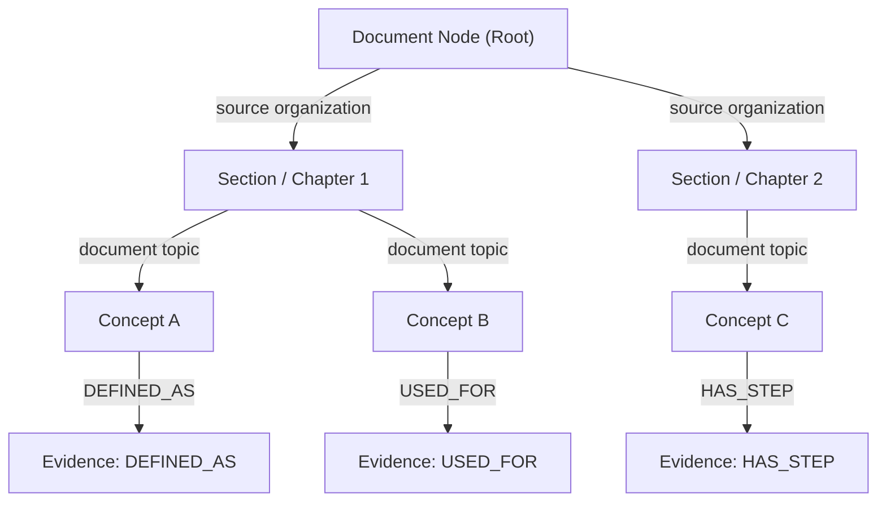

# Mind Map Generation & Graph Layout Algorithm Evidence

> **Audit Context**: LuminaR Research Evidence Audit — Part 6  
> **Source Files Verified**:
> - `rag/services/document_knowledge.py` (Lines 426–435, 516–547)
> - `frontend/src/components/knowledge/mapLayout.ts` (Lines 1–57)
> - `frontend/src/components/knowledge/KnowledgeMap.tsx` (Lines 1–127)

---

## 1. Node & Edge Hierarchy

The LuminaR Mind Map constructs a multi-tiered hierarchical semantic graph directly from document structure and extracted facts:



### A. Node Typology
| Node Type | Source Origin | Maximum Cap | Description / Payload |
| :--- | :--- | :--- | :--- |
| **`document`** | Document Title | 1 (Root) | Central graph anchor (`id: 'document'`) |
| **`chapter` / `section`** | Structural Headings | Up to 10 | Organizational group nodes inferred from chunk headings |
| **`concept`** | MMR-selected Concepts | Up to 24 | Core knowledge concepts with explanation, confidence, score |
| **`evidence`** | Relation Target Sentences | Up to 24 | Extracted factual predicates, explanations, or step targets |
| **Total Graph Limit** | — | **$\le 60$ nodes** | `min(24, 60 - len(nodes))` in `document_knowledge.py:539` |

### B. Edge Typology & Semantic Relations
Edges in LuminaR explicitly distinguish between **structural containment** and **semantic assertion**:

1. **Structural Edges**:
   - `'source organization'`: Connects `document` to intermediate `chapter` or `section` groups.
   - `'document topic'`: Connects `chapter` or `section` to child `concept` nodes.
2. **Semantic Relation Edges**:
   Mapped in `document_knowledge.py:426-435` from source predicate verbs:
   - `DEFINED_AS`: Mapped from `"is defined as"`, `"refers to"`, `"means"`, or definitional `"is"` / `"are"`.
   - `CONTAINS`: Mapped from `"consists of"`.
   - `USED_FOR`: Mapped from `"is used for"`.
   - `HAS_STEP`: Mapped from procedural step statements (`"has step"`).
   - `DESCRIBED_AS`: Mapped from non-definitional `"is"` / `"are"` sentences.

---

## 2. Selection, Pruning & Degree Limits

To prevent cluttered, unreadable "hairball" graph visualizers, the engine enforces strict degree and pruning constraints:

```python
# rag/services/document_knowledge.py:520-547
for concept in concepts[:24]:
    parent = 'document'
    for field in ('chapter', 'section'):
        label = concept.get(field)
        if not label or phrase_key(label) == phrase_key(concept['label']):
            continue
        key = (parent, field, label)
        if key not in groups and len(groups) < 10:
            group = legacy.identifier('group', '|'.join(key))
            groups[key] = group
            nodes.append({'id': group, 'label': label, 'type': field, ...})
            edges.append({'source': parent, 'target': group, 'relation': 'source organization', ...})
        parent = groups.get(key, parent)
    nodes.append({**concept, 'type': 'concept'})
    edges.append({'source': parent, 'target': concept['id'], 'relation': 'document topic', ...})

for relation in model.relations[:min(24, 60 - len(nodes))]:
    if not any(n['id'] == relation['source'] for n in nodes):
        continue
    target = relation['id']
    nodes.append({'id': target, 'label': normalized(relation['targetText'])[:160], 'type': 'evidence', ...})
    edges.append({'source': relation['source'], 'target': target, 'relation': relation['type'], ...})
```

### Pruning Constraints:
1. **Concept Cap**: Only top 24 concepts are included.
2. **Structural Group Cap**: At most 10 intermediate sections/chapters are created.
3. **Evidence Cap**: Total nodes cannot exceed 60 (`60 - len(nodes)`).
4. **Target Text Length**: Evidence node labels are clamped to 160 characters (`[:160]`).
5. **Deduplication Threshold**: Redundant concepts with cosine similarity $\ge 0.90$ are pruned during earlier Bounded MMR selection.

---

## 3. Custom Client-Side Graph Layout (`mapLayout.ts`)

LuminaR does NOT depend on heavy external graph libraries (such as D3-force, Cytoscape, Vis.js, or ReactFlow). Instead, it implements a **custom, deterministic, two-sided balanced tree layout** in `frontend/src/components/knowledge/mapLayout.ts`:

### A. Algorithm Steps
1. **Root Identification**: Locates the `document` node (depth 0).
2. **BFS Tree Traversal**: Traverses outgoing edges to establish depth levels for all reachable nodes.
3. **Weight Computation**: Recursively computes subtree weight:
   $$\text{weight}(u) = \max\left(1, \sum_{v \in \text{children}(u)} \text{weight}(v)\right)$$
4. **Two-Sided Partitioning**: Splits main branches into Left (Side 0) and Right (Side 1) trees to maintain a visually balanced canvas centered on the document root:
   ```typescript
   const sides: string[][] = [[], []], counts = [0, 0]
   for (const branch of children.get(root)!) {
     const side = counts[0] <= counts[1] ? 0 : 1
     sides[side].push(branch); counts[side] += weight.get(branch) || 1
   }
   ```
5. **Coordinate Assignment**:
   - Card dimensions: Fixed card width = 205 px, height = 68 px (`mapCardWidth = 205`, `mapCardHeight = 68`).
   - X-coordinates: Projected outward from central root along horizontal tiers:
     $$X(u) = X_{\text{center}} \pm \text{depth}(u) \times \text{gap}$$
   - Y-coordinates: Evenly distributed within branch vertical spans to prevent overlapping cards.

### B. Connector Rendering
Edges are rendered as smooth SVG cubic Bézier curves (`KnowledgeMap.tsx:98-99`):
```tsx
const middle = (x1 + x2) / 2
<path
  d={`M${x1},${y1} C${middle},${y1} ${middle},${y2} ${x2},${y2}`}
  fill="none"
  stroke="currentColor"
  strokeWidth="1.2"
  vectorEffect="non-scaling-stroke"
  opacity=".3"
>
  <title>{edge.relation.replaceAll('_', ' ')}</title>
</path>
```

---

## 4. Source Mapping & Interactive UI

In `frontend/src/components/knowledge/KnowledgeMap.tsx`:
- **Canvas Controls**:
  - Interactive pan via pointer capture (`onPointerDown`, `onPointerMove`, `onPointerUp`).
  - Zooming via mouse wheel (`event.deltaY`) or zoom buttons (`0.1x` to `2.5x`).
  - "Reset view" button: Re-centers the graph to fit the bounding box.
  - "Fullscreen" mode: Accessible modal dialog with focus trapping and `Escape` key handler.
- **Source Inspection**:
  - Clicking any node fires `setSelected(node)` and calls `onSource(node.sourceChunkIds[0])`.
  - The side preview drawer slides out, fetching the chunk via `getSource()` and displaying the exact page number and source excerpt.
