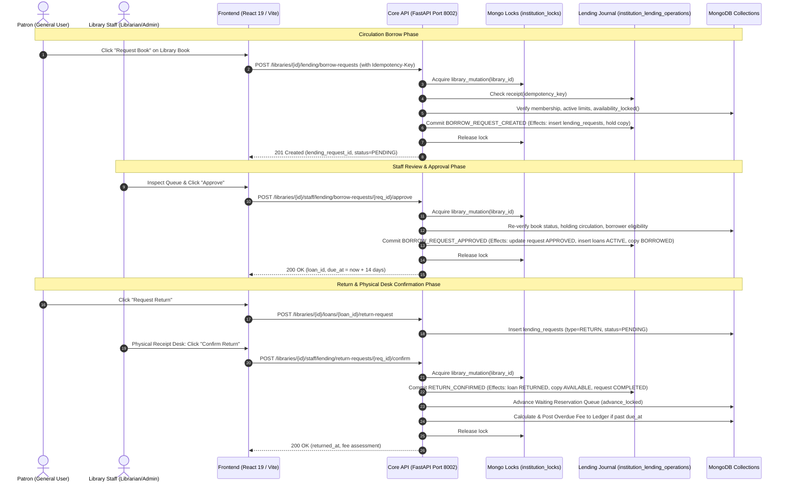

# 45_LIBRARY_OPERATIONS.md: Library Operations Audit & E2E Tracing

> **Audit Report:** Part 8 Research Evidence Audit  
> **Repository:** LuminaR (`d:\SDC\LibraryLLM`)  
> **Scope:** Complete Library Operations, Circulation Workflows, Inventory Management, and E2E Stack Tracing  
> **Status:** Ground-Truth Code Verification  

---

## 1. Architectural Overview of Library Operations

LuminaR implements a **dual circulation and cataloging architecture**:
1. **Global Catalogue System (Legacy / Compatibility Layer):** Direct book browsing across 5,000,000 OpenLibrary records (`books` collection), platform-wide issue tracking (`issues` collection), legacy fine accumulation, and global reservations.
2. **Tenant Institution Circulation Operating System (Canonical V2 System):** Multi-tenant digital library management operating within an immutable `library_id` scope. Uses a **write-ahead durable operation journal** (`institution_lending_operations`), pessimistic cross-worker mutation serialization (`institution_locks`), two-phase commit state machines, strict accession numbering (`LIB-000001`), integer minor-unit fee ledgers, and waiting reservation queues.



---

## 2. Exhaustive End-to-End Tracing by Operation

### 2.1 Add Book (Tenant Inventory)

| Stage | Concrete Code Artifact | Technical Mechanics |
| :--- | :--- | :--- |
| **Frontend UI** | `frontend/src/pages/LibraryInventory.tsx` (`BookModal`, `handleSaveBook`) | Renders modal form with Title, Authors, ISBN-10/13, Shelf Location, Local Call Number, Subjects. Sends `POST /api/libraries/{library_id}/inventory/books` using `coreRequest`. Generates client-side `idempotency_key = crypto.randomUUID()`. |
| **Backend Route** | `backend/routes/library_inventory.py:21-24` (`def create`) | Route: `POST /libraries/{library_id}/inventory/books`, Status: 201. Depends on `get_current_user`. Validates payload against `BookCreate` schema (`schemas/library_catalogue.py`). Calls `service.create_book(library_id, request, actor)`. |
| **Service Layer** | `backend/services/library_catalogue_service.py:102-149` (`create_book`) | 1. Acquires `library_mutation(library_id, durable=True)` lock.<br>2. Calls `require_library_staff(library_id, actor, locked=True)` (verifies role $\in \{\text{ADMIN}, \text{LIBRARIAN}\}$).<br>3. Verifies optional `global_work_id` or checks ISBN compatibility via `isbn_candidates()`.<br>4. Checks duplicate titles via `duplicate(repo, data)`.<br>5. Generates accession sequence and number via `repo.accession(library)` (`LIB-000001`).<br>6. Prepares records for `institution_library_books` and default `institution_holdings`. |
| **Journal & Commits** | `backend/services/library_lending_journal.py` | If library is in `CANONICAL` lending mode, registers operation in `institution_lending_operations` and applies two-phase atomic effects. If legacy snapshot, directly executes Mongo inserts. |
| **MongoDB Target** | `institution_library_books`, `institution_holdings`, `institution_sequences`, `institution_audit` | Inserts new document in `institution_library_books` (`library_book_id` UUID, `accession_number`, `status: 'ACTIVE'`). Inserts matching holding in `institution_holdings` (`total_copies: 0`, `available_copies: 0`). Atomic sequence increment in `institution_sequences`. Records event `BOOK_CREATED` in `institution_audit`. |

---

### 2.2 Edit Book Metadata & Holding Details

| Stage | Concrete Code Artifact | Technical Mechanics |
| :--- | :--- | :--- |
| **Frontend UI** | `frontend/src/pages/LibraryInventory.tsx` (`handleUpdateBook`, `handleSaveHolding`) | Allows staff to edit title, author array, shelf location, call number, or stock quantity. Triggers `PATCH /api/libraries/{id}/inventory/books/{book_id}` or `PUT .../holding`. |
| **Backend Route** | `backend/routes/library_inventory.py:31-39` (`def update`, `def holding`) | `PATCH /books/{library_book_id}` validates `BookUpdate`. `PUT /books/{library_book_id}/holding` validates `HoldingUpdate`. |
| **Service Layer** | `backend/services/library_catalogue_service.py:292-366` (`update_book`, `update_holding`) | Under `library_mutation`: ensures staff authority. Recomputes `search_text` and `normalized_title`. If canonical circulation is active, direct override of `available_copies` is rejected with HTTP 409 (`Use canonical Manage Stock; requestable availability cannot be overridden`). Updates shelf location across both book and holding. |
| **MongoDB Target** | `institution_library_books`, `institution_holdings`, `institution_audit` | Mutates fields via `$set`. Emits `LIBRARY_BOOK_UPDATED` or `SHELF_UPDATED` audit entry with previous vs new values. |

---

### 2.3 Delete / Withdraw Book

| Stage | Concrete Code Artifact | Technical Mechanics |
| :--- | :--- | :--- |
| **Frontend UI** | `frontend/src/pages/LibraryInventory.tsx` (`handleWithdrawBook`) | Displays confirmation dialog warning that active loans prevent withdrawal. Sends `DELETE /api/libraries/{id}/inventory/books/{book_id}` with `Idempotency-Key` header. |
| **Backend Route** | `backend/routes/library_inventory.py:46-49` (`def withdraw`) | Route: `DELETE /books/{library_book_id}`. Extracts `idempotency_key` from header. |
| **Service Layer** | `backend/services/library_catalogue_service.py:398-418` (`withdraw`) | Under `library_mutation`: ensures staff authority. Validates that no active loans exist for this holding. Does **not** physically purge the row; updates status to `WITHDRAWN` (`soft-delete`). Updates holding `circulation_status: 'WITHDRAWN'`. In canonical mode, commits via durable journal `LIBRARY_BOOK_WITHDRAWN`. |
| **MongoDB Target** | `institution_library_books`, `institution_holdings`, `institution_audit` | Updates `status: 'WITHDRAWN'` on book and holding. Records `LIBRARY_BOOK_WITHDRAWN` event in `institution_audit`. |

---

### 2.4 Browse & Filter Books

| Stage | Concrete Code Artifact | Technical Mechanics |
| :--- | :--- | :--- |
| **Frontend UI** | `frontend/src/pages/LibraryCatalogue.tsx`, `frontend/src/lib/libraryCatalogue.ts` | Dispatches query parameters: `search`, `subject`, `author`, `circulation_status`, `sort` (`title`, `new_arrivals`, `popular`), `offset`, `limit`. Displays book format badges (`PHYSICAL`, `DIGITAL`, `HYBRID`), request availability, and reservation buttons. |
| **Backend Route** | `backend/routes/library_catalogue_experience.py:32-39` (`def books`) | Route: `GET /libraries/{library_id}/catalogue/books`. Parameters bounded: `search` (max 150), `offset` ($\le 100,000$), `limit` (max 50). Depends on `get_current_user`. |
| **Service Layer** | `backend/services/library_catalogue_experience.py:112-198` (`books`) | 1. Verifies membership via `resolve_library_membership(library_id, actor)`.<br>2. Executes MongoDB aggregation pipeline filtering by tenant `library_id` and `status: 'ACTIVE'`.<br>3. Performs `$lookup` on `institution_holdings` and `institution_library_assets`.<br>4. Resolves real-time availability via `hydrate()`: calculates requestable count, waiting queue length, and user loan status. |
| **MongoDB Target** | `institution_library_books`, `institution_holdings`, `institution_library_assets`, `institution_reservations` | Aggregates read-only records with indexed projections. Requires `require_readable(library_id)` ensuring no concurrent destructive mutation lock is held. |

---

### 2.5 Real-Time Availability Checking

| Stage | Concrete Code Artifact | Technical Mechanics |
| :--- | :--- | :--- |
| **Formula & Logic** | `backend/services/library_catalogue_availability.py:21-48` (`project`) | Mathematical availability projection:$$\text{physical\_available} = \begin{cases} \max(0, \text{total\_copies} - \text{unavailable\_stock} - \text{conditions} - \text{active} - \text{pending}) & \text{if AGGREGATE} \\ \text{copy\_available} & \text{if COPY mode} \end{cases}$$$$\text{requestable} = \begin{cases} \text{physical\_available} & \text{if not waiting queue exists} \\ 0 & \text{if waiting queue has active members} \end{cases}$$ |
| **Backend Route** | `backend/routes/library_lending.py:46-49` (`def availability`) | Route: `GET /libraries/{id}/inventory/{library_book_id}/availability`. Returns breakdown: `physical_total`, `physical_available`, `active_loans`, `pending_holds`, `requestable`, `allocation_mode`, `circulation_status`. |
| **Database State** | `institution_holdings`, `institution_copies`, `institution_lending_requests`, `institution_loans` | Under serializing lock, queries live counts of `lending_requests` (`status: PENDING`), `loans` (`status: ACTIVE`), and damaged/lost copies in `institution_copies`. |

---

### 2.6 Borrow Book (Approval Circulation Workflow)

| Stage | Concrete Code Artifact | Technical Mechanics |
| :--- | :--- | :--- |
| **Frontend UI** | `frontend/src/pages/LibraryCatalogue.tsx` (`handleBorrowRequest`), `frontend/src/lib/libraryLending.ts` | Patron clicks "Request Book". Prompts for confirmation. Sends `POST /api/libraries/{id}/lending/borrow-requests` with `{ library_book_id: string, idempotency_key: string }`. |
| **Backend Route** | `backend/routes/library_lending.py:51-54` (`def borrow`) | Route: `POST /libraries/{library_id}/lending/borrow-requests`, Status: 201. Accepts `Borrow` schema (`library_book_id`, `idempotency_key`). |
| **Service Layer** | `backend/services/library_lending_service.py:159-188` (`borrow`) | 1. Enters `library_mutation(library_id)` lock.<br>2. Verifies actor is active patron (`require_library_patron`).<br>3. Checks pending request limit (max 5 per user across tenant).<br>4. Re-checks availability locked: requires `requestable >= 1`.<br>5. Checks that book is not blocked by waiting queue (`blocks_direct`).<br>6. If allocation mode is `COPY`, finds lowest copy number `AVAILABLE` and allocates to `HELD_FOR_REQUEST`.<br>7. Sets hold expiry: `now() + timedelta(hours=24)`.<br>8. Journal commits `BORROW_REQUEST_CREATED`. |
| **MongoDB Target** | `institution_lending_requests`, `institution_copies`, `institution_lending_operations` | Inserts into `institution_lending_requests` with `status: 'PENDING'`. Updates `institution_copies` (if COPY mode) to `HELD_FOR_REQUEST`. |

---

### 2.7 Review & Approve / Reject Borrow Request (Staff Desk)

| Stage | Concrete Code Artifact | Technical Mechanics |
| :--- | :--- | :--- |
| **Frontend UI** | `frontend/src/pages/LibraryCirculation.tsx` (`handleApproveBorrow`, `handleRejectBorrow`) | Staff views "Borrow Requests" queue tab. Filters by PENDING. Clicks "Approve" or "Reject" (with optional reason modal). Sends `POST /api/libraries/{id}/staff/lending/borrow-requests/{req_id}/{action}`. |
| **Backend Route** | `backend/routes/library_lending.py:87-90` (`def review_borrow`) | Route: `POST /staff/lending/borrow-requests/{request_id}/{action}` (`action` $\in \{\text{'approve'}, \text{'reject'}\}$). |
| **Service Layer** | `backend/services/library_lending_service.py:197-236` (`review_borrow`) | Under `library_mutation`: validates staff authority. If reject: marks request `REJECTED`, releases copy hold (returns copy to `AVAILABLE`). If approve: verifies patron membership is still active; creates new loan document (`status: 'ACTIVE'`, `borrowed_at = now()`, `due_at = now() + 14 days`); updates request `status: 'APPROVED'`; transitions copy status to `BORROWED`. Commits via journal. |
| **MongoDB Target** | `institution_lending_requests`, `institution_loans`, `institution_copies`, `institution_lending_operations` | Updates request status, inserts into `institution_loans`, mutates copy status, appends committed operation in journal. |

---

### 2.8 Return Book & Desk Confirmation

| Stage | Concrete Code Artifact | Technical Mechanics |
| :--- | :--- | :--- |
| **Patron Request UI** | `frontend/src/pages/LibraryCirculation.tsx`, `AccountPages.tsx` | Patron initiates return: `POST /api/libraries/{id}/loans/{loan_id}/return-request`. Loan enters `pending_return_request_id` state. |
| **Staff Assisted UI** | `frontend/src/pages/LibraryCirculation.tsx` (`handleConfirmReturn`, `handleAssistedReceive`) | Desk staff clicks "Receive & Return" directly. Triggers `POST /api/libraries/{id}/staff/loans/{loan_id}/receive` which bundles return request and physical confirmation atomically. |
| **Backend Route** | `backend/routes/library_lending.py:97-100, 127-134` (`review_return`, `assisted_receive`) | Validates `Review` payload with idempotency key. |
| **Service Layer** | `backend/services/library_lending_service.py:273-297` (`review_return`) | Under `library_mutation`: verifies staff authority. Sets loan `status: 'RETURNED'`, `returned_at = now()`, `received_by_user_id = staff_user_id`. Transitions copy back to `AVAILABLE`. Calls `advance_locked(library_id, book_id)` to notify/convert head of waiting reservation queue. Calculates overdue fine if `now() > due_at`. |
| **MongoDB Target** | `institution_loans`, `institution_lending_requests`, `institution_copies`, `institution_fees`, `institution_fee_ledger` | Updates loan to `RETURNED`. Releases copy to `AVAILABLE`. Inserts fee into `institution_fees` if overdue. Commits via journal. |

---

### 2.9 Book Reservation & Queue Conversion

| Stage | Concrete Code Artifact | Technical Mechanics |
| :--- | :--- | :--- |
| **Frontend UI** | `frontend/src/pages/LibraryCatalogue.tsx` (`handleReserveBook`), `LibraryReservationsFees.tsx` | When `requestable == 0`, displays "Reserve Book" button showing current queue depth. Prompts user and sends `POST /api/libraries/{id}/reservations`. |
| **Backend Route** | `backend/routes/library_reservations_fees.py:26-29` (`def reserve`) | Route: `POST /libraries/{library_id}/reservations`, Status: 201. Validates `Reservation` schema (`library_book_id`, `idempotency_key`). |
| **Service Layer** | `backend/services/library_reservation_service.py:63-91` (`create`) | 1. Under `library_mutation`: validates patron membership.<br>2. Verifies user does not already hold active loan, pending hold, or waiting reservation for this book.<br>3. Enforces limit: max 5 active reservations per user.<br>4. Atomically increments monotonic counter in `institution_reservation_counters` for `(library_id, library_book_id)`.<br>5. Inserts reservation with `queue_sequence = sequence`, `status: 'WAITING'`. |
| **Queue Advancement** | `backend/services/library_reservation_service.py:36-48` (`advance_locked`) | Triggered on return receipt or cancellation: evaluates head of queue (`WAITING` sorted by `queue_sequence` ascending). Validates patron account eligibility. If eligible and physical copy is now available, advances head member into hold. |
| **MongoDB Target** | `institution_reservations`, `institution_reservation_counters`, `institution_lending_operations` | Inserts queue entry with unique partial index on `(library_id, library_book_id, user_id)` for status `WAITING`. |

---

### 2.10 Overdue Fines, Due Dates & Ledger Reconciliation

| Stage | Concrete Code Artifact | Technical Mechanics |
| :--- | :--- | :--- |
| **Policy Definition** | `backend/services/library_fee_service.py:13-26` (`initial_policy`, `current_policy`) | Rate: `rate_minor_per_day: 500` (represents ₹5.00 INR/day in integer minor units). Grace period: `grace_days: 0`. Charge stop: `PHYSICAL_RECEIPT` or `FIRST_VALID_RETURN_REQUEST`. Day boundary: `UTC_CALENDAR_DAY`. |
| **Fee Calculation** | `backend/services/library_fee_service.py:28-47` (`calculation`) | Mathematical calculation:$$\text{overdue\_days} = \max\left(0, \left(\text{date}(\text{stop}) - \text{date}(\text{due\_at})\right).\text{days} - \text{grace\_days}\right)$$$$\text{amount\_minor} = \text{overdue\_days} \times \text{rate\_minor\_per\_day}$$ |
| **Posting & Ledger** | `backend/services/library_fee_service.py:49-72` (`fee_effects`) | Generates deterministic `fee_id` via UUIDv5. Inserts fee in `institution_fees` (`status: 'OPEN'`). Simultaneously posts append-only debit entry in `institution_fee_ledger` (`entry_type: 'CHARGE'`). Balance invariant verified via `verify_ledger(fee)`:$$\text{balance\_minor} \equiv \sum \text{charges} - \sum \text{credits} - \sum \text{waivers} - \sum \text{payments}$$ |
| **Waiver & Payments** | `backend/services/library_fee_service.py:101-150` (`mutate`) | Staff can waive fines (`POST .../waive`) or record physical cash payments at desk (`POST .../payments`). Appends `WAIVER` or `PAYMENT_RECORD` into ledger. Recomputes fee status (`PAID` or `PARTIALLY_PAID`). |

---

### 2.11 Loan Renewals

| Stage | Concrete Code Artifact | Technical Mechanics |
| :--- | :--- | :--- |
| **Frontend UI** | `frontend/src/pages/LibraryCirculation.tsx` (`handleRenewLoan`), `frontend/src/lib/loanRenewal.ts` | Patron or staff clicks "Renew". Sends `POST /api/libraries/{id}/loans/{loan_id}/renew`. |
| **Backend Route** | `backend/routes/library_lending.py:102-105, 122-125` (`renew`, `assisted_renew`) | Validates `Renew` schema with idempotency key. |
| **Service Layer** | `backend/services/library_lending_service.py:299-340` (`renew`) | Under `library_mutation`: checks that loan is `ACTIVE`. Checks max renewal count (max 2 renewals). Checks whether waiting reservation exists for this book via `renewal_blocked(library_id, book_id, user_id)`: **if another patron is waiting in queue, renewal is strictly blocked with HTTP 409**. Extends `due_at` by 14 days and increments `renewal_count`. |
| **MongoDB Target** | `institution_loans`, `institution_lending_operations` | Mutates `due_at` and `renewal_count` under journal transaction. |

---

### 2.12 Physical Copies Tracking & Management

| Stage | Concrete Code Artifact | Technical Mechanics |
| :--- | :--- | :--- |
| **Frontend UI** | `frontend/src/pages/LibraryInventory.tsx` (`CopiesModal`, `handleAddCopy`, `handleUpdateCondition`) | Staff opens book copies modal. Inspects copy barcodes, condition statuses, and acquisition dates. Registers individual barcode units. |
| **Backend Route** | `backend/routes/library_inventory.py:51-59` (`def copies`, `def copy`), `backend/routes/library_lending.py:117-120` (`def condition`) | `GET /books/{id}/copies` (paginated), `POST /books/{id}/copies`, `PUT .../copies/{copy_id}/condition`. |
| **Service Layer** | `backend/services/library_catalogue_service.py:84-100, 420-436` (`add_copy_locked`, `create_copy`), `library_lending_service.py:380-410` (`manage`) | In canonical mode, copy registration requires UUID idempotency key. Increments holding `total_copies`. Validates unique barcode. Updates copy condition to `DAMAGED`, `LOST`, `AVAILABLE`, or `WITHDRAWN`. Adjusts `conditions` count in availability formula. |
| **MongoDB Target** | `institution_copies`, `institution_holdings`, `institution_audit` | Mutates `institution_copies` with unique index on `(library_id, barcode)`. |

---

### 2.13 Admin / Librarian Management Operations

| Operation | Primary Endpoint | Guard & Authority | Journal / Mutation Protection |
| :--- | :--- | :--- | :--- |
| **Lending Cutover** | `POST /libraries/{id}/staff/lending/activate` | Requires `ADMIN` membership | Verifies zero unconverted legacy loans; locks tenant mutation; sets `lending_config.state = 'CANONICAL'`. |
| **Bulk CSV/XLSX Import** | `POST /libraries/{id}/inventory/imports/preview`<br>`POST .../imports/{id}/apply` | Requires `STAFF` (`ADMIN` or `LIBRARIAN`) | Enforces 5 MiB / 2,000 row budget via `InventoryUploadLimit`. Two-stage ephemeral preview with validation before batch application. |
| **Access Code Rotation** | `POST /libraries/{id}/security/access-code` | Requires `ADMIN` owner | Hashes pass code via bcrypt/argon2 in `institution_security`; audits rotation. |
| **Staff Invitation & Role Demotion** | `POST /libraries/{id}/invitations`<br>`PATCH /libraries/{id}/memberships/{id}` | Requires `ADMIN` authority | Sends Brevo email with cryptographically random OTP token; restricts role promotion/demotion. |
| **Fee Policy Versioning** | `POST /libraries/{id}/settings/fee-policy` | Requires `ADMIN` authority | Creates immutable version $N+1$ in `institution_fee_policies`. Does not retroactively mutate past loans. |
| **Digital Asset Ingestion** | `POST /libraries/{id}/assets` | Requires `STAFF` authority | Enforces 64 MiB limit via `LibraryAssetUploadLimit`. Spools PDF to disk, triggers extraction, chunking, and embedding. |

---

## 3. Operations Verification Summary

```text
========================================================================================
OPERATION               FRONTEND PAGE                BACKEND ROUTE                      MONGODB COLLECTIONS
========================================================================================
Add Book                LibraryInventory.tsx         POST .../inventory/books           institution_library_books, holdings
Edit Book               LibraryInventory.tsx         PATCH .../inventory/books/{id}    institution_library_books, holdings
Delete (Withdraw) Book  LibraryInventory.tsx         DELETE .../inventory/books/{id}   institution_library_books (WITHDRAWN)
Browse Catalogue        LibraryCatalogue.tsx         GET .../catalogue/books            institution_library_books, holdings
Availability Check      LibraryCatalogue.tsx         GET .../availability              holdings, copies, loans, requests
Request Borrow          LibraryCatalogue.tsx         POST .../borrow-requests           institution_lending_requests, copies
Approve Borrow          LibraryCirculation.tsx       POST .../borrow-requests/{id}/app  institution_loans, copies, requests
Reject Borrow           LibraryCirculation.tsx       POST .../borrow-requests/{id}/rej  institution_lending_requests, copies
Request Return          LibraryCirculation.tsx       POST .../loans/{id}/return-request institution_lending_requests
Confirm Return Desk     LibraryCirculation.tsx       POST .../return-requests/{id}/conf institution_loans, copies, fees
Reserve Book            LibraryCatalogue.tsx         POST .../reservations              institution_reservations, counters
Cancel Reservation      LibraryReservationsFees.tsx  POST .../reservations/{id}/cancel  institution_reservations (CANCELLED)
Advance Reserve Queue   (Automated / Return Hook)    advance_locked()                   institution_reservations, requests
Generate Overdue Fee    (Automated / Return Hook)    fee_effects()                      institution_fees, institution_fee_ledger
Waive / Adjust Fee      LibraryReservationsFees.tsx  POST .../fees/{id}/waive           institution_fees, institution_fee_ledger
Pay Fee Desk Cash       LibraryReservationsFees.tsx  POST .../fees/{id}/payments        institution_fees, institution_fee_ledger
Renew Loan              LibraryCirculation.tsx       POST .../loans/{id}/renew          institution_loans
Add / Update Copy       LibraryInventory.tsx         POST/PUT .../copies                institution_copies, holdings
Bulk Ingest Catalogue   LibraryInventory.tsx         POST .../imports/...               institution_inventory_imports
========================================================================================
```
