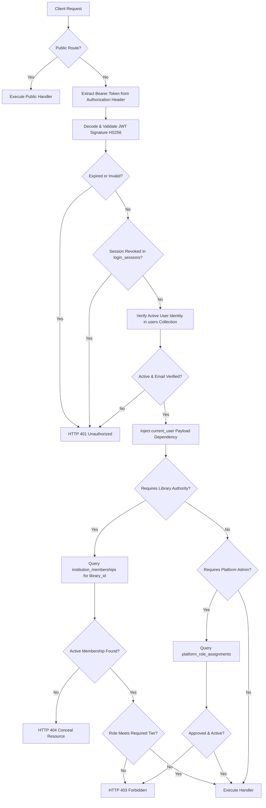

# 47_AUTH_AND_AUTHORIZATION.md: Authentication & Authorization Audit

> **Audit Report:** Part 8 Research Evidence Audit  
> **Repository:** LuminaR (`d:\SDC\LibraryLLM`)  
> **Scope:** User Registration, Login, Password Hashing, JWT/Session Lifecycle, Role Hierarchy, and Access Control  
> **Status:** Ground-Truth Code Verification  

---

## 1. Authentication Architecture & Protocol

LuminaR implements a **token-based stateless bearer authentication model** paired with **session revocation tracking (`sid`)** and **email OTP verification**:



---

## 2. Authentication Lifecycles

### 2.1 User Registration (`POST /auth/register`)
- **Source:** `backend/routes/auth.py:77-118`, `backend/services/auth_service.py:48-114`
- **Validation:**
  - Email: Formatted via `pydantic.EmailStr`, whitespace-trimmed, and normalized to lowercase via `normalize_email()`.
  - Password: Enforces $8 \le \text{length} \le 72$ UTF-8 bytes.
- **Workflow:**
  1. Checks if email already exists in `users` (`email_exists`). If found, returns HTTP 409 (`Email already registered`).
  2. Hashes password using `bcrypt.hashpw(password_bytes, bcrypt.gensalt())`.
  3. Allocates atomic integer `user_id` from `counters` collection.
  4. Inserts document into `users` with `role: "GENERAL_USER"`, `is_email_verified: False`, `is_active: True`.
  5. Generates 6-digit random decimal OTP (`generate_otp`). Hashes OTP via `bcrypt.hashpw()` and stores in `email_verifications` with 10-minute expiry (`attempts: 0`).
  6. Dispatches transactional email via Brevo REST API (`send_otp_email`).
  7. **Compensating Rollback:** If Brevo email dispatch fails (`email_sent is False`), the unverified `users` record and `email_verifications` token are immediately deleted from MongoDB, raising HTTP 500 (`Unable to send verification email`).

---

### 2.2 Email OTP Verification (`POST /auth/verify-email`)
- **Source:** `backend/routes/auth.py:120-154`, `backend/services/auth_service.py:117-150`
- **Rate Limiting:** Enforces `limit_auth_attempts` middleware dependency.
- **Verification Logic:**
  1. Verifies OTP format: exactly 6 ASCII digits.
  2. Queries `email_verifications` for `user_id` where `expires_at > now()` and `attempts < 5`.
  3. Atomically increments `attempts` by 1 (`find_one_and_update`). If attempts reach 5, code is invalidated.
  4. Verifies hash via `bcrypt.checkpw(otp.encode(), otp_hash.encode())`.
  5. If valid, deletes verification record atomically (`delete_one`) to prevent code replay attacks.
  6. Updates `users` collection: sets `is_email_verified: True`.

---

### 2.3 User Login (`POST /auth/login`)
- **Source:** `backend/routes/auth.py:190-224`, `backend/services/auth_service.py:261-291`
- **Verification Logic:**
  1. Finds user document by normalized email.
  2. If user not found, or password exceeds 72 bytes: returns HTTP 401 (`Invalid email or password`).
  3. Verifies password hash using `bcrypt.checkpw(password.encode(), password_hash.encode())`.
  4. Ensures `user.is_active is True`.
  5. Ensures `user.is_email_verified is True` (otherwise raises HTTP 403 `Please verify your email before logging in`).
  6. Issues JWT access token with unique session ID (`sid`).

---

### 2.4 Staff Login (`POST /auth/staff-login`)
- **Source:** `backend/routes/auth.py:226-245`
- **Privilege Gate:**
  1. Executes standard password and email verification.
  2. Queries `institution_memberships` for `user_id` where `status: "ACTIVE"` and `role` $\in \{"\text{ADMIN}", "\text{LIBRARIAN}"\}$.
  3. If no tenant staff membership exists, queries `platform_role_assignments` for active platform admin roles.
  4. If neither condition is satisfied, emits security audit log `security_event('staff_login_failure')` and rejects login with HTTP 403 (`This account is not authorized for staff access`).
  5. If authorized, records `security_event('staff_login_success')` and issues staff-scoped JWT (30-minute expiry).

---

### 2.5 Session Logout & Revocation (`POST /auth/logout`)
- **Source:** `backend/routes/auth.py:22-37`, `backend/services/login_sessions.py:8-35`
- **Workflow:**
  1. Extracts `sid` from authenticated JWT payload.
  2. Sends synchronous HTTP request to RAG service (`POST http://127.0.0.1:8005/rag/session/logout`) with Bearer token.
  3. RAG service purges all session-isolated private documents and temporary vector indices associated with `(owner, sid)`.
  4. Core backend registers `sid` in `login_sessions.revoke()`, causing any subsequent request presenting this JWT to fail validation with HTTP 401.

---

## 3. Cryptographic Specifications

### 3.1 Password Hashing
- **Algorithm:** `bcrypt` with random salt generation (`bcrypt.gensalt()`).
- **Cost Factor:** Default work factor 12 (4,096 iterations).
- **Password Length Boundary:**
  - Minimum: 8 characters.
  - Maximum: 72 UTF-8 bytes.
  - **Security Rationale:** Bcrypt natively truncates inputs at 72 bytes. Passwords longer than 72 bytes would allow authentication with differing suffixes without length enforcement. LuminaR explicitly rejects inputs $> 72$ bytes at both Pydantic and service layers.

### 3.2 JWT Token Architecture
- **Algorithm:** `HS256` (HMAC with SHA-256) via `python-jose[cryptography]`.
- **Signing Key:** Loaded dynamically via `os.getenv("JWT_SECRET_KEY")`.
- **Token Claims Schema:**
  ```json
  {
    "sub": "42",
    "email": "reader@example.com",
    "role": "GENERAL_USER",
    "sid": "7b3a9c81e5f24d10ba8204639cf01234",
    "iat": 1728810000,
    "exp": 1728813600
  }
  ```
- **Token Expiration Policies:**
  - Patron / General Reader: 60 minutes (`ACCESS_TOKEN_EXPIRE_MINUTES = 60`).
  - Staff / Librarian / Administrator: 30 minutes (`30 if role in ('ADMIN', 'LIBRARIAN') else 60`).
- **Token Decoding Controls:** Configured with `options={'require_exp': True, 'require_sub': True}`.

---

## 4. Authorization & Role-Based Access Control (RBAC)

### 4.1 Hierarchical Role Matrix

| Role Tier | Scope | Storage Location | Capabilities & Boundaries |
| :--- | :--- | :--- | :--- |
| **`PLATFORM_ADMIN`** | Global Platform | `platform_role_assignments` | Manage tenant library lifecycles (suspend/restore/remove); inspect platform account directory; oversee system audit logs. Does **not** bypass tenant membership checks. |
| **`ADMIN`** (Institution) | Tenant Library | `institution_memberships` | Full control over tenant library: edit profile, rotate access codes, invite staff, promote/demote librarians, view audit logs, perform lending cutover, execute all librarian actions. |
| **`LIBRARIAN`** | Tenant Library | `institution_memberships` | Manage tenant catalogue: add/edit books, manage copies, shelf locations, review/approve borrow requests, confirm physical returns at desk, waive/adjust fines, schedule events, upload digital assets. |
| **`GENERAL_USER`** (Patron) | Tenant Library | `institution_memberships` | Browse library catalogue, view real-time availability, submit borrow requests, submit return requests, place reservations in waiting queues, view personal loans/fees, access digital assets marked `PATRON_AND_STAFF`. |
| **`PLATFORM_USER`** / Unassigned | Global Account | `users` | Discover public libraries, manage profile, access global search, upload session-scoped private documents into personal RAG sandbox. |

---

### 4.2 Route Protection Guards & Dependencies

| Guard Function | File Location | Enforcement Mechanism | Failure Response |
| :--- | :--- | :--- | :--- |
| `get_current_user` | `backend/dependencies.py:10-24` | Extracts and decodes Bearer JWT; verifies signature, expiry, and session revocation. | HTTP 401 (`Invalid or expired token`) |
| `require_roles` | `backend/dependencies.py:27-32` | **Explicitly deprecated.** Raises immediate exception to prevent legacy role bypass. | HTTP 403 (`Legacy account roles do not grant management authority`) |
| `resolve_library_membership` | `backend/institution_dependencies.py:18-36` | Queries `institution_libraries` (`status: ACTIVE`) and `institution_memberships` (`status: ACTIVE`). | Returns `(library, membership)` or `(library, None)` |
| `require_library_membership` | `backend/institution_dependencies.py:39-44` | Enforces active tenant membership. **Conceals protected resources from outsiders and unauthorized admins.** | **HTTP 404 (`Library resource not found`)** |
| `require_library_role` | `backend/institution_dependencies.py:47-51` | Ensures member role $\in \text{allowed\_roles}$. | HTTP 403 (`Insufficient library permissions`) |
| `require_library_staff` | `backend/institution_dependencies.py:54-56` | Checks `membership['role'] in ('ADMIN', 'LIBRARIAN')`. | HTTP 403 (`Insufficient library permissions`) |
| `require_library_patron` | `backend/institution_dependencies.py:58-61` | Checks `membership['role'] == 'GENERAL_USER'`. | HTTP 403 (`Insufficient library permissions`) |
| `require_library_owner` | `backend/institution_dependencies.py:63-67` | Requires `membership['role'] == 'ADMIN'` AND `library['owner_user_id'] == actor_id(current_user)`. | HTTP 403 (`Only the library owner can perform this action`) |
| `require_platform_admin` | `backend/platform_dependencies.py:42-46` | Verifies active record in `platform_role_assignments` with non-expired approval timestamp. | HTTP 403 (`An active, explicitly approved PLATFORM_ADMIN assignment is required`) |

---

## 5. Document & Library Ownership Model

### 5.1 Private Document Ownership (RAG Workspace)
- **Isolation Scope:** `(owner_user_id, owner_session_id, exp)`
- **Storage:** Isolated SQLite database (`rag/private_documents/registry.sqlite`) with `PRAGMA secure_delete=ON`.
- **Enforcement (`rag/services/private_documents.py:70-76`):**
  ```python
  def owned(self, document_id, user):
      owner, sid = self.identity(user)
      with self.db() as db:
          row = db.execute(
              "SELECT * FROM documents WHERE id=? AND owner=? AND sid=? AND state='ACTIVE' AND expires>?",
              (document_id, owner, sid, time.time())
          ).fetchone()
      if row is None:
          raise HTTPException(404, 'Document not found.')
      return dict(row)
  ```
- **Security Guarantee:** A user from session $A$ cannot query, export, or synthesize artifacts from documents uploaded in session $B$, even under the same user account. Cross-user access is impossible.

### 5.2 Institutional Digital Asset Ownership
- **Isolation Scope:** `(library_id, visibility, status)`
- **Enforcement (`backend/services/library_asset_service.py:115-140`):**
  - Patrons can only list and query digital assets where `visibility == 'PATRON_AND_STAFF'` AND `status == 'READY'`.
  - Assets marked `STAFF_ONLY` are filtered out of patron queries.
  - File downloads are protected via `Content-Security-Policy: sandbox; default-src 'none'` and `X-Content-Type-Options: nosniff`.
