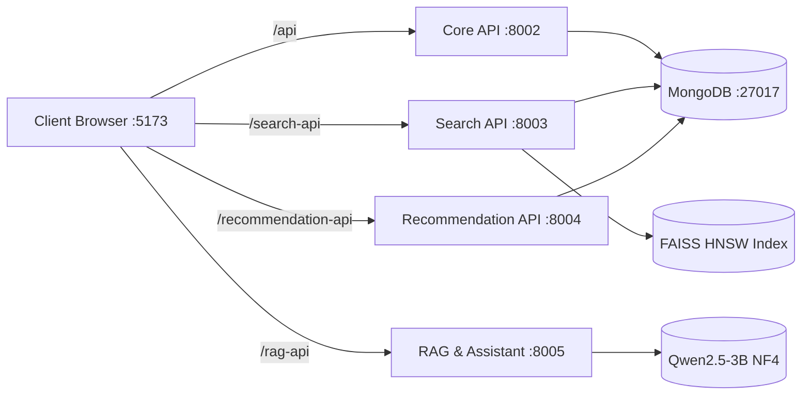

# 52_REPRODUCIBILITY.md: Comprehensive Reproduction Guide & Environment Specification

> **Audit Report:** Part 8 Research Evidence Audit  
> **Repository:** LuminaR (`d:\SDC\LibraryLLM`)  
> **Scope:** Full Environment Setup, Runtimes, Package Dependencies, Pre-trained Models, Database Seeding, Index Construction, and Multi-Service Startup  
> **Status:** Ground-Truth Code & Verification Guide  

---

## 1. System Runtime Specifications

| Runtime Layer | Required Version | Verification Command | Notes |
| :--- | :--- | :--- | :--- |
| **Python** | `3.13.x` (or `3.10+` - `3.12+`) | `python --version` | Recommended version: Python 3.13. Requires C++ Build Tools on Windows for `faiss-cpu` / `pymupdf`. |
| **Node.js** | `v20.x` or `v22.x` LTS | `node --version` | Node runtime required for Vite dev server and test runner (`--experimental-strip-types`). |
| **npm** | `v10.x+` | `npm --version` | Clean install via `npm ci`. |
| **MongoDB** | `v7.0+` or `v8.3+` | `mongod --version` | Standalone MongoDB Community Server binding loopback on port `27017`. |
| **CUDA (Optional)** | `CUDA 12.1+` / `12.4+` | `nvcc --version` / `nvidia-smi` | GPU acceleration for Qwen 4-bit NF4 quantization and Cross-Encoder batch inference. |

---

## 2. Pinned Package Dependencies

### 2.1 Python Environment (`LibraryLLM/requirements.txt`)
```text
# --- FastAPI & Web Services ---
fastapi>=0.115.0
uvicorn[standard]>=0.30.0
pydantic>=2.8.0
pydantic-core>=2.20.0
email-validator>=2.0.0
python-multipart>=0.0.9
httpx>=0.27.0
requests>=2.31.0
aiohttp>=3.9.0

# --- Authentication & Cryptography ---
python-jose[cryptography]>=3.3.0
bcrypt>=4.0.0
argon2-cffi>=23.1,<26
cryptography>=42.0.0
python-dotenv>=1.0.0

# --- Database & Storage ---
pymongo>=4.8.0
duckdb>=1.0.0

# --- AI, LLM & RAG Engine ---
torch>=2.2.0
torchvision>=0.17.0
torchaudio>=2.2.0
transformers>=4.40.0
sentence-transformers>=3.0.0
faiss-cpu>=1.8.0
accelerate>=0.30.0
bitsandbytes>=0.43.0
safetensors>=0.4.0
tokenizers>=0.19.0
huggingface-hub>=0.23.0
lm-format-enforcer>=0.10.0

# --- Document & Data Processing ---
numpy>=1.26.0
scipy>=1.13.0
scikit-learn>=1.5.0
pandas>=2.2.0
openpyxl>=3.1.0
pyarrow>=16.0.0
pymupdf>=1.24.0
datasets>=2.20.0

# --- Transactional Notifications ---
brevo-python>=5.0.0

# --- CLI & Testing ---
tqdm>=4.66.0
rich>=13.7.0
pyyaml>=6.0.1
click>=8.1.0
pytest>=8.0.0
```

### 2.2 Frontend Environment (`LibraryLLM/frontend/package.json`)
```json
{
  "dependencies": {
    "@tailwindcss/vite": "^4.3.3",
    "katex": "0.19.0",
    "lucide-react": "^1.33.0",
    "react": "^19.2.8",
    "react-dom": "^19.2.8",
    "react-markdown": "10.1.0",
    "react-router-dom": "^7.18.2",
    "rehype-katex": "7.0.1",
    "remark-gfm": "4.0.1",
    "remark-math": "6.0.0",
    "remark-parse": "11.0.0",
    "tailwindcss": "^4.3.3",
    "unified": "11.0.5",
    "zustand": "^5.0.15"
  },
  "devDependencies": {
    "@testing-library/react": "^16.3.3",
    "@testing-library/user-event": "^14.6.7",
    "@types/node": "^24.13.3",
    "@types/react": "^19.2.17",
    "@types/react-dom": "^19.2.3",
    "@vitejs/plugin-react": "^6.0.4",
    "axe-core": "^4.13.0",
    "fake-indexeddb": "^6.2.5",
    "jsdom": "^30.1.1",
    "oxlint": "^0.15.11",
    "tsx": "^4.19.3",
    "typescript": "~5.7.2",
    "vite": "^6.2.0"
  }
}
```

---

## 3. Pre-Trained Machine Learning Models

| Canonical Model Identifier | Architecture | Parameters / Dim | Storage Path (HuggingFace Cache) | Primary Function |
| :--- | :--- | :---: | :--- | :--- |
| **`sentence-transformers/all-MiniLM-L6-v2`** | 6-layer MiniLM Bi-Encoder | 22.7M / 384-D | `models--sentence-transformers--all-MiniLM-L6-v2` | Dense query embedding & semantic candidate retrieval |
| **`cross-encoder/ms-marco-MiniLM-L-6-v2`** | 6-layer Cross-Encoder | 22.7M / N/A | `models--cross-encoder--ms-marco-MiniLM-L-6-v2` | Deep cross-attention candidate re-ranking (top 50) |
| **`Qwen/Qwen2.5-3B-Instruct`** | Autoregressive Decoder Transformer | 3.09B / 4-bit NF4 | `models--Qwen--Qwen2.5-3B-Instruct` | Grounded question answering & assistant orchestration |

---

## 4. Environment Variables Configuration

Copy `.env.example` to `.env` in the `LibraryLLM/` directory:

```bash
# ============================================================
# CORE BACKEND & DATABASE CONFIGURATION
# ============================================================
MONGO_URI=mongodb://127.0.0.1:27017
MONGO_DB_NAME=luminar_library

# Cryptographic JWT signing secret (generate with: openssl rand -base64 36)
JWT_SECRET_KEY=replace-with-a-long-random-secret-do-not-expose

# ============================================================
# OPTIONAL EMAIL NOTIFICATIONS (BREVO)
# Leave unset or empty to run in local offline mode
# ============================================================
BREVO_API_KEY=
BREVO_SENDER_EMAIL=library@example.org
BREVO_SENDER_NAME=LuminaR

# ============================================================
# AI & MODEL RUNTIME FLAGS
# ============================================================
# Set to 1 to bypass GPU generation and use mock LLM responses during tests
LUMINAR_MOCK_LLM=0
LUMINAR_DEBUG_PROMPT=0

# ============================================================
# OPTIONAL ENCRYPTED CLIENT DEVICE CACHE
# ============================================================
KNOW_MORE_DEVICE_CACHE_ENABLED=false
KNOW_MORE_CACHE_MASTER_KEY=
KNOW_MORE_CACHE_KEY_VERSION=1
```

> [!CAUTION]
> **Credential Security:** Never commit `.env` or paste real `JWT_SECRET_KEY` / `BREVO_API_KEY` values into version control.

---

## 5. End-to-End Reproduction Procedure

Execute the following commands sequentially from the `d:\SDC\LibraryLLM` root directory:

### Step 1: Python Virtual Environment & Dependencies
```powershell
# Create isolated Python virtual environment
python -m venv .venv

# Activate virtual environment (Windows PowerShell)
.\.venv\Scripts\Activate.ps1

# Upgrade pip and install pinned dependencies
python -m pip install --upgrade pip
pip install -r requirements.txt
```

### Step 2: Secret & Directory Initialization
```powershell
# Initializes random JWT secrets and local storage directories
python scripts/local_init.py
```

### Step 3: Start Standalone MongoDB Instance
```powershell
# Ensure writable data directory exists
New-Item -ItemType Directory -Force .local/mongodb

# Start mongod on default port 27017
& 'C:\Program Files\MongoDB\Server\8.3\bin\mongod.exe' --dbpath "$PWD/.local/mongodb" --bind_ip 127.0.0.1 --port 27017
```
*(Leave running in a dedicated background terminal window).*

### Step 4: Model Cache Pre-fetch
```powershell
# Downloads all-MiniLM-L6-v2, ms-marco reranker, and Qwen2.5-3B-Instruct into local HF cache
python scripts/local_models.py
```

### Step 5: Database Seeding & Sample Assets
```powershell
# Seeds sample libraries, study guides, accounts, and catalog records
python scripts/local_seed.py --assets
```

**Seeded Development Credentials:**
- **Reader Patron:** `reader@luminar.example.com` / `LuminaR-Local-123!`
- **Institution Admin:** `admin@luminar.example.com` / `LuminaR-Admin-123!`

### Step 6: Frontend Build & Installation
```powershell
Push-Location frontend
npm ci
npm run build
Pop-Location
```

### Step 7: Index Construction (HNSW & Lexical Stores)
```powershell
# Rebuilds the FAISS HNSW graph index if operating on customized dataset
python search/build_search_corpus.py
python search/build_hnsw_index.py
```

### Step 8: Multi-Service Launch
```powershell
# Supervised launcher starts all 5 microservices concurrently:
# - Core Library API (Port 8002)
# - Search API (Port 8003)
# - Recommendation API (Port 8004)
# - RAG & Assistant API (Port 8005)
# - Vite React Frontend (Port 5173)
python scripts/start_local.py
```

Once initialized, navigate to: **`http://127.0.0.1:5173/`**.

---

## 6. Service Port & Routing Mapping


