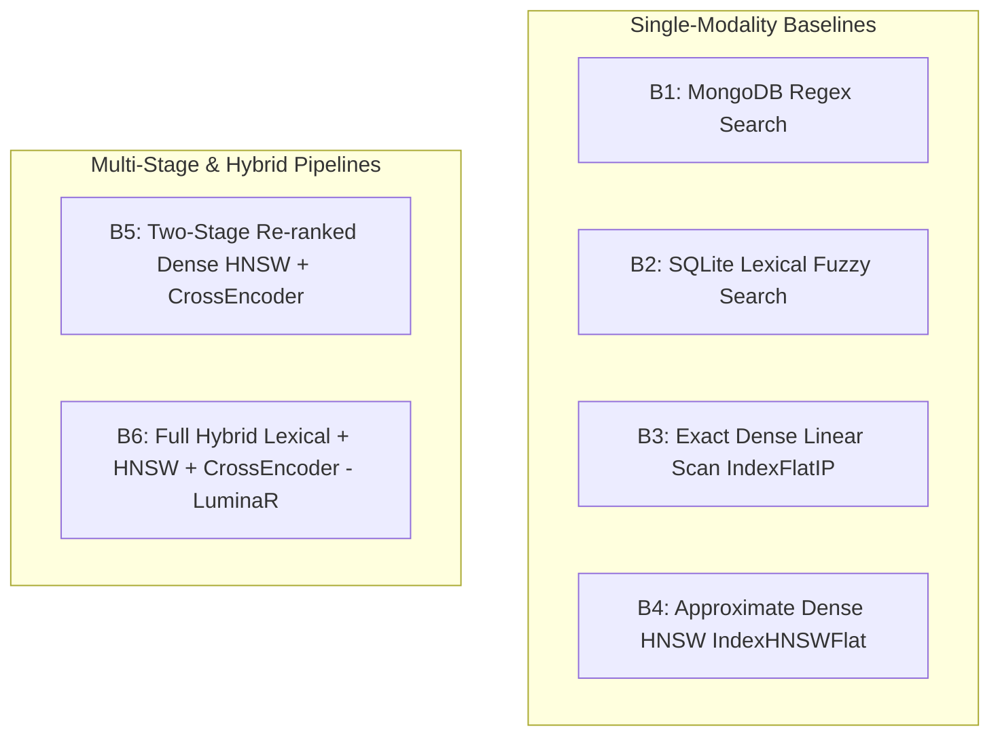

# 57_BASELINES.md: Experimental Baselines Inventory & Configurations

> **Audit Report:** Part 9 Research Experiment Design  
> **Repository:** LuminaR (`d:\SDC\LibraryLLM`)  
> **Scope:** Complete Specification of Implemented and External Comparison Baselines across Information Retrieval, Vector Indexing, Generation, Recommendation, and Knowledge Synthesis  
> **Status:** Ground-Truth Specification  

---

## 1. Overview of Experimental Baselines

To establish defensible claims in the research paper, LuminaR is evaluated against **18 distinct baseline systems** categorized into two groups:
1. **Implemented Internal Baselines:** Code, models, and execution paths resident directly inside the `LibraryLLM` repository.
2. **External Reference Baselines:** Standard open-source algorithms (e.g., standard BM25, Lucene) used for empirical benchmarking against established IR literature.

---

## 2. Search & Retrieval Baselines (Experiment A, B, C)



### B1: MongoDB Keyword / Regex Baseline (Implemented)
- **Implementation:** `backend/services/book_service.py:180-220`, `books_collection.find()`
- **Mechanism:** Standard database B-Tree index scan with case-insensitive `$regex` matching across `title`, `authors`, and `subjects`.
- **Strengths:** Exact substring and author prefix matches.
- **Weaknesses:** Zero conceptual awareness; fails on synonyms, natural language descriptions, and typographical errors.

### B2: SQLite Lexical Fuzzy Baseline (Implemented)
- **Implementation:** `search/lexical_store.py:26-41`
- **Mechanism:** SQLite B-tree token indexing with NFKC normalization (`nfkc-casefold-space-v1`), prefix seeking, and Levenshtein distance filtering (`MIN_FUZZY_LENGTH = 5, FUZZY_THRESHOLD = 0.86`).
- **Strengths:** Tolerates 1–2 character spelling variations and normalized token forms.
- **Weaknesses:** Constrained to lexical surface forms; cannot map semantic intent.

### B3: Brute-Force Exact Dense Scan (Implemented)
- **Implementation:** `faiss.IndexFlatIP(384)` with `sentence-transformers/all-MiniLM-L6-v2`
- **Mechanism:** Computes exact cosine similarity between query vector and every vector in the corpus via exhaustive linear matrix multiplication.
- **Strengths:** Perfect mathematical recall ($1.0$ theoretical upper bound).
- **Weaknesses:** $\mathcal{O}(N)$ computation; latency scales linearly with catalogue size.

### B4: Unranked Approximate Dense HNSW (Implemented)
- **Implementation:** `faiss.IndexHNSWFlat(384, 32, METRIC_INNER_PRODUCT)`, $efConstruction=200, efSearch=128$ (`search/index_manager.py:53-57`)
- **Mechanism:** Small-world navigable graph traversal returning top-$k$ candidates without second-stage re-ranking.
- **Strengths:** Sub-millisecond latency (0.31 ms p50).
- **Weaknesses:** Susceptible to bi-encoder vector false positives; lacks deep cross-attention alignment.

### B5: Two-Stage Re-ranked Dense Search (Implemented)
- **Implementation:** HNSW retrieval ($k=50$) + `cross-encoder/ms-marco-MiniLM-L-6-v2` (`search/luminar_search.py:415-460`)
- **Mechanism:** Retrieves 50 nearest neighbors from HNSW graph, then computes cross-attention token interaction across query and book text via a 6-layer BERT model.
- **Strengths:** High precision (Precision@1 = 0.900, nDCG@10 = 0.855).
- **Weaknesses:** Ignores exact keyword signals if bi-encoder embedding drifts.

### B6: Full Hybrid Multi-Modality Search (LuminaR Target)
- **Implementation:** Merged candidates from B2 (Lexical) and B4 (HNSW) into B5 (Cross-Encoder) (`search/lexical_integration.py`)
- **Mechanism:** Evaluates union of fuzzy token candidates and vector nearest neighbors through unified cross-encoder scoring.
- **Strengths:** Combines exact term recall with semantic conceptual discovery.

---

## 3. Generative RAG & Hallucination Baselines (Experiment D, E, F)

### B7: Parametric Zero-Shot LLM (Implemented)
- **Implementation:** `rag/llm.py` with `LuminaRLLM.generate()` without context injection.
- **Prompt:**
  ```text
  You are LuminaR. Answer the user's question directly.
  QUESTION: {question}
  ANSWER:
  ```
- **Strengths:** Zero retrieval latency; tests internal parametric knowledge of `Qwen2.5-3B-Instruct`.
- **Weaknesses:** High hallucination rate on specific books; invents citations and plot details.

### B8: Unconstrained Standard RAG (Implemented Variant)
- **Implementation:** Retrieved chunks concatenated into prompt, but bypassing `lm-format-enforcer` JSON schema validation and without negative abstention penalties.
- **Weaknesses:** Tends to agree with user premises; susceptible to prompt injection and partial hallucinations.

### B9: LuminaR Grounded RAG (Current Production System)
- **Implementation:** `rag/qa.py:540-620` + `rag/llm.py:71-80`
- **Features:**
  1. Multi-stage grounding system prompt (`SYSTEM_MESSAGE`).
  2. Dynamic retrieval depth ($k \in \{3, 5, 10, 20\}$).
  3. JSON intent and evidence verification via `lm-format-enforcer`.
  4. Explicit abstention override (`NOT_SUPPORTED` verdict).
  5. Repetition penalty logits processor (`AnswerRepetitionControl`).

---

## 4. Document Chunking Baselines (Experiment G)

### B10: Character Sliding Window Chunker (Current Production)
- **Implementation:** `rag/services/document_service.py:43-44, 85-124`
- **Parameters:** `CHUNK_SIZE = 3000` unicode characters, `CHUNK_OVERLAP = 400` unicode characters.
- **Characteristics:** Pure character slicer operating strictly within page boundaries.

### B11: Token-Bounded Chunking Baselines (Experimental Directory)
- **Implementation:** `datasets/rag_experiments/chunking_v1/`
- **Variants:**
  - `tokens_180`: 180 tokens sliding window with 30-token overlap.
  - `tokens_220`: 220 tokens sliding window with 40-token overlap.
  - `tokens_240`: 240 tokens sliding window with 50-token overlap.

---

## 5. Recommendation Engine Baselines (Experiment J)

### B12: Uniform Random Recommender (Implemented Baseline)
- **Implementation:** Uniform random sampling over active tenant catalogue records where `status == 'ACTIVE'`.
- **Purpose:** Establishes theoretical lower bound for relevance and subject affinity.

### B13: Global Borrow Popularity Recommender (Implemented Baseline)
- **Implementation:** Ranked by cumulative `reading_log_count` descending from `books` collection.
- **Weaknesses:** Severe popularity bias; ignores patron personal taste and real-time tenant physical availability.

### B14: Unweighted Content/Subject Overlap (Implemented Baseline)
- **Implementation:** Jaccard similarity between user borrowed book subjects and candidate book subjects.
- **Weaknesses:** Cold-start issues; static without temporal decay.

### B15: LuminaR 8-Factor Hybrid Recommender (Current Production System)
- **Implementation:** `recommendation/recommendation_service.py:120-210`
- **Features:** Synthesizes 8 weighted signals:
  $$S = w_1 S_{\text{sem}} + w_2 S_{\text{subj}} + w_3 S_{\text{auth}} + w_4 S_{\text{hist}} + w_5 S_{\text{res}} + w_6 S_{\text{rate}} + w_7 S_{\text{pop}} + w_8 S_{\text{avail}}$$
  with exponential time decay ($e^{-\lambda \Delta t}$) and physical availability gating (`requestable >= 1`).

---

## 6. Knowledge Synthesis Baselines (Experiment K)

### B16: Unconstrained Generative LLM Artifact Prompting (Reference Baseline)
- **Mechanism:** Prompts `Qwen2.5-3B-Instruct` to output JSON flashcards, mind maps, and quizzes directly from document text.
- **Weaknesses:** Prone to JSON parsing errors (unterminated strings, invalid commas), high token latency (15–40 seconds), and hallucinated factual details.

### B17: Deterministic Algorithmic Synthesis (LuminaR Production System)
- **Implementation:** `rag/services/document_knowledge.py` + `rag/services/cloze_grading.py`
- **Features:** Deterministic sentence boundary extraction, bipartite noun phrase graph clustering, Cloze fill-in-the-blank masking, and MiniLM cosine semantic grading. Zero generative LLM inference overhead ($< 100\text{ ms}$).

---

## 7. Baselines Summary Matrix

| Baseline Code | Category | Algorithm / Model | Repository Location | Status |
| :---: | :--- | :--- | :--- | :---: |
| **B1** | Search | MongoDB `$regex` Pattern | `backend/services/book_service.py` | Implemented |
| **B2** | Search | SQLite Fuzzy Levenshtein | `search/lexical_store.py` | Implemented |
| **B3** | Vector | FAISS `IndexFlatIP` (Exact) | `search/index_manager.py` | Implemented |
| **B4** | Vector | FAISS `IndexHNSWFlat` | `search/index_manager.py` | Implemented |
| **B5** | Search | HNSW + `ms-marco` Reranker | `search/luminar_search.py` | Implemented |
| **B6** | Search | Hybrid Lexical + Dense + Rerank | `search/lexical_integration.py` | Implemented |
| **B7** | Generation | Zero-Shot Parametric Qwen | `rag/llm.py` (Zero context) | Implemented |
| **B8** | Generation | Unconstrained Standard RAG | `rag/qa.py` (No enforcer) | Implemented |
| **B9** | Generation | LuminaR Grounded RAG | `rag/qa.py` (Full constraints) | Implemented |
| **B10**| Chunking | 3000-char Sliding Window | `rag/services/document_service.py`| Implemented |
| **B11**| Chunking | 180/220/240 Token Windows | `datasets/rag_experiments/chunking_v1`| Implemented |
| **B12**| RecSys | Uniform Random Sampling | `recommendation/recommendation_service.py` | Implemented |
| **B13**| RecSys | Global Borrow Popularity | `recommendation/recommendation_service.py` | Implemented |
| **B14**| RecSys | Content Subject Jaccard | `recommendation/recommendation_service.py` | Implemented |
| **B15**| RecSys | LuminaR 8-Factor Hybrid | `recommendation/recommendation_service.py` | Implemented |
| **B16**| Artifacts | Generative LLM JSON Prompt | Prompt Script (`rag/llm.py`) | Reference |
| **B17**| Artifacts | Deterministic Extraction | `rag/services/document_knowledge.py` | Implemented |
