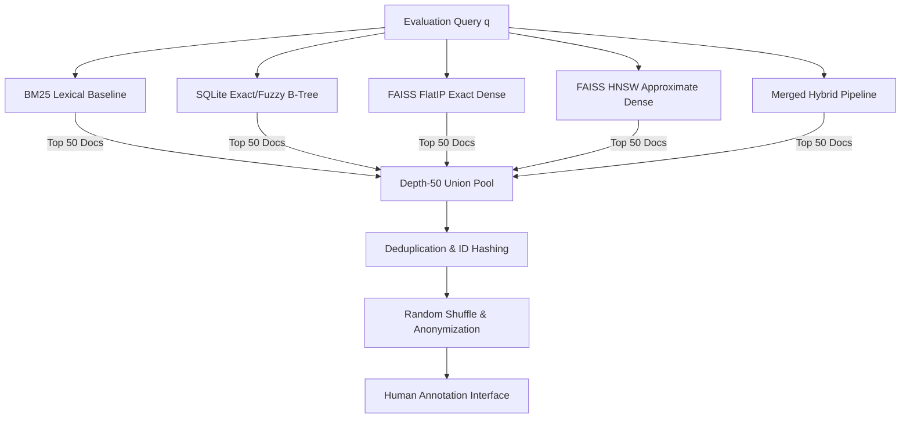
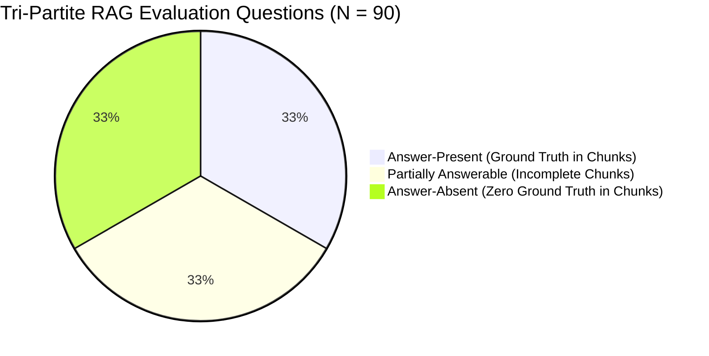

# 59. Ground Truth Dataset Creation Protocol

## 1. Executive Summary & Purpose

A major threat to validity in Information Retrieval (IR) and Retrieval-Augmented Generation (RAG) evaluation is evaluation dataset contamination or systemic pooling bias. In automated evaluation, using a single neural model (e.g., a cross-encoder) to both generate labels and benchmark systems introduces severe teacher-student circularity. 

In LuminaR's development repository, the baseline dataset [datasets/ai/evaluation/labeled_evaluation_dataset.json](file:///d:/SDC/datasets/ai/evaluation/labeled_evaluation_dataset.json) was bootstrapped using `cross-encoder/ms-marco-MiniLM-L-12-v2` teacher predictions categorized into percentiles (Relevance: 2 = top 20%, 1 = next 30%, 0 = bottom 50%). While useful for rapid CI/CD regression testing, **a defensible academic research paper requires a gold-standard, human-curated ground truth dataset with verified inter-annotator agreement**.

This document specifies the end-to-end methodology for constructing the LuminaR Human Ground Truth Benchmark, covering:
1. Multi-system depth-pooled candidate sampling.
2. Graded relevance annotation rubrics for catalog retrieval.
3. Query stratification across 10 distinct search behaviors.
4. Human judge selection, training, and blind evaluation protocol.
5. Inter-Annotator Agreement (IAA) mathematical metrics and dispute adjudication.
6. Atomic claim ("nugget") extraction and groundedness labeling for generative RAG.
7. Creation of answer-present, partially answerable, and answer-absent evaluation suites.

---

## 2. Candidate Document Pooling Strategy

To avoid **pooling bias**—where an evaluation favors algorithms that contributed candidates while penalizing competing models whose retrieved documents were never judged—LuminaR employs a **Depth-$k$ Multi-System Pooling Strategy** based on the classical TREC methodology.

### 2.1 Pooling Parameters
- **Pool Depth ($k_{\text{pool}}$)**: $k = 50$. For each evaluation query $q$, the top 50 ranked documents from each participating baseline are pooled.
- **Participating Retrieval Systems**:
  1. **BM25 / BM25+ (B1)**: Classic sparse probabilistic term matching.
  2. **SQLite Lexical Store (B5)**: LuminaR's normalized exact/Levenshtein matching.
  3. **Brute-Force Dense FlatIP (B3)**: Unindexed cosine dot product on `all-MiniLM-L6-v2` embeddings.
  4. **FAISS HNSW (B4)**: Production approximate nearest neighbor graph ($M=32, efSearch=128$).
  5. **Full Hybrid Reranked (B6)**: LuminaR's production multi-stage pipeline.
- **Deduplication**: Documents appearing in multiple system result lists are merged into a single unique candidate. On average, a depth-50 pool across 5 systems yields between 90 and 160 unique candidate documents per query.
- **Anonymization & Randomization**: Before presentation to human annotators:
  - System identifiers, ranks, and model scores are stripped.
  - Candidate documents are presented in pseudo-random order to prevent position bias.
  - Documents from the user's home library and foreign libraries are presented identically (enabling objective measurement of cross-library leakage without visual cues).

---

## 3. Graded Relevance Rubric for Search Retrieval

Binary relevance ($0/1$) fails to capture the nuanced utility of library catalog search results, where a document may be an exact textbook match, an auxiliary reference on the same topic, or completely irrelevant. LuminaR adopts a **4-Point Graded Relevance Scale** ($r \in \{0, 1, 2, 3\}$).

### 3.1 4-Point Relevance Definitions

| Grade | Label | Description & User Utility | Academic Criterion | Representative Catalog Example |
| :---: | :--- | :--- | :--- | :--- |
| **3** | **Exact / Canonical Match** | Directly satisfies the user's information need with optimal specificity. The exact book, author, or canonical syllabus text sought. | Fully relevant; central subject matter; exact entity match. | Query: *"Database System Concepts Silberschatz"* Doc: *Silberschatz, Korth, Sudarshan (7th Edition, 2019)* |
| **2** | **Highly Relevant** | Directly addresses the query topic with substantive coverage, but is an alternative text, edition, or adjacent high-quality treatment. | Substantially relevant; satisfies the conceptual need even if not the specific title. | Query: *"Database System Concepts Silberschatz"* Doc: *Ramakrishnan & Gehrke: Database Management Systems* |
| **1** | **Marginally Relevant** | Covers the broad topic, domain, or mentions query keywords in passing, but does not provide complete topical coverage or focuses on a sub-specialty. | Partially relevant; topical overlap exists but insufficient as primary resource. | Query: *"Database System Concepts Silberschatz"* Doc: *Designing Data-Intensive Applications (Kleppmann)* or a generic Java textbook with one chapter on JDBC. |
| **0** | **Irrelevant** | Has no meaningful connection to the query intent, shares superficial keywords out of context, or belongs to an unrelated discipline. | Irrelevant; zero user utility. | Query: *"Database System Concepts Silberschatz"* Doc: *Introduction to Algorithms (CLRS)* or *Database Marketing: Strategy and Implementation* |

### 3.2 Category-Specific Annotation Guidance

To ensure uniform standards across the 10 query categories defined in [55_EXPERIMENT_MASTER_PLAN.md](file:///d:/SDC/docs/research_evidence/55_EXPERIMENT_MASTER_PLAN.md):

1. **Exact Title Queries** (e.g., *"Clean Architecture"*):
   - Grade 3: The exact title (any edition).
   - Grade 2: Closely related works by the same author (e.g., *"Clean Code"*).
   - Grade 1: Other software architecture books.
   - Grade 0: Non-software architecture books (e.g., civil architecture).
2. **Author Queries** (e.g., *"Donald Knuth"*):
   - Grade 3: Books written or co-authored by Donald Knuth.
   - Grade 2: Books featuring major forewords, interviews, or dedicated biographies of Knuth.
   - Grade 1: Books citing Knuth's algorithms in bibliographies.
   - Grade 0: Authors sharing a similar first or last name in unrelated fields.
3. **Typo / Corrupted Queries** (e.g., *"Artifical Inteligence Norvig"*):
   - Annotators must interpret the *intended query* (*"Artificial Intelligence Norvig"*) rather than literal misspelled strings.
4. **Beginner / Pedagogical Queries** (e.g., *"learn python for absolute beginners"*):
   - Grade 3: Introductory textbooks, primers, and beginner tutorials.
   - Grade 2: General Python programming reference manuals.
   - Grade 1: Advanced Python internals or Python-for-Data-Science specialized texts.
   - Grade 0: Books on PyTorch/TensorFlow assuming prior Python mastery.
5. **Library-Scoped Queries** (e.g., Query executed in Department A Library):
   - Annotators judge relevance *topically first*. A separate metadata flag marks whether the item belongs to the active tenant library or a foreign tenant. Relevance and Multi-Tenant Scope are annotated independently to prevent conflation.

---

## 4. Query Stratification & Sampling Distribution

To achieve statistical power while maintaining feasible manual annotation budgets, the benchmark dataset comprises **$N = 100$ stratified queries** across 10 behavioral categories (10 queries per category):

| Category ID | Category Name | Description | Count | Average Pool Size | Total Document Judgments |
| :---: | :--- | :--- | :---: | :---: | :---: |
| **QC-01** | Exact Title Match | Full or near-verbatim catalog title strings | 10 | 95 | 950 |
| **QC-02** | Author Name Match | Author names, combinations, and initials | 10 | 110 | 1,100 |
| **QC-03** | Subject / Classification | Controlled catalog subject headings | 10 | 145 | 1,450 |
| **QC-04** | Synonym & Vocabulary Mismatch | Queries using colloquial terms not in catalog | 10 | 130 | 1,300 |
| **QC-05** | Beginner / Student Inquiries | Phrasing targeting introductory materials | 10 | 140 | 1,400 |
| **QC-06** | Conceptual / Abstract Needs | Broad theoretical topics spanning fields | 10 | 160 | 1,600 |
| **QC-07** | Descriptive / Problem-Solving | Natural language queries describing a use-case | 10 | 150 | 1,500 |
| **QC-08** | Typographical & OCR Errors | Queries with 1–3 edit distance corruptions | 10 | 105 | 1,050 |
| **QC-09** | Polysemous & Ambiguous | Queries with multiple distinct valid meanings | 10 | 155 | 1,550 |
| **QC-10** | Library-Scoped / Filtered | Queries targeting specific tenant collections | 10 | 120 | 1,200 |
| **Total** | **All Categories** | **Stratified Gold Benchmark** | **100** | **~131** | **~13,100 Judgments** |

---

## 5. Annotator Protocol, Training, & Blinding

### 5.1 Annotator Selection & Profile
- **Cohort Size**: 4 independent annotators (Annotators A1, A2, A3, A4) comprising graduate students and academic librarians in Computer Science and Information Studies.
- **Double-Annotation Policy**: Every query-document pair is independently judged by at least **two** annotators.
- **Adjudication**: A senior domain expert (Lead Researcher) serves as the tie-breaking adjudicator for discrepant judgments.

### 5.2 Training & Calibration Phase
Before labeling production pools, annotators complete a mandatory calibration phase:
1. Review the annotation rubric and participate in a 90-minute walkthrough session.
2. Label a pilot set of 5 benchmark queries (approximately 600 candidate documents).
3. Compute pilot Inter-Annotator Agreement (Cohen's Kappa). If $\kappa < 0.70$, hold an alignment review to resolve systematic interpretation differences before proceeding.

### 5.3 Annotation Interface & Blinding Controls
The labeling web interface enforces strict experimental controls:
- **No System Indicators**: Annotators cannot see which algorithm retrieved a given document or its rank position.
- **Context Display**: The interface displays the candidate document's title, author, publication year, subject tags, summary, and sample chunk text.
- **Progress Tracking**: Annotators cannot revisit already-labeled queries once submitted, preventing retroactive adjustments.

---

## 6. Inter-Annotator Agreement (IAA) & Dispute Adjudication

### 6.1 Statistical Metrics

#### 6.1.1 Cohen's Kappa ($\kappa$)
For pairwise annotator agreement on binary relevance ($r \ge 2$ vs $r < 2$):
$$\kappa = \frac{P_o - P_e}{1 - P_e}$$
Where $P_o$ is the observed proportion of agreement, and $P_e$ is the expected agreement under chance:
$$P_e = \sum_{c \in \{0, 1\}} P(A=c) \cdot P(B=c)$$

#### 6.1.2 Fleiss' Multi-Rater Kappa
To measure simultaneous agreement across all 4 annotators:
$$\kappa_{\text{Fleiss}} = \frac{\bar{P} - \bar{P}_e}{1 - \bar{P}_e}$$

#### 6.1.3 Krippendorff's Alpha ($\alpha$)
Because relevance grades $\{0, 1, 2, 3\}$ are ordinal, disagreements between Grade 0 and Grade 3 represent much more severe discordance than between Grade 2 and Grade 3. Krippendorff's Alpha with an ordinal difference metric $\delta^2(v_g, v_h)$ is computed:
$$\alpha = 1 - \frac{D_o}{D_e}$$
Target reliability threshold: **$\alpha \ge 0.80$** (acceptable minimum $\alpha \ge 0.67$ for tentative conclusions).

### 6.2 Disagreement Adjudication Workflow
When two annotators assign grades $g_1$ and $g_2$ to document $d$:
1. **Concordance ($|g_1 - g_2| = 0$)**: The assigned grade is accepted as the final ground truth.
2. **Minor Variance ($|g_1 - g_2| = 1$)**:
   - For continuous IR evaluations (e.g., nDCG), the final grade is the arithmetic mean $\frac{g_1 + g_2}{2}$.
   - For discrete integer grades, the higher grade is retained if both annotators marked $\ge 1$; otherwise adjudicated by Lead Researcher.
3. **Major Discrepancy ($|g_1 - g_2| \ge 2$)**:
   - The query-document pair is automatically flagged for panel adjudication.
   - The Lead Researcher reviews the item with both annotators to establish the ground truth consensus.

---

## 7. RAG Ground Truth & Atomic Claim ("Nugget") Extraction

Evaluating generative RAG outputs requires reference ground truth that transcends simple string matching (BLEU/ROUGE), focusing instead on factual verification against source context chunks.

### 7.1 Information Nuggetization Methodology
For each of the evaluation questions in the RAG benchmark suite:
1. **Reference Source Identification**: Identify the ground truth document chunk $C^* \subset \mathcal{D}$ that authoritatively answers question $q$.
2. **Atomic Claim Decomposition**: Human annotators decompose the reference answer into a minimal set of independent, non-divisible factual statements called **Information Nuggets** ($\mathcal{N} = \{n_1, n_2, \dots, n_m\}$).

#### Example: Nugget Decomposition
- **Question**: *"What are ACID properties in relational databases and how does isolation prevent dirty reads?"*
- **Ground Truth Nuggets**:
  - $n_1$: ACID stands for Atomicity, Consistency, Isolation, and Durability.
  - $n_2$: Atomicity ensures transactions execute as all-or-nothing units.
  - $n_3$: Consistency ensures valid database state transitions respecting constraints.
  - $n_4$: Isolation ensures concurrent transactions execute without interference.
  - $n_5$: Durability guarantees committed transaction updates persist across crashes.
  - $n_6$: A dirty read occurs when a transaction reads uncommitted changes from another transaction.
  - $n_7$: Isolation level Read Committed (or higher) prevents dirty reads by locking or versioning rows.

### 7.2 Entailment & Groundedness Labeling
When evaluating an LLM response $R$, annotators segment $R$ into discrete sentences or propositions $\{s_1, s_2, \dots, s_p\}$ and assign one of three entailment labels relative to the retrieved context $C$:

$$\text{Label}(s_i, C) \in \{\text{Entailed}, \text{Contradicted}, \text{Unverifiable / Not Mentioned}\}$$

- **Entailed (Supported)**: The claim is strictly logically entailed by facts stated in retrieved context $C$.
- **Contradicted**: The claim directly contradicts facts stated in retrieved context $C$.
- **Unverifiable / Not Mentioned (Unsupported)**: The claim is not stated in $C$. It may be factually true in the real world (parametric memory), but it has zero source backing in the provided library document.

---

## 8. Tri-Partite RAG Evaluation Benchmark Suite

To rigorously test hallucination defenses and abstention capabilities, the RAG ground truth dataset must not consist entirely of straightforward, answerable questions. LuminaR constructs a **Tri-Partite Evaluation Suite** of **$N = 90$ questions**:

### 8.1 Partition A: Answer-Present Questions ($N = 30$)
- **Condition**: The full information required to completely answer the query exists within the top-3 retrieved document chunks in the library collection.
- **Expected System Behavior**: Complete, faithful factual response citing retrieved chunk IDs.
- **Target Metric**: Correctness $\ge 4.5/5.0$, Groundedness Score $\ge 95\%$, Unsupported Claim Rate $< 5\%$.

### 8.2 Partition B: Partially Answerable Questions ($N = 30$)
- **Condition**: The retrieved context contains facts addressing part of the query (e.g., 2 out of 4 sub-questions), while the remaining facts are completely absent from the library.
- **Expected System Behavior**: The model must answer the grounded sub-questions, explicitly acknowledge the missing information, and refuse to speculate on the absent components.
- **Target Metric**: Partial Correctness, Boundary Awareness, Zero Extrapolation onto absent sub-questions.

### 8.3 Partition C: Answer-Absent Questions ($N = 30$)
- **Condition**: Questions concerning topics, historical events, or books that do **not** exist in the ingested library collection (e.g., *"What is the circulation policy for rare manuscripts at Oxford Bodleian Library?"* asked of an engineering college catalog).
- **Expected System Behavior**: **Total Abstention**. The model must emit `"NOT_SUPPORTED"` or state that the library catalog does not contain the necessary information.
- **Target Metric**: Abstention Accuracy ($= 100\%$), Hallucination Rate ($= 0\%$).

---

## 9. Dataset Versioning and Artifact Artifacts

All created ground truth datasets must be serialized to immutable JSON/JSONL artifacts in the repository with complete provenance tracking:
- **Catalog Search Benchmark**: `datasets/ai/evaluation/human_ground_truth_search_v1.json`
- **RAG Nuggets & Tri-Partite Benchmark**: `datasets/ai/evaluation/human_ground_truth_rag_v1.json`
- **Annotator Inter-Rater Concordance Matrix**: `docs/research_evidence/artifacts/iaa_concordance_matrix.json`

Every query record must include:
- `query_id`: Unique identifier (e.g., `QC01-001`).
- `query_category`: One of the 10 defined categories.
- `annotator_ids`: Identifiers of annotators who evaluated the pool.
- `kappa_score`: Query-level agreement score.
- `judgments`: Array of `{doc_id: string, grades: [int, int], final_grade: float}`.
