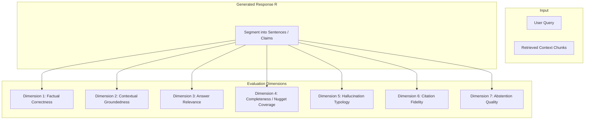
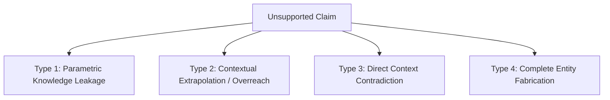

# 60. RAG Evaluation Rubric and Assessment Protocol

## 1. Overview and Assessment Dimensions

Retrieval-Augmented Generation (RAG) evaluation requires multi-dimensional measurement. Relying solely on surface-level lexical similarity metrics (such as BLEU, ROUGE, or METEOR) fails because:
1. They reward verbatim quotation over concise synthesis.
2. They cannot verify factual faithfulness or distinguish between truthful answers and hallucinated text that happens to share n-grams with a reference answer.
3. They provide no mechanism to grade refusal behavior on unanswerable questions.

This document establishes the official **LuminaR Multi-Dimensional Evaluation Rubric** for assessing responses produced by the RAG pipeline ([rag/generation.py](file:///d:/SDC/rag/generation.py)) and comparative baselines. 

The evaluation framework assesses seven orthogonal dimensions:
1. **Factual Correctness** (5-Point Likert & Binary)
2. **Contextual Groundedness / Faithfulness** (Ratio of Entailed Claims)
3. **Answer Relevance** (Responsiveness to User Intent)
4. **Information Completeness** (Coverage of Target Nuggets)
5. **Hallucination Severity & Typology** (Error Classification)
6. **Citation Fidelity & Source Consistency** (Attribution Verification)
7. **Abstention Quality** (Appropriate Refusal on Unsupported Topics)



---

## 2. Dimension 1: Factual Correctness (5-Point Likert)

Correctness evaluates whether the factual assertions in the generated response reflect ground truth facts within the domain of inquiry.

### 2.1 5-Point Scoring Criteria

| Score | Rating | Definition & Operational Guidelines | Required Evaluator Criteria |
| :---: | :--- | :--- | :--- |
| **5** | **Completely Correct** | The answer is completely accurate, factually sound, and unambiguous. Contains zero false assertions or misleading claims. | All core facts, figures, dates, entity names, and causal explanations match reference truth exactly. |
| **4** | **Mostly Correct** | The central thesis and primary facts are accurate, but the answer contains a minor imprecision or non-critical omission that does not mislead the reader. | Minor stylistic oversimplification or slight imprecision in terminology that does not alter substantive meaning. |
| **3** | **Partially Correct** | The answer contains a mixture of true and false statements, or gets the basic concept right while misstating significant operational details. | At least one major factual claim is inaccurate or missing, but the core domain concept is recognizable. |
| **2** | **Mostly Incorrect** | The answer misidentifies the primary mechanism or entity, though some peripheral keywords or superficial concepts are accurate. | The primary conclusion or explanatory mechanism is false, misleading the reader. |
| **1** | **Completely Incorrect** | The answer is entirely false, completely hallucinatory, or asserts statements directly opposite to documented facts. | Zero factual alignment with reality; fabricated concepts, authors, or mechanisms throughout. |

### 2.2 Binary Correctness Threshold
For binary classification metrics:
$$\text{Correctness}_{\text{binary}} = \begin{cases} 1 & \text{if Score} \ge 4 \\ 0 & \text{if Score} \le 3 \end{cases}$$

---

## 3. Dimension 2: Contextual Groundedness (Faithfulness)

Groundedness measures whether the generated answer is strictly logically entailed by the retrieved context chunks provided to the LLM, independent of whether the statements are factually true in the broader world.

### 3.1 Sentence-Level Proposition Decomposition
1. The response $R$ is segmented into a set of atomic, independent propositions $\mathcal{P} = \{p_1, p_2, \dots, p_m\}$.
2. Each proposition $p_i$ is evaluated against retrieved context $C$:
   - **Supported ($+1$)**: Context $C$ directly states or strictly entails $p_i$.
   - **Unsupported ($0$)**: Context $C$ does not mention $p_i$ (even if $p_i$ is factually true in real life).
   - **Contradicted ($-1$)**: Context $C$ explicitly contradicts $p_i$.

### 3.2 Metric Calculation
$$\text{Groundedness Score} = \frac{|\{p \in \mathcal{P} \mid \text{Entailed}(p, C)\}|}{|\mathcal{P}|}$$

### 3.3 Scoring Tiers
- **Fully Grounded ($1.00$)**: Every claim has direct textual backing in $C$.
- **High Groundedness ($0.80$–$0.99$)**: Minor connective phrases unsupported, but all substantive facts derived from $C$.
- **Moderate Groundedness ($0.50$–$0.79$)**: Significant external parametric knowledge injected into the response.
- **Low / Ungrounded ($< 0.50$)**: Model ignored retrieved context and answered from parametric memory or hallucination.

---

## 4. Dimension 3: Answer Relevance

Relevance measures how directly and concisely the response satisfies the user's specific prompt, without drifting into off-topic tangents or filler.

### 4.1 4-Point Relevance Scale

| Level | Rating | Definition | Indicator |
| :---: | :--- | :--- | :--- |
| **3** | **Directly Relevant** | Addresses every element of the user's question directly, succinctly, and without extraneous monologue. | Answers the exact question asked in the opening sentence; zero conversational padding. |
| **2** | **Mostly Relevant** | Fully answers the query, but includes unnecessary tangential background or excessive boilerplate. | Contains the answer, but requires the user to read through extraneous paragraphs. |
| **1** | **Marginally Relevant** | Mentions concepts related to the question topic, but fails to answer the specific question asked. | Topic is related (e.g., talks about Python dictionaries when asked about set comprehensions). |
| **0** | **Irrelevant** | Fails to address the user's request; answers an entirely different question or drifts into unrelated domain text. | Completely unresponsive to the prompt. |

---

## 5. Dimension 4: Information Completeness (Nugget Coverage)

Completeness measures the proportion of essential factual information units (nuggets) present in the reference answer that appear in the generated response.

### 5.1 Formulation
Given ground truth nuggets $\mathcal{N} = \{n_1, n_2, \dots, n_k\}$ defined in [59_GROUND_TRUTH_CREATION.md](file:///d:/SDC/docs/research_evidence/59_GROUND_TRUTH_CREATION.md):
$$\text{Completeness} = \frac{\sum_{i=1}^{k} \mathbb{I}(n_i \text{ is satisfied in } R)}{|\mathcal{N}|}$$

### 5.2 Criteria
- **Complete ($1.0$)**: All target nuggets covered.
- **Substantially Complete ($0.75$–$0.99$)**: All primary nuggets covered; minor secondary nuance omitted.
- **Incomplete ($0.40$–$0.74$)**: Omitted half of the required explanatory steps.
- **Deficient ($< 0.40$)**: Missed the core explanatory nuggets.

---

## 6. Dimension 5: Hallucination Severity & Typology

When an unsupported claim is identified, it must be categorized into the LuminaR Hallucination Taxonomy to diagnose pipeline failure modes.

### 6.1 Typology Definitions



1. **Type 1: Parametric Knowledge Leakage**
   - *Description*: The claim is factually true in real-world Computer Science / Literature, but is **not** present in the library document chunk provided.
   - *Severity*: Low (Operationally harmless, but violates RAG source boundaries).
   - *Example*: Chunk mentions *B-Trees have balanced branching*; LLM adds *B-Trees were invented by Rudolf Bayer in 1971*.
2. **Type 2: Contextual Extrapolation / Overreach**
   - *Description*: The model draws an unwarranted logical inference that exceeds what the text supports.
   - *Severity*: Moderate.
   - *Example*: Chunk says *The library holds 3 copies of Tanenbaum*; LLM asserts *Tanenbaum is the most popular textbook on campus*.
3. **Type 3: Direct Context Contradiction**
   - *Description*: The generated text makes an assertion that directly contradicts facts explicitly stated in the context chunk.
   - *Severity*: High.
   - *Example*: Chunk states *HTTP/2 uses binary framing rather than text*; LLM asserts *HTTP/2 is a plain-text ASCII protocol*.
4. **Type 4: Complete Entity Fabrication (Pure Hallucination)**
   - *Description*: The model invents nonexistent book titles, authors, algorithms, theorems, or citations out of whole cloth.
   - *Severity*: Critical.
   - *Example*: Citing a fictitious book: *"Quantum Neural Networks by J. K. Vance (2025)"* with an invented ISBN.

---

## 7. Dimension 6: Citation Fidelity & Source Consistency

LuminaR RAG models are instructed to cite chunk identifiers (e.g., `[Doc 1, Chunk 2]`).

### 7.1 Citation Scoring Rules
- **Valid Citation**: The citation references a chunk that was actually provided in the context window AND that chunk contains the cited fact.
- **Phantom Citation**: The response generates a citation to a chunk ID that was **not** present in the prompt context (e.g., `[Chunk 9]` when only 5 chunks were provided).
- **Misattributed Citation**: The cited chunk exists in the context, but does **not** contain the claim it is claimed to support.

$$\text{Citation Precision} = \frac{|\text{Valid Citations}|}{|\text{Total Generated Citations}|}$$

---

## 8. Dimension 7: Abstention Quality

When presented with questions where the answer is absent from the catalog or retrieved context, the system must abstain gracefully rather than guessing.

### 8.1 4-Point Abstention Scoring Scale

| Score | Rating | System Action | Evaluation Criteria |
| :---: | :--- | :--- | :--- |
| **3** | **Optimal Abstention** | Emits `"NOT_SUPPORTED"` or explicitly states that the library collection does not contain the requested information. | Correctly acknowledges informational boundary without hallucinating; no false claims. |
| **2** | **Partial / Qualified Abstention** | States that the document does not mention the subject, but attempts a speculative answer using hedging (*"The text does not say, but it might be..."*). | Demonstrates awareness of absence, but introduces mild risk by guessing. |
| **1** | **Misleading Refusal** | Abstains on an **answerable** question (false negative refusal) due to over-conservative prompting. | Context contained the answer, but system refused to respond. |
| **0** | **Total Abstention Failure** | Generates a confident, fabricated answer to an unanswerable question. | Zero abstention; pure hallucination. |

---

## 9. Concrete Case Studies & Exemplar Evaluations

### 9.1 Case Study 1: Answer-Present Query
- **Query**: *"What is the time complexity of searching in an AVL tree according to the text?"*
- **Retrieved Chunk**: *"In an AVL tree, the heights of the two child subtrees of any node differ by at most one. Because the tree remains strictly balanced, lookup, insertion, and deletion operations all take $O(\log n)$ worst-case time."*
- **Candidate Response A (LuminaR RAG)**: *"Searching in an AVL tree takes $O(\log n)$ time in the worst case because the tree maintains strict height balance where subtree heights differ by at most one [Chunk 1]."*
  - *Correctness*: 5/5
  - *Groundedness*: 1.0 (100%)
  - *Relevance*: 3/3
  - *Completeness*: 1.0
  - *Citation Precision*: 1.0
  - *Verdict*: Perfect RAG generation.
- **Candidate Response B (LLM-Only / Hallucination)**: *"Searching in an AVL tree takes $O(\log n)$ average time, but can degrade to $O(n)$ if the tree becomes unbalanced due to frequent deletions."*
  - *Correctness*: 1/5 (Factually false for AVL trees; confounds with BST).
  - *Groundedness*: 0.0 (Contradicts AVL definition).
  - *Verdict*: Factual error.

### 9.2 Case Study 2: Answer-Absent Query
- **Query**: *"What is the refund policy for library printing cards at the circulation desk?"*
- **Retrieved Chunks**: *[Chunks discuss book borrowing periods (14 days), overdue fines ($0.50/day), and reservation limits (3 books). Zero mention of printing cards.]*
- **Candidate Response A (LuminaR RAG with Refusal)**: *"NOT_SUPPORTED: The provided library records do not contain information regarding printing cards or refund policies."*
  - *Abstention Score*: 3/3 (Optimal Abstention)
  - *Hallucination Rate*: 0.0%
  - *Verdict*: Correct defensive abstention.
- **Candidate Response B (Unconstrained LLM)**: *"Printing card balances can be refunded at the circulation desk within 30 days of purchase upon presentation of your student ID and a $2 administrative processing fee."*
  - *Abstention Score*: 0/3 (Total Failure)
  - *Hallucination Type*: Type 4 (Pure Entity Fabrication).
  - *Verdict*: Critical operational failure.

---

## 10. Automated LLM-as-a-Judge Evaluation Protocol

To scale evaluations across hundreds of test prompts alongside human verification, an automated LLM-as-a-Judge script may be deployed using a structured evaluation prompt.

### 10.1 Structured Judge Prompt Template

```
[SYSTEM PROMPT]
You are an expert academic evaluator in Information Retrieval and RAG systems.
Your task is to evaluate the following Generated Answer strictly against the provided Retrieved Context and Ground Truth Nuggets.
Do not use your own external knowledge. Grade strictly based on the text provided.

[USER PROMPT]
Query: {query}

Retrieved Context:
{retrieved_context}

Ground Truth Nuggets:
{ground_truth_nuggets}

Generated Answer:
{generated_answer}

Provide your evaluation as a strict JSON object with the following schema:
{
  "factual_correctness_score": <integer from 1 to 5>,
  "groundedness_score": <float from 0.0 to 1.0>,
  "total_claims": <integer>,
  "supported_claims": <integer>,
  "contradicted_claims": <integer>,
  "unsupported_claims": <integer>,
  "answer_relevance_score": <integer from 0 to 3>,
  "completeness_score": <float from 0.0 to 1.0>,
  "hallucination_types_detected": [<list of strings: "NONE", "PARAMETRIC_LEAK", "EXTRAPOLATION", "CONTRADICTION", "FABRICATION">],
  "abstention_score": <integer from 0 to 3, or null if question was answerable>,
  "justification": "<concise paragraph detailing rationale>"
}
```
