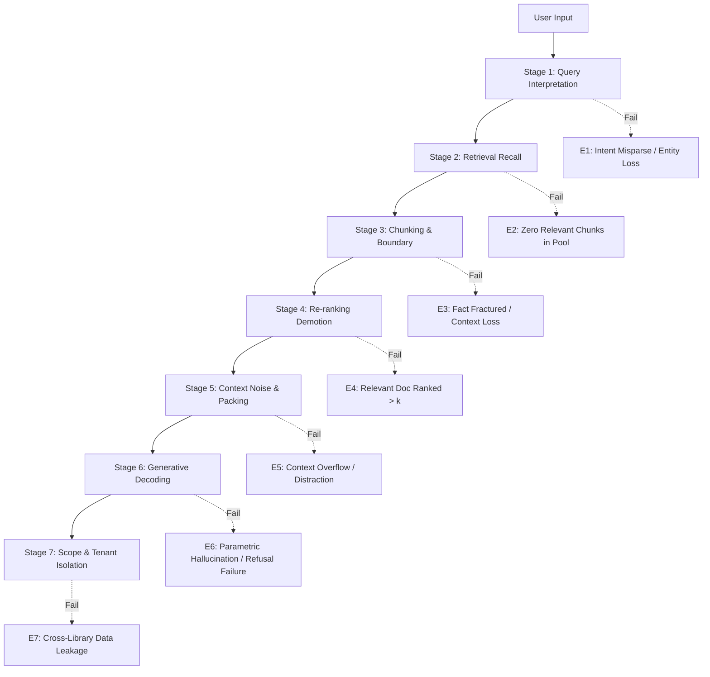

# 61. RAG Error Analysis Taxonomy and Diagnostic Template

## 1. Overview and Diagnostic Framework

When an end-to-end Retrieval-Augmented Generation (RAG) system generates an incorrect, incomplete, ungrounded, or privacy-violating response, attributing the failure simply to "model error" obscures the root cause. A RAG pipeline is a multi-stage sequential distributed system: an error in query interpretation cascades into retrieval, which cascades into re-ranking, context packaging, and autoregressive decoding.

This document establishes the official **LuminaR 7-Stage RAG Error Taxonomy and Diagnostic Template**. It provides:
1. Formal definitions, diagnostic signatures, and boundary criteria for the 7 failure stages.
2. An Individual Failure Case Analysis Worksheet.
3. An Aggregated Error Distribution Matrix.
4. A Root-Cause Remediation Decision Tree.



---

## 2. The 7-Stage Error Taxonomy

### 2.1 Stage 1: Query Interpretation Error (E1)
- **Definition**: The system fails to correctly parse the user's information need, misclassifies the operational intent, fails to normalize typographical corruptions, or drops essential named entities before search execution.
- **Diagnostic Signature**:
  - The query router sends a catalog search to the conversational agent, or vice-versa.
  - Entity extraction omits the author or title (e.g., searches for *"systems"* instead of *"Database Systems"*).
  - Normalization fails on typos (e.g., fails to map *"algrithms"* to *"algorithms"*).
- **Sub-Types**:
  - `E1.1`: Intent Misclassification (Catalog vs. Chat vs. Admin).
  - `E1.2`: Entity Extraction Drop (dropped proper noun or year).
  - `E1.3`: Normalization Failure (unhandled unicode, unstripped punctuation).

### 2.2 Stage 2: Retrieval Recall Failure (E2)
- **Definition**: The first-stage candidate retrieval mechanisms (FAISS HNSW dense search and SQLite lexical search) fail to include *any* ground truth document or chunk within the initial top-$k_1$ candidate pool ($k_1 = 50$).
- **Diagnostic Signature**:
  - Ground truth document $D^* \notin \text{Pool}_{50}$.
  - The downstream reranker cannot possibly select the correct document because it was never retrieved.
- **Sub-Types**:
  - `E2.1`: Dense Semantic Gap (cosine similarity too low due to unusual domain vocabulary).
  - `E2.2`: Lexical Mismatch (zero exact term overlap between query and text).
  - `E2.3`: Graph Approximation Pruning (HNSW beam search missed target node due to low `efSearch`).

### 2.3 Stage 3: Chunking & Boundary Artifacts (E3)
- **Definition**: The relevant document was retrieved, but the ingestion chunking strategy split the necessary factual premise across distinct chunks, severed a pronoun from its referent, or omitted critical section headers.
- **Diagnostic Signature**:
  - Document $D$ is in the pool, but Chunk $C_i$ contains half the fact and Chunk $C_{i+1}$ contains the other half, neither alone satisfying the query.
  - A definition appears in a chunk with no subject because the heading was on the preceding line.
- **Sub-Types**:
  - `E3.1`: Fact Fracturing (split across sliding window boundary).
  - `E3.2`: Anaphora / Coreference Loss (pronoun "it" separated from entity name).
  - `E3.3`: Structural Header Omission (table rows separated from column headers).

### 2.4 Stage 4: Re-ranking Demotion (E4)
- **Definition**: The relevant chunk was present in the first-stage candidate pool ($k_1 \le 50$), but the cross-encoder reranker assigned it a low relevance score, pushing its rank below the final context cutoff ($k > 5$).
- **Diagnostic Signature**:
  - Target chunk $C^* \in \text{Pool}_{50}$, but $\text{Rank}(C^*) > k_{\text{context}}$ (e.g., ranked at position 12 when $k=5$).
  - As a result, $C^*$ was excluded from the prompt sent to the LLM.
- **Sub-Types**:
  - `E4.1`: False Negative Score Suppression (cross-encoder scored peripheral chunk higher).
  - `E4.2`: Cutoff Truncation (budget $k$ too small for multi-document synthesis queries).

### 2.5 Stage 5: Context Noise & Distraction (E5)
- **Definition**: The relevant chunk was successfully included in the context window ($k \le 5$), but either:
  1. Excessive irrelevant chunks diluted the attention mechanism ("Lost in the Middle" phenomenon), or
  2. Context length exceeded effective attention span, causing the model to miss the fact.
- **Diagnostic Signature**:
  - $C^* \in \text{Prompt Context}$, but LLM fails to mention the facts in $C^*$, or repeats distractor facts from surrounding irrelevant chunks.
- **Sub-Types**:
  - `E5.1`: Lost in the Middle (target chunk placed at position 3 of 5 was ignored).
  - `E5.2`: Distractor Interference (an irrelevant chunk had higher lexical similarity to the query, drawing false model focus).

### 2.6 Stage 6: Generative Distortion & Hallucination (E6)
- **Definition**: The relevant context chunk was present and attended to, but the language model generated factually false, ungrounded, or contradictory text during decoding.
- **Diagnostic Signature**:
  - Context contains the exact fact $X$; model outputs $\neg X$, or model invents external fact $Y$ not present in $C$.
  - Model fails to abstain when prompt context is empty or irrelevant (refusal failure).
- **Sub-Types**:
  - `E6.1`: Parametric Knowledge Intrusion (overriding context with training pre-training data).
  - `E6.2`: Contextual Overreach / Speculation (unjustified inferences).
  - `E6.3`: Direct Inversion / Contradiction (negating the text).
  - `E6.4`: Refusal Failure (answering an answer-absent question with fabricated facts).

### 2.7 Stage 7: Scope & Tenant Isolation Failure (E7)
- **Definition**: The system retrieved, synthesized, or exposed catalog items, book excerpts, or user activity logs belonging to a foreign tenant library without proper authorization.
- **Diagnostic Signature**:
  - User in `Library_A` executes a search and receives chunks tagged with `library_id = "Library_B"`.
  - LLM includes private reserve shelf data from another department in its generated answer.
- **Sub-Types**:
  - `E7.1`: Unfiltered Vector Index Query (FAISS search executed without tenant metadata mask).
  - `E7.2`: Cache / Session Bleed (reusing query cache across different tenant requests).
  - `E7.3`: Missing Authorization Gate in Document Ingestion API.

---

## 3. Individual Failure Case Diagnostic Worksheet

When an evaluation query produces an unacceptable result (Correctness $< 4$, Groundedness $< 0.80$, Hallucination $> 0$, or Leakage $> 0$), evaluators must complete this standardized worksheet:

```markdown
# LuminaR Failure Case Diagnostic Worksheet

## 1. Metadata
- **Incident ID**: ERR-[YYYYMMDD]-[QUERY_ID]
- **Evaluator**: [Annotator Name / ID]
- **Date**: [YYYY-MM-DD]
- **Query ID**: [QCxx-xxx]
- **User Query**: "[Exact query string]"
- **Tenant Context**: [library_id]

## 2. Observed Output & Ground Truth
- **System Output**: "[Full generated text]"
- **Expected Ground Truth Answer**: "[Reference truth nuggets]"
- **Observed Metrics**:
  - Correctness Score: [1-5]
  - Groundedness Score: [0.0 - 1.0]
  - Hallucination Type: [None / Type 1 / Type 2 / Type 3 / Type 4]

## 3. Pipeline Trace Audit
- **Stage 1 (Query Interpretation)**:
  - Parsed Intent: [e.g., CATALOG_SEARCH]
  - Extracted Keywords / Entities: [...]
  - Verdict: [PASS / FAIL (E1)]
- **Stage 2 (First-Stage Retrieval)**:
  - Target Doc ID Present in Top-50 Pool?: [YES / NO]
  - Rank in Dense Pool: [int / N/A]
  - Rank in Lexical Pool: [int / N/A]
  - Verdict: [PASS / FAIL (E2)]
- **Stage 3 (Chunking Quality)**:
  - Is Target Information Fully Contained in a Single Chunk?: [YES / NO]
  - Boundary Artifact Present?: [YES / NO]
  - Verdict: [PASS / FAIL (E3)]
- **Stage 4 (Cross-Encoder Re-ranking)**:
  - Rank of Target Chunk after Re-ranking: [int]
  - Was Target Chunk within Top-k Context ($k=5$)?: [YES / NO]
  - Re-ranking Score: [float]
  - Verdict: [PASS / FAIL (E4)]
- **Stage 5 (Context Packaging)**:
  - Total Context Tokens: [int]
  - Target Chunk Position in Context Window: [1..5]
  - Verdict: [PASS / FAIL (E5)]
- **Stage 6 (Generative Decoding)**:
  - Did Model Attend to Context?: [YES / NO]
  - Did Model Output "NOT_SUPPORTED" when Appropriate?: [YES / NO / N/A]
  - Verdict: [PASS / FAIL (E6)]
- **Stage 7 (Tenant Scope Verification)**:
  - Are All Context Chunks Owned by Requesting Tenant?: [YES / NO]
  - Verdict: [PASS / FAIL (E7)]

## 4. Primary Root Cause Assignment
- **Primary Stage Failure**: [E1 / E2 / E3 / E4 / E5 / E6 / E7]
- **Secondary Contributing Stage**: [None / Exx]
- **Root Cause Summary**: [Detailed 2-3 sentence technical explanation]

## 5. Recommended Remediation
- **Component**: [Search / Ingestion / Reranker / Prompt / Enforcer / Tenant Filter]
- **Action**: [Specific engineering adjustment]
```

---

## 4. Aggregated Error Distribution Matrix

To evaluate where pipeline vulnerabilities lie, all analyzed failure cases must be aggregated into the following distribution matrix across query categories:

| Failure Stage | Exact Title | Author | Subject | Synonym | Beginner | Conceptual | Descriptive | Typo | Ambiguous | Scoped | **Total Failures** | **% of Total** |
| :--- | :---: | :---: | :---: | :---: | :---: | :---: | :---: | :---: | :---: | :---: | :---: | :---: |
| **E1: Query Interpretation** | NOT MEASURED | NOT MEASURED | NOT MEASURED | NOT MEASURED | NOT MEASURED | NOT MEASURED | NOT MEASURED | NOT MEASURED | NOT MEASURED | NOT MEASURED | NOT MEASURED | NOT MEASURED |
| **E2: Retrieval Recall** | NOT MEASURED | NOT MEASURED | NOT MEASURED | NOT MEASURED | NOT MEASURED | NOT MEASURED | NOT MEASURED | NOT MEASURED | NOT MEASURED | NOT MEASURED | NOT MEASURED | NOT MEASURED |
| **E3: Chunking Boundary** | NOT MEASURED | NOT MEASURED | NOT MEASURED | NOT MEASURED | NOT MEASURED | NOT MEASURED | NOT MEASURED | NOT MEASURED | NOT MEASURED | NOT MEASURED | NOT MEASURED | NOT MEASURED |
| **E4: Re-ranking Demotion** | NOT MEASURED | NOT MEASURED | NOT MEASURED | NOT MEASURED | NOT MEASURED | NOT MEASURED | NOT MEASURED | NOT MEASURED | NOT MEASURED | NOT MEASURED | NOT MEASURED | NOT MEASURED |
| **E5: Context Noise** | NOT MEASURED | NOT MEASURED | NOT MEASURED | NOT MEASURED | NOT MEASURED | NOT MEASURED | NOT MEASURED | NOT MEASURED | NOT MEASURED | NOT MEASURED | NOT MEASURED | NOT MEASURED |
| **E6: Generative Hallucination** | NOT MEASURED | NOT MEASURED | NOT MEASURED | NOT MEASURED | NOT MEASURED | NOT MEASURED | NOT MEASURED | NOT MEASURED | NOT MEASURED | NOT MEASURED | NOT MEASURED | NOT MEASURED |
| **E7: Scope / Isolation** | NOT MEASURED | NOT MEASURED | NOT MEASURED | NOT MEASURED | NOT MEASURED | NOT MEASURED | NOT MEASURED | NOT MEASURED | NOT MEASURED | NOT MEASURED | NOT MEASURED | NOT MEASURED |
| **Total Failures by Category** | NOT MEASURED | NOT MEASURED | NOT MEASURED | NOT MEASURED | NOT MEASURED | NOT MEASURED | NOT MEASURED | NOT MEASURED | NOT MEASURED | NOT MEASURED | NOT MEASURED | 100.0% |

---

## 5. Root-Cause Remediation Decision Tree

```mermaid
flowchart TD
    Start[Identified Pipeline Failure] --> CheckE7{Foreign Tenant Data in Result?}
    CheckE7 -- YES --> FixE7[Remediation E7: Audit TenantInventory.scope enforcement & FAISS filter metadata]
    CheckE7 -- NO --> CheckE1{Intent or Entity misparsed?}
    
    CheckE1 -- YES --> FixE1[Remediation E1: Tune intent regex/prompt & expand NFKC/fuzzy tokenization]
    CheckE1 -- NO --> CheckE2{Target doc missing from Top-50 pool?}
    
    CheckE2 -- YES --> FixE2[Remediation E2: Tune HNSW efSearch, add dense-lexical hybrid weighting]
    CheckE2 -- NO --> CheckE3{Fact split across chunk boundaries?}
    
    CheckE3 -- YES --> FixE3[Remediation E3: Increase chunk overlap (400 -> 600) or add document section headers]
    CheckE3 -- NO --> CheckE4{Target chunk ranked > k by Cross-Encoder?}
    
    CheckE4 -- YES --> FixE4[Remediation E4: Increase context budget k or fine-tune Cross-Encoder on library queries]
    CheckE4 -- NO --> CheckE5{Target chunk present but ignored due to distractor?}
    
    CheckE5 -- YES --> FixE5[Remediation E5: Apply context compression or rerank to position top-1 at edges]
    CheckE5 -- NO --> FixE6[Remediation E6: Strengthen negative refusal prompt & enforce schema constraints]
```
