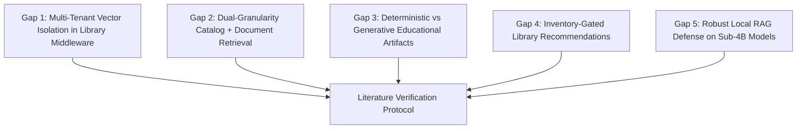

# 65. Research Gap Candidates and Verification Protocol

## 1. Protocol Notice and Methodology

In academic research paper drafting, asserting that "no prior work has addressed X" or "existing systems fail at Y" without exhaustive citation is considered an ungrounded claim and a primary cause of reviewer rejection. 

To maintain scientific integrity:
1. Every candidate research gap is formulated as a testable hypothesis.
2. Every field-level assertion regarding existing literature, commercial systems, or prior art is explicitly flagged with **`[REQUIRES LITERATURE VERIFICATION]`**.
3. Every gap includes targeted academic search strings, target databases (ACM Digital Library, IEEE Xplore, Google Scholar, arXiv), and relevant venues to verify prior art before writing the final manuscript.

---

## 2. Candidate Research Gaps

---

### Candidate Gap 1: Multi-Tenant Vector Isolation in Federated Library Middleware
- **Hypothesized Research Gap**: 
  - *Claim*: While multi-tenancy is widely studied in relational and NoSQL databases, multi-tenant vector retrieval in library consortia either relies on separate, siloed vector index instances per institution (high memory and maintenance overhead) or unpartitioned global indexes that risk cross-library data leakage. An architectural pattern for lightweight, federated middleware that provides unified semantic discovery while enforcing strict, audited tenant isolation at the vector and lexical index level remains underexplored in digital library literature. **`[REQUIRES LITERATURE VERIFICATION]`**
- **Field-Level Assertions Requiring Verification**:
  - *Assertion 1*: Commercial ILS (e.g., Ex Libris Alma, Koha, Folio) lack native dense semantic vector search middleware across consortia nodes. **`[REQUIRES LITERATURE VERIFICATION]`**
  - *Assertion 2*: Multi-tenant vector databases (e.g., Pinecone, Milvus, Qdrant) focus on cloud multi-tenancy rather than federated cross-institutional library privacy policies. **`[REQUIRES LITERATURE VERIFICATION]`**
- **Literature Verification Search Plan**:
  - *Databases*: ACM Digital Library, IEEE Xplore, JCDL Proceedings.
  - *Search Strings*:
    - `"multi-tenant" AND ("vector search" OR "vector database") AND ("isolation" OR "privacy")`
    - `"federated search" AND "digital libraries" AND ("dense retrieval" OR "semantic search")`
    - `"library consortia" AND ("information retrieval" OR "middleware") AND "multi-tenancy"`
  - *Key Target Venues*: ACM/IEEE Joint Conference on Digital Libraries (JCDL), ACM Conference on Information and Knowledge Management (CIKM).

---

### Candidate Gap 2: Dual-Granularity (Catalog-Level + Chunk-Level) Retrieval in Digital Libraries
- **Hypothesized Research Gap**:
  - *Claim*: Current information systems treat catalog discovery (OPAC searching of titles, authors, and metadata) and in-document QA (RAG searching of textbook passages and PDF excerpts) as disjoint operational silos. Users must either query an OPAC to find a book or upload a PDF to an isolated ChatPDF-style tool. A unified dual-granularity retrieval architecture that dynamically routes and synthesizes between high-level bibliographic records and low-level chunk passages within a single context window is lacking in published systems literature. **`[REQUIRES LITERATURE VERIFICATION]`**
- **Field-Level Assertions Requiring Verification**:
  - *Assertion 1*: Existing digital library RAG architectures focus exclusively on article/paper text and ignore circulation, availability, and catalog metadata hierarchies. **`[REQUIRES LITERATURE VERIFICATION]`**
  - *Assertion 2*: Two-tier retrieval pipelines in IR typically operate at a single level of text granularity (e.g., passage reranking) rather than bridging heterogeneous catalog metadata and unstructured PDF text. **`[REQUIRES LITERATURE VERIFICATION]`**
- **Literature Verification Search Plan**:
  - *Databases*: ACM SIGIR, ACL Anthology, Google Scholar.
  - *Search Strings*:
    - `"dual-granularity" OR "hierarchical retrieval" AND ("RAG" OR "retrieval-augmented generation")`
    - `"digital library" AND "question answering" AND ("metadata" AND "full-text")`
    - `"catalog discovery" AND "passage retrieval" AND "unified"`
  - *Key Target Venues*: ACM SIGIR, European Conference on Information Retrieval (ECIR), JCDL.

---

### Candidate Gap 3: Deterministic vs. Generative Paradigms for Educational Knowledge Artifacts
- **Hypothesized Research Gap**:
  - *Claim*: Recent educational technology literature overwhelmingly defaults to generative LLMs for automatic question generation (AQG), flashcards, and concept maps. However, generative LLMs suffer from severe hallucination rates, high inference latency ($>3000\text{ ms}$), GPU resource demands, and grading inconsistency. There is a marked lack of empirical research demonstrating whether pure deterministic, CPU-bound NLP heuristics can achieve equivalent or superior pedagogical faithfulness and zero hallucination at two orders of magnitude lower computational cost. **`[REQUIRES LITERATURE VERIFICATION]`**
- **Field-Level Assertions Requiring Verification**:
  - *Assertion 1*: State-of-the-art AQG benchmarks (e.g., SQuAD question generation, EduQG) focus predominantly on fine-tuned transformer or prompting approaches and neglect deterministic syntactic baselines. **`[REQUIRES LITERATURE VERIFICATION]`**
  - *Assertion 2*: Student-facing AI study tools do not combine deterministic rule-based definition extraction with phonetic and Levenshtein Cloze grading. **`[REQUIRES LITERATURE VERIFICATION]`**
- **Literature Verification Search Plan**:
  - *Databases*: IEEE Transactions on Learning Technologies, ACM Conference on Innovation and Technology in Computer Science Education (ITiCSE), AIED.
  - *Search Strings*:
    - `"automatic question generation" AND ("rule-based" OR "deterministic") AND ("LLM" OR "generative")`
    - `"flashcard generation" AND ("faithfulness" OR "hallucination") AND "textbooks"`
    - `"cloze test generation" AND ("phonetic" OR "levenshtein") AND "evaluation"`
  - *Key Target Venues*: International Conference on Artificial Intelligence in Education (AIED), IEEE TLT, Educational Data Mining (EDM).

---

### Candidate Gap 4: Real-Time Physical Availability and Recency Gating in Library Recommendations
- **Hypothesized Research Gap**:
  - *Claim*: Classical recommendation literature (collaborative filtering, matrix factorization, graph neural networks) assumes unconstrained digital consumption (e.g., Netflix, Spotify, Amazon e-books) where item availability is infinite. In physical and hybrid academic libraries, recommendation algorithms that do not gate recommendations on real-time copy availability ($\text{available} > 0$) or fail to model exponential recency decay of student curriculum interests produce high rates of patron churn and unserviceable reserve hold queues. Formulations optimizing multi-factor circulation utility under strict availability constraints are under-reported. **`[REQUIRES LITERATURE VERIFICATION]`**
- **Field-Level Assertions Requiring Verification**:
  - *Assertion 1*: Published book recommendation benchmarks (e.g., GoodReads, Book-Crossing) evaluate preference matching without inventory constraints. **`[REQUIRES LITERATURE VERIFICATION]`**
  - *Assertion 2*: Library recommendation studies rarely evaluate the operational trade-off between semantic relevance and physical catalog availability. **`[REQUIRES LITERATURE VERIFICATION]`**
- **Literature Verification Search Plan**:
  - *Databases*: ACM RecSys, IEEE TKDE, Journal of Documentation.
  - *Search Strings*:
    - `"book recommendation" AND ("library" OR "circulation") AND ("inventory" OR "availability")`
    - `"recommendation systems" AND "physical constraints" AND "finite inventory"`
    - `"temporal decay" AND "library recommendation" AND "borrowing history"`
  - *Key Target Venues*: ACM Conference on Recommender Systems (RecSys), User Modeling and User-Adapted Interaction (UMAP).

---

### Candidate Gap 5: Constrained Decoding and Defensive Abstention for Edge-Deployed Sub-4B RAG Models
- **Hypothesized Research Gap**:
  - *Claim*: High-performance RAG benchmarks predominantly evaluate massive commercial models (GPT-4, Claude 3.5, Llama-3-70B) deployed on high-end cloud clusters. In privacy-conscious, budget-constrained institutional settings (such as university libraries), deploying small language models (sub-4B parameters, e.g., Qwen2.5-3B in 4-bit quantization) on consumer workstations ($<6\text{GB}$ VRAM) is essential. However, sub-4B models exhibit acute hallucination rates and sycophantic refusal failures on out-of-domain queries. The systematic integration of decoding-time grammar constraints (`lm-format-enforcer`) with strict negative refusal prompting to establish defensible abstention on consumer edge hardware represents a clear systems gap. **`[REQUIRES LITERATURE VERIFICATION]`**
- **Field-Level Assertions Requiring Verification**:
  - *Assertion 1*: Most RAG hallucination benchmark papers (e.g., HaluEval, RAGTruth) do not evaluate decoding-time regex/schema enforcers on sub-4B models. **`[REQUIRES LITERATURE VERIFICATION]`**
  - *Assertion 2*: Local edge RAG literature focuses primarily on latency/quantization rather than abstention accuracy on answer-absent catalog queries. **`[REQUIRES LITERATURE VERIFICATION]`**
- **Literature Verification Search Plan**:
  - *Databases*: arXiv, ACL Anthology, EMNLP, NeurIPS Systems.
  - *Search Strings*:
    - `"retrieval-augmented generation" AND ("small language models" OR "SLM" OR "3B") AND "hallucination"`
    - `"constrained decoding" OR "grammar-guided" AND "RAG" AND ("abstention" OR "refusal")`
    - `"Qwen" AND "RAG" AND ("edge" OR "quantization") AND "hallucination"`
  - *Key Target Venues*: EMNLP, ACL, MLSys.

---

## 3. Summary of Gap Candidacy and Recommendations

| Candidate Gap ID | Research Theme | Theoretical Defensibility | Implementation Grounding | Priority Recommendation |
| :--- | :--- | :---: | :---: | :--- |
| **RG-1** | Multi-Tenant Vector Isolation in Middleware | Very High | Direct (TenantContext, cross-library middleware) | **Primary Systems Contribution** |
| **RG-2** | Dual-Granularity Catalog + Document Retrieval | High | Direct (Catalog search + PDF chunk RAG) | **Key Architectural Contribution** |
| **RG-3** | Deterministic vs. Generative Artifacts | Very High | Direct (document_knowledge.py, cloze_grading.py) | **High-Impact Pedagogical Contribution** |
| **RG-4** | Availability-Gated Library Recommendations | Moderate | Direct (recommendation_service.py) | Secondary Application Contribution |
| **RG-5** | Constrained Decoding on Edge Sub-4B RAG | High | Direct (lm-format-enforcer, Qwen NF4) | Critical Reliability Contribution |
