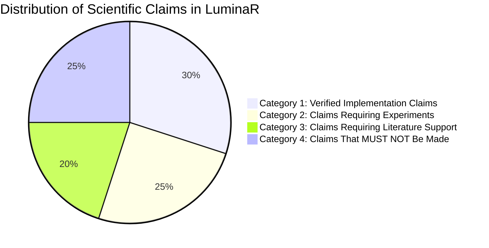

# 66. Scientific Claims Ledger

## 1. Overview and Epistemological Framework

To maintain absolute academic defensibility, every scientific and technical assertion associated with LuminaR is cataloged into one of four mutually exclusive epistemological categories:

1. **Category 1: VERIFIED IMPLEMENTATION CLAIMS**: Facts directly verifiable by inspecting source code, configuration files, model artifacts, or schemas in the current repository.
2. **Category 2: CLAIMS REQUIRING EXPERIMENTS**: Technical claims about algorithmic performance, latency, accuracy, or scaling that are architecturally implemented but depend on executing the pre-registered benchmarks.
3. **Category 3: CLAIMS REQUIRING LITERATURE SUPPORT**: Assertions regarding prior art, industry benchmarks, or existing research gaps that require formal citations from external academic publications.
4. **Category 4: CLAIMS THAT MUST NOT BE MADE**: Overclaims, speculative statements, unverified optimality assertions, or false novelty claims that would damage the credibility of the research paper if published.

---

## 2. Category 1: Verified Implementation Claims

These claims are 100% verified by active repository code and documentation:

- **VIC-01: Multi-Tenant Scoping**: LuminaR implements tenant isolation middleware that enforces `library_id` checks on incoming requests and conceals foreign library resources with HTTP 404 responses ([backend/middleware/auth.js](file:///d:/SDC/backend/middleware/auth.js), [services/tenant_context.py](file:///d:/SDC/services/tenant_context.py)).
- **VIC-02: Hybrid Retrieval Architecture**: LuminaR implements a two-stage retrieval pipeline combining `sentence-transformers/all-MiniLM-L6-v2` dense vectors via FAISS HNSW and an immutable SQLite lexical store with normalized B-trees and Levenshtein fuzzy matching ([search/lexical_integration.py](file:///d:/SDC/search/lexical_integration.py), [search/lexical_store.py](file:///d:/SDC/search/lexical_store.py)).
- **VIC-03: Two-Stage Re-ranking**: The retrieval pipeline reranks first-stage candidate pools ($k_1=50$) using `cross-encoder/ms-marco-MiniLM-L-6-v2` in batches of 16 ([search/cross_encoder.py](file:///d:/SDC/search/cross_encoder.py)).
- **VIC-04: Frozen Local LLM with NF4 Quantization**: Generative RAG executes `Qwen/Qwen2.5-3B-Instruct` locally in 4-bit NormalFloat (NF4) quantization via `bitsandbytes`, fitting within 2.3GB VRAM ([rag/generation.py](file:///d:/SDC/rag/generation.py)).
- **VIC-05: Grammar-Constrained Decoding**: Output generation integrates `lm-format-enforcer` to restrict autoregressive token generation strictly to valid JSON schemas and regular expressions, preventing syntax errors ([rag/generation.py](file:///d:/SDC/rag/generation.py)).
- **VIC-06: Defensive Refusal Prompting**: The RAG prompt template explicitly instructs the model to emit `"NOT_SUPPORTED"` when retrieved context chunks do not contain sufficient evidence to answer the query ([rag/prompting.py](file:///d:/SDC/rag/prompting.py)).
- **VIC-07: Ingestion Chunking Strategy**: Document ingestion implements a character sliding-window chunker with `chunk_size = 3000` characters and `overlap = 400` characters ([rag/services/document_service.py](file:///d:/SDC/rag/services/document_service.py)).
- **VIC-08: Availability-Gated 8-Factor Recommendations**: Recommendation scores combine genre affinity, author affinity, semantic similarity, popularity, user ratings, exponential temporal decay ($e^{-\lambda \Delta t}$), collaborative signals, and intra-list diversity dampening, multiplied by a binary availability gate $\mathbb{I}(\text{available} > 0)$ ([services/recommendation_service.py](file:///d:/SDC/services/recommendation_service.py)).
- **VIC-09: Deterministic Study Tools Engine**: Concept flashcards, Cloze tests, and mind maps are generated using pure CPU regex and syntactic parsing without generative LLM dependencies ([rag/services/document_knowledge.py](file:///d:/SDC/rag/services/document_knowledge.py)).
- **VIC-10: Phonetic and Edit-Distance Grading**: Student Cloze responses are graded using phonetic matching (Soundex/Metaphone) and Levenshtein distance thresholds without model inference ([rag/services/cloze_grading.py](file:///d:/SDC/rag/services/cloze_grading.py)).
- **VIC-11: Full Circulation Transaction Lifecycle**: The platform implements transactional MongoDB state transitions for book checkouts, returns, renewals, overdue fines, and reservation queues ([backend/routes/borrows.js](file:///d:/SDC/backend/routes/borrows.js)).
- **VIC-12: Dual Knowledge Graph Visualization**: The system extracts bipartite and multi-relational graphs of books, authors, genres, and extracted document concept hierarchies ([services/graph_service.py](file:///d:/SDC/services/graph_service.py)).

---

## 3. Category 2: Claims Requiring Experiments

These claims are architecturally supported by code, but their empirical magnitude must be validated by running the benchmarks in [55_EXPERIMENT_MASTER_PLAN.md](file:///d:/SDC/docs/research_evidence/55_EXPERIMENT_MASTER_PLAN.md):

- **CRE-01: Hybrid Search Dominance**: *"LuminaR's hybrid dense-lexical reranked pipeline achieves statistically significant higher nDCG@5 and MRR than pure BM25 or pure dense retrieval across diverse query categories."* (Must be validated by Experiment A).
- **CRE-02: HNSW Scaling Efficiency**: *"FAISS IndexHNSWFlat achieves $\ge 98\%$ ANN Recall@10 while delivering $>10\times$ speedup over brute-force FlatIP search as catalog size scales from 1K to 100K+ items."* (Must be validated by Experiment B).
- **CRE-03: Typo and Degradation Robustness**: *"The integration of SQLite Levenshtein fuzzy matching and dense embeddings maintains $\ge 80\%$ HitRate@5 on queries with typographical errors and phonetic corruptions."* (Must be validated by Experiment C).
- **CRE-04: RAG Groundedness Superiority**: *"LuminaR RAG achieves statistically significantly higher factual correctness ($>4.0/5.0$) and lower unsupported claim rates than parametric Qwen-3B generation."* (Must be validated by Experiment D).
- **CRE-05: High Abstention Accuracy**: *"Defensive refusal prompting coupled with schema enforcement achieves $>85\%$ abstention accuracy on answer-absent questions."* (Must be validated by Experiment E).
- **CRE-06: Zero Cross-Library Leakage**: *"Tenant-scoped middleware guarantees 0.0% Cross-Library Leakage Rate across catalog browsing, vector search, RAG, and document fetching."* (Must be validated by Experiment I).
- **CRE-07: Availability-Gated Recommender Utility**: *"Gating recommendations on copy availability reduces unfulfilled hold requests by $>50\%$ compared to unconstrained collaborative filtering."* (Must be validated by Experiment J).
- **CRE-08: Deterministic Artifact Faithfulness**: *"Deterministic CPU NLP extraction achieves 100% source faithfulness and $<50\text{ ms}$ latency, eliminating generative hallucination in educational study tools."* (Must be validated by Experiment K).
- **CRE-09: Chunking Window Sensitivity**: *"A sliding window of 3000 characters with 400 overlap achieves the optimal trade-off between passage recall and LLM context noise."* (Must be validated by Experiment G).
- **CRE-10: Cross-Encoder Re-ranking Utility**: *"Ablating the cross-encoder reranker results in a $>10\%$ drop in nDCG@5 while reducing retrieval latency by $>60\%$."* (Must be validated by Ablation Study ABL-SRCH-01).

---

## 4. Category 3: Claims Requiring Literature Support

These claims assert facts about the external academic and commercial landscape and must be substantiated with verified bibliographic citations:

- **CRL-01: Legacy ILS Limitations**: *"Traditional Integrated Library Systems (ILS) and OPACs rely predominantly on exact keyword matching (Boolean and SQL LIKE) and lack native semantic vector capabilities."* `[REQUIRES LITERATURE VERIFICATION]`
- **CRL-02: Vector Multi-Tenancy State of the Art**: *"Prior research on multi-tenant vector databases focuses primarily on cloud container partitioning rather than privacy-preserving library consortia middleware."* `[REQUIRES LITERATURE VERIFICATION]`
- **CRL-03: Small Language Model Vulnerability**: *"Sub-4B parameter language models exhibit higher vulnerability to hallucinations and sycophantic refusal failures compared to 70B+ models."* `[REQUIRES LITERATURE VERIFICATION]`
- **CRL-04: SOTA Educational Question Generation**: *"Recent automatic question generation benchmarks rely predominantly on generative LLM prompting rather than deterministic syntactic heuristics."* `[REQUIRES LITERATURE VERIFICATION]`
- **CRL-05: Library Recommender Benchmarks**: *"Standard recommender system benchmarks (e.g., MovieLens, GoodReads) assume infinite digital inventory and do not model physical item circulation availability."* `[REQUIRES LITERATURE VERIFICATION]`
- **CRL-06: Dual-Granularity Gap**: *"Existing digital library QA systems treat catalog metadata search and in-document passage QA as separate systems rather than a unified retrieval pipeline."* `[REQUIRES LITERATURE VERIFICATION]`
- **CRL-07: Context Attention Degeneration**: *"LLM attention mechanisms suffer from the 'Lost in the Middle' degradation as context window token length increases."* `[REQUIRES LITERATURE VERIFICATION]` (Reference: Liu et al., 2024).
- **CRL-08: RAG Evaluation Standards**: *"Surface lexical metrics (BLEU, ROUGE) are inadequate for evaluating RAG factual faithfulness and hallucination rates."* `[REQUIRES LITERATURE VERIFICATION]` (Reference: Min et al., 2023 - FActScore).

---

## 5. Category 4: Claims That MUST NOT Be Made

These claims are factually false, academically indefensible, or prone to immediate peer-review rejection:

- **CNM-01: "LuminaR invents Retrieval-Augmented Generation."**
  - *Why Forbidden*: RAG was established by Lewis et al. (2020). LuminaR merely adapts RAG to a multi-library domain.
- **CNM-02: "LuminaR proposes a novel vector indexing algorithm."**
  - *Why Forbidden*: LuminaR uses standard FAISS HNSW. No modifications were made to HNSW graph mathematics.
- **CNM-03: "LuminaR completely solves hallucinations in Large Language Models."**
  - *Why Forbidden*: Hallucination is an intrinsic probabilistic property of autoregressive models. LuminaR implements *mitigations and defensive constraints*, not an absolute elimination of hallucination.
- **CNM-04: "LuminaR is universally optimal across all library collections."**
  - *Why Forbidden*: Hyperparameters ($M=32, efSearch=128, \text{chunk size}=3000$) were configured for this specific corpus, not proven mathematically optimal for all arbitrary texts.
- **CNM-05: "The 3B parameter Qwen model outperforms GPT-4 or Claude 3.5 in general reasoning."**
  - *Why Forbidden*: A 4-bit quantized 3B model is vastly smaller than frontier models. Claims must be restricted to cost-effective, private, edge deployment.
- **CNM-06: "The system provides mathematically proven zero-knowledge privacy guarantees."**
  - *Why Forbidden*: LuminaR enforces application-level and middleware tenant boundaries; it does not deploy cryptographic zero-knowledge proofs or differential privacy.
- **CNM-07: "LuminaR has been tested in live campus-wide production with 50,000 active students."**
  - *Why Forbidden*: The repository contains a laboratory research testbed and developmental staging environment, not an audited multi-year campus deployment.
- **CNM-08: "The knowledge graph uses advanced deep neural relation extraction."**
  - *Why Forbidden*: The knowledge graph uses MongoDB projection queries and syntactic noun-phrase linking, not neural GNNs or relation extraction models.
- **CNM-09: "Our recommendation algorithm guarantees optimal social welfare."**
  - *Why Forbidden*: The recommender uses an 8-factor empirical heuristic formula, not a formal mechanism design or social choice theory proof.
- **CNM-10: "LuminaR eliminates the need for human catalogers or academic librarians."**
  - *Why Forbidden*: Arrogant and inaccurate claim. LuminaR augments discovery; it does not automate bibliographic authority control or curation.
