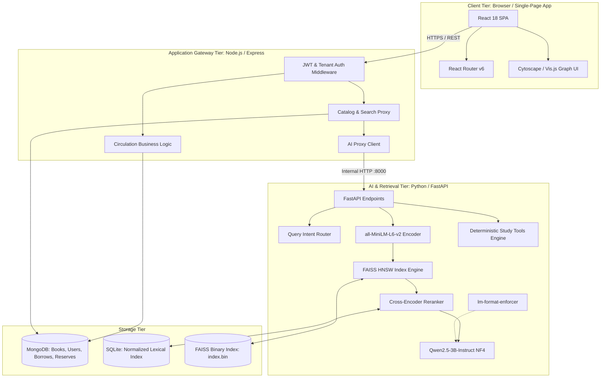
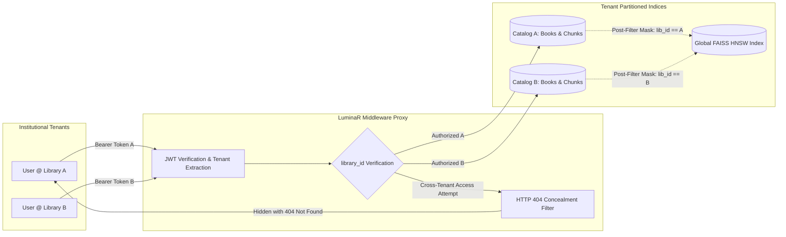
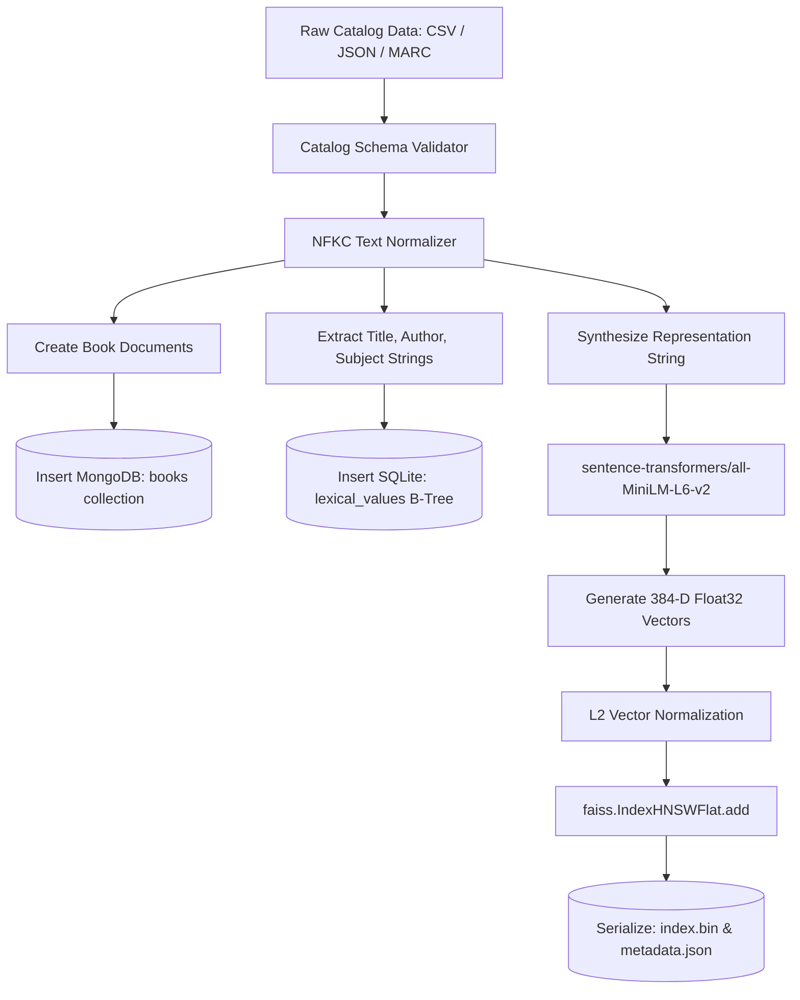
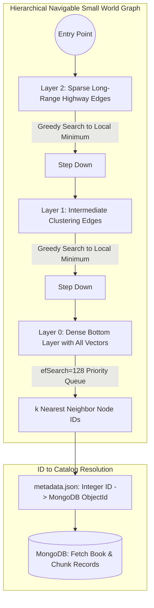
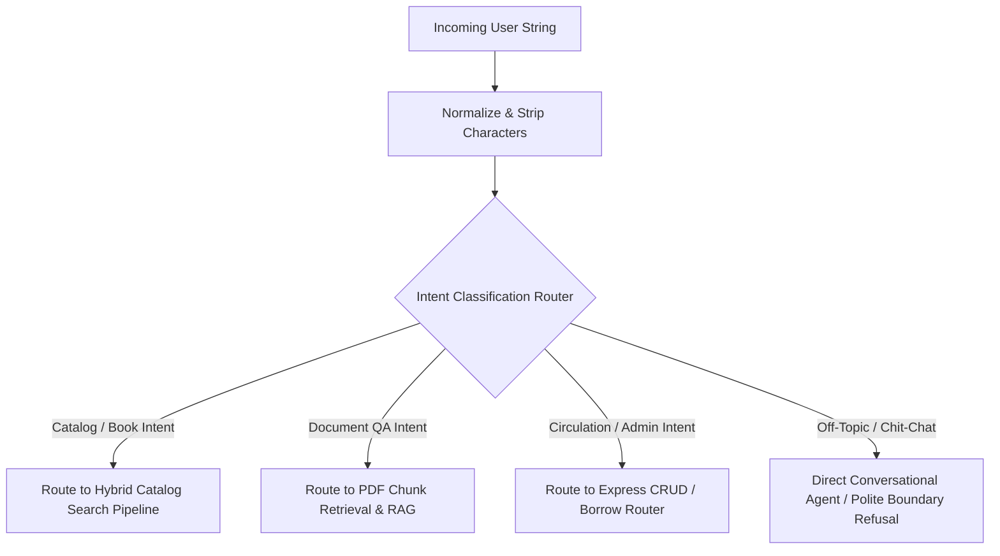
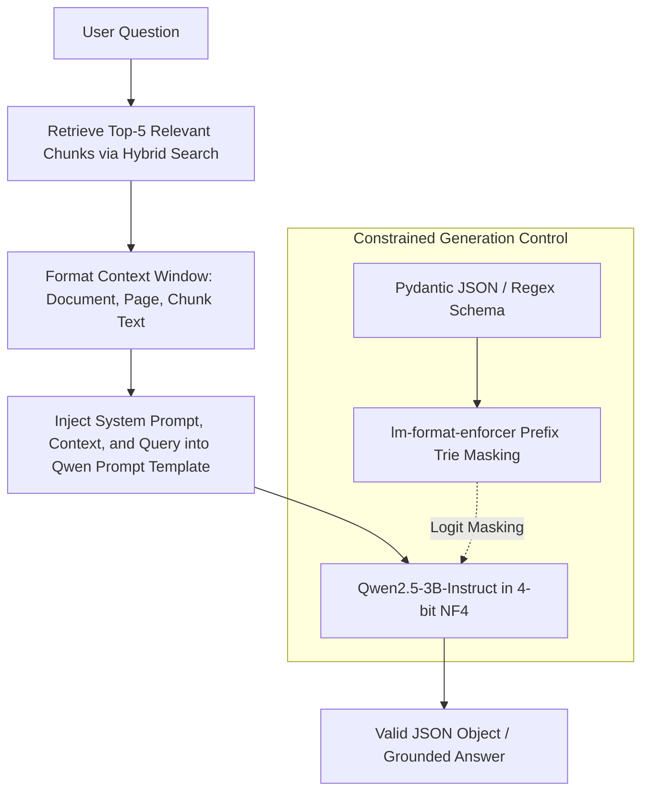
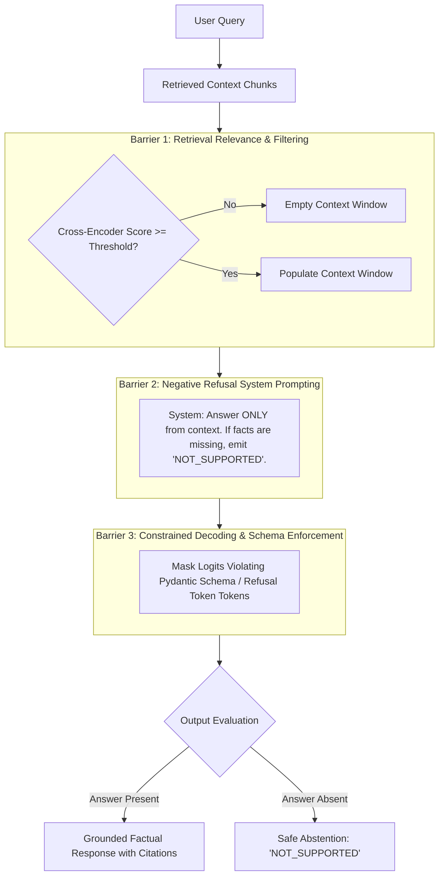
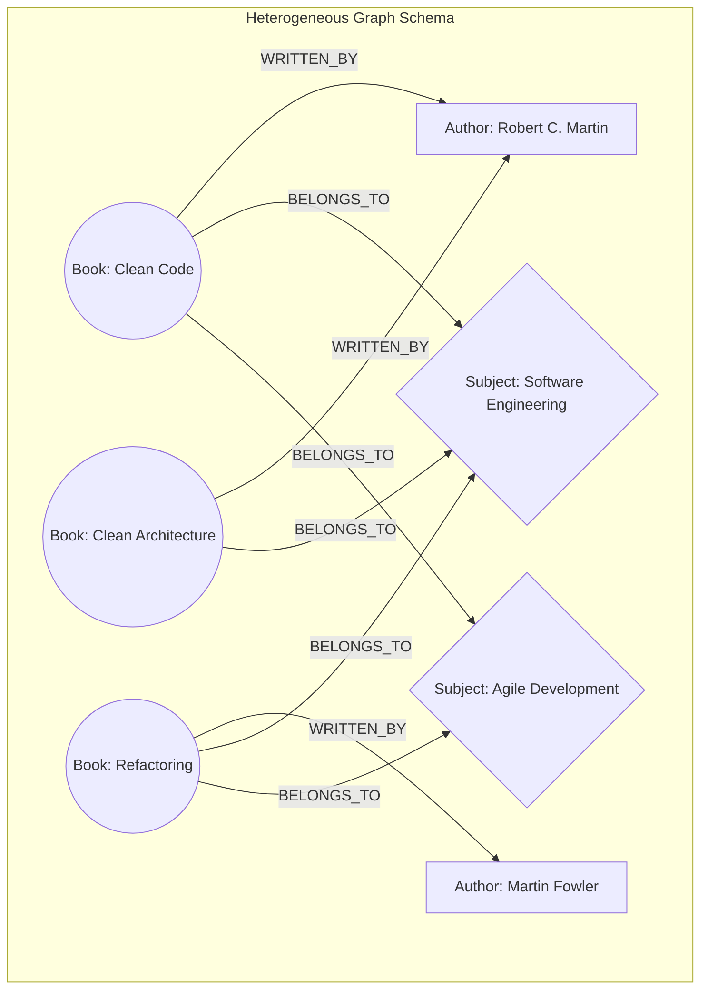
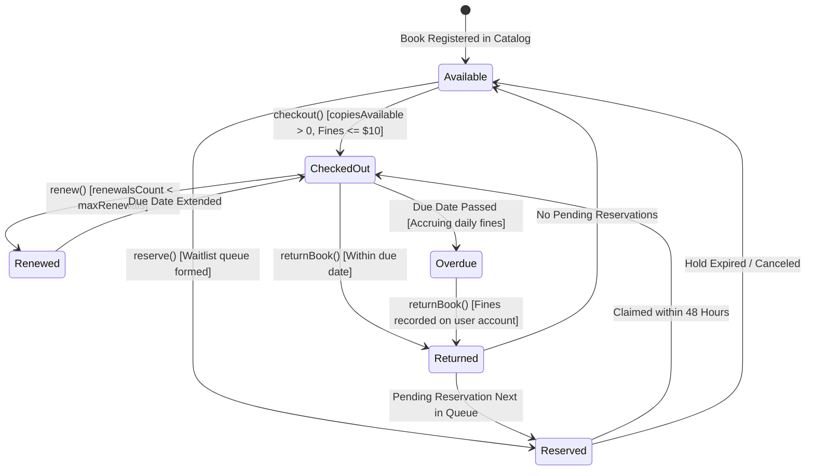
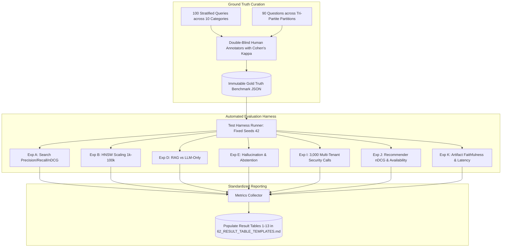

# 70. Publication Diagram Specifications

## 1. Overview and Graphical Standards

Academic systems papers require rigorous, clear, and informative architectural diagrams. Every diagram in the manuscript must depict the **actual software implementation** without vague abstraction or hand-waving.

This document provides detailed design specifications and executable Mermaid code for the **14 core publication figures** required for the LuminaR paper:
1. Overall LuminaR Multi-Tier Architecture
2. Multi-Library Intelligent Middleware & Tenant Isolation
3. Catalog & Dataset Ingestion Pipeline
4. Two-Stage Hybrid Semantic Search
5. HNSW Graph Structure & Vector Index Mapping
6. Query Understanding & Routing Pipeline
7. Retrieval-Augmented Generation (RAG) Architecture
8. Multi-Layered Hallucination Mitigation
9. Document PDF Processing & Chunk Segmentation
10. Availability-Gated 8-Factor Recommendation Engine
11. Multi-Relational Knowledge Graph Exploration
12. Deterministic Educational Knowledge Artifacts Pipeline
13. Library Circulation Transaction State Machine
14. End-to-End Experimental Architecture & Evaluation Testbed

---

## 2. Diagram Specifications

### Figure 1: Overall LuminaR Multi-Tier Architecture
- **Purpose**: System overview showing the interaction between the React frontend, Node.js API Gateway, Python FastAPI AI Microservice, and dual database storage.
- **Key Components**: Client Browser (SPA), Express Gateway (Auth/Circulation), FastAPI Microservice (PyTorch/FAISS), MongoDB, SQLite/FAISS file store.



---

### Figure 2: Multi-Library Middleware & Tenant Isolation
- **Purpose**: Demonstrates how requests from multiple institutional tenants are authenticated, scoped, and prevented from cross-library leakage.



---

### Figure 3: Catalog & Dataset Ingestion Pipeline
- **Purpose**: Shows how raw catalog records (CSV/JSON) are normalized, embedded, and distributed into MongoDB, SQLite, and FAISS.



---

### Figure 4: Two-Stage Hybrid Semantic Search
- **Purpose**: Details the candidate generation, dynamic score normalization, candidate merging, and cross-encoder reranking steps.

```mermaid
flowchart TD
    Query[User Search Query q] --> NFKC[NFKC Normalization & Preprocessing]
    
    NFKC -->|Dense Path| Embed[all-MiniLM-L6-v2 Bi-Encoder]
    Embed --> HNSWQuery[FAISS HNSW Search: efSearch=128]
    HNSWQuery --> DensePool[Top-50 Dense Candidates with Dot Products]
    
    NFKC -->|Lexical Path| SQLiteQuery[SQLite Normalized B-Tree Query]
    SQLiteQuery --> FuzzyLev[Levenshtein Distance Filter: dist <= 2]
    FuzzyLev --> LexicalPool[Top-50 Lexical Candidates with Match Ratios]
    
    DensePool --> DenseNorm[Min-Max Normalization: S_dense_norm]
    LexicalPool --> LexicalNorm[Min-Max Normalization: S_lex_norm]
    
    DenseNorm & LexicalNorm --> Merge[Candidate Fusion: S_hybrid = alpha*S_dense + (1-alpha)*S_lex]
    Merge --> TenantFilter[Tenant Scope Filter: library_id == user.library_id]
    TenantFilter --> Top50Union[Top-50 Union Candidates]
    
    Top50Union --> CrossEncoder[cross-encoder/ms-marco-MiniLM-L-6-v2]
    Query -.-> CrossEncoder
    CrossEncoder --> Softmax[Relevance Logit Computation]
    Softmax --> TopK[Top-5 Final Ranked Results]
```

---

### Figure 5: HNSW Graph Structure & Vector Index Mapping
- **Purpose**: Illustrates the hierarchical multi-layer graph search process and mapping to MongoDB document metadata.



---

### Figure 6: Query Understanding & Routing Pipeline
- **Purpose**: Explains how incoming user prompts are categorized into Catalog Search, Factual QA, or Administrative commands.



---

### Figure 7: Retrieval-Augmented Generation (RAG) Architecture
- **Purpose**: Depicts the end-to-end RAG pipeline from chunk retrieval to constrained autoregressive generation.



---

### Figure 8: Multi-Layered Hallucination Mitigation
- **Purpose**: Shows the three defensive barriers that prevent hallucinations and enforce abstention.



---

### Figure 9: Document PDF Processing & Chunk Segmentation
- **Purpose**: Illustrates PDF document parsing, page extraction, sliding-window chunking, and metadata indexing.

```mermaid
flowchart TD
    PDF[Uploaded PDF Document] --> PyPDF[PyPDF2 Text Extraction Engine]
    PyPDF --> PageExtract[Extract Text by Page with Page Number Metadata]
    PageExtract --> CleanText[Remove Non-printable Characters & Normalize Whitespace]
    
    CleanText --> SlidingWindow[Sliding Character Window Chunker]
    
    subgraph ChunkSpecs [Chunking Parameters]
        CSize[Window Size: 3,000 Characters (~650 Tokens)]
        COverlap[Window Overlap: 400 Characters (~90 Tokens)]
    end
    
    SlidingWindow --> ChunkList[Array of Text Chunks with {doc_id, page_num, chunk_index}]
    ChunkList --> Embedder[Sentence-Transformers Bi-Encoder]
    Embedder --> VectorStore[(Register in SQLite & FAISS Chunk Index)]
```

---

### Figure 10: Availability-Gated 8-Factor Recommendation Engine
- **Purpose**: Details the 8 mathematical components and availability gating of the recommendation scoring function.

```mermaid
flowchart TD
    User[User Profile u] & Book[Candidate Book i] --> Factors[Compute 8 Composite Factors]
    
    Factors --> f1[f1: Genre / Subject Match w1=0.25]
    Factors --> f2[f2: Author Affinity w2=0.20]
    Factors --> f3[f3: Semantic Embedding Cosine w3=0.20]
    Factors --> f4[f4: Global Borrow Popularity w4=0.10]
    Factors --> f5[f5: Catalog Review Rating w5=0.10]
    Factors --> f6[f6: Temporal Recency Decay: exp(-lambda*dt) w6=0.05]
    Factors --> f7[f7: Collaborative Co-Borrowing w7=0.05]
    Factors --> f8[f8: Intra-List Diversity Penalty w8=-0.05]
    
    f1 & f2 & f3 & f4 & f5 & f6 & f7 & f8 --> Sum[Weighted Sum: S_raw(u, i)]
    
    Book --> InvCheck{copiesAvailable > 0?}
    InvCheck -- No (0 Copies) --> GateZero[Multiply by 0: Final Score = 0]
    InvCheck -- Yes (> 0 Copies) --> GateOne[Multiply by 1: Final Score = S_raw]
    
    GateOne --> RankList[Rank Candidates in Descending Order]
    GateZero --> Exclude[Filter from Top-k Recommendations]
```

---

### Figure 11: Multi-Relational Knowledge Graph Exploration
- **Purpose**: Depicts the bipartite schema linking books, authors, and subjects, along with dynamic neighborhood expansion.



---

### Figure 12: Deterministic Educational Knowledge Artifacts Pipeline
- **Purpose**: Contrasts the deterministic CPU NLP study tools pipeline with unconstrained generative models.

```mermaid
flowchart TD
    DocText[Ingested Textbook Section] --> Preproc[Sentence Boundary Tokenization]
    
    subgraph DeterministicEngine [Deterministic CPU NLP Engine (Zero-LLM)]
        Preproc --> CopularRegex[Copular Pattern Matcher: 'X is defined as Y']
        CopularRegex --> Flashcards[Concept Flashcards: 100% Faithful]
        
        Preproc --> TFIDFMask[Noun-Phrase & Keyword Salience Filter]
        TFIDFMask --> ClozeBlanks[Generate Cloze Fill-in-the-Blank Tests]
        
        Preproc --> NounCooccur[Noun-Phrase Co-occurrence Graph Builder]
        NounCooccur --> CyclePrune[Cycle Detection & Hierarchical DAG Pruning]
        CyclePrune --> MindMap[Renderable Hierarchical Mind Map]
    end
    
    subgraph GradingEngine [Deterministic Grading Engine]
        StudentInput[Student Answer] --> PhoneticMatch[Soundex & Metaphone Phonetic Distance]
        StudentInput --> EditDist[Levenshtein Distance: dist <= 2]
        PhoneticMatch & EditDist --> FinalGrade[Binary / Partial Credit Grade in <50ms]
    end
    
    ClozeBlanks --> StudentInput
```

---

### Figure 13: Library Circulation Transaction State Machine
- **Purpose**: Illustrates the state machine transitions and invariants governing book copies, borrows, and reservations.



---

### Figure 14: End-to-End Experimental Architecture & Evaluation Testbed
- **Purpose**: Depicts the master evaluation framework executing Experiments A through K with frozen seeds and metrics logging.


