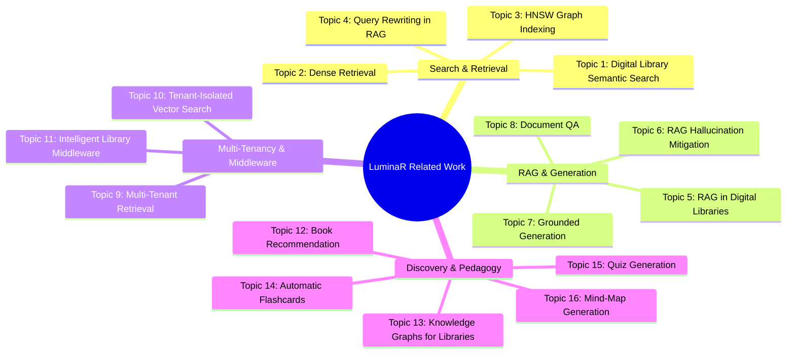

# 71. Related Work Search Plan and Bibliographic Strategy

## 1. Protocol Notice and Literature Integrity Mandate

> [!IMPORTANT]
> **Strict Literature Rule**: In strict compliance with academic standards, **NO FICTITIOUS CITATIONS, FABRICATED DOIS, OR SYNTHETIC REFERENCES ARE INCLUDED IN THIS DOCUMENT**. 
> This document specifies the precise bibliographic search strategy, boolean query strings, target indexing databases, and screening criteria required to populate the Related Work section of the final research manuscript.

---

## 2. Bibliographic Databases and Screening Protocol

### 2.1 Target Academic Databases
- **ACM Digital Library**: Primary venue for digital libraries (JCDL), information retrieval (SIGIR, CIKM), and recommender systems (RecSys).
- **IEEE Xplore**: Systems, transactions, and data engineering (TKDE, Access, TLT).
- **ACL Anthology**: Computational linguistics, QA, and retrieval-augmented generation (ACL, EMNLP, NAACL).
- **arXiv (cs.IR, cs.CL, cs.AI, cs.DB)**: Preprints for the latest state of the art in RAG, small language models, and vector search.
- **Google Scholar**: Cross-disciplinary citation chaining and impact analysis.

### 2.2 Paper Inclusion and Screening Criteria
1. **Peer-Reviewed Status**: Preference given to proceedings of CORE A*/A conferences or Q1 journals published between 2018 and 2026.
2. **Direct Relevance**: Work must directly address dense retrieval, RAG architectures, multi-tenant databases, digital library systems, or automated pedagogical tools.
3. **Reproducibility**: Papers providing open-source benchmarks or formal mathematical formulations prioritized.

---

## 3. Thematic Search Queries across the 16 Core Topics

---

### Topic 1: Digital Library Semantic Search
- **Search Purpose**: Identify prior attempts to integrate neural semantic embeddings into library catalogs (OPACs) and evaluate user satisfaction vs. keyword search.
- **Search Strings**:
  - `("digital library" OR "OPAC" OR "library catalog") AND ("semantic search" OR "dense retrieval" OR "neural search")`
  - `("subject indexing" OR "bibliographic metadata") AND ("sentence transformers" OR "BERT embeddings")`
- **Target Venues**: ACM/IEEE JCDL, *Journal of Documentation*, *Information Processing & Management*.

---

### Topic 2: Dense Retrieval & Bi-Encoder / Cross-Encoder Pipelines
- **Search Purpose**: Document foundational literature on two-stage retrieve-and-rerank pipelines (bi-encoder candidate retrieval followed by cross-encoder re-ranking).
- **Search Strings**:
  - `("dense retrieval" OR "bi-encoder") AND ("cross-encoder" OR "reranker") AND ("MS MARCO" OR "TREC")`
  - `("hybrid search" OR "lexical dense fusion") AND ("BM25" AND "embeddings") AND "nDCG"`
- **Target Venues**: ACM SIGIR, EMNLP, *ACM Transactions on Information Systems (TOIS)*.

---

### Topic 3: Hierarchical Navigable Small World (HNSW) Indexing
- **Search Purpose**: Establish the theoretical baseline for approximate nearest neighbor (ANN) search and empirical performance in high-dimensional vector spaces.
- **Search Strings**:
  - `("HNSW" OR "hierarchical navigable small world") AND ("vector search" OR "approximate nearest neighbor")`
  - `("ANN benchmarks" OR "FAISS") AND ("recall" AND "latency" AND "build time")`
- **Target Venues**: IEEE TPAMI, VLDB, ACM SIGMOD.

---

### Topic 4: RAG in Digital Libraries and Academic Collections
- **Search Purpose**: Find existing implementations of retrieval-augmented generation applied to institutional repositories, university archives, or book collections.
- **Search Strings**:
  - `("retrieval-augmented generation" OR "RAG") AND ("digital library" OR "textbook" OR "academic repository")`
  - `("scientific literature" OR "long-form document") AND ("RAG" OR "question answering") AND "grounding"`
- **Target Venues**: ACM JCDL, ACL Anthology, arXiv cs.IR.

---

### Topic 5: RAG Hallucination Mitigation
- **Search Purpose**: Survey techniques for suppressing parametric hallucinations in RAG pipelines, including defensive prompt engineering, self-verification, and token-level constraints.
- **Search Strings**:
  - `("hallucination mitigation" OR "hallucination detection") AND ("RAG" OR "retrieval-augmented generation")`
  - `("factuality" OR "faithfulness") AND ("language models" AND "external knowledge")`
- **Target Venues**: NeurIPS, ACL, EMNLP.

---

### Topic 6: Grounded Generation and Constrained Decoding
- **Search Purpose**: Identify research on decoding-time grammar constraints, prefix-trie logit masking, and strict JSON schema enforcement in small language models.
- **Search Strings**:
  - `("constrained decoding" OR "grammar-guided generation" OR "structured generation") AND ("JSON schema" OR "regex")`
  - `("lm-format-enforcer" OR "outlines" OR "guidance") AND ("LLM" OR "logit bias")`
- **Target Venues**: MLSys, ACL, ICLR.

---

### Topic 7: Query Rewriting and Intent Classification in RAG
- **Search Purpose**: Review methods for rewriting colloquial, ambiguous, or typo-laden queries into optimized retrieval vectors before dense index lookup.
- **Search Strings**:
  - `("query rewriting" OR "query expansion") AND ("dense retrieval" OR "RAG")`
  - `("query intent classification" OR "router") AND ("retrieval-augmented")`
- **Target Venues**: ACM SIGIR, CIKM, ECIR.

---

### Topic 8: Multi-Tenant Retrieval and Data Partitioning
- **Search Purpose**: Survey database and search literature on isolating multiple client tenants within shared physical clusters.
- **Search Strings**:
  - `("multi-tenant" OR "multi-tenancy") AND ("search engine" OR "information retrieval") AND ("isolation" OR "data segregation")`
  - `("database multi-tenancy") AND ("security boundary" OR "privacy leakage")`
- **Target Venues**: VLDB, ACM SIGMOD, IEEE ICDE.

---

### Topic 9: Tenant-Isolated Vector Search in Vector Databases
- **Search Purpose**: Investigate state of the art in partitioning high-dimensional vector graphs (such as HNSW or IVF) across institutional tenants without memory blowup or privacy leakage.
- **Search Strings**:
  - `("multi-tenant" OR "tenant-isolated") AND ("vector database" OR "vector search" OR "ANN")`
  - `("vector index" AND "metadata filtering") AND ("HNSW" AND "security")`
- **Target Venues**: VLDB (Industrial), ACM SIGMOD, IEEE TKDE.

---

### Topic 10: Book Recommendation and Circulation-Constrained Recommenders
- **Search Purpose**: Identify book recommendation models and assess whether existing algorithms incorporate real-time physical inventory availability and temporal decay.
- **Search Strings**:
  - `("book recommendation" OR "library recommender") AND ("collaborative filtering" OR "content-based")`
  - `("recommender systems") AND ("physical inventory" OR "finite stock" OR "availability constraints")`
  - `("temporal decay" OR "recency") AND ("library circulation" OR "borrowing patterns")`
- **Target Venues**: ACM RecSys, *User Modeling and User-Adapted Interaction (UMAP)*.

---

### Topic 11: Knowledge Graphs for Digital Libraries and Catalog Discovery
- **Search Purpose**: Review graph schemas linking books, authors, subjects, and citations for visual exploration and recommendation.
- **Search Strings**:
  - `("knowledge graph" OR "semantic network") AND ("digital library" OR "bibliographic data")`
  - `("graph exploration" OR "visual browsing") AND ("library catalog" OR "linked data")`
- **Target Venues**: ACM JCDL, *Journal of Informetrics*, *Semantic Web Journal*.

---

### Topic 12: In-Document QA and Long-Context Document Understanding
- **Search Purpose**: Review passage retrieval and QA systems specialized for textbooks, technical manuals, and multi-page PDFs.
- **Search Strings**:
  - `("document QA" OR "textbook question answering") AND ("passage retrieval" OR "chunking")`
  - `("long-context" OR "document comprehension") AND ("PDF parsing" AND "layout-aware")`
- **Target Venues**: ACL Anthology, EMNLP, Document Analysis and Recognition (ICDAR).

---

### Topic 13: Automatic Flashcard Generation
- **Search Purpose**: Survey automatic concept definition extraction and flashcard synthesis methods, contrasting rule-based extraction with neural generation.
- **Search Strings**:
  - `("automatic flashcard generation" OR "flashcard extraction") AND ("textbook" OR "educational text")`
  - `("definition extraction" OR "copular sentences") AND ("NLP" OR "educational technology")`
- **Target Venues**: IEEE Transactions on Learning Technologies (TLT), AIED.

---

### Topic 14: Automated Quiz Generation and Distractor Evaluation
- **Search Purpose**: Survey Multiple-Choice Question (MCQ) generation, Cloze deletion item creation, and distractor plausibility ranking.
- **Search Strings**:
  - `("automatic question generation" OR "quiz generation") AND ("distractor generation" OR "cloze test")`
  - `("cloze grading" OR "fill-in-the-blank") AND ("phonetic" OR "string distance")`
- **Target Venues**: *Computers & Education*, AIED, Educational Data Mining (EDM).

---

### Topic 15: Mind-Map and Concept Map Generation
- **Search Purpose**: Identify algorithms for automatically generating hierarchical concept maps or mind maps from unstructured documents, focusing on DAG validation and cycle removal.
- **Search Strings**:
  - `("concept map generation" OR "mind map generation") AND ("NLP" OR "text mining")`
  - `("graph extraction" AND "cycle detection") AND ("educational hierarchy")`
- **Target Venues**: *Expert Systems with Applications*, IEEE TLT.

---

### Topic 16: Intelligent Library Middleware and Consortia Interoperability
- **Search Purpose**: Review architectures for federated library consortia middleware, interoperability protocols (Z39.50, OAI-PMH), and unified search proxies.
- **Search Strings**:
  - `("library middleware" OR "consortia search") AND ("federated retrieval" OR "interoperability")`
  - `("OAI-PMH" OR "Z39.50") AND ("modern architecture" OR "microservices")`
- **Target Venues**: ACM JCDL, *Library Hi Tech*, *D-Lib Magazine*.

---

## 4. Synthesis and Bibliographic Workflow

Prior to writing the final Related Work section:
1. Execute the 16 search queries across the target databases.
2. Select the top 3–5 seminal papers per topic (target bibliography size: 45–65 references).
3. Export citations to an immutable BibTeX file: `docs/research_evidence/artifacts/references.bib`.
4. Construct a Comparative Capabilities Matrix explicitly benchmarking LuminaR against the top 5 most closely related systems in the literature.
