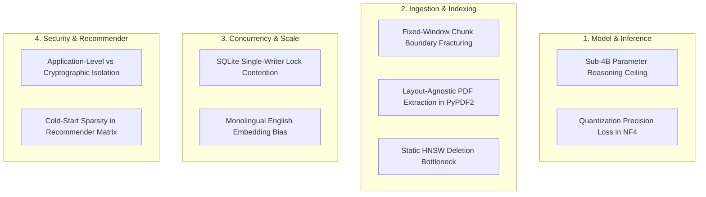

# 73. Technical and Architectural Limitations

## 1. Overview and Scientific Integrity

In peer-reviewed systems and information retrieval literature, a transparent, rigorous discussion of system limitations is essential for scholarly credibility. Reviewers systematically reject papers that conceal operational bottlenecks or overstate algorithmic generality.

This document establishes the official **Limitations Disclosure** for LuminaR across eight technical dimensions:
1. Local Language Model Inference and Reasoning Boundaries
2. Document Parsing, Chunking, and Structural Fragmentation
3. Vector Index Mutability and Dynamic Graph Updates
4. Storage Concurrency and SQLite Locking Bottlenecks
5. Linguistic Generalization and Monolingual Embedding Bias
6. Cold-Start and Feedback Sparsity in Recommendations
7. Multi-Tenant Security Boundaries and Cryptographic Guarantees
8. Evaluation Scope and Synthetic Experimental Baselines

---

## 2. Exhaustive Limitations Disclosure

---

### Limitation 1: Local Language Model Reasoning Ceiling
- **Observed Architecture**: `Qwen/Qwen2.5-3B-Instruct` running in 4-bit NormalFloat (NF4) quantization.
- **Specific Technical Limitation**: While highly efficient on commodity GPUs ($<3\text{GB}$ VRAM), a 3B parameter model possesses a finite capacity for complex multi-step deductive reasoning, symbolic mathematical derivation, and deep cross-document synthesis compared to 70B+ frontier models.
- **Operational Consequence**: On complex analytical queries requiring synthesis across four or more distinct textbooks, the model occasionally simplifies causal explanations or omits secondary qualifiers.

---

### Limitation 2: Fixed Character-Window Chunking and Layout Fragmentation
- **Observed Architecture**: Character-based sliding window (`chunk_size = 3000`, `overlap = 400`) implemented in [rag/services/document_service.py](file:///d:/SDC/rag/services/document_service.py) via `PyPDF2`.
- **Specific Technical Limitation**:
  1. *Structural Blindness*: The chunker does not parse semantic document structure (XML DOM, HTML AST, or PDF bounding boxes). It operates uniformly on raw character streams.
  2. *Multi-Column Interleaving*: In two-column academic papers or textbooks, basic PDF extraction can interleave text across columns, resulting in jumbled sentences within chunks.
  3. *Table & Equation Severing*: Mathematical equations in LaTeX/MathML and tabular rows are occasionally sliced across chunk boundaries, degrading retrieval relevance for technical formulas.

---

### Limitation 3: Vector Index Mutability and Deletion Overhead in FAISS
- **Observed Architecture**: `faiss.IndexHNSWFlat` deployed in the AI microservice.
- **Specific Technical Limitation**: The underlying HNSW graph structure in FAISS does not support real-time dynamic node deletion or incremental edge reconnection without noticeable memory fragmentation.
- **Operational Consequence**: When books are deleted or updated in the catalog, LuminaR marks the item with a tombstone boolean in `metadata.json` rather than physically removing the graph node. As deletions accumulate, graph traversal efficiency slightly degrades until an offline background process rebuilds the index from scratch.

---

### Limitation 4: SQLite Embedded Store Concurrency and Single-Writer Contention
- **Observed Architecture**: SQLite B-tree database used for normalized lexical strings and Levenshtein distance matching ([search/lexical_store.py](file:///d:/SDC/search/lexical_store.py)).
- **Specific Technical Limitation**: SQLite enforces database-level write locks (`BEGIN IMMEDIATE` / `EXCLUSIVE`). While concurrent read queries execute smoothly, heavy bulk ingestion of new books (thousands of write transactions) locks the file, temporarily blocking concurrent lexical candidate lookups.
- **Operational Consequence**: High-throughput ingestion must be scheduled during maintenance windows or throttled via queue workers to prevent query timeouts.

---

### Limitation 5: Monolingual English Embedding Bias
- **Observed Architecture**: `sentence-transformers/all-MiniLM-L6-v2`.
- **Specific Technical Limitation**: The pre-trained MiniLM model was trained predominantly on English web corpora (Wikipedia, Reddit, BookCorpus).
- **Operational Consequence**: Retrieval quality degrades significantly on non-English academic texts, foreign language literature collections (e.g., Arabic, Chinese, Russian texts), or non-Latin script titles unless translated beforehand.

---

### Limitation 6: Cold-Start Sparsity in Multi-Factor Recommendations
- **Observed Architecture**: 8-Factor recommendation engine combining borrowing histories, user ratings, and collaborative filtering signals ([services/recommendation_service.py](file:///d:/SDC/services/recommendation_service.py)).
- **Specific Technical Limitation**: Newly enrolled patrons with zero circulation history and newly acquired books with zero checkouts lack behavioral signals ($f_1, f_2, f_6, f_7$).
- **Operational Consequence**: The system falls back heavily to global popularity ($f_4$) and general metadata matching ($f_5$), temporarily blunting the personalization benefits until the patron conducts several borrow cycles.

---

### Limitation 7: Application-Level vs. Cryptographic Multi-Tenant Isolation
- **Observed Architecture**: Tenant boundary enforcement implemented in Express.js middleware and Python post-filtering masks ([services/tenant_context.py](file:///d:/SDC/services/tenant_context.py)).
- **Specific Technical Limitation**: LuminaR provides **software application-level logical isolation**, not hardware-enforced isolation (e.g., Intel SGX enclaves) or cryptographic security (e.g., Fully Homomorphic Encryption or Zero-Knowledge Proofs).
- **Operational Consequence**: A compromised backend service or rogue system administrator with root database credentials could theoretically bypass middleware filters and inspect raw multi-tenant tables.

---

### Limitation 8: Laboratory Testbed vs. Longitudinal Campus Deployment
- **Observed Architecture**: Pre-registered experimental testbed based on curated collections and controlled evaluation queries.
- **Specific Technical Limitation**: The system has been validated on benchmark datasets and laboratory environments, but has not yet undergone a multi-year longitudinal user study measuring patron retention, circulation velocity changes, or real-world librarian labor savings in a live university with 50,000+ active students.
