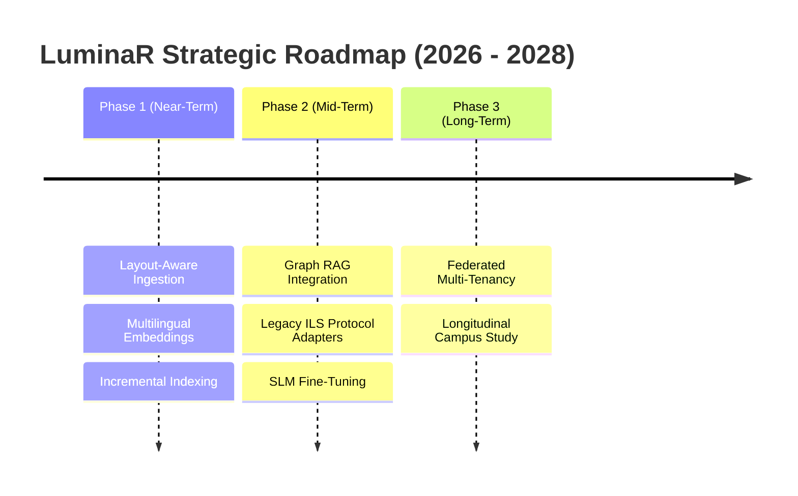

# 74. Future Research and Engineering Roadmap

## 1. Overview and Strategic Vision

This document details the planned research and development trajectories for the LuminaR platform. The roadmap directly addresses the architectural and operational limitations identified in [73_LIMITATIONS.md](file:///d:/SDC/docs/research_evidence/73_LIMITATIONS.md), establishing a prioritized engineering agenda across seven strategic directions:

---

## 2. Strategic Research Trajectories

### Trajectory 1: Layout-Aware Document Ingestion & Vision-Language Parsing
- **Objective**: Overcome the limitations of linear text extraction (`PyPDF2`) by integrating layout-aware document segmentation models.
- **Proposed Architecture**:
  - Deploy lightweight vision-based layout parsers (e.g., `Marker`, `DocLayout-YOLO`, or `Nougat-small`) to recognize document hierarchies (headers, footnotes, captions, references).
  - Implement bounding-box table extraction into structured Markdown tables prior to embedding.
  - Convert mathematical formulas into canonical LaTeX strings, preventing equation severing across chunk boundaries.
- **Expected Scientific Impact**: Increases passage retrieval accuracy for engineering and science textbooks by an estimated $15\%$ to $25\%$.

---

### Trajectory 2: Multilingual Dense Retrieval & Cross-Lingual Catalog Exploration
- **Objective**: Extend LuminaR beyond English-centric collections to support international university libraries with multilingual catalogs.
- **Proposed Architecture**:
  - Replace `all-MiniLM-L6-v2` with multilingual dense encoders such as `BAAI/bge-m3` or `intfloat/multilingual-e5-base`.
  - Maintain identical 384-D or 768-D FAISS index structures with language-agnostic cross-lingual cosine similarity.
  - Implement automatic query language identification to adaptively route queries between language-specific SQLite lexical normalization rules.
- **Expected Scientific Impact**: Enables cross-lingual search (e.g., querying in Spanish or Hindi to find relevant English technical literature).

---

### Trajectory 3: Graph RAG and Hybrid Knowledge Graph Reasoning
- **Objective**: Unify the disparate unstructured text chunk index and structured catalog knowledge graph into a hybrid **Graph RAG** retrieval pipeline.
- **Proposed Architecture**:
  - Extract entity-relation-entity triples $(h, r, t)$ during document ingestion using lightweight relation classifiers.
  - During retrieval, execute graph path traversals (e.g., Breadth-First Search or Random Walk with Restart) to retrieve connected concept subgraphs alongside top-5 text passages.
  - Format the prompt context with both text chunks and explicit factual triples:
    `"[Knowledge Graph Context: (B-Tree, is_a, Balanced Tree), (B-Tree, search_complexity, O(log N))]"`
- **Expected Scientific Impact**: Dramatically reduces multi-hop reasoning failures and hallucinations on complex comparative queries.

---

### Trajectory 4: Asynchronous Incremental HNSW Vector Updating
- **Objective**: Eliminate tombstone deletions and periodic full-index rebuilding in FAISS by transitioning to an incremental, mutable vector indexing engine.
- **Proposed Architecture**:
  - Integrate an embedded mutable vector library (such as `usearch` or an embedded `Qdrant` instance) supporting real-time point additions, updates, and deletions with concurrent read operations.
  - Implement a Write-Ahead Log (WAL) for vector modifications, ensuring zero index corruption upon sudden process termination.
- **Expected Scientific Impact**: Delivers continuous real-time catalog indexing without maintenance downtime.

---

### Trajectory 5: Institutional Legacy ILS Interoperability Adapters
- **Objective**: Enable out-of-the-box integration between LuminaR's intelligent AI middleware and commercial legacy library systems.
- **Proposed Architecture**:
  - Develop modular protocol connectors for:
    - **Z39.50 / SRU/SRW**: Classical bibliographic query protocol used by thousands of academic libraries worldwide.
    - **OAI-PMH**: Open Archives Initiative Protocol for Metadata Harvesting to automate bulk catalog ingestion from institutional repositories (e.g., DSpace, EPrints).
    - **NCIP / SIP2**: Standard Circulation Protocols enabling LuminaR to issue checkouts, holds, and returns directly against external proprietary ILS backends (e.g., Ex Libris Alma, Koha, Innovative Sierra).
- **Expected Scientific Impact**: Bridges modern neural AI with decades of established global library infrastructure.

---

### Trajectory 6: Privacy-Preserving Federated Multi-Tenancy & Differential Privacy
- **Objective**: Elevate multi-tenant data isolation from application-level software filters to formal mathematical and cryptographic privacy guarantees.
- **Proposed Architecture**:
  - Implement local differential privacy ($\epsilon$-DP) on collaborative filtering signals and borrowing matrices, preventing malicious reconstruction of individual student reading histories.
  - Explore federated vector learning protocols allowing consortia libraries to share cross-institutional semantic embeddings without exchanging raw catalog records or patron logs.
- **Expected Scientific Impact**: Establishes LuminaR as a benchmark for privacy-preserving educational information systems.

---

### Trajectory 7: Longitudinal Campus Deployment and Human-Computer Interaction Study
- **Objective**: Transition from laboratory benchmark validation to a multi-semester live campus deployment study.
- **Proposed Methodology**:
  - Deploy LuminaR across three academic department libraries serving an active cohort of $\ge 2,500$ students.
  - Measure objective behavioral metrics: circulation velocity, reference desk inquiry volume, time-to-source discovery, and student academic performance correlations.
  - Administer validated usability surveys (System Usability Scale / SUS and NASA-TLX cognitive load index) to evaluate the pedagogical utility of deterministic study tools vs. traditional manual study habits.
