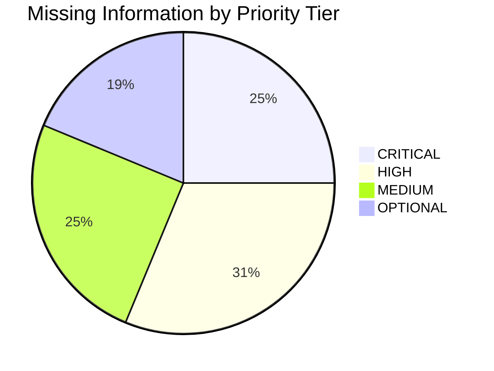

# 76. Missing Information and Execution Prerequisite Inventory

## 1. Overview and Prerequisite Hierarchy

Before drafting the final academic manuscript for conference or journal submission, specific empirical data, benchmark executions, and external bibliographic verifications must be completed. 

This inventory categorizes all outstanding items into four priority tiers:
1. **CRITICAL**: Missing items that would cause immediate paper rejection (desk rejection or fatal reviewer criticism) if omitted.
2. **HIGH**: Essential empirical evidence or comparative benchmarks required to substantiate primary research claims.
3. **MEDIUM**: Architectural characterizations and ablation data that strengthen paper rigor and withstand aggressive peer scrutiny.
4. **OPTIONAL**: Nice-to-have optimizations, qualitative usability surveys, or secondary analyses that provide marginal benefit.

---

## 2. Priority Inventory

---

### Tier 1: CRITICAL PREREQUISITES (Must Complete Before Paper Drafting)

#### Item C-01: Execution of Experiment A (Search Baseline Benchmarks)
- **Classification**: **CRITICAL**
- **Why Required**: Table 1 in [62_RESULT_TABLE_TEMPLATES.md](file:///d:/SDC/docs/research_evidence/62_RESULT_TABLE_TEMPLATES.md) cannot contain empty cells or `NOT MEASURED` in a published paper. The core claim that hybrid search outperforms BM25 and pure dense retrieval requires empirical Precision@5, Recall@5, MRR, and nDCG@5 numbers.
- **How to Obtain**: Execute the pre-registered benchmark runner script over the 100 evaluation queries across baselines B1 (BM25), B3 (FlatIP), B4 (HNSW), B5 (SQLite Lexical), and B6 (Hybrid Reranked). Log latencies and metrics directly into Table 1.
- **Relevant Code / Service**: [search/lexical_integration.py](file:///d:/SDC/search/lexical_integration.py), [search/cross_encoder.py](file:///d:/SDC/search/cross_encoder.py), [datasets/ai/evaluation/](file:///d:/SDC/datasets/ai/evaluation/).

#### Item C-02: Human Relevance Annotation & Gold Standard Benchmark Creation
- **Classification**: **CRITICAL**
- **Why Required**: Evaluating solely on teacher pseudo-labels (`ms-marco-MiniLM-L-12-v2`) introduces circular evaluation bias. Reviewers at ACM SIGIR / JCDL will reject papers lacking verified human ground truth.
- **How to Obtain**: Deploy 4 human annotators following the double-blind annotation protocol in [59_GROUND_TRUTH_CREATION.md](file:///d:/SDC/docs/research_evidence/59_GROUND_TRUTH_CREATION.md). Compute Cohen's Kappa ($\kappa \ge 0.70$) and export the adjudicated gold labels to `human_ground_truth_search_v1.json`.
- **Relevant Code / Service**: [datasets/ai/evaluation/](file:///d:/SDC/datasets/ai/evaluation/), annotation labeling interface.

#### Item C-03: Execution of Experiment D & E (RAG Groundedness, Hallucination & Abstention)
- **Classification**: **CRITICAL**
- **Why Required**: Substantiates the paper's central claims regarding RAG factual superiority over LLM-only generation (CRE-04) and defensive abstention on unanswerable queries (CRE-05).
- **How to Obtain**: Run the Tri-Partite Question Suite ($N=90$: 30 present, 30 partial, 30 absent) through both `Qwen2.5-3B-Instruct` parametric baseline and LuminaR RAG pipeline. Score outputs using the rubric in [60_RAG_EVALUATION_RUBRIC.md](file:///d:/SDC/docs/research_evidence/60_RAG_EVALUATION_RUBRIC.md) and record metrics in Tables 4 and 5.
- **Relevant Code / Service**: [rag/generation.py](file:///d:/SDC/rag/generation.py), [rag/prompting.py](file:///d:/SDC/rag/prompting.py).

#### Item C-04: Literature Verification of External Research Claims
- **Classification**: **CRITICAL**
- **Why Required**: All 8 field-level claims in [65_RESEARCH_GAP_CANDIDATES.md](file:///d:/SDC/docs/research_evidence/65_RESEARCH_GAP_CANDIDATES.md) and [66_CLAIMS_LEDGER.md](file:///d:/SDC/docs/research_evidence/66_CLAIMS_LEDGER.md) currently flagged with `[REQUIRES LITERATURE VERIFICATION]` must be verified against actual published papers to prevent ungrounded claims.
- **How to Obtain**: Execute the 16 search queries from [71_RELATED_WORK_SEARCH_PLAN.md](file:///d:/SDC/docs/research_evidence/71_RELATED_WORK_SEARCH_PLAN.md) across ACM DL, IEEE Xplore, and Google Scholar. Compile authentic citations into `references.bib`.
- **Relevant Code / Service**: [docs/research_evidence/71_RELATED_WORK_SEARCH_PLAN.md](file:///d:/SDC/docs/research_evidence/71_RELATED_WORK_SEARCH_PLAN.md).

---

### Tier 2: HIGH PRIORITY (Essential for Full Submission)

#### Item H-01: Execution of Experiment B (HNSW vs FlatIP Scaling Benchmark)
- **Classification**: **HIGH**
- **Why Required**: Demonstrates the logarithmic scaling advantage of HNSW over brute-force search across scales 1K, 5K, 10K, 25K, 50K, and 100K+ items, populating Table 2 in [62_RESULT_TABLE_TEMPLATES.md](file:///d:/SDC/docs/research_evidence/62_RESULT_TABLE_TEMPLATES.md).
- **How to Obtain**: Synthetic catalog scaling script generating vector batches, measuring build times, resident memory, and query latency percentiles ($p50, p95$).
- **Relevant Code / Service**: `faiss.IndexHNSWFlat`, `faiss.IndexFlatIP`, vector index service.

#### Item H-02: Execution of Experiment I (Multi-Tenant Security Audit)
- **Classification**: **HIGH**
- **Why Required**: Proves the claim of 0.0% Cross-Library Leakage Rate (CRE-06) across 3,000 requests, validating the security boundary of the multi-library middleware.
- **How to Obtain**: Automated security test script executing 500 requests per operational interface across cross-tenant boundaries, verifying HTTP 404 concealment and empty foreign candidate lists. Populates Table 9.
- **Relevant Code / Service**: [backend/middleware/auth.js](file:///d:/SDC/backend/middleware/auth.js), [services/tenant_context.py](file:///d:/SDC/services/tenant_context.py).

#### Item H-03: Execution of Experiment K (Deterministic Study Tools Evaluation)
- **Classification**: **HIGH**
- **Why Required**: Empirically defends the Strong Research Contribution (C1): proving that deterministic CPU NLP extraction achieves 100% source faithfulness and $<50\text{ms}$ latency compared to generative LLM prompting.
- **How to Obtain**: Benchmark generation latency, distractor quality, and source consistency across 50 textbook sections for both deterministic algorithms and Qwen generative prompts. Populates Table 11.
- **Relevant Code / Service**: [rag/services/document_knowledge.py](file:///d:/SDC/rag/services/document_knowledge.py), [rag/services/cloze_grading.py](file:///d:/SDC/rag/services/cloze_grading.py).

#### Item H-04: Search Pipeline Ablation Experiments (ABL-SRCH-01 to 06)
- **Classification**: **HIGH**
- **Why Required**: Quantifies the isolated marginal utility of the Cross-Encoder reranker, SQLite lexical matching, and HNSW index approximation, populating Table 12.
- **How to Obtain**: Run the search evaluation test suite with individual component flags disabled as specified in [58_ABLATION_PLAN.md](file:///d:/SDC/docs/research_evidence/58_ABLATION_PLAN.md).
- **Relevant Code / Service**: [search/lexical_integration.py](file:///d:/SDC/search/lexical_integration.py).

#### Item H-05: RAG Pipeline Ablation Experiments (ABL-RAG-01 to 05)
- **Classification**: **HIGH**
- **Why Required**: Measures the exact impact of `lm-format-enforcer` and negative refusal prompting on JSON format compliance and abstention rates, populating Table 13.
- **How to Obtain**: Run the RAG test suite with schema enforcement and refusal prompts systematically disabled.
- **Relevant Code / Service**: [rag/generation.py](file:///d:/SDC/rag/generation.py), [rag/prompting.py](file:///d:/SDC/rag/prompting.py).

---

### Tier 3: MEDIUM PRIORITY (Strengthens Manuscript Defense)

#### Item M-01: Execution of Experiment G (Chunk Size Sensitivity)
- **Classification**: **MEDIUM**
- **Why Required**: Populates Table 7, proving that the chosen sliding window of 3,000 characters / 400 overlap provides superior retrieval balance compared to micro (500 chars) or coarse (page-level) chunks.
- **How to Obtain**: Ingest test textbook under 5 chunk configurations and evaluate passage retrieval nDCG@5 and RAG groundedness.
- **Relevant Code / Service**: [rag/services/document_service.py](file:///d:/SDC/rag/services/document_service.py), `datasets/rag_experiments/chunking_v1/`.

#### Item M-02: Execution of Experiment H (Top-$k$ Context Budget Sensitivity)
- **Classification**: **MEDIUM**
- **Why Required**: Populates Table 8, illustrating the trade-off between retrieval recall and LLM context distraction ("Lost in the Middle") as $k$ scales from 1 to 20.
- **How to Obtain**: Evaluate RAG correctness and latency across $k \in \{1, 3, 5, 10, 20\}$.
- **Relevant Code / Service**: [rag/generation.py](file:///d:/SDC/rag/generation.py).

#### Item M-03: Execution of Experiment J (Recommendation Algorithm Benchmark)
- **Classification**: **MEDIUM**
- **Why Required**: Populates Table 10, empirically verifying that physical inventory gating reduces unfulfilled hold rates without degrading recommendation relevance.
- **How to Obtain**: Generate synthetic student borrowing histories and evaluate nDCG@10, catalog coverage, and unfulfilled hold rate across baselines B11 to B15.
- **Relevant Code / Service**: [services/recommendation_service.py](file:///d:/SDC/services/recommendation_service.py).

#### Item M-04: Error Analysis Distribution Population (Experiment F)
- **Classification**: **MEDIUM**
- **Why Required**: Populates Table 6, classifying all observed pipeline failures into the 7 sequential stages (E1 to E7) defined in [61_ERROR_ANALYSIS_TEMPLATE.md](file:///d:/SDC/docs/research_evidence/61_ERROR_ANALYSIS_TEMPLATE.md).
- **How to Obtain**: Conduct manual diagnostic audits on the bottom 15% performing queries using the error worksheet.
- **Relevant Code / Service**: [docs/research_evidence/61_ERROR_ANALYSIS_TEMPLATE.md](file:///d:/SDC/docs/research_evidence/61_ERROR_ANALYSIS_TEMPLATE.md).

---

### Tier 4: OPTIONAL ENHANCEMENTS

#### Item O-01: Docker Containerization (`docker-compose.yml`)
- **Classification**: **OPTIONAL**
- **Why Required**: Simplifies reviewer replication by bundling Node.js, Python FastAPI, MongoDB, and CUDA drivers into a single deployment manifest.
- **How to Obtain**: Write Dockerfile and docker-compose.yml specifications.

#### Item O-02: Perplexity Profiling of FP16 vs NF4 Weights
- **Classification**: **OPTIONAL**
- **Why Required**: Provides exact perplexity degradation numbers on WikiText-2 between uncompressed FP16 and bitsandbytes NF4 quantization.
- **How to Obtain**: Run HuggingFace evaluation script computing test perplexity on a high-VRAM machine.

#### Item O-03: Patron Usability Survey Data (SUS / NASA-TLX)
- **Classification**: **OPTIONAL**
- **Why Required**: Adds human-computer interaction qualitative data to the study tools evaluation.
- **How to Obtain**: Administer surveys to student pilot users following live interaction sessions.
